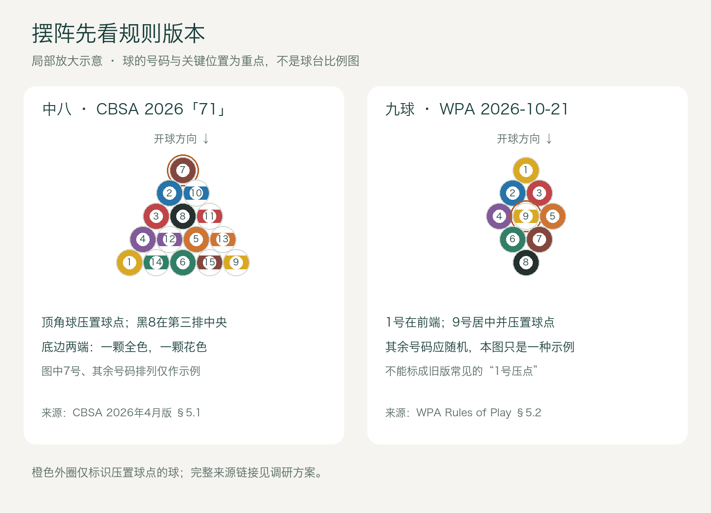
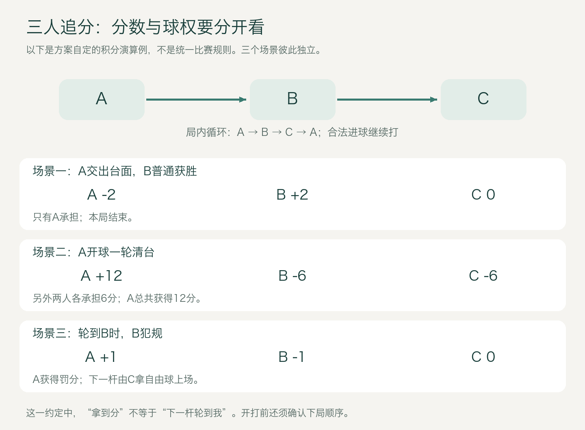
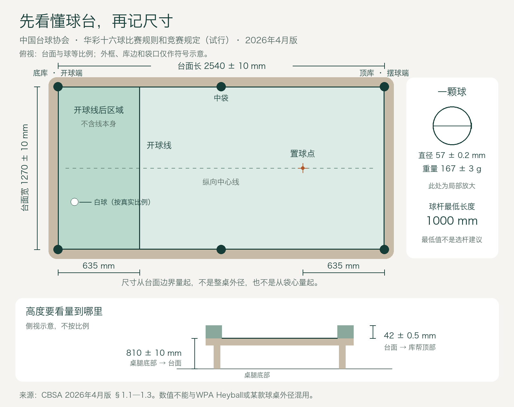

# 中八与追分规则页面调研方案

日期：2026-10-28。状态：调研与产品提案，尚未批准实施。本轮范围是两篇新手规则教程、配图计划与后续验收标准，不改 App、不改现有判罚引擎。

**同日文稿阶段更新**：已按用户后续指令写出[中八完整新手稿](20261028-中八新手完整文稿.md)和[追分完整新手稿](20261028-追分新手完整文稿.md)，新增9张原创示意图；交付范围及补证结果见[核查记录](20261028-规则文稿补证与核查记录.md)。GB/T22751—2008表1的中式角袋84±1mm、中袋86±1mm已核扫描原文；CBSA专门袋角模板仍未取得。五球及谈门已写完整教学约定／案例，但未核定为通行规则，不宣称研究缺口全部关闭。下方原提案的计分例与正文试玩约定不可混用，正文主例明确为14710。

**最新资料复核修订（同日）**：按用户要求重新检索协会公告并取得附件原文，发现CBSA已于2026-04-30发布《华彩十六球比赛规则和竞赛规定（试行）》2026年4月版。**撤回本方案初稿采用2017版作为中八主线的建议，改以新版“71”打法及其通则、竞赛规定为基础**；2017版仅作历史对照。基础器材常识成为首版必备内容，详见§4.2—4.4。本文“最新”指截至2026-10-28本次能够核实的公开协会版本，不把检索日期写成规则生效日期。

本日补充需求：用户不熟悉具体规则，描述常玩追分为“一般不允许防守”，并要求考虑“谈门”。据此，追分主线明确为**不主动防守的球房休闲玩法**；允许防守的赛事和正式九球放入版本对照。“谈门”升为首版必备章节，不能只留一句术语或要求用户先指定整套规则。具体地方裁定仍须核实，用户提供的是使用场景，不是所有细则的确认。

建议在「练」Tab 的「学」分类增加「中八规则」「追分规则」两张免费阅读卡。中八以明确版本的协会规则为入门基线；追分先讲顺序击球，再分别解释四／五／六／九球、两人／三人、不主动防守与让杆、计分及谈门。详细内容应当齐全，但读者首次进入不必同时看完所有版本。

最关键的结论是：**球数、人数、击球规则、计分规则是四个不同问题。选了“六球、三人”，仍不能自动确定大小金分值、让杆、罚分对象和下一局顺序。**

## 1 证据与规则版本

本方案把来源分为三层。协会规则可支持该版本下的规则判断；主办方材料只支持该赛事；社区材料只能证明某种玩法存在。检索日期不等于规则生效日期。

|来源|本次核实内容|页面使用方式|
|---|---|---|
|中国台球协会《华彩十六球比赛规则和竞赛规定（试行）》，2026年4月版［S12］|2026-04-30印发；附件原文含器材、定义、通则、犯规、“71”“431”及竞赛规定；已读取正文与球台示意图|中八主线采用“71”，保留“试行”字样；“431”在差异说明中介绍|
|中国台球协会2026-10-13小项规则征集公告［S13］|确认2025年中式台球调整命名为华彩台球；十六球为其中一个小项|解释官方名称与“中八”的关系；征集公告不是新版十六球完整规则|
|中国台球协会《中式台球竞赛总则》，2017年1月修订［S1］|旧版协会原文可读；比赛规则第三部分|仅历史对照；不再作为主线，不标成现行最新版|
|WPA Rules of Play，2026-10-21生效［S2］|官网当前下载链接；原PDF共45页，九球在§5、PDF第22—24页|正式九球知识基线，区别于民间追分|
|WPA Playing Regulations，2026-10-21生效［S3］|三球开球要求及其处理、赛事管理等|与Rules of Play配套，不单取一条开球要求|
|WPA Rules of Heyball，2025-08-16生效［S4］|官网独立挂载的21页文件|中八相关国际赛事版本对照，不与CBSA条款拼接成一套|
|乔氏官方“决金”规则说明，2019-05-23［S5］|大金／小金／普胜／三犯的定义与分值|具名赛事计分范例；不是所有追分或当前各季的统一规则|
|2023龙腾·点金六球追分赛规程，媒体刊载［S6］|双人、交替开球、1／3／5／7、允许防守及自由球限制|地方赛事实例，明确主办方与年份；正式采用前仍应向主办方核对|
|MPRC自定义玩法记录［S7］|四球1239、两人与三人不同计分、让杆列|证明玩法差异；该旧页面自标过期，只保留为历史样本|
|宜昌中式台球联盟2012年论坛记录［S8］|三人轮转、普通获胜与开球清台的结算对象不同|历史民间样本，不能署名“中国台协规则”|
|WHM个人台球资料页［S9］|幺四七幺零的一种对应关系；三人上下家解释|民间术语对照，不能据此证明全国普及率|
|球手公开谈门教学标题与讨论［S11］|“谈门”“三金三”“三金九”等实际使用，以及让球后开球、目标球已入袋、三人关系等疑问|证明词语及教学需求；未取得完整可靠逐字讲解，不据标题或评论定具体判罚|
|全国标准信息公共服务平台GB/T 22751—2008［S14］|台球桌推荐性国家标准；平台显示现行，2025-03-27复审结论继续有效|说明产品标准与竞赛规则不同；官方未公开全文，本次不借其编号背书具体尺寸|
|WPA Recommended Equipment Specifications［S15］|当前官网仍链接的文件，正文标注2001年11月生效；普尔球台、球、球杆等|仅作普尔九球器材对照，不冒称2024或2026新版，不覆盖Heyball专门规定|
|星牌、Stamford、Mark Williams品牌官网［S16—S18］|具体球台型号的内外径，球杆构成、选材与11毫米先角产品实例|厂商自述与型号实例，不当作协会标准或购买推荐|

重要核对结果：

- CBSA2026版“71”规则：开球后保持开放；分组需要结合首碰球组与合法进球，而不是仅看进球颜色；开球制胜球入袋先置放；非开球阶段制胜球入袋伴随犯规属于输局。打制胜球时仅母球落袋且制胜球留台，适用一般犯规，不能写成一律输局。［S12，§3.3、5.2—5.7］
- 新版“71”章节没有要求指定袋口；“是否必须指袋”应按所采用规则及赛事补充解释。2017版与WPA Heyball明确写有无需指球定袋，可在历史／版本对照中引用，不能把旧版原句伪装成新版条文。［S12，第五章；S1，第三部分§1；S4，第二部分§11］
- WPA现行九球摆球是1号在前端、9号居中并位于置球点。网上常见“1号压点”不能直接标成现行WPA规则。［S2，§5.2］
- WPA九球的一般犯规、推杆后选择权、连续三犯与民间“让杆”“罚一分”不是同一套制度。［S2，§3.13、5.4—5.8］
- 六球公开规程存在允许防守的版本，因此“追分一律不准防守”不成立。［S6］
- **五球已纳入本方案，不因资料少而省略；但本次没有找到可直接采用的协会级五球追分完整规则。** 目标球组合、摆法及计分应作为具名约定或教学方案呈现。

## 2 当前 App 入口与落位

已直接检查当前源码：

- `QiuJi/App/MainTabView.swift`：「练」对应 `AngleHomeView` 的导航栈，不是首页 `TrainingHomeView`。
- `QiuJi/Features/AngleTraining/Views/AngleHomeView.swift`：已有学／理／练／打／解；内容类型有阅读／答题／击球／交互；「学」区已有阅读卡。
- 同文件当前搜索只匹配标题和副标题；主题筛选为准度、加塞、走位、吃库、防守。需要规划“规则”“九球”“黑八”“自由球”等别名检索，不能假设现成支持。
- `QiuJi/Data/Services/UserPreferences.swift` 当前已经区分 `.nineBall → 9 球` 与 `.zhuifen → 追分`。继续保留两者含义，不用个人偏好枚举来承载规则版本。
- 既有 `LearnDocSectionCard`、`LearnDocText`、阅读页样式与 `BTTableFigure` 可作为复用候选。是否直接复用仍需实施时核对API；没有做原生视觉验收。

推荐入口文案：

|标题|副标题|分类与权限|
|---|---|---|
|中八规则|从分球、犯规到黑八，学会打一局|学／阅读／建议免费|
|追分规则|四、五、六、九球，两人三人怎么打|学／阅读／建议免费|

优先放在「学」区前部。不新增第六个侧栏分类，不放入讲物理定理的「理」区。规则阅读建议离线可用、无需登录、不消耗练习次数。免费是本次产品建议，正式实施时同步商业化规格。

## 3 新手教学方法

两页都按“我现在该做什么”组织，而不是按裁判手册编号长篇铺陈。

1. **先看懂一局**：用一句话说明目标，再看摆球、开球、轮流击打、结束的流程。
2. **跟着做**：逐节解释轮到自己时先看哪颗球、怎样继续、何时换人。
3. **出问题时查**：按“白球掉了”“打进了对方球”“9号提前进了”等口语问题定位。
4. **最后看差异与来源**：知道自己读的是哪套规则，遇到不同球房约定去哪里核对。

每个核心规则单元采用四部分：一句结论、一个具体场景、一张必要的图、明确的下一步。判罚至少回答“谁接着打、白球放哪、目标球是否拿出来、是否结束这一局”；追分再回答“谁加减多少分”。不要只显示“犯规”两个字。

首次出现的词直接解释：母球就是白球，目标球是被白球碰撞的编号球，库边是台面四周的弹性边，开放球局是还没分组，自由球是按当前规则取得重新摆放白球的权利。术语表提供回跳，正文不要求读者先背术语。

建议主线读完约8—12分钟／页，此数是内容预算而非实测阅读耗时。细节折叠、目录直达、答案可展开；内容完整性不能靠把必要规则藏进页尾脚注解决。

## 4 中八页面完整内容规划

页面名仍建议为“中八规则”，便于球房新手识别；副说明采用“按中国台球协会《华彩十六球比赛规则和竞赛规定（试行）》2026年4月版‘71’打法整理”。正文首次出现时解释：这里讲的是每人一组7颗球，清完自己的球组再处理制胜球的打法；传统编号球组中制胜球为黑8。“华彩台球”是项目分项名称，不能把所有华彩小项都等同于中八。［S12，第五章；S13］

### 4.1 规则主线与新版差异

|章节|必须回答的问题|示例与配图要求|
|---|---|---|
|01 先认球、球台和球杆|白球、全色1—7、花色9—15、黑8分别做什么？球台多大、球多大、杆头是什么？开球线和置球点在哪？|§4.2基础常识先看图，规格细节展开；号码和花纹共同标识|
|02 怎样赢一局|先处理自己的球组，什么时候才轮到黑八？组内是否按号码顺序？|己方球组→黑八的目标流程；和追分作简短区别|
|03 开局前做什么|怎样摆15颗球？谁先开？比赛抢几局、以后谁开？|三角阵关键位置；比球决定首局选择权；新版通则为轮流开球|
|04 开球后怎么办|合法进球、未进但足够碰库、开球违例、白球入袋、目标球飞出台各怎样继续？|按§5.2分支，区分开球违例与其他犯规；加累计开球违例规则及警告条件|
|05 全色花色怎么分|开球进全色就归我吗？两组都进怎么办？开放局先碰8号行吗？|连续两幅球组状态图；保留开放局的特殊组合球例外|
|06 轮到我怎样合法击球|先碰哪类球？碰完后还需要发生什么？没进就是犯规吗？|先碰合法球→进球或后续碰库的时间顺序图|
|07 进了球谁接着打|合法进己方球；只进对方球；己方和对方同时进；伴随犯规怎样处理？|用同一球形对照，分别写轮次与已进球处理|
|08 自由球怎样摆|全台自由球与开球阶段线后自由球有什么区别？能移动其他球吗？|两个可摆放区域；线后目标球的特殊情况展开讲|
|09 黑八专章|提前进、与最后己方球同杆进、黑白同落、8号未进但犯规、开球进8怎样区别？|五种结果对照；每格明确是否输局|
|10 容易忽略的犯规|碰球、连击、推击、球未停、双脚离地、飞球、违规跳球怎样识别？战术犯规是什么？|推击与九球push out分开；合法防守与故意不尝试碰合法球分开|
|11 特殊情况|贴库、贴球、袋口球弹回、球自行落袋、僵局、外界干扰怎么办？|先保留球位、请求裁定；对应条款入口|
|12 打球前确认与来源|采用哪套规则？是否另约指袋、开球要求、计时和让球？|确认清单＋来源备注|

以上是完整的撰稿清单；正式文稿应按S12第一部分第1—5章及第二部分相关规定逐条展开，不用美式八球或2017旧版补空白。关键已核实裁定见第1节；对于球组混进、开放局组合球等情形，要保留完整先后条件，避免“进哪种就打哪种”的过度简化。

新版必须单独解释以下事项：

- **开球违例不是普通未进球**：无进球且不足四颗子球碰库时，“71”打法给予对手接受台面、自己重开或要求原开球方重开的选择；母球落袋则有线后手中球的专门处理，不能混成一个分支。［S12，§5.2］
- **比赛默认轮流开球**：按局轮流；分盘比赛还按盘轮流。球房若另约胜方开球，明确标为另约。［S12，§3.5］
- **合法防守仍可存在**：新版限制的是特定战术犯规，不等同于用户所说追分“不主动防守”的球房约定。战术犯规涉及未尝试击中合法子球、故意触犯所列条款；同局第二次及裁判警告条件须一起讲。［S12，第二部分§5、第一部分§5.6］
- **开球违例累计限制**：协会主办赛事须采用，第二次之前的警告条件不能遗漏；不把它简化成“任何两次犯规输局”。［S12，第二部分§4、第一部分§5.6］
- **“431”是另一种打法**：当自己的球组少于4颗时，要按号码升序首碰；先碰最小号后合法传入己方其他球仍可续打。默认教程讲“71”；以一张对照卡解释“为什么有的比赛剩3颗要按顺序”。“431”不能解释成只用4、3、1号球。［S12，§6.3—6.4、6.7］
- **清台条件用完整表达**：新版用己方球组全部离台描述，并给出离台球定义；不要把“必须亲手把7颗都打进”写成获胜条件。［S12，§2.17、第五章］

**中八边界样例清单（写稿及验收共用）**：开球进8；开球8与白球同落；开球只进一种；开球两组同进；开放局合法目标球传另一组；只碰合法球但无进球且后续无碰库；合法先碰己方球而只进对方球；最后己方球与8同杆入袋；打8时仅白球入袋；8飞出台；对方球被意外带入；贴库球原地贴着不算新增碰库。每例明确所选规则版本。

### 4.2 基础常识的完整范围

两篇教程共用“先认识球具”内容，放在规则前部；追分页按实际采用中式台或美式台补充差异。先用约3分钟的图解认识物件，再展开规格与误区；不要求初学者先记公差。以下是研究结论及撰稿要求，不是器材购买榜单。

|主题|给新手的核心解释|必须覆盖的细节与边界|
|---|---|---|
|球台与台面|球真正滚动的区域和整张桌子的外框不是同一尺寸|有效台面、库边、库帮、角袋4个／中袋2个、顶库／底库；“9英尺”是规格类别，不能拿9英尺直接换算成台面长度|
|尺寸与高度|先记中八台面约2.54米×1.27米；看“高”必须看量到哪里|台面高度、库帮顶部高度分别标；不能拿81厘米台面与旧资料85厘米库顶直接判断谁错|
|开球线与置球点|开球线限定特定情况下母球能放的区域；置球点用于摆阵、复位|从哪侧短库量635毫米；线后区域不含线本身；球位置按球心垂直投影判断，不按球外缘|
|球和编号|母球由球杆击打，其他球通常由母球碰撞；黑8承担中八制胜角色|传统全色1—7、花色9—15；8虽为全色外观但不属于1—7组；9球玩法与球花色分组无关；按号码辨认，不能只记颜色|
|球的尺寸、重量和材料|同一套比赛用球要满足所用规则，球不是用石头做的|CBSA新版酚醛树脂、57毫米名义直径；57.15毫米是其他规则／产品常见数值；解释直径≠半径，球径≠杆头直径；不推导所有球房白球一定更大更重|
|球杆构成|皮头接触母球；其后是先角、前节、连接部、后把等|“大头／小头”指杆头附近尺寸，不是球大小；一体、1/2、3/4是连接结构，不能当作水平等级；部分产品没有传统独立先角|
|打杆、冲杆、跳杆|分别服务于常规击球、开球和跳击；名称说明用途|使用何种杆仍须满足比赛规则；跳杆不等于可以铲白球；加长器延长球杆，架杆支撑球杆，两者用途不同|
|长度、重量、材质|最低合法长度不等于适合个人的杆长；重量与重心是不同属性|球杆可以是木材或复合材料；不声称碳杆必然更准、小头必然更转、重杆必然冲得更强；oz是重量单位，不是长度|
|皮头与巧粉|皮头是接触部位，巧粉用于降低滑杆风险|薄而均匀覆盖皮头工作面作为使用建议；不往台呢上敲落粉、不用巧粉标瞄准点；皮头软硬不直接等于技术优劣|
|台呢与库边|台呢是滚动接触表面，库边参与反弹|新版规定顺毛方向；普尔九球台呢规范另有口径；袋口不是只有宽度一个参数，形状、深度和来球状态也影响是否进袋|
|摆球器、架杆、手套|摆球器帮助排紧球，架杆解决够不着，手套辅助手部接触|摆球框／摆球纸是否准用按具体赛事；“不会伸手够球”不等于必须高难度架桥；比赛中不要自行挪动其他球|
|球房操作与礼仪|轮到自己再击球，先留出挥杆和走动空间|球未停不要打；饮料食物不放台面；不坐台、不干扰出杆；拿放架杆注意球位；发现台呢、皮头、球破损请工作人员处理。这些以使用建议标识，不全部冒称正式判罚|

### 4.3 器材参数真源表

**主线表：CBSA2026年4月版，第一章。** 原文允许赛事竞赛规程对用球另有规定。正文用厘米／米辅助理解，精确数值及公差在展开项展示。

|项目|核实值|测量口径与教学注意点|
|---|---|---|
|台面长×宽|2540±10毫米 × 1270±10毫米|库边以内覆盖台呢的区域，非整桌外框；名义值2.54米×1.27米|
|球台台面高度|810±10毫米|从桌腿底部到台面，约81厘米|
|库帮顶部高出台面|42±0.5毫米|这是台面至库帮顶部，不是库鼻接触球的高度；名义库顶离桌腿底部852毫米为两值相加的推算，不另冒称原文规定|
|开球线|距底库帮635毫米|平行于底库帮；线后区域不含开球线|
|置球点|纵向中心线上距顶库帮635毫米|测量方向与开球线从相反端开始；点、线都不是袋心位置|
|球径|57±0.2毫米|直径；不是每颗球只能恰好57.00毫米。57.15毫米在此直径区间内，但不能仅凭球径断言整套器材获认证|
|球重|167±3克|对应164—170克；不再把旧版156—170克直接标为本版标准|
|球材料与表面|酚醛树脂；原文要求未抛光状态且不得打蜡|教学提示不自行涂润滑物；不把此句扩展成禁止正常清洁|
|球杆最低长度|1000毫米|传统锥形；允许更换打杆／冲杆／跳杆及使用加长器。最低1米不是“建议购买1米杆”|
|架杆数量|击球时最多两个|支撑关系按§1.4；球杆由架杆头支撑，使用第二个时须由第一个架杆头支撑|
|巧粉与手套|允许用于规定用途|巧粉防滑杆，不得用作测量／校准／瞄准标记；新版另把使用滑石粉列为违反体育道德行为，不能照抄Heyball允许适量滑石粉的条款|
|袋口|本版只要求形状、开口符合协会有关规定|补查GB/T22751—2008表1：中式角袋84±1mm、中袋86±1mm；仅属该产品标准。CBSA专门形状／量规未核，不冒称全国赛事统一标准|

**版本对照不能省略。** 同样叫“中八”，CBSA与WPA Heyball的器材条文并不完全相同：

|项目|CBSA2026年4月［S12］|WPA Heyball 2025-08-16［S4，第二部分§3］|
|---|---|---|
|台面内沿|2540×1270毫米，各±10毫米|2540×1260毫米，原文±9毫米|
|高度|桌腿底部→台面810±10毫米；台面→库顶42±0.5毫米|地面→库顶800—850毫米，基准面不同|
|球|57±0.2毫米；167±3克|57.15±0.05毫米；156—170克；另有指定球组条款|
|球杆最低长度|1000毫米|1016毫米|

若追分实际在中式球台打，先解释这张桌子的器材；若在美式九球台打，再显示普尔球台对照，不因使用9号球就自动切换球桌标准。WPA当前链接的《Recommended Equipment Specifications》正文生效日期是2001年11月：9英尺普尔台面名义2540×1270毫米，台面离地约742.95—787.4毫米；球杆最低1016毫米、最高重量25盎司、杆头宽度上限14毫米；台呢要求无方向、无绒毛。只标为该文件的适用要求，不覆盖具体赛事另行认可的器材或Heyball专门规定。［S15，§1、2、5、12、17］

**产品标准与型号例子：** GB/T 22751—2008仍为现行推荐性国家标准，最近一次复审为2025-03-27且继续有效；官方全文平台因版权限制不提供本文阅读，本次仅核实其状态。星牌2020年官网举例XW110-9A外径283×155×84厘米、内径254×127厘米：这能帮助解释内外径，但不能据旧型号资料宣称其符合2026新规全部要求。Stamford 8-SPEC官网列白蜡木／枫木选材；Mark Williams品牌中式杆页面描述11毫米先角，证明存在不同设计，不能推导“所有中八杆必须11毫米”。该商品页附加信息中的3千克、100×10×10厘米明显不能直接当作使用中的球杆规格，本方案不采信这组字段为杆重／杆长。［S14、S16—S18］

### 4.4 配图与阅读组织

器材基础安排四组原创图解，主线与追分页共用，参数按所选规则标注：

1. **球台俯视＋侧视**：俯视标2.54×1.27米、6袋、开球线、置球点及两端635毫米；侧视区分台面81厘米与高出台面的42毫米。袋口只画符号，不暗示真实袋口尺寸。
2. **球组与尺寸**：全色／花色／黑8／母球，一颗球上标直径57毫米，注明CBSA版本；再用小卡解释57.15毫米的来源和容差关系。球的直径与台面采用同一缩放比例，放大特写明确标“局部放大”。
3. **球杆拆解**：皮头、先角、前节、连接部、后把、加长器；配打杆／冲杆／跳杆／架杆的用途对照，不写固定“推荐购买套装”。
4. **球房常见误解**：内径不是外径、库顶不是台面、杆头不是球径、8不是己方全色球、追分球数不包括白球。每项一个短例，避免重复整段规格。

当前增补图只承担尺寸和术语表达，不用App物理引擎参数冒充协会规则。现有项目几何的57.15毫米球径、0.80米台面高度属于既有仿真配置；本轮不据新规修改生产物理、资产或题库。正式落图时须标清教学图版本与实际App模型配置的关系。

## 5 追分页面完整内容规划

页首先说：“追分通常采用先碰台面最小号球、围绕9号结束一局的玩法。球数、人数和计分约定不同，玩法也会不同。”避免用“国际九球官方追分规则”作标题。

### 5.1 页面顺序

1. 一分钟认识追分：与中八的区别；无需分全色花色；什么叫最小号球。
2. 本文怎么读：先学通用动作，再看所选球数与人数，最后确认计分约定。
3. 选择球数：4／5／6／9；白球另计。选择人数：2／3；这里的两人是1对1，不是双打。
4. 球具与摆球：球号、摆法、压点位置、谁开球以及本版本开球要求。
5. 一杆如何进行：首碰、合法进球、未进、犯规、换人。
6. 9号的特殊情况：顺序打进、组合球提前进、开球进、犯规进、推杆进。
7. 如何计分：先解释事件，再解释分值及结算对象。
8. 两人完整一局／三人完整一局：逐步看轮转和记分。
9. 主线的不主动防守约定：遇到障碍怎么办，解球与让杆怎样处理；推杆放进正式九球对照。
10. 谈门：平打、让球、让分及“几金几”等约定怎样听懂，结合两人和三人案例。
11. 常见争议、开打前确认清单、规则来源。

### 5.2 正式九球知识基线

WPA九球中，每杆先接触台面最小号球；这不要求所有入袋球也严格依次排列。合法进9号可赢局，推杆除外；犯规或推杆进9要重置。一般犯规给予对手全台自由球。合法开球后紧接的一杆可声明推杆，让对手选择接打或交回；连续三犯判负还包含同局和警告条件。［S2，§3.13、5.4—5.8］

这些内容用来解释顺序击球的基础。进入民间追分时，不能自动推导出“同样允许推杆”“同样可以自由球传9”或“同样只判自由球”。

开球内容必须独立版本化：S2 §5.3中的碰库要求与S3 §16的入袋／越线要求不是一个指标；S3还区分未达到开球要求与一般犯规。图解必须分别画清“不同目标球碰库”和“入袋及越过开球线”，不混用球次、球数、库数。［S3］

### 5.3 四种球数

|球数|页面采用的球号口径|摆球内容|证据与展示边界|
|---|---|---|---|
|4球|1、2、3、9|单独画四球版本，标关键位置与压点|1239见S7；具体摆位、开球与分值仍按所选约定，不标全国统一|
|5球|提议用1、2、3、4、9讲解|先给球号集合图；正式球房摆阵待具名核实|这是本方案的教学提议，不能从“比六球少一颗”推出整套规则|
|6球|1、2、3、4、5、9作为教学口径|六球三角阵；指定球位置绑定来源版本|公开教学资料有此组合，可信度低于协会原文；S6能证实六球赛事及其特定赛规，但未给出完整球号摆位|
|9球|1—9|菱形；WPA版1前9中、9压点|S2；球房采用1压点时另标该约定，不能只换图片不换文字|

四／五／六球的共同教学重点是：减少的是目标球数量，读者仍要在实际在台球中找最小号；9仍作为本提案中的结束球。不能把5球解释为打到5就结束，也不能按球号累加成45分。若当地确有另一球号组合，保留其名字和清单，不能覆盖为同一种规则。

**五球交付策略**：首版可以完整提供“球迹五球教学约定”说明，但发布前必须明确它是自定教学版本并通过用户审核；若目标是复现用户常玩的五球，则取得当地规则后再定稿。两种策略都可保留完整章节，不在成品中用含糊的“通常如此”替代关键规则。

### 5.4 计分与术语

先讲发生了什么，再讲叫什么。建议将术语拆为：普通获胜、开球清台、接手后连续清台、开球进9、击球过程中传进9、犯规。之后才映射“大金／大摸、小金／小摸、黄金九、普胜”等地方称呼。

“小金”尤其不能只解释成“不是开球的人清台”：一些版本要求特定球仍在台，有些将开球进9或开球后的连续传9归入同一分档。连同白球落袋的“黑金”叫法和处罚也需单列约定。

|版本|犯规／三犯|普通获胜|小金或相应分档|大金|不能混用之处|
|---|---|---|---|---|---|
|2019决金赛事［S5］|迫使对方连续三犯得1分|2分|4分|6分|三犯得分不能改写成“每犯一次罚1”；开球进9等归类看该赛事定义|
|2023点金六球赛资格赛［S6］|犯规1分|普胜、黄金九3分|追金5分|7分|该规程还有自由球传9限制；不能只截取分值移植|
|幺四七幺零的一种民间口径［S9］|犯规1分|4分|7分|10分|数字本身不告诉你小金资格、黄金九归类和谁承担分数|

S5所述小金包含开球进球后连续清台过程中传9、开球无进球后的特定清台以及开球进9。它是具名历史赛事的定义示例，不代表所有球房。S7的四球自定义表又给出了其他分档，足以说明不能把“1、4、7、10”机械解释为普胜、小金、大金、黄金九。

**展示建议**：主线先教“怎么看计分表”，选定具体规则后只显示那张完整表。所有示例用积分，不涉及金额换算。正文注明计分方式是赢家加分，还是双方一增一减；两种算法的比分差不同。

### 5.5 两人玩法

两人只需跟踪A、B，但仍要交代：首局开球选择、下一局胜者开还是交替开、同一轮进球能否继续、犯规后球位与分数、什么条件结束一场。

完整案例必须覆盖：

|情景|教程必须展示|
|---|---|
|A合法进球继续、随后未进，B接手|当前击球人变化；未进与犯规的区别|
|A开球后连续清完|是否符合所选版本大金资格、分数如何变化|
|A开球未进，B连续清完|小金资格取决于哪套定义，不能仅看“后手清台”|
|中途合法传9|先判是否合法，再判归类和分值|
|9与白球同落|不按正常获胜直接记分；展示所选规则的重置／判负／扣分处理|
|A犯规、B取得自由球|白球可摆区、是否可传9、谁加减分|
|打满预定局数或达到目标分|只使用一种明确赛制，不把限时与抢分混成默认|

演算教学例（**仅为算分演示，非某球房标准**）：采用转移积分，普通胜利2分、开球清台6分，每次一般犯规向对手转移1分。A普通赢一局后A=2、B=−2；B开球清台后A=−4、B=4；A再犯规后A=−5、B=5。每一步两人合计为0；若改成赛事赢家累加计分，应另算，不能沿用此表。

### 5.6 三人玩法

三人不是“把两人表多加一列”。必须区分三个身份：当前击球人、上一位交出球权的人、下一位接手的人；得分对象与下一杆接手者也可能不是同一个人。

常见历史样本有普通获胜由上家承担、开球一轮清台由另外两人分别承担、犯规时上家取得罚分而下家获得自由球的结构。不同样本并不完全一致，页面只能在具名约定下解释。［S8、S9］

推荐三人教学图始终用固定姓名A／B／C和箭头，随当前人切换上家／下家标签。不要写“给上家一分”而不显示上家到底是谁。

演算教学例（**本方案自定示例**）：局内按A→B→C→A轮转，合法进球继续；普胜由交出台面者向赢家转移2分；开球清台时另外两人各向赢家转移6分；一般犯规向上家转移1分、下家取得自由球；暂不含让杆。

|事件|A变化|B变化|C变化|接下来|
|---|---:|---:|---:|---|
|A交出台面，B普通获胜|−2|+2|0|本局结束，按已约定规则确定下局顺序|
|A开球一轮清台|+12|−6|−6|本局结束；明确“每人6”与“总共12”|
|轮到B时B犯规|+1|−1|0|C拿自由球；A拿分不代表A接打|

三行是三个独立场景，不是同一局连续账目。每行积分变化合计为0。

下局顺序另讲两种可选约定：固定顺序循环；或胜者先、承担普通输分者第二、另一人第三。后者见S8的历史例子，但开球清台时两人都承担分数、连续犯规终局、让杆后输分等情况必须补齐，不能声称一句“胜负闲”就涵盖全部情况。初学演示建议固定循环，标为教学约定；熟悉常见球房玩法的章节再给完整地方版本。

### 5.7 让杆、防守与推杆

**本节主线已经由用户反馈明确**：采用不主动防守的休闲追分语境。先解释“主动做障碍”与“正常进攻后意外留下障碍”的区别，再解释能否请求让杆以及后续处理。不把“打完形成障碍”一律写成犯规，也不把允许让杆理解为可以随意把难球退回。认定进攻意图、障碍条件和争议处理的方法必须随具名约定写清。

|词语|应怎样教|防止的误解|
|---|---|---|
|防守|把对方下一杆变难的战术；是否允许看当前规则|不是所有追分都禁止防守|
|解球|被挡后设法先碰合法目标球，还要满足该版其他要求|碰到最小号不必然已经合法|
|推杆 Push out|WPA九球特定开局时机的声明程序，配对手选择权|不是想不打就随时交还，也不是连击犯规里的“推杆”动作|
|让杆／反让|地方玩法可能赋予的交还击球权；按具体条件说明|不是自动获得自由球，不默认可以无限互让|

每个要收录的让杆版本必须具备七项：何时可提出、谁有选择权、能否反让、原球位还是自由球、解球成功但未进的后续、解球进球后的资格、犯规与最终输分对象。缺项就只作术语介绍，不能给出可执行却不完整的自动判定。

让杆后的分值不能先写死成“翻倍”：检索中有不同倍率的教学说法，而聚合页转录还存在“吃苦／吃库”等明显识别错误。后续核实需分别记录倍率基数、触发条件、责任人和适用胜利类型。首版必须讲明这些分歧，但只为完整确认的版本给出算分答案。

### 5.8 谈门与让球条件

“谈门”沿用用户用词。公开球手内容中有这一写法，也出现“放门”等相关表达；不将其擅自纠正为“弹门”。本页解释为：**开打前，根据双方水平商量这场怎样让球、让分、计算胜负。** 它发生在规则约定层面，与局中遇到障碍球时交还击球权的“让杆”分开。［S11，民间术语材料］

本节从“朋友比我厉害，怎么一起打”切入，拆成五步：

1. **先认平打**：双方按相同获胜条件玩；再理解谁让谁、让的是什么。
2. **看改变了哪个条件**：是提前满足普通获胜条件，还是改变清台／金的资格，或只调整积分；球数减少不自动等于某种让法。
3. **再读口语简称**：纳入一金一、二金二、三金三、三金九等检索词。每一种正式讲解都写出适用球数、双方身份、普通获胜条件、金的条件及例外，不能只列口令。
4. **走一遍完整局面**：正常按序进球、开球提前打进让球目标、目标被对手先打掉、组合球提前传入、伴随犯规，各给前后状态图。
5. **三人单独确认关系**：A让B不等于C也让B；A分别让B和C时，B与C之间如何打，以及开球清台分别结算到谁，都要说明。

目前已确认这些口语的使用，但本轮可访问材料不足以为所有“几金几”确定同一套细则。**不把数字解释成连续打进几颗球，也不把某一简称自动换成“任何阶段打进某号都赢”。** 具体映射必须经完整原始讲解或具名球房规则交叉核对，不能从短视频评论里的提问推断答案。

正式文稿采用以下展示模板，实例必须填满后才发布：

|读者要知道的事|文稿应明确给出的答案|
|---|---|
|这是谁对谁的让法？|例如A让B；A自己的获胜条件是否变化|
|适用于几球？|4／5／6／9，列出实际在台球号|
|普通阶段怎样赢？|具体目标或条件；是否仍需先碰最小号|
|怎样算小金／大金？|起始条件、连续性、结束条件及分值|
|约定目标被开进或提前打掉？|补回、转移条件、继续到9或其他处理，按版本写清|
|能否用组合球／自由球达到让球条件？|分别说明，不默认继承普通9号的处理|
|有犯规怎么办？|是否结束、球如何处理、积分给谁|
|三人怎么办？|逐对写清让球关系；一人结束后另两人的责任|

概念例（**仅解释谈门，不给任何口令下定义**）：A对B说“你的普通获胜条件提前，但清台奖励另算”。教程将它拆成“普通获胜”“金的资格”“特殊情况”三张卡，让读者意识到必须把三部分问清；不能用一句“放你某某”让新手自行猜测。

这一节为首版必备，不推迟到进阶版。基础正文先让读者理解三类条件，复杂让法放展开项；来源备注标为“民间约定”，不用CBSA／WPA为谈门条款背书。

## 6 八种球数与人数组合的覆盖矩阵

|组合|必须有的专属内容|本次方案状态|
|---|---|---|
|4球×2人|1239集合、摆阵版本、大小金资格、短局示例|已规划；具体球房版本待选择|
|4球×3人|上述内容＋上下家、普胜与双人承担、犯规分／球权分离|已规划；不得套两人扣分|
|5球×2人|五球集合与摆阵约定、完整算分例|已规划；本地规则证据待补，或采用明确教学约定|
|5球×3人|五球约定＋三人轮转与下局排序|已规划；不因少一球推导其他规则|
|6球×2人|123459教学集合；展示具名六球赛事的差异|已规划；球号摆位与赛事版本分开核实|
|6球×3人|六球集合＋三人责任关系、让杆争议|已规划；S6是双人赛，不能据其证明三人规则|
|9球×2人|正式九球基础与追分计分两层、推杆与三犯边界|规则基线已核；追分配置待选|
|9球×3人|九球集合、局内循环、分数去向、下局排序|历史地方材料已核；不署WPA三人标准|

共用解释可以复用，但每种组合须能单独读通：球数切换后不能残留上一种摆阵，人数切换后不能残留错误的责任人。两人和三人是实质内容分支，不能仅换标题。

## 7 必要示意图与交互

第一版建议以静态矢量图、前后状态对照、点击逐步揭示为主；无需为了讲规则引入可自由击球的3D沙盘。详细配图任务如下。

|图号|用途|必须画清什么|
|---|---|---|
|G01|认识球与球台|白球、球组、8／9特殊角色；开球线、置球点、六袋|
|G02|中八摆球|15球三角、8的位置、底角两组球；只强调受规则限制的位置|
|G03|开球不等于分组|开球前、开球后仍开放、合法确定球组三个状态|
|G04|普通合法击球|先碰合法球，随后入袋或碰库；碰库发生的先后|
|G05|自由球区域|全台与线后两个可摆区域；白球位置与目标球首碰要求分开|
|G06|黑八结果对照|提前入8、最后己方球同进8、8白同落、仅白落、开球入8|
|G07|贴库与触库|已经贴库、离库后再触库、其他球碰库的区别|
|G08|九球摆阵版本|现行WPA的9压点与具名球房1压点对照，图上直接写版本|
|G09|四／五／六球|先画球号集合；摆阵确认后再画位置，五球不伪造标准|
|G10|首碰不等于进球顺序|白球先碰最小号，再由组合球使9入袋；非法先碰9的反例|
|G11|推杆选择权|允许时机、事先声明、对手接打／交回；不是球杆动作示范|
|G12|两人流程|合法进球继续、未进换人、犯规自由球、赢局结算|
|G13|三人轮转|A→B→C循环、上家下家随当前人变化|
|G14|三人积分去向|普通胜利一人承担、开球清台两人承担、犯规得分与球权分流|
|G15|大小金判定|开球是否进球、何时接手、哪些球仍在、是否中断、是否传9|
|G16|让杆情景|提出→选择→接打／交回→结果；用具体规则的责任链|
|G17|九球开球要求|碰库数与入袋／越线计数分开；不把三点当四库|
|G18|赛前确认卡|本次球数、人数、计分、开球、传9、让杆、防守、下局顺序|
|G19|谈门条件拆解|谁让谁→普通获胜条件／金的条件／例外；避免仅放口令|
|G20|三人让球关系|A对B、A对C、B对C分别标注，不把一个人的让法传给全桌|
|G21|球台俯视与高度|CBSA2026台面尺寸、两端635毫米、6袋、台面与库顶高度；袋口为符号|
|G22|球组与直径|传统球组身份；57毫米直径与57.15毫米规格来源；局部放大标注|
|G23|球杆与辅助器材|皮头至后把的构成，打杆／冲杆／跳杆、加长器／架杆的用途|
|G24|常识误区对照|内外径、台面与库顶、球径与杆头尺寸、8号身份、追分白球计数|

配图必须有图注和纯文字替代说明，球始终带号码；合法／非法同时用文字或图标，不仅用红绿。图中线条标成“规则流程示意”或“运动方向示意”，不能冒充经过物理模拟的实际轨迹。示意图使用球迹同源球样式与台面比例；局部放大明确注明。

本轮另附三张概念配图，用于审阅信息表达。摆阵图已随基线更新为CBSA2026“71”；三人图仍为自定演算例；新增球台尺寸图采用CBSA2026参数。它们不是App截图或已经定稿的界面。

## 8 页面交互与可读性

两页用竖向阅读布局，iPad可用更宽的内容栏，图保持比例；不强制手机进入横屏。页面顶部显示短摘要和目录入口，当前章节标题便于返回定位。来源备注放在页尾，争议条款旁仍要有可点击的来源编号。

追分页球数／人数选择只改变相关小节、案例和示意图，共用教学不必重复四份。另有“本文采用的约定”说明当前版本；不能把初学者推进几十个开关的规则配置器。初次默认9球、2人以便建立基础，用户可立即切4／5／6球与3人。默认是提案，若用户偏重某地四球玩法，可调整首次展示。

“新手先看”“详细规则”“常见问题”是同一篇文章的阅读层级，不再增加多个独立入口。全文问答可按“白球进袋”“轮到谁”“算什么金”检索。首版可用目录与少量常见问题列表；跨全文搜索在确认必要性后实现，避免为两篇文章新增复杂搜索服务。

小测验可作为后续增强：中八8题、追分12题以内，每题解释原因并回链。不是首版完整性的前提，也不写入技能训练成绩。无需自动给真实比赛判罚或记账；三人积分表是教学例子，不是新增比赛管理产品。

## 9 引用备注的成品写法

来源不能只在最后列机构名。每个可争议结论应关联来源、条款、版本和适用范围。页面底部可使用以下文案：

> 本页中八基础规则依据中国台球协会《华彩十六球比赛规则和竞赛规定（试行）》（2026年4月版）中的“71”打法及相关通则整理。“431”打法、WPA Heyball与球房约定另作对照。具体比赛请结合该赛事公布的规程阅读。

> 本页正式九球基础说明参考WPA《Rules of Play》及《Playing Regulations》（2026年10月21日生效）。四球、五球、六球及多人追分的计分、让杆等约定，不等同于WPA正式九球规则；各实例均单独注明适用版本。

> 大小金等术语在不同玩法中可能有不同定义。开始前请确认球数、人数、分值、犯规处理和轮转方式。

每条来源展示机构／作者、标题、规则日期、条款或PDF页码、原文链接、核对日期。采用转述与原创图解，不整篇复制规则书；保留外链，离线正文仍可阅读。链接失效时显示已保存的来源信息，不改用搜索摘要推断规则。

## 10 实施范围与工作顺序

以下是方案批准后的串行阶段，不是本轮已执行工作。

|阶段|交付|完成条件|
|---|---|---|
|A 规则口径冻结|CBSA2026“71”及赛事规定；追分版本表；五球处理方式；两人与三人完整约定|每个会改变判罚／记分的字段有来源或明确教学约定；发布前复核协会有无后续修订|
|B 完整新手文稿|两篇正文、共用球具常识、术语、案例、常见问题、页尾备注|按第4—6节覆盖；新手能认器材并独立说明一局流程|
|C 配图与内容审查|G01—G24按必要性合并制作；图文同源|尺寸单位与测量基准、球数、球号、首碰、箭头、轮转、分数、让球关系均核对；无伪造物理轨迹|
|D 原生页面接入|两张卡、导航、阅读页、球数人数切换、来源入口|沿当前组件与导航；不影响进行中的练习、额度及历史成绩|
|E 验证与用户评阅|内容断言、路由与切换UI验证、代表尺寸原生截图|内容／程序／视觉／真机／用户意见分别记录|

建议内容模型只描述文章、章节、规则版本、来源、案例和图解引用，保持轻量。本轮不建议做通用比赛判罚引擎、自动记账或规则编辑器；已有每日清台引擎只作为现状，不作为正式比赛规则的证据。

每个追分版本至少完整写出：球号与摆阵、人数、首碰、合法开球、犯规后球位、进9处理、金的条件、分值、分数接收人、局内顺序、下局顺序、防守、让杆、推杆、三犯、结束一场的方式。任一关键字段未知，就不能标“完整规则可直接开打”。

## 11 验收清单

内容核验重点：

- 中八：第4节12组边界案例均有完整条件与后果；开球例外不被普通规则覆盖。
- 新版差异：“71”与“431”分开，开球违例与一般犯规分开，战术犯规与合法防守分开；相应累计与警告条件完整。
- 球具常识：台面／外框／台面高／库顶高／库鼻高不混用；球径、球重、公差及球杆最低长度绑定版本；具体产品不是统一标准；不能拿App内置模型当官方来源。
- 追分：八种组合都能读到完整适用说明；数字表示目标球数量，白球另计；五球证据等级明确。
- 大小金：至少覆盖开球直接进9、开球后连续传9、后手清台、最小号已不在、只剩9、清台中断、9白同落；结论绑定版本。
- 三人：每例清楚标明当前人／上下家；轮转与分数分开；转移计分合计为0；赢家加分制不套用零和断言。
- 让杆：至少覆盖可否提出、交回、解到未进、解进继续、犯规、翻倍对象、下局排序；不把推杆等同让杆。
- 不主动防守：区分主动做障碍与进攻后的意外障碍；有争议时按所选约定处理，不靠“看着不像进攻”自动判罚。
- 谈门：首版讲清平打与让法，覆盖约定目标被开进、提前消失、组合进球、犯规进球及三人不同让球关系；所有简称都关联完整条件。
- 引用：逐条原文可定位，版本与日期明确；官方、赛事和民间材料分层。

实现后验证重点：正式入口、返回与重进；四球数×两人数切换；旧展开状态不能引用错误版本；离线正文及外链失败；标准／紧凑手机、iPad横竖与缩窗；浅深色、最大字号、VoiceOver和减少动态；图中文字不缩成无法辨认的小字。静态图、原生UI、真机体验分别验收。

## 12 球桌页面规范适用性

依据现行《球桌页面统一规范》v1.1。两页同属“阅读＋内嵌图解”，下表为设计阶段判定；所有App实现和运行验证均为**未实施／未验**，不能据本表宣称已适配。

|条款|判定|本页处理|
|---|---|---|
|TP01|继承|正式卡片、稳定页面身份、返回路径|
|TP02|按业务调整|嵌入图保持真实比例；摆阵局部图标放大，无全屏舞台|
|TP03|按业务调整|竖向阅读；iPad窗口与图缩放，不锁全屏横屏|
|TP04|按业务调整|原生阅读标题和规则版本；无FPS／电量HUD|
|TP05|不适用|无可操作球库；球号集合用只读图例|
|TP06|按业务调整|号码与花纹辨球；教学标注不冒充可选球角色|
|TP07|不适用|无方向尺、杆速尺、击球按钮|
|TP08|继承|阅读组件、图标、按钮反馈同源|
|TP09|继承|大字重排、图可放大、文字替代、44pt交互命中|
|TP10|不适用|无方向／杆速输入|
|TP11|不适用|无可调打点|
|TP12|不适用|无打点盘及透明度控制|
|TP13|不适用|无真实出杆；揭示步骤不触发物理模拟|
|TP14|按业务调整|图中说明合法目标，不提供自动选球／推荐|
|TP15|按业务调整|切版本同步切图文与例子，旧条件立即失效|
|TP16|不适用|首版仅2D阅读图，无3D模式或临时俯视|
|TP17|不适用|无3D相机；图片放大为阅读能力|
|TP18|不适用|图内不可拖球；避免与滚动手势竞争|
|TP19|按业务调整|只提供内容相关选择、目录、来源；无击球设置|
|TP20|继承|球数、人数、版本采用原生单选语义|
|TP21|继承|目录与来源弹层关闭可靠，不穿透点击|
|TP22|按业务调整|规则顺序与假设线明确标注；不宣称物理预测|
|TP23|不适用|无瞄准条及瞄准特写；局部图作为教学插图|
|TP24|按业务调整|就地解释判罚与后果，不用转瞬即逝Toast讲重要规则|
|TP25|按业务调整|上一／下一步只控制案例，不产生新局或重复结算|
|TP26|按业务调整|可记阅读位置；不计训练成绩、球局草稿、练习额度|
|TP27|按业务调整|球数人数局部偏好，不改全局击球设置|
|TP28|不适用|无可编辑操作布局|
|TP29|按业务调整|复用球样式；规格图几何按具名规则参数，不能照搬App仿真名义值；静态图不冒充仿真|
|TP30|继承|离页释放图资源；不建立常驻SceneKit渲染|
|TP31|按业务调整|无击球音；交互尊重减少动态，不依赖震动传达规则|
|TP32|按业务调整|按章节和规则状态揭示，不复制图谱调参面板|
|TP33|不适用|首版无正式考核；可选小测须另建状态合同|
|TP34|不适用|无编辑、求解或自定义训练|
|TP35|继承|文稿、图示、功能、原生视觉、真机、用户意见分列|
|TP36|继承|本方案存页内差异，不改变共用规范；实施后另回填实际状态|

能力接线：球数／人数／版本选择、目录、案例展开、图放大、来源外链、返回为适用能力；选球／选袋／调杆／相机／求解／击球／重开／布局编辑／训练保存均无该业务，不提供入口。状态覆盖为首次进入、已选择、已展开、切换版本、图放大、来源打开失败、离线、返回与重进；结果与判罚为阅读案例，不是现场裁判结果。

## 13 未决事项与下一步

根据用户补充，主线已确定为“不主动防守的休闲追分＋谈门入门”，同时保留具名规则对照。用户无需先选择地方版本或解释术语；资料核实、差异整理与推荐由后续内容工作完成。首版发布仍须冻结一套完整口径。

1. 五球：采用明确的球迹教学约定，还是复现指定地区／球房版本。
2. 具体分值与让杆细节：在已确定的不主动防守主线下核实事件定义、让杆资格及结算；允许防守的赛事不作为默认。
3. 谈门：补齐常见“几金几”的原始讲解和例外，不让用户承担定义工作；三人逐对关系独立核对。

当前下一步：两篇完整文稿与9张配图已形成，进入内容评阅；五球实际球房摆法、几金几原始讲解和CBSA专门袋角模板仍待更强证据。正文的明确教学约定不等于已批准的App默认规则。当前没有进行App实现、构建、模拟器或真机测试。

## 来源链接

- ［S1］[中国台球协会：中式台球竞赛总则，2017年1月修订](https://cbsa.cssf.net.cn/annoucement/2017/0120/142126.html)。重点第三部分§1、3—9、13—15、18、21—23、27。
- ［S2］[WPA Rules of Play，2026-10-21](https://wpapool.com/wp-content/uploads/2026/10/WPA-Rules-2026-10-21-211.pdf)。§1.3、3.13、5；PDF第6、16、22—24页。[官网规则入口](https://wpapool.com/rules/)。本次网站解析抓取超时，已从同一官方URL下载原PDF并抽取相应页核对。
- ［S3］[WPA Playing Regulations，2026-10-21](https://wpapool.com/wp-content/uploads/2026/10/WPA-Regs-2026-10-21-211.pdf)。§15—16，PDF第7—8页。
- ［S4］[WPA Rules of Heyball，2025-08-16](https://wpapool.com/wp-content/uploads/2025/08/250816-Rules-of-Heyball.pdf)。Chapter II §6、8—12，PDF第7—9页。
- ［S5］[乔氏：“决金”之金，2019-05-23](https://www.joy147.com/newsinfo/1195137.html)。主办品牌关于该届赛事的计分说明。
- ［S6］[2023龙腾·点金桌球杯中式六球业余追分赛竞赛规程](https://www.sohu.com/a/643171984_121124676)。2023-02-20，微门体育刊载，西安点金桌球俱乐部凤城五路店主办；比赛规则及赛制部分。
- ［S7］[MPRC自定义规则记录](https://mprc-billiards.github.io/05-%E8%B5%84%E6%96%99/1-%E8%A7%84%E5%88%99%E7%A7%8D%E7%B1%BB/)。页面注明过期，仅作历史差异证据。
- ［S8］[宜昌中式台球联盟：九号球追分简易规则](https://yc8q.longluntan.com/t24-%E4%B9%9D%E5%8F%B7%E7%90%83%E8%BF%BD%E5%88%86%E8%A7%84%E5%88%99-%E4%B9%9D%E5%8F%B7%E7%90%83%E8%BF%BD%E5%88%86%E8%A7%84%E5%88%99)。2012年论坛帖，仅作历史民间例子。
- ［S9］WHM个人资料页：[中式九球](https://whm-billiards.github.io/1-Rules/A3-%E4%B8%BB%E6%B5%81%E7%8E%A9%E6%B3%95%EF%BC%9A%E4%B9%9D%E7%90%83/02-%E4%B8%AD%E5%BC%8F%E4%B9%9D%E7%90%83/)与[追分台球](https://whm-billiards.github.io/1-Rules/M-%E5%A4%9A%E4%BA%BA%E7%8E%A9%E6%B3%95/01-%E8%BF%BD%E5%88%86%E5%8F%B0%E7%90%83/)。用于民间术语及责任结构，非协会文件。
- ［S10］[六球规则教学检索页](https://www.douyin.com/shipin/7302044605418342436)。仅用于记录123459、六球摆阵的教学线索；聚合页与自动转录不作为最终判罚依据。
- ［S11］谈门教学线索：[台球三师兄关于三金三、三金四的公开视频](https://www.douyin.com/video/7428102498893745417)（2024-10-21）；[阳哥说球杆关于三金三的公开视频](https://www.douyin.com/video/7508734580023774516)（2025-05-26）；[鹏哥说的对关于追分口语的公开视频](https://www.douyin.com/video/7514296550785404210)（2025-06-10）。本次能核验标题／作者／相关公开讨论，未完成原视频逐字内容核验；仅支持术语存在与问题覆盖，不作为具体让法裁定。搜索聚合页出现“谈门／弹门”等转录差异，保留用户“谈门”的用法。

- ［S12］[中国台球协会：印发《华彩十六球比赛规则和竞赛规定（试行）》的通知](https://cbsa.cssf.net.cn/NewsReleases/NewListDetails.htm?id=74A3873C4F5CB7D9)，2026-04-30；附件封面为2026年4月版。[协会内容服务器原附件](https://cbsaht.cssf.net.cn/ueditor/net/upload/file/20260513/6391430865213755756022415.docx)。重点第一部分§1.1—1.6、2.14—2.17、3.3—3.5、4.8—4.9、第五章“71”、第六章“431”，第二部分§4—5。通知页面显示附件名为`.doc`，实际链接文件为`.docx`；前台相对路径本次404，内容服务器同路径取得有效DOCX，146739字节，SHA-256 `fe01b586e7b7806a99c9ba405abfc9fb0cb445f2804b8d55c11dac1ab90f7f06`。读取了正文、目录及唯一球台示意图，未对Word分页进行渲染验收，故条款定位优先，不自行声称已核实分页。上传目录20260513不替代文件版本／通知日期。
- ［S13］[中国台球协会：公开征集华彩台球小项打法和竞赛规则](https://cbsa.cssf.net.cn/NewsReleases/NewListDetails.htm?id=0C47C4C5F41F4963)，2026-10-13。仅支持名称和项目关系，不作为“十月版十六球规则”。
- ［S14］[全国标准信息公共服务平台：GB/T 22751—2008台球桌](https://std.samr.gov.cn/gb/search/gbDetailed?id=71F772D7C874D3A7E05397BE0A0AB82A)，现行推荐性国家标准，2025-03-27复审继续有效；[国家标准全文公开系统的该标准信息页](https://openstd.samr.gov.cn/bzgk/std/newGbInfo?hcno=9BCDEEF58326A3AC72379A7113CBC87A)说明不提供文本阅读。后续补查已取得并目视核对[第三方托管原文节选](https://img.antpedia.com/standard/files/pdfs_ora/CN-GB/9c3/GB_T%2022751-2008_488.pdf)表1、第6.1条；不把节选当成完整袋口模板。
- ［S15］[WPA Recommended Equipment Specifications](https://wpapool.com/wp-content/uploads/2024/01/RECOMMENDED-EQUIPMENT-SPECIFICATIONS.pdf)，7页，正文标注2001年11月生效。2026-10-28检查[WPA规则入口](https://wpapool.com/rules/)仍链接此文件，上传路径2024/01不是修订年月。重点§1、2、5、9、12、16—19。
- ［S16］[星牌官网：台球桌的标准尺寸](https://www.xingpaibilliard.com/tqzcc/2020/07/21/7897.html)，2020-07-21。仅采中式XW110-9A内外径实例；该文其他项目数据不自动纳入教程，不把厂商场地留空建议当中台协强制标准。
- ［S17］[Stamford Cuemakers：8-SPEC](https://www.stamfordcuemakers.com/8-spec)，本次核验日期2026-10-28，页面未见明确修订日期。用于解释中式杆选材与结构；不采用厂商性能宣传作为物理定论。
- ［S18］[Mark Williams品牌：Canadian Ash Chinese Pool Cue](https://markwilliamssnooker.com/product/mark-williams-snooker-canadian-ash-chinese-pool-cue/)，本次核验日期2026-10-28，页面未见明确修订日期。正文11毫米先角仅为型号实例，附加商品字段不能直接解释为球杆实际尺寸；不引用价格与现货状态。

**仍需补证的器材资料**：CBSA现行专门袋口形状／开口量规要求；若要给常用成人杆长、重量、杆头直径区间，应增加多家厂商正式规格，不由单个产品推导行业分布。首版基础常识不以这些资料缺口为由省略，已核实参数与用途解释可以先写，缺证数字不发布。

证据排除：百度文库AI总结、短视频搜索摘要、腕上计分程序自称“真规则”等，不作为正式规则权威；五球检索未形成完整可核规则，不补写不存在的协会引用。对标题新、正文旧的页面，按正文版本标注；对带“XXX”编号的标准草案，不当作已经实施的正式标准。
