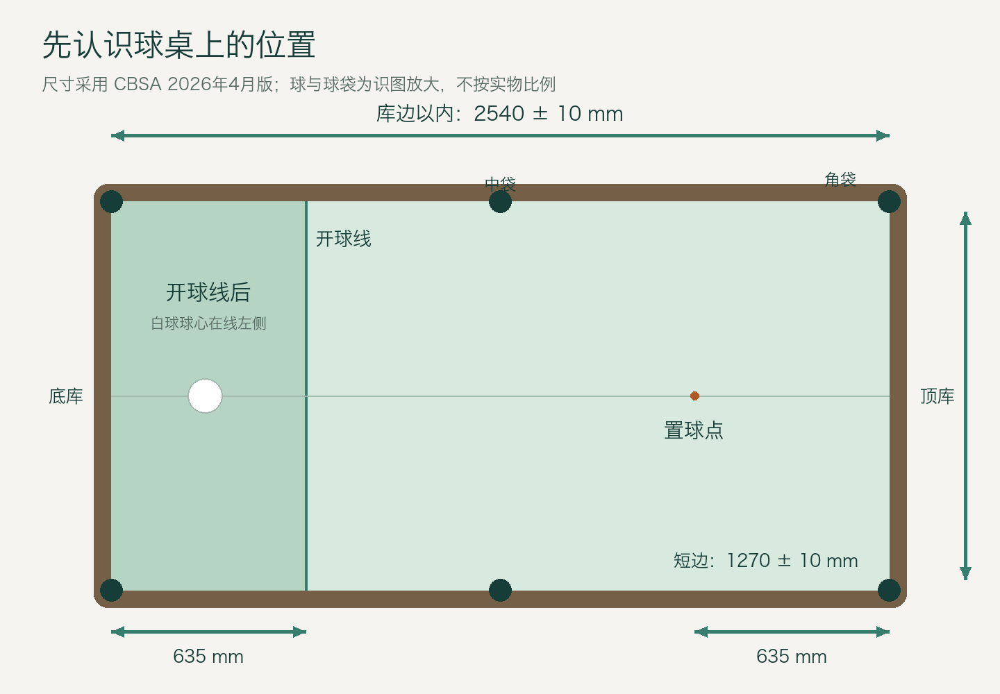
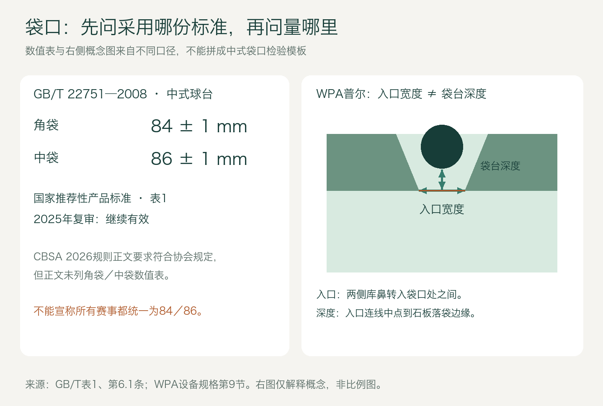
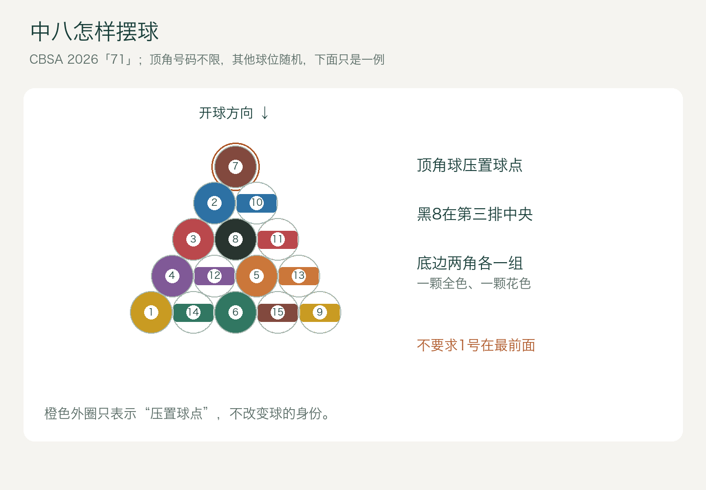
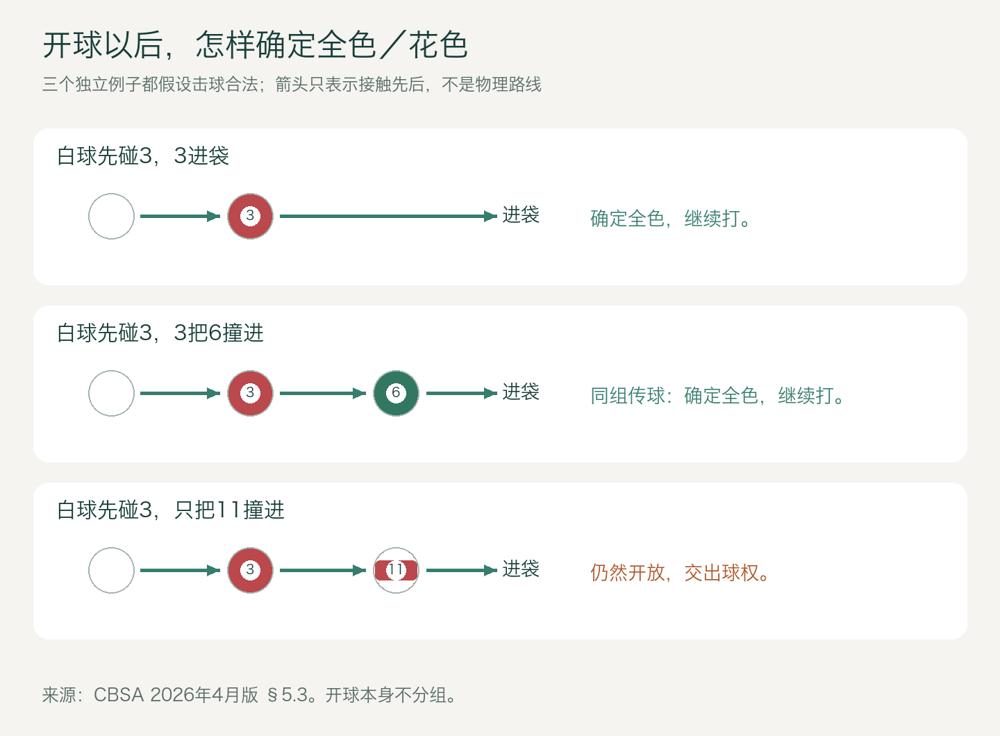
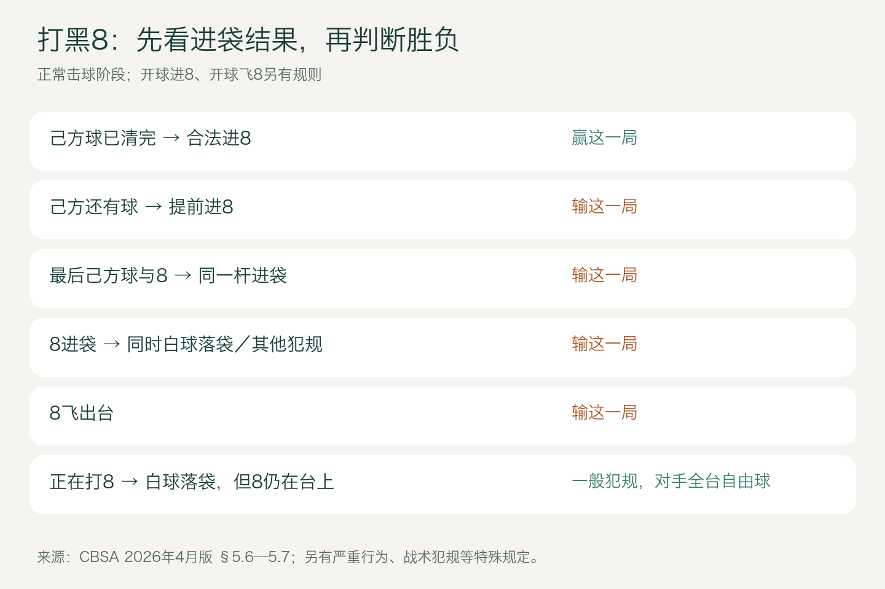

# 中八入门：从认识球桌，到打完第一局

版本：2026-10-28 · 新手阅读稿 v1 · 配图为原创教学示意。

你在球房里听到的“中八”，通常就是中式八球：两个人各打一组球，最后争取打进黑8。本文采用中国台球协会（CBSA）2026 年 4 月版《华彩十六球比赛规则和竞赛规定（试行）》中的“71”打法。“71”读作“七加一”：先清除自己组的七颗球，再打制胜球。下文用大家熟悉的全色、花色和黑8讲解。[规则发布说明](https://cbsa.cssf.net.cn/NewsReleases/NewListDetails.htm?id=74A3873C4F5CB7D9)

## 1. 先记住这六句话

1. 用球杆打白球，由白球去碰其他球，不能拿球杆直接打目标球。
2. 分组以后，你打全色或花色中的一组；这组球内通常不用按号码顺序打。
3. 每杆先碰合法目标球；没有进球时，碰球之后还要有至少一颗球碰库。
4. 合法打进自己的球，可以继续；合法但没进自己的球，通常换对手。
5. 普通犯规一般给对手全台自由球；开球犯规另有规定。
6. 自己的七颗球全部离台以后，再单独合法打进黑8，才能获胜。最后一颗己方球和黑8不能在同一杆进袋。

“离台”在规则中包括进袋和跳离球台；把球打飞本身仍会犯规，不能把“离台”理解成允许把球打出桌外。[CBSA 原文，第2、4、5章](https://cbsaht.cssf.net.cn/ueditor/net/upload/file/20260513/6391430865213755756022415.docx)

## 2. 认识球、球桌和球杆

### 白球、全色、花色与黑8

一套常见的中八用球共有 16 颗：一颗白色母球，以及 15 颗子球。母球可能带有观察旋转的圆点，这不影响它作为白球的身份。

| 球 | 怎么认 | 在一局中的作用 |
|---|---|---|
| 母球 | 白色，可能带标识 | 双方共用；每次用杆头击打它 |
| 1—7号 | 主体为一种颜色，俗称全色、小号 | 一个球组 |
| 9—15号 | 白底上有彩色带，俗称花色、大号 | 另一个球组 |
| 8号 | 常见为黑色 | 最后争夺的制胜球 |

不同品牌的配色可能不同，认球时以号码和全色／花色标识为准。花色不是“分数更高”，中八也不是把进球号码加起来计分：通常赢一局记一局。

### 球桌上这些位置叫什么

四个角上的洞叫角袋，两条长边中间的洞叫中袋，一共六个袋。台面边缘能使球反弹的部分叫库。开球时站的一端叫底库端，摆球堆的一端叫顶库端。

图1：俯视识图。开球区在图左，摆球区在图右；换一个站位，规则中的顶库、底库名称不会跟着变。球和袋为识别而放大，图形不是加工图。

| 项目 | 本文采用的 CBSA 2026 年 4 月版要求 | 新手怎样理解 |
|---|---|---|
| 库边以内台面 | 2540 ± 10 × 1270 ± 10 mm | 约2.54米长、1.27米宽；不是整张球桌的外尺寸 |
| 球台高度 | 桌腿底部至台面810 ± 10 mm | 测到铺台呢的台面，不是测到库帮顶部 |
| 台面至库帮顶部 | 42 ± 0.5 mm | 不要直接当成橡胶库鼻的接触高度 |
| 开球线 | 离底库帮635 mm | 白球开球时放在线后区域；线本身不属于线后区域 |
| 置球点 | 纵向中心线上，离顶库帮635 mm | 摆球堆、部分情况下重置黑8会用到 |
| 球直径 | 57 ± 0.2 mm | 含母球；赛事另有规定时从其规定 |
| 球重量 | 167 ± 3 g | 同样属于本文这套规则的器材要求 |
| 球杆长度 | 不短于1000 mm | 这是比赛允许的下限，不是推荐新手买1米长的杆 |

以上数字来自同一份规则的第1章。你还可能看到“57.15 mm”的球、“9英尺”的球台或“84 cm高”的商品介绍：它们可能引用其他标准或测量位置。不能只看一个数字，就断言器材不合格；应核对规则版本、测量对象和该场赛事规程。[CBSA 器材条款](https://cbsaht.cssf.net.cn/ueditor/net/upload/file/20260513/6391430865213755756022415.docx)

### 袋口到底多大？为什么同样是中八，难度不一样？

这件事要分两层看。

**国家产品标准有明确数字。** GB/T 22751—2008《台球桌》表1中的“中式球台”一行，角袋为 **84 ± 1 mm**，中袋为 **86 ± 1 mm**。它属于推荐性产品标准，官方平台截至本稿核查时显示“现行”，2025年3月27日复审结论为“继续有效”。这里的“2008”是标准编号中的年份，不代表已经废止。[官方状态](https://std.samr.gov.cn/gb/search/gbDetailed?id=71F772D7C874D3A7E05397BE0A0AB82A)；[标准表1及第6.1条扫描件，第三方镜像](https://img.antpedia.com/standard/files/pdfs_ora/CN-GB/9c3/GB_T%2022751-2008_488.pdf)

**具体赛事还有自己的器材口径。** CBSA 2026 年 4 月版第1.1（7）条要求球袋形状及开口尺寸符合协会有关规定，但该规则正文没有给出一张角袋／中袋数值表。因此，不能把上面的84／86直接写成“所有2026年中八赛事统一袋口”，也不能据球房口头说的“85口、90口”断定它采用了哪份标准。[CBSA 第1.1条](https://cbsaht.cssf.net.cn/ueditor/net/upload/file/20260513/6391430865213755756022415.docx)

图2：左侧为国家产品标准数值；右侧借WPA普尔设备文件说明“入口宽度”和“袋台深度”是两件事，**右图不是中式袋口检验模板**。

袋口不是台面下方那个圆洞的直径。球要先经过两侧袋角，再进入失去台面支撑的区域；入口轮廓、袋角角度、袋台深度都会改变可进球的空间。WPA的普尔设备文件就分别规定入口宽度、袋角角度和袋台深度，并把入口宽度定义为两侧库鼻转入袋口处之间的距离。[WPA 设备规格，第9节](https://wpapool.com/wp-content/uploads/2024/01/RECOMMENDED-EQUIPMENT-SPECIFICATIONS.pdf)

GB/T扫描件第6.1条列明袋口尺寸用游标卡尺测量；本次取得的节选没有给出完整的中式袋角圆弧模板和测量端点图。买台、改袋或做赛事验收时，要让厂商提供所采用标准的完整图纸及测量方法，不能把右图的普尔测量定义直接套到中式圆弧袋角上。新手先知道：**比较两张桌子的袋口，除了宽度，还要比较形状和测量位置。**

### 一支球杆上要认识什么

接触白球的是最前端的皮头；皮头后是先角，再往后是前节、连接部位及后把。木杆与碳纤维前节都能见到；材质名称本身不能决定一支杆是否适合你。

打杆用于普通击球，冲杆用于开球，跳杆用于采用合法方式打跳球；加长器帮助够到远处的球，架杆帮助支撑球杆。CBSA允许比赛期间更换这些球杆，但长度、形态和使用方式仍要合规。[CBSA 第1.3—1.4条](https://cbsaht.cssf.net.cn/ueditor/net/upload/file/20260513/6391430865213755756022415.docx)

巧粉擦在皮头上，用于减少滑杆，不是涂在白球或手上的粉。手套可以改善手架处的滑动。不要拿巧粉在台面上做瞄准记号，也不要涂蜡、涂液体改变比赛用球；这版规则还禁止使用滑石粉。[CBSA 第1.5—1.6、4.16条](https://cbsaht.cssf.net.cn/ueditor/net/upload/file/20260513/6391430865213755756022415.docx)

第一次到球房，不用先买整套器材。先找一支皮头完整、长度适合自己伸展、出杆时容易控制的公杆，学会安全持杆和打完一局。够不到时用架杆，别为了伸远而把双脚都抬离地面。

## 3. 开局：摆球、决定谁先打、开球

### 摆球不是把15颗球随便堆成三角形

15颗子球要紧密排列成五排三角形。顶角球压在置球点上；黑8位于第三排中央，也就是顶角球正下方的第一个球位；三角形底边的两个角分别放一颗全色、一颗花色，其余号码随机。**顶角不要求一定是1号。**[CBSA 第5.1条](https://cbsaht.cssf.net.cn/ueditor/net/upload/file/20260513/6391430865213755756022415.docx)

图3：橙色外圈表示置球点，示例中恰好放7号。这里只固定黑8、两底角的球组及顶角压点关系，不要求背下全部号码。

正式比球时，两人几乎同时从开球线后把球击向顶库，再让球返回；在比球合法的前提下，停得更靠近底库的人获得第一局开球选择权。不是把球打得越远越好，也不能进袋、碰边库或跨入对方一侧。之后按本文规则逐局轮流开球。[CBSA 第3.2、3.5条](https://cbsaht.cssf.net.cn/ueditor/net/upload/file/20260513/6391430865213755756022415.docx)

### 开球后的五种常见结果

母球球心须位于开球线后。开球不要求先碰某个特定号码；球停稳后，再判断结果。

| 开球结果 | 接下来怎么办 |
|---|---|
| 合法进了普通子球 | 开球者继续，但仍未分组 |
| 没进子球，至少四颗不同子球碰库 | 合法开球结束，换对手从现有位置打 |
| 没进子球，碰库的子球不足四颗 | 开球违例；对手可接受台面、自己重开，或让原开球者重开 |
| 合法开球打进黑8 | 黑8重置，开球者接受现有台面继续；不是直接赢 |
| 白球进袋或飞出台 | 对手获得线后手中球；若黑8也进袋，先重置黑8 |

“四颗球碰库”数的是不同子球，不是一颗球撞四次库，白球也不计入这四颗。其他开球犯规按第5.2（7）条处理：离台的普通子球不重置，对手可接受台面，或选线后手中球。开球把黑8打飞，也要重置黑8并按开球犯规处理；不能套用正常击球阶段的“黑8飞出台直接输”。[CBSA 第5.2、5.5条](https://cbsaht.cssf.net.cn/ueditor/net/upload/file/20260513/6391430865213755756022415.docx)

## 4. 开球进全色，不代表你已经是全色

球组尚未确定时，叫“开放台面”。你可以先碰全色或花色，通常不能先碰黑8。开球进的球不决定分组。

开球以后，要看一次合法击球中：**进袋的球有没有母球先碰的那颗球，或同组的球。**有，才据此确定球组；没有，仍然开放，并交出球权。

图4：箭头表示接触先后，不表示实际角度、力度或必然进球路线。

例一：白球先碰3号，3号进袋。你选定全色，对手花色，你继续。

例二：白球先碰3号，3号撞进6号，而3号没进。只要本杆合法，仍然选定全色，你继续。

例三：白球先碰3号，只把11号撞进，3号和其他全色都没进。即便本杆没有其他犯规，也不能据此选成花色；台面继续开放，换对手打。

如果白球先碰3号，同时进了3号和11号，则选定全色。只有几乎同时接触不同球组、无法分清先后等特定情况，才适用特殊选组处理；不能概括成“同一杆进两组就随便选”。[CBSA 第5.3条](https://cbsaht.cssf.net.cn/ueditor/net/upload/file/20260513/6391430865213755756022415.docx)

还有一种少见例外：开放台面时，某一球组已经全部被打进，球员可以临时选定这个空组，然后击打黑8争取获胜。普通对局先掌握前面三个例子即可。

## 5. 分组后，每一杆怎样才合法

### 先碰对球，再看进球或碰库

假设你是全色，桌上还剩2、5、7号。本文“71”打法允许你任选其中一颗先打，不必先打2号；把一颗合法全色撞进另一颗全色也可以。

白球先碰合法目标以后，如果本杆没有任何球进袋，就必须有至少一颗球碰库。这颗球可以是白球、己方球或对手球。

- 白球先碰5号，5号没进，白球随后碰库：可以是合法击球，换对手。
- 白球先碰库，再碰5号，随后没有球进袋，也没有球再碰库：不满足“碰球之后碰库”的条件，犯规。
- 白球先碰5号，5号进袋，白球没有碰库：只要没有其他犯规，本杆合法，可以继续。
- 白球先碰对手的10号，即便随后把5号打进：先碰错球，仍然犯规。

先碰库再去碰目标球叫解球，不因“先碰库”本身犯规。能不能合法，要继续检查先碰到的子球是谁，以及碰球后的进袋／碰库结果。[CBSA 第2.7、4.2—4.4、5.4条](https://cbsaht.cssf.net.cn/ueditor/net/upload/file/20260513/6391430865213755756022415.docx)

### 对手的球进了怎么办

只要先碰的是自己的合法目标，且没有其他犯规，碰进去的对手球留在袋里。若这一杆只进了对手球，没有自己的球，则换对手；若自己的球也合法进了，可以继续。不能把对手球捞出来当作“无效进球”。

### 贴库、贴球要先确认

目标球本来贴着库，轻碰它却没有离开库再回来，不能拿原来的接触冒充一次新碰库。还可以靠其他球在碰球后碰库，或合法进球来满足要求。击球前先请对手／裁判确认贴库状态。

白球与合法目标球已经紧贴，和两球很近但没有贴住，也不是一回事。规则允许对真正相贴的合法目标球朝其方向击打，但动作必须清楚，不能长时间推着白球走；朝远离相贴球的方向打，不自动算已经碰过该球。遇到这种难判的球，先确认球位，再出杆。[CBSA 第2.14、4.8—4.9条](https://cbsaht.cssf.net.cn/ueditor/net/upload/file/20260513/6391430865213755756022415.docx)

## 6. 犯规后，自由球怎么放、怎么打

“自由球”通常是手中球的口语说法，意思是可以按规则重新放置白球，**不是可以任选一颗不合法的球先碰**。

| 常见情况 | 一般后果，开球除外 |
|---|---|
| 白球进袋、飞出台，或没碰到任何子球 | 对手全台自由球 |
| 先碰了对手球，或还没清完己方球就先碰黑8 | 对手全台自由球 |
| 无进球，碰球后也没有任何球碰库 | 对手全台自由球 |
| 手、衣服、头发、球杆等意外碰动局中球 | 对手全台自由球 |
| 连击、推击、球未停稳就打、抢打 | 按一般犯规处理 |
| 击球瞬间双脚都离地 | 一般犯规；至少一只脚要接触地面 |
| 黑8涉及输局情况 | 直接按下一节判负，不只给自由球 |

全台自由球可把白球放在台面任意合规位置，正式击球前可重新调整；摆球过程也不能碰动其他球。开球白球摔袋后得到的是**开球线后手中球**，不要放到全台任意位置。

线后手中球还有击打范围限制：不能把白球放在线后，直接击打同在线后区域的目标球；需按规则先越过开球线后再返回。目标球的球心恰在线上，则可击打。判断球在线前或线后看球心投影，不看球边是否压线。[CBSA 第2.15、3.3、4.12—4.13、5.7条](https://cbsaht.cssf.net.cn/ueditor/net/upload/file/20260513/6391430865213755756022415.docx)

如果打进己方球的同时白球也掉袋，这不是“进球抵消犯规”。己方球通常留在袋内，轮到对手拿自由球。黑8则有更严格的结果。

## 7. 黑8：哪些赢，哪些输，哪些只是犯规

图5：本图适用于正常击球阶段，开球另看第3节。

| 球局与结果 | 判定 |
|---|---|
| 己方球已全部离台，合法打进黑8 | 赢这一局 |
| 己方还有球，提前把黑8打进 | 输这一局 |
| 最后一颗己方球与黑8在同一杆进袋 | 输；即使己方球先掉进去，也不行 |
| 黑8进袋，同时白球进袋或发生其他犯规 | 输这一局 |
| 黑8跳离球台 | 输这一局 |
| 轮到打黑8，黑8没进，白球掉袋 | 一般犯规；对手全台自由球，不能只因“正在打黑8”就判输 |
| 轮到打黑8，没碰到它，黑8也未进袋、未离台 | 一般犯规；若还涉及战术犯规等规定，另外判断 |

这些区别来自第5.6条的具体条件。**犯规与输局不是同义词，关键是黑8是否进袋／跳离，以及当时的球组状态。**[CBSA 第5.6—5.7条](https://cbsaht.cssf.net.cn/ueditor/net/upload/file/20260513/6391430865213755756022415.docx)

### 黑8要报袋吗？“蒙进”算不算？

本文采用的CBSA“71”条文没有设置“黑8必须指袋”的要求；不能把旧版、其他赛事或球房的指袋约定塞进本规则。以本稿口径，只要进球满足合法性和获胜条件，不因没事先报袋而失效。如果参加的赛事或球房明确采用指球／指袋约定，应在开打前核对。[CBSA 第5章](https://cbsaht.cssf.net.cn/ueditor/net/upload/file/20260513/6391430865213755756022415.docx)

国际Heyball是另一个需要指明版本的口径。WPA 2025年8月16日《Rules of Heyball》也明确写明不要求报球报袋，包括最后的8号球；但其器材、部分程序与CBSA文本并不完全相同，不能因名称接近就混用整套条款。[WPA Heyball，第II部分第11项](https://wpapool.com/wp-content/uploads/2025/08/250816-Rules-of-Heyball.pdf)

## 8. 可以防守，但不能把战术犯规当成合法防守

中八允许通过合法击球把白球留在对手难打的位置。比如，先碰自己的合法球，再让白球碰库并停在障碍球后面：不进球，交出球权，本身不等于犯规。

但故意不尝试碰合法球、故意掉白球或先打对手球，不属于这种合法防守。2026版有战术犯规限制：同一球员在**一局**中累计两次战术犯规，可被判负；首次后要立即警告。另有开球违例累计限制及相应警告要求。两项限制在CBSA举办的华彩十六球赛事中必须使用。[CBSA 第5.6条及第二部分第4—5条](https://cbsaht.cssf.net.cn/ueditor/net/upload/file/20260513/6391430865213755756022415.docx)

这不是“任何两次犯规都输”，也不是“防守两次就输”。若无论直接还是间接都不可能碰到合法球，规则还有裁判询问是否按僵局处理的程序；别自行猜成可以随便打错球。

## 9. 跟着走完一局

甲开球打进2号，白球留在台面上，没有犯规。甲继续，但两人还没分组。

甲随后先碰3号并把它打进，确定甲打全色、乙打花色。甲再打5号，没有进，但白球在碰5号后碰了库。甲这一杆合法，轮到乙。

乙先碰10号，却把白球打进了袋。甲获得全台自由球；甲可重新放白球，仍须先碰自己的全色球。

之后，甲依次打完自己的剩余全色。此时乙桌上还剩多少花色，不影响甲已经可以打黑8。甲用下一杆合法打进黑8，甲赢一局。下一局按轮流开球安排进行，而不是因为甲赢了就必然继续开球。

这段过程里最容易记错的三件事是：开球进球不分组；没进球也可能合法；赢一局不等于下一局一定由赢家开球。

## 10. 球房里还会遇到的情况

**球在袋口停了一会儿，自己掉了。**不能一律算上一杆进球。规则对击球结束后明显静止5秒再自行掉落有复位规定；从袋里弹回桌面的球也不算进。别用手推袋口球。[CBSA 第2.8、3.6条](https://cbsaht.cssf.net.cn/ueditor/net/upload/file/20260513/6391430865213755756022415.docx)

**球在库帮顶部滚过又回到桌面。**单纯如此不一定是跳离球台；停在库帮上，或碰到灯、巧粉、人体等外物后回桌，处理不同。发生争议先停球局并请裁判，不要自己把球拿走。[CBSA 第2.16条](https://cbsaht.cssf.net.cn/ueditor/net/upload/file/20260513/6391430865213755756022415.docx)

**白球跳起来了，是不是一定犯规？**不是。规则允许用抬高球杆、向下击白球使其从台面反弹的合法跳击；故意铲球不可当成技巧。2026版对意外滑杆造成跳起另有处理，不能写成“只要白球离开台面就犯规”。新手先学稳定的平杆击球，跳球请在允许练习的场地由教练指导。[CBSA 第2.7、2.20、4.16条](https://cbsaht.cssf.net.cn/ueditor/net/upload/file/20260513/6391430865213755756022415.docx)

**听说还有431打法。**它也在同一份规则中，但当己方球组少于4颗，即只剩3颗或更少时，要先碰己方最小号球。它不是本文“71”打法的一条隐藏要求；先确认今天玩的是哪一种。[CBSA 第6章](https://cbsaht.cssf.net.cn/ueditor/net/upload/file/20260513/6391430865213755756022415.docx)

开打前可以用一句话确认：“我们按七加一打，开球不分组，黑8不另报袋，普通犯规全台自由球，开球犯规按线后手中球处理。”若对方采用另一套规则，把有差异的地方先说清。击球前留出挥杆空间，等球全部停稳再上场，疑难球先请人观察，比进球后争论更容易解决。

## 文末备注与引用

- **主规则**：中国台球协会，2026年4月《华彩十六球比赛规则和竞赛规定（试行）》。[2026-04-30发布页](https://cbsa.cssf.net.cn/NewsReleases/NewListDetails.htm?id=74A3873C4F5CB7D9)；[协会服务器原始附件](https://cbsaht.cssf.net.cn/ueditor/net/upload/file/20260513/6391430865213755756022415.docx)。本文按第1—5章及相关竞赛规定转写为入门讲解，正式裁判以原文和赛事规程为准；“71”与“431”分开。
- **国家产品标准**：GB/T 22751—2008《台球桌》。[官方状态及2025年复审结论](https://std.samr.gov.cn/gb/search/gbDetailed?id=71F772D7C874D3A7E05397BE0A0AB82A)。袋口数字核对了表1扫描原文；[可公开读取的节选镜像](https://img.antpedia.com/standard/files/pdfs_ora/CN-GB/9c3/GB_T%2022751-2008_488.pdf)不是官方托管全文，本稿不把缺失的袋口模板补画成标准。
- **国际对照**：[WPA《Rules of Heyball》2025-08-16](https://wpapool.com/wp-content/uploads/2025/08/250816-Rules-of-Heyball.pdf)，用于说明版本差异和不报袋口径；[WPA《Recommended Equipment Specifications》](https://wpapool.com/wp-content/uploads/2024/01/RECOMMENDED-EQUIPMENT-SPECIFICATIONS.pdf)第9节仅用于普尔袋口测量概念。后者文件正文生效日期为2001年11月，网址上传目录年份不能当成修订年份。
- **核查日期与边界**：2026-10-28。本轮检索到的中八主基线仍为上述CBSA2026年4月版。协会后续赛事专门规程、器材核准文件可有补充；本稿没有获得足以宣称“所有中八赛事统一口径”的袋角模板。
