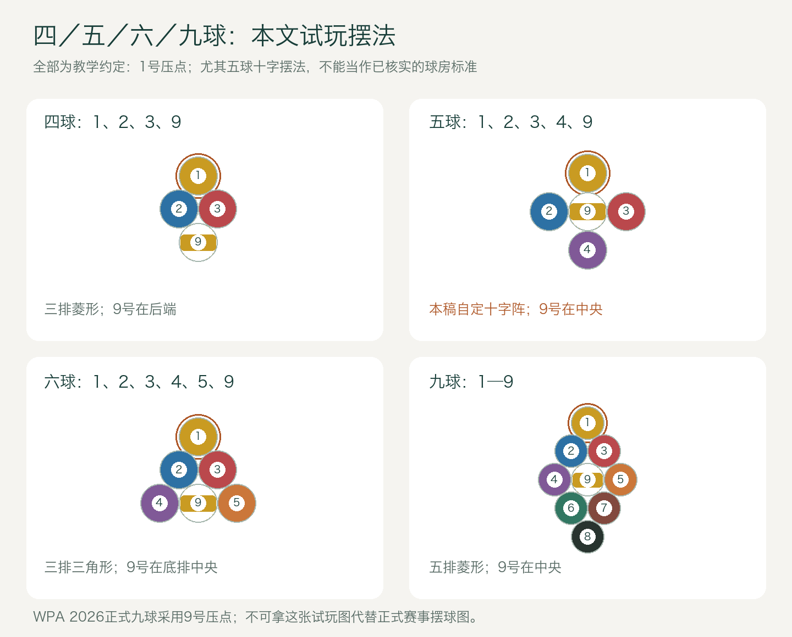
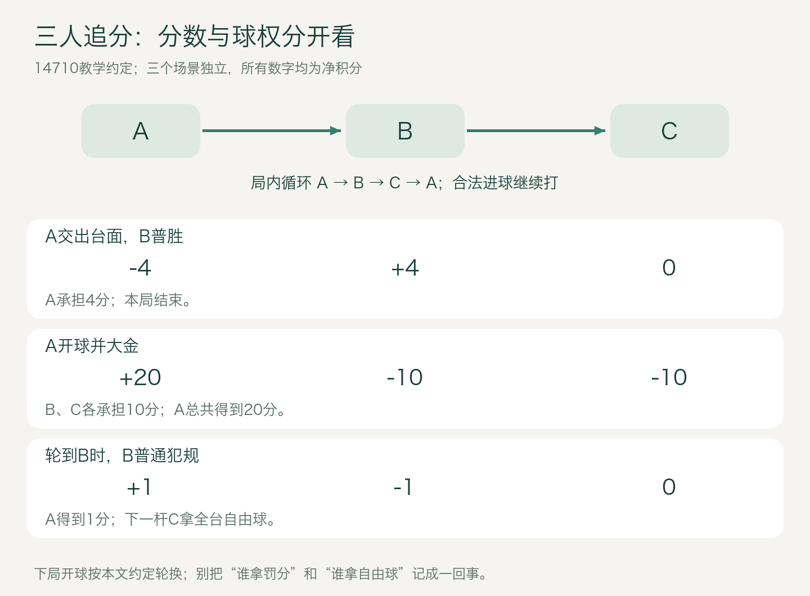
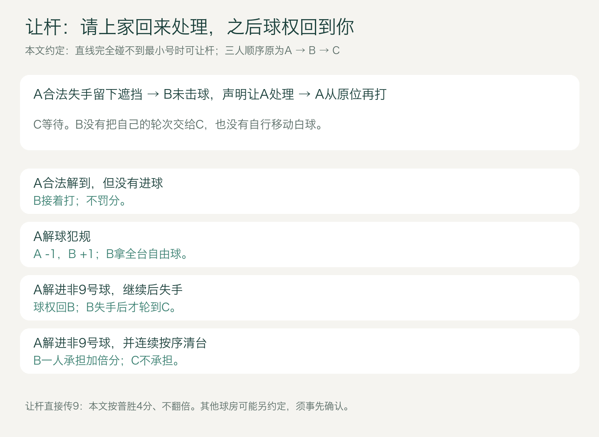
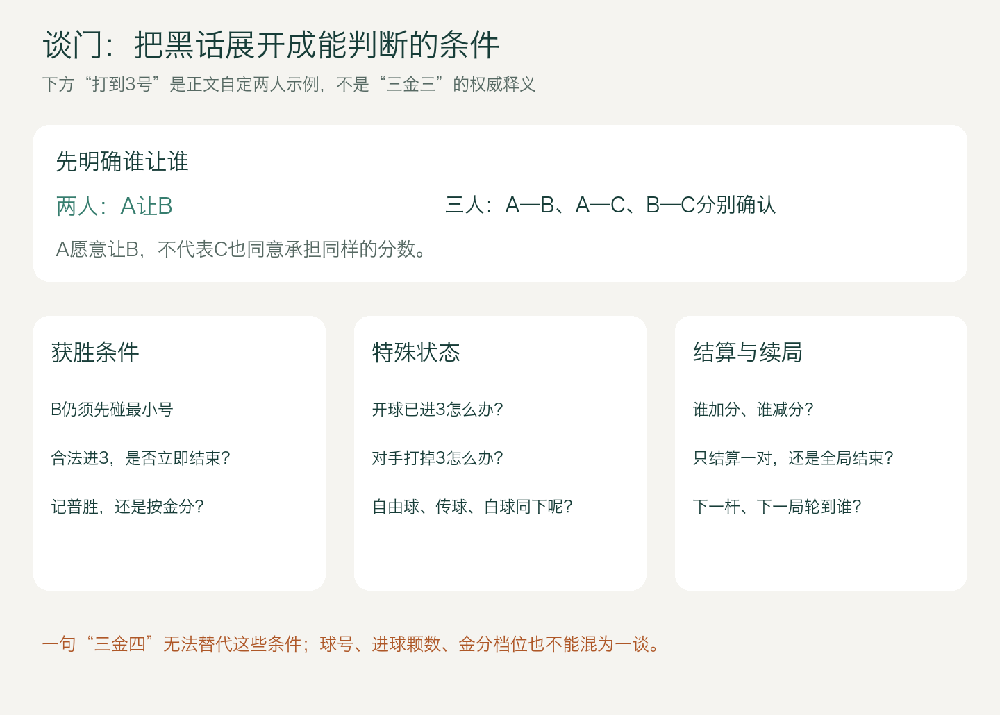

# 追分入门：四球、五球、六球、九球，两个人和三个人怎么玩

版本：2026-10-28 · 新手阅读稿 v1 · 配图为原创教学示意。

球房里的“追分”，通常指以九球的顺序击球为基础，再加入大金、小金、普胜、罚分和多人结算的玩法。它可以只摆四颗、五颗或六颗目标球，并不一定把1—9号全部摆上桌。

先记住最重要的一点：**号码决定这一杆先碰谁，局面和事先约定决定得多少分。**打进3号不是自动得3分，也不是谁进球多谁就赢。

本文先教你看懂基本过程，再给出一套两人、三人都能完整试玩的约定。你提到的“不允许防守”采用“不主动防守、受阻时可以按约定让杆”的球房口径；它不能代表所有追分比赛。乔氏2019年“决金”采用过大金6、小金4、普胜2的赛事计分，民间也有“幺四七幺零”等版本，可见名称相同不代表细则相同。[乔氏赛事规则](https://www.joy147.com/newsinfo/1195137.html)

> **阅读标识**：下文标“教学约定”的内容，是本稿为了让新手能够完整试玩而明确选定的规则，不宣称是CBSA、WPA或全国球房统一规则。尤其五球的球号／摆法，以及让杆、自由球传9、黑金和谈门的边界，需要与同桌玩家确认。

## 1. 先认识球和器材

双方或三人共用一颗白球。用杆头击打白球，由白球去碰带号码的目标球；9号是这套基础玩法的制胜球。追分不分全色、花色，两人都可以打同一颗合法目标。

“四球、五球、六球、九球”在本文都数**目标球**，不包含白球。因此五球练习桌上总共是五颗目标球加一颗白球，共六颗。

追分可以在中式球台上玩；在同一张桌上把中八改成追分，球和袋口不会因此自动变成美式普尔的规格。如果球房使用CBSA2026年4月版所述中式器材，台面约为2.54 × 1.27米，球的要求为57 ± 0.2 mm、167 ± 3 g；如果采用其他赛事或普尔器材标准，则核对相应文件。别因“九球”两个字就断言一定使用大袋口。[CBSA 器材条款](https://cbsaht.cssf.net.cn/ueditor/net/upload/file/20260513/6391430865213755756022415.docx)

中式球台产品标准GB/T 22751—2008表1列角袋84 ± 1 mm、中袋86 ± 1 mm；官方平台核查时仍显示现行。这是国家产品标准中的一组规格，不能替代每场比赛的指定器材条件。[官方标准状态](https://std.samr.gov.cn/gb/search/gbDetailed?id=71F772D7C874D3A7E05397BE0A0AB82A)；[表1扫描件](https://img.antpedia.com/standard/files/pdfs_ora/CN-GB/9c3/GB_T%2022751-2008_488.pdf)

图1：采用中式球台尺寸的识图示例。左侧线后区域放开球白球，右侧置球点用于定位球堆；袋口与球为识别而放大。

新手只用普通打杆也能开始学规则。皮头是接触白球的部分，巧粉擦在皮头上；不要把杆头往台呢上戳。冲杆、跳杆属于不同用途的球杆，暂时不会跳球不影响学习追分。够不到时使用架杆；击球瞬间至少有一只脚接触地面。

## 2. 每一杆都先找桌上最小号

假设桌上剩2、4、9号，你必须让白球先碰2号。碰到2号之后，2号可以撞进4号或9号；这叫组合球，球房也常说“传球”。只要先碰合法、没有其他犯规，并符合本场对自由球等特殊状态的限制，就可能有效。

“按号码顺序”首先约束的是**白球最先碰到的目标球**，不是要求每次只能进最小号球。

| 桌面与击球 | 基本判断 |
|---|---|
| 剩2、4、9，白球先碰2并打进2 | 合法时继续，下一杆先碰4 |
| 剩2、4、9，先碰2，再把4撞进 | 合法时继续；2仍在，下一杆仍先碰2 |
| 剩2、4、9，白球直接先碰4 | 犯规；即使4进袋也不改变先碰错球的事实 |
| 剩2、4、9，先碰2，2把9撞进 | 普通击球可提前赢；怎样记分看约定，自由球可能受限制 |
| 只剩9 | 先碰9，争取合法打进 |

碰球后若没有球进袋，还须有至少一颗球碰库。先碰库再碰最小号可以是合法解球，但若之后没有球进袋、也没有球再碰库，就不满足这一要求。[WPA九球规则第5章及通用犯规条款](https://wpapool.com/wp-content/uploads/2026/10/WPA-Rules-2026-10-21-211.pdf)

## 3. 四球、五球、六球和九球，具体差在哪里

### 先把球号说清楚

四球采用1、2、3、9号的玩法，有公开民间规则记录；六球采用1—5及9号的口径也见于球房教学。它们属于从九球缩短球数的玩法，不能直接把整本WPA九球规则冠名为“四球官方规则”。[MPRC四球自定规则](https://mprc-billiards.github.io/05-%E8%B5%84%E6%96%99/1-%E8%A7%84%E5%88%99%E7%A7%8D%E7%B1%BB/)；[球房教学口径，平台转写](https://www.douyin.com/shipin/7330492517370136639)

**五球的核查结论需要单独说清。**已经检索到“五球追分”的实际玩法名称及相关摆球／对局视频线索，但本次没有取得足够可靠的完整规则原稿和可核对的原视频内容，无法把某一组球号、某一种摆法、某一套金分认定为通用标准。下面提供的五球版本是**完整教学约定**，不是冒充已经证实的球房通例。

| 本文版本 | 目标球 | 正常逐颗清台顺序 | 初学时主要多出什么任务 |
|---|---|---|---|
| 四球 | 1、2、3、9 | 1 → 2 → 3 → 9 | 较少的连续走位，先学会轮转与结算 |
| 五球，教学约定 | 1、2、3、4、9 | 1 → 2 → 3 → 4 → 9 | 比四球多一次顺序衔接 |
| 六球 | 1、2、3、4、5、9 | 1 → 2 → 3 → 4 → 5 → 9 | 更长的连续控白球过程 |
| 九球 | 1—9 | 1 → 2 → … → 9 | 完整顺序球局，障碍和衔接更多 |

表中顺序跳过已经离台的球；普通击球允许合法组合球时，也可能提前结束一局。球数少不等于每一局都容易：球贴库、互相遮挡或距离远，照样可能很难。

### 摆球示意：本文怎样开始练

图2：本稿试玩统一采用图示摆法和“1号压置球点”。四球是1—2—1菱形；五球采用1—3—1十字形；六球是1—2—3三角形；九球是1—2—3—2—1菱形。**整张图是教学约定，其中五球的十字形并非已核实的球房标准。**普通号码在允许球位内随机，不使用固定进球模板。

这套五球十字摆法中，9号位于中央，1号在朝向开球者的一端，剩下三颗分别放在左右和后方，每颗外围球贴住中央9号。不需要拿一个缺角、漏球的六球三角形冒充标准五球阵。若球房使用不同摆法，就采用双方事先确认的摆法，不能把本图当成申诉依据。

正式WPA九球另有明确摆法：2026-10-21版第5.2条规定1号在球堆前端，**9号居中并压置球点**。这与本稿球房试玩的“1号压点”不同；看正式赛事时按该赛事版本辨认。[WPA 第5.2条](https://wpapool.com/wp-content/uploads/2026/10/WPA-Rules-2026-10-21-211.pdf)

## 4. 先用这一套约定，完整玩起来

下面这张卡对四、五、六、九球都适用。它是本文全部例子的共同前提，换人数不自动改变它。

| 项目 | 本文教学约定 |
|---|---|
| 第一局与后续开球 | 抽签确定最初顺序；以后每局轮流开球。两人A、B交替；三人A、B、C循环 |
| 摆球 | 采用图2；开球白球放在线后；先碰1号 |
| 开球力度要求 | 有目标球合法进袋，或至少三颗不同目标球碰库；不数白球，不把同一颗重复碰库算多颗 |
| 开球未达到要求 | 本稿按开球犯规：罚1分，下一位全台自由球；不另加重开选择 |
| 普通击球 | 先碰台面最小号；合法进球继续；未进球则换人；无进球时碰球后须有球碰库 |
| 防守 | 不主动做防守；不以“没有打进”本身判故意防守；明显违规按普通犯规处理 |
| 让杆 | 只在下一位的最小号球完全不能被白球沿直线碰到时允许；具体过程见第8节 |
| 普通犯规 | 一次击球记一次1分罚分；下一位全台自由球。三人罚分受益人与下一位可能不同 |
| 自由球 | 仍先碰最小号；本稿不允许在该杆提前传进9；若只剩9则可以打9 |
| 9号随犯规入袋或飞出台 | 不赢；重置9号，按普通犯规处理；不另加黑金处罚 |
| 其他目标球犯规进袋或飞出台 | 不重置；球权和罚分照常处理 |
| 报袋、跳球、推杆 | 本稿不要求报袋；不启用跳球和push out，让新手先用平面击球与解球练习 |
| 连续犯规、点金 | 不额外启用三犯输局或点金；每次按已约定条款处理 |
| 一场何时结束 | 约定固定完整局数，例如12局；打完后比较净积分，不因某人中途领先就突然结束 |

这张卡里的“三颗不同球碰库”是为本稿短球练习选定的开球条件，不是引用WPA九球的四球碰库条件，也不是赛事“三球过线”的同义说法。三球过线通常还涉及进袋球数如何参与计算，不能只把“四”改成“三”就说采用了正式赛事规则。

普通犯规还包括衣服、手或球杆意外碰动局中球；一杆中皮头再次触碰白球的连击；长时间用杆头推着白球走的推击；球还在移动或旋转就击球；抢在别人轮次打球；以及击球瞬间双脚离地。自由球放置时也不能碰动其他球。本文对这些情况都按同一套普通罚分与球权处理；故意改变球位或干扰他人，应先暂停，由参与者处理，不把破坏比赛当成可用1分交换的战术。

**为什么先写这么清楚？**因为开球不合法后是重开还是自由球、自由球能不能传9、9和白球同时落袋怎么罚，都会直接改变结算。只说“按普通追分”不能确定这些答案。

## 5. 大金、小金、普胜、黄金九，分别是什么

“幺四七幺零”通常用来记住1、4、7、10四个分值。本文把它们分别用于普通犯规、普胜、小金、大金；不是按目标球号码给分。

| 名称 | 本文教学约定的判定 | 基础分 |
|---|---|---:|
| 普通犯规 | 摔袋、错球、没碰球、无进球且碰球后无球碰库等 | 1 |
| 普胜 | 合法打进9，但不符合下面的金分条件 | 4 |
| 小金 | 非大金情况下，上手开始时1和9都还在；本轮不中断、无犯规，按顺序清除所有剩余球，最后打进9 | 7 |
| 大金 | 本人合法开球有进球且9仍在，接着在同一轮不中断、无犯规，按顺序清除其他剩余球，最后打进9 | 10 |
| 开球黄金九 | 合法开球直接进9 | 4，三人时另外两人各承担4 |
| 开球者连续击球中提前进9 | 本文归“开球轮提前9”；不是大金 | 4，三人时另外两人各承担4 |

“按顺序清台”在这里还要求：收9这一杆开始前，其他目标球已清除。若先碰最小号把9提前传进，或最后一颗普通球和9同杆进袋，本稿按提前9归类，不按大金／小金。进球可以合法，只是分值类别不同；不要套用中八“最后己方球和黑8同进直接输”的规定。

小金采用“上手时1和9仍在”的教学口径，因而不要求原先所有球一颗不少。例如开球进了2号，后来球权转给你，上手时仍有1、3、9，你按序清完，按本稿可记小金。另一些约定只认“开球没下后的第一次接清”或“全部球仍在”的全球金；不能用本文替它们判分。

公开赛事也可能把开球进9、开球者提前传9列入“小金”，且给不同分数。乔氏2019年规则就是这种例子。**先认定事件，再套本场分值，别反过来凭“小金”两个字推断所有细节。**[乔氏2019赛事原文](https://www.joy147.com/newsinfo/1195137.html)

## 6. 两人追分：先学最简单的结算

两人只有你和对手。合法进球继续；失去球权才换人。本文采用双方净积分记账：赢家增加多少，对手就减少多少。

| A发生的事件 | A | B |
|---|---:|---:|
| 普胜 | +4 | -4 |
| 小金 | +7 | -7 |
| 大金 | +10 | -10 |
| 合法开球黄金九 | +4 | -4 |
| 普通犯规 | -1 | +1，同时B拿全台自由球 |

有些记分器只记一边的净分或只累计得分，这不影响你理解谁获胜，但不能把不同记账方式的数字直接混加。本文所有例子用净积分，总和始终为0。

### 两人五球，走完三局

用1、2、3、4、9，按图2摆好，采用第4节约定，第一局A开球。

**第一局：大金。**A合法开球进2号，白球留台；随后依次合法打进1、3、4、9。A加10，B减10。开球进掉的2号不用拿回，也不必为了“从1到4”再补打一颗2号。

**第二局：小金。**轮到B开球。B没进球，但满足三颗不同目标球碰库，开球合法；A接手时1和9都在。A连续按序打进1、2、3、4、9，A加7，B减7。

**第三局：犯规后普胜。**A开球后打进1、2，打3时没进但满足碰库，轮到B。B先碰3却掉了白球，B减1，A加1，A获全台自由球。A依次打进3、4、9；因上手时已经没有1号，本稿记普胜4分。三局累计A为+22，B为-22。

把同一过程换成四球，少掉4号；换成六球，多一个5号；换成九球，再多6、7、8号。先碰最小号、球权转换和上述计分逻辑不因球数自动改变。

## 7. 三人追分：谁付分，谁上场，要分开看

先把循环顺序定为A → B → C → A。轮到B时，A是上家，C是下家。这些名称表示击球顺序关系，不表示固定座位，也不表示谁水平高。

本文的三人教学结算采用：普通胜利追给出当前机会的上家；开球者在自己的开球轮内结束本局，由另外两人共同承担；普通犯规给上家罚分、下家拿自由球。此类上下家关系有公开民间规则记录，但具体分值和特殊事件仍由本稿约定。[WHM追分玩法说明](https://whm-billiards.github.io/1-Rules/M-%E5%A4%9A%E4%BA%BA%E7%8E%A9%E6%B3%95/01-%E8%BF%BD%E5%88%86%E5%8F%B0%E7%90%83/)

图3：三个场景独立，均按本文14710教学约定。B犯规时，A拿1分，C拿自由球；A不用上场，也可以获得这1分。

| 独立场景 | A | B | C | 下一步 |
|---|---:|---:|---:|---|
| A交出台面，B普胜 | -4 | +4 | 0 | 本局结束 |
| A交出台面，B小金 | -7 | +7 | 0 | 本局结束 |
| A开球并大金 | +20 | -10 | -10 | 本局结束 |
| A合法开球进9 | +8 | -4 | -4 | 本局结束 |
| B普通犯规 | +1 | -1 | 0 | C拿全台自由球 |

“大金10分，两家各给”意味着三人时赢家净加20，不是把总共10分平均分给两家。两人时则只有一位对手，不能凭空多收一份。

### 三人五球，一局里发生两件事

A开球后已经打进1号，后来没有继续进球，球权到B。B犯规：先记A +1、B -1，C拿自由球。C随后合法清完剩余球，记C +4、B -4。把两件事加起来：A +1，B -5，C +4，总和为0。

C这次普通获胜追的是留下自由球机会的B，不是最早开球的A。已经结算的那1分犯规分也不会因为C获胜而被抹掉。

### 下一局谁先打

本文采用逐局轮换开球：第一局A、第二局B、第三局C；每局从开球者开始，沿原循环次序进行。例如B开球的一局，正常顺序是B → C → A。

球房可能用“赢家开球、输家第二、闲家第三”等顺序，那是另一项约定。别把本文的局内轮转和别处的局间重排规则混在一起。

## 8. 不主动防守，球被挡住时怎么办

主动防守，是以把下一位留在困难位置为主要目的进行击球；正常进攻没打进，偶然留下了遮挡，不等于自动犯规。不能只看结果难打，就认定上一位故意做球。

九球正式比赛通常允许合法防守，而你熟悉的追分可以约定不主动防守。这里是一条球房玩法差异，不是说防守违反所有九球规则。[WPA九球规则](https://wpapool.com/wp-content/uploads/2026/10/WPA-Rules-2026-10-21-211.pdf)；[民间不防守／让杆说明](https://whm-billiards.github.io/1-Rules/M-%E5%A4%9A%E4%BA%BA%E7%8E%A9%E6%B3%95/01-%E8%BF%BD%E5%88%86%E5%8F%B0%E7%90%83/)

### 什么叫让杆

让杆，是本来轮到你打，但在约定的受阻条件下，请刚留下这个局面的上家继续处理。**不是让下家跳过你上场，也不是获得随意移动白球的权利。**如果上家上一杆已经犯规，你通常已得到自由球，直接按犯规处理，不需要靠让杆再换一个自由球。

本文把可让杆条件订得明确：从白球沿直线无法先碰到当前最小号球的任何部分时，才允许让杆。能碰到一点但不好进、距离远、贴库或走位差，不自动获得让杆权。其他地方可能采用“看不到整颗球／不能打全薄边”等更宽条件，开局前要说清。

图4：A留下遮挡，B尚未击球就声明让杆。A处理这一轮后，球权先回B，不直接跳到C。

### 本文让杆的完整处理

设正常顺序A → B → C。A上一杆合法但没进，B面对完全受阻的最小号球。B在击球、移动白球或改变局面前说“让你解”，双方确认后由A从原位继续。

1. **A解到合法球，没进球且满足碰库条件**：这一轮结束，B接着打，C仍等待；不罚分。
2. **A解球犯规**：A减1，B加1，B拿全台自由球。这里罚分给让杆者B；不能机械套“普通犯规给循环上家C”。
3. **A合法进了非9号球**：A可以继续。本轮失手后球权回B，B失去球权后才轮到C。
4. **A解球这一杆进了非9号球，并随后连续按序清到9**：本稿开启“让杆清台加倍”，由B一人承担本次普胜或小金基础分的两倍，C不分摊。例如普胜基础4，A +8、B -8、C 0。
5. **A在解球这一杆直接组合进9**：本稿不算上面的连续清台加倍，按普胜4由B承担；若本场另约定传9也翻倍，则要另写。

让杆不会恢复大金资格：A已经交出过球权，不能因为又回到桌前就重新当成“开球连续清台”。本稿也不允许同一次受阻局面被双方来回无限让杆；受让的一方必须处理或双方同意重开。若没有可行的合法击球方式，经全体同意按僵局重开，已经完成的独立罚分保留，新局不计胜分，由原开球者重新开球。

这是一套完整教学选择，不能宣称每家球房都这样翻倍。有的地方不翻倍，有的只在特定解进情况下翻倍；“解到了”“解进了”“解进后清台”是三个不同事件。

## 9. 自由球、传9、双下和黑金

### 自由球不等于可以先打9

桌上剩2、4、9，拿到自由球也要先碰2。本稿允许自由摆白球，但禁止在这一杆提前把9传进；如果这样进9，9重置，按普通犯规记1分，下一位拿自由球。可以先合法打进2，继续取得的下一杆已不是手中球那一杆；此后能否组合9按普通击球处理。

只剩9时，自由球当然可以直接打9，否则球局无法正常结束。这也说明“自由球不能传9”与“自由球不能打9”不是同一句话。正式WPA九球并不采用本稿这条自由球提前9限制。[WPA 第5.6—5.8条](https://wpapool.com/wp-content/uploads/2026/10/WPA-Rules-2026-10-21-211.pdf)

### 白球与9号一起进袋

同时进白球和9号，击球不合法，不能只因9进了就宣布获胜。按本稿：9放回置球点，白球交给下一位作全台自由球，记一次普通罚分，不结束这一局。置球点被占时，沿球台纵向中心线向顶库方向找最近可放位置，不能挤动其他球；整段无法放下时再向另一侧找。

球房常把某些“本来有金、最后却带着白球一起下”的结果称作黑金、暗金，黄金九与白球同下也可能另称黑黄金九。究竟是赔一份、两份、加罚1分，还是重置继续，各地约定不同。**本文没有启用这些额外赔分，所以不能看见“黑金”二字就套一个通用倍数。**公开球房讲解与评论中，确实能看到不同的赔分方式。[球房教学口径](https://www.douyin.com/shipin/7330492517370136639)

### 点金不是每次自由球自带的权利

“点金”通常是另行约定的挑战／计分条件。能否点、要剩几颗、点完能否传9、失败如何算，都须由本场条款说明。本文试玩不启用，拿自由球时只按已讲清的普通程序处理。

## 10. 谈门：把“让你一点”变成双方都能判的条件

“谈门”是球房里协商双方条件、尤其协商让球／让分条件的说法。它不是“袋口”的另一个名字，也不是一个固定犯规动作。“放门”“让门”可用于描述一方向另一方提供有利条件。

“三金三”“三金四”“一金一”等确实出现在台球原作者的讲解标题中；但本次能取得的页面主要是标题和评论，未获得足以可靠核对所有边界的原视频正文。自动转写与评论还存在把数字解释成球号、颗数等不同表述。因此，**本稿不把其中某一种解释强行定为全国统一词义**。[台球三师兄：三金三／三金四原视频页](https://www.douyin.com/video/7428102498893745417)；[阳哥说球杆：三金三原视频页](https://www.douyin.com/video/7508734580023774516)

### 谈门主要会改哪件事

| 让法 | 用白话说清楚 | 容易混淆的地方 |
|---|---|---|
| 改获胜目标 | 弱方合法打进指定的某个号码，就可以结束本局 | 说的是某号球，还是上手后累计进几颗？ |
| 改金分条件 | 弱方达到较短的连续进球条件，就按某档金分结算 | 只改记分，还是达到条件立即结束球局？ |
| 让起始分或局数 | 开始时一方先拥有明确的分数或局数优势 | 这是分差／局差，不是少打一颗球 |
| 改开球权或局间顺序 | 某一方多开球或固定开球 | 不自动改变普胜、大金和罚分 |

这些是理解让步内容的分类，不是一张可以把所有黑话自动翻译出来的词典。听到“三金四”，应把它展开成“谁在什么情况下，打到什么条件，算什么结果”，而不是背一个没有边界的口号。

### 用一个完全说清楚的门来理解

下面是**另立的两人练习让球示例**，不用“三金三”给它命名，也不覆盖前面不让球的14710示例：

> A让B。在五球1、2、3、4、9中，B仍须先碰当前最小号。非开球阶段，B合法打进仍在台面上的3号，立刻按普胜4分结束该局；A仍须合法进9才能赢。开球进3不立即获胜，3不重置，此局B改以9为目标。A先打掉3也是如此。自由球那一杆不能用组合球提前进3；若3已是当前最小号，可直接打3。若B犯规同时进3，3重置、按普通犯规处理，不算获胜。此让球例不设大金、小金或让杆翻倍，其他普通规则照旧。

这一段虽然比三个字长，却能判断常见争议：B合法先碰2，把仍在台上的3传进，普通击球时可以普胜；B直接先碰3而桌上2还在，犯规；B把3和白球一起打进，犯规，不能赢。为了让示例完整，本例中的3号被犯规打进或打飞时均重置，按9号相同的置放顺序处理；这也是让球例专门增加的条款。

图5：先确定参与者，再确定获胜目标和特殊状态。图中“打到3号”是上述自定例，不能当作“三金三”的权威释义。

### 开球把让球打掉了，为什么最容易争执

假设有人说“让你打到3”。如果开球已经进了3，至少还存在这些可能的不同约定：直接算某种胜利、把3拿回重置、门暂时失效改打9、改成打某个后续球。它们不能同时成立。**没有明确约定，就不能事后挑对自己有利的一条。**

同样要确认：指定球被对手打掉怎么办；合法传进算不算；自由球时算不算；白球同下怎么罚；上手时只剩一颗是否还算金；多种条件同杆满足时优先用哪一条。只问“大金几分”还不够。

### 三人谈门，不能只说一句“A让B”

三人存在A—B、A—C、B—C三组关系。A愿意让B，不代表C也同意按同样条件付分。

例如B被A让到3号，但C仍要求B打到9：B打进3时，是只结清A—B的分继续打，还是整局结束而C退出结算，必须三人事先写清。否则球权、金分和剩余球都无从判断。

初学时可以先三人平打，或让所有可能承担该事件分数的人同意同一条件。若要采用不同的两两让法，就逐对记录，并写出同一局里先触发一个条件后是否继续、谁继续、另一对怎样结算。本文不把两人让球示例直接复制成三人默认规则。

### 一张能直接照读的谈门确认卡

“我们今天打____颗目标球，号码是____；____让____。普通胜利要完成____；大金／小金分别要完成____，分数是____。开球已经打掉指定球时____；被对手打掉时____；自由球时____；传进时____；犯规同时进时____。达到条件就____（结束全局／只结算这一对继续打）。三人时由____承担，下一杆／下一局轮到____。”

说不清的项目先沿用不让球的基础规则，或先不启用这项门。新手需要的是双方能一致判断的条件，不是熟练说出一串黑话。

## 11. 正式九球和球房追分，别混成一本规则

| 项目 | WPA正式九球，2026-10-21版 | 本稿追分试玩 |
|---|---|---|
| 基础目标 | 合法进9赢一局 | 依事件计分，并按人数确定承担者 |
| 球数 | 1—9共九颗目标球 | 四／五／六／九球 |
| 摆球定位 | 9号在置球点，1号在前端 | 教学约定1号压点 |
| 合法防守 | 可以 | 约定不主动防守 |
| Push out | 合法开球后的下一杆可按程序声明，随后对手可选择接打或退回 | 不启用；不能当作让杆使用 |
| 普通犯规 | 对手手中球 | 球权之外还有1分罚分及三人上下家关系 |
| 三次连续犯规 | 有专门输局及提醒规定 | 不自动采用 |
| 自由球提前进9 | 按正式九球合法性判断，并无本稿禁止项 | 本稿另设禁止项 |
| 大金／小金／谈门 | 不是这套九球抢局规则的统一计分条款 | 需另外约定 |

Push out不是犯规的“推击”。它是正式九球中的特定程序，只能在符合条件的开球后下一杆使用，要提前声明；该杆的首先碰球与碰库要求有特殊豁免，但其他犯规仍可能发生。追分里的让杆是把已有局面交回上家，两者不能互换。[WPA 第5.4、5.6—5.9条及通用犯规规定](https://wpapool.com/wp-content/uploads/2026/10/WPA-Rules-2026-10-21-211.pdf)

## 12. 第一次上桌，按这个顺序做

先选球数，再确认两人还是三人；把开球顺序、犯规、自由球传9、让杆和分值说清。暂时不用谈门，拿纸或记分器只记净积分。

每次上手先找最小号，再判断自己是不是拿着自由球。每杆结束等球停稳，先判是否犯规，再判是否结束本局，最后确定事件名称和谁承担分数。发生让杆时，先把“谁让谁、谁回来打”说出来。

打完一局做一次简单复核：各人的净分加起来应为0。若不是0，先查是不是把三人大金的“两家各10”错当总共10，或把罚分受益人和自由球获得者记成了同一个人。

## 文末备注与引用

### 权威资料：支持正式规则和器材事实

1. [WPA《Rules of Play》，2026-10-21版](https://wpapool.com/wp-content/uploads/2026/10/WPA-Rules-2026-10-21-211.pdf)：第5章九球，用于先碰最小号、组合球、正式摆球、push out及犯规等对照。它不为本稿民间计分、五球或谈门背书。
2. [中国台球协会2026-04-30发布页](https://cbsa.cssf.net.cn/NewsReleases/NewListDetails.htm?id=74A3873C4F5CB7D9)及[2026年4月原始附件](https://cbsaht.cssf.net.cn/ueditor/net/upload/file/20260513/6391430865213755756022415.docx)：用于中式器材基础知识，不把华彩十六球比赛规则直接当成追分规则。
3. [GB/T 22751—2008官方状态](https://std.samr.gov.cn/gb/search/gbDetailed?id=71F772D7C874D3A7E05397BE0A0AB82A)及[表1扫描节选镜像](https://img.antpedia.com/standard/files/pdfs_ora/CN-GB/9c3/GB_T%2022751-2008_488.pdf)：用于说明国家产品标准的角袋、中袋数值；镜像并非官方托管全文。

### 赛事与民间资料：只支持对应范围

4. [乔氏2019年“决金”中式九球赛事规则](https://www.joy147.com/newsinfo/1195137.html)：主办方规则，证明大金、小金的分值和归类可以随赛事变化，不冒称它是2026年全部赛事现行版。
5. [WHM追分玩法](https://whm-billiards.github.io/1-Rules/M-%E5%A4%9A%E4%BA%BA%E7%8E%A9%E6%B3%95/01-%E8%BF%BD%E5%88%86%E5%8F%B0%E7%90%83/)及[MPRC四球自定规则](https://mprc-billiards.github.io/05-%E8%B5%84%E6%96%99/1-%E8%A7%84%E5%88%99%E7%A7%8D%E7%B1%BB/)：个人／社群记录，用于交叉检查多人关系和民间差异，权威等级低于协会规则。
6. [小夫台球教学的平台聚合转写](https://www.douyin.com/shipin/7330492517370136639)：记录四／六／九球、14710、黑黄金九等球房口径。聚合页和自动转写可能变化，只用于说明存在此说法，不用其错误转写词作术语标准。
7. [台球三师兄谈三金三／三金四](https://www.douyin.com/video/7428102498893745417)、[阳哥说球杆谈三金三](https://www.douyin.com/video/7508734580023774516)：核实了标题、作者和术语使用；未把评论或未能核对的视频内容写成确定释义。

**本稿核查截至2026-10-28。**五球完整通用规则、几金几的统一词义和全部边界仍未获得足够原始资料支持。正文已经给出可独立试玩的五球教学约定和完整让球例，明确区别于已核实的民间通例；不以“权威引用”包装这部分自定内容。所有计分例都是竞技／练习积分，不设现金换算。
