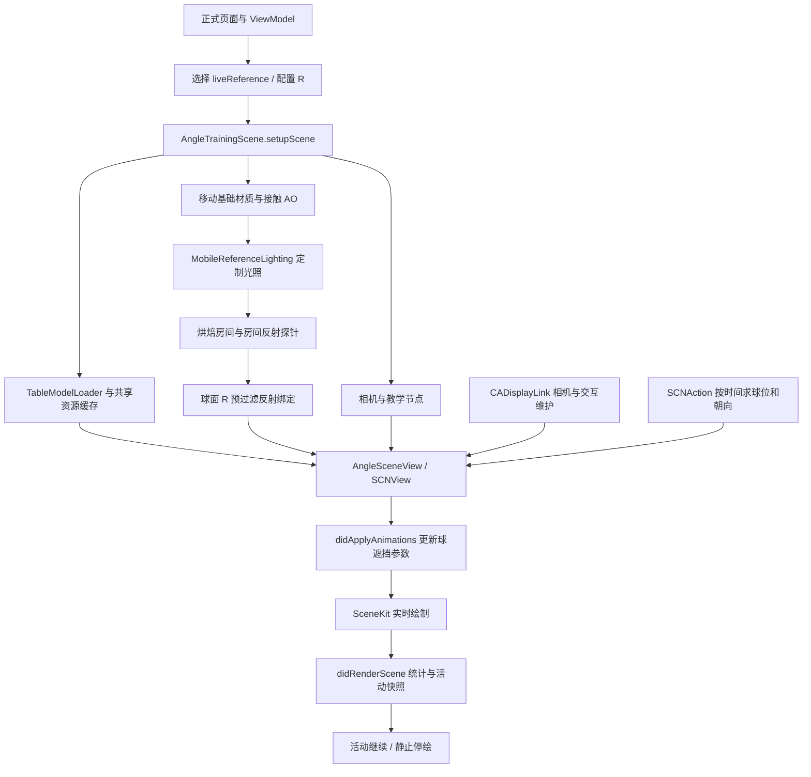

# 3D 渲染现状与既有优化方案核对

核对日期：2026-11-12（北京时间）

对象：球迹 / CuePhys 当前工作区的生产源码、默认资源及既有优化记录

状态：**源码核对与方案盘点；未实施新的渲染优化，未进行本轮真机性能验收。**

## 1. 文档范围、证据和阅读方式

这份文档回答四个问题：现在究竟怎么画、已经优化了什么、哪些方案实际上没有落地、现有证据能够证明到哪一步。它不把旧方案中的目标当作已实现能力，也不把某次独立测试宿主的结果当成当前完整 App 的性能。

本轮以工作区实际文件为准，开始核对时 Git HEAD 为 `259a2116bb084534f9546dd44b5fae72c1b0696a`。工作区存在其他任务的未提交修改，特别是球库跨相机模式交互；**本文并非单纯复述这个提交，也不证明用户手机上安装的二进制与该工作区相同。**

核对方法：

1. 从正式页面入口追踪场景配置、加载、材质覆盖、反射绑定、帧调度和退出释放。
2. 阅读 shader 的实际生成逻辑，而不只读静态字符串、注释或枚举默认值。
3. 搜索所有 `AngleSceneView` 的 `contentIsAnimating` 调用及拟议新架构的关键类型。
4. 对默认与备用 USDZ 计算真实 SHA-256，读取包内 PNG 尺寸，与历史资产报告对照。
5. 将旧性能记录按日期、硬件、宿主、指标和失效边界分别整理。
6. 保存核对前后源码哈希清单；哈希覆盖面不等于逐行人工审阅覆盖面，实际重点审阅文件见末尾索引。

证据目录：[本轮核对证据](../../output/render-audit-20261112/)。本轮没有启动模拟器、安装 App、运行性能测试或修改生产 Swift / USDZ。

本文状态术语：

| 状态 | 含义 |
|---|---|
| 已实现、正常入口启用 | 当前源码的正常调用链会使用；仍可能有资源失败回退和设备条件 |
| 已实现、条件启用 | 只有指定页面、配置或可用资源满足时使用 |
| 诊断 / 候选 | 保留代码或测试宿主，不能当成正式默认方案 |
| 仅方案 | 文档描述了设计与验收目标，生产中未找到对应实现 |
| 历史证据 | 证明当时特定版本和条件，不自动证明今天的完整页面 |

建议先读第 2–4 节理解总貌，再读第 7–10 节理解主要成本，最后读第 16–19 节区分历史结果和后续方案。

## 2. 当前方案的一句话描述与关键结论

**当前是 SceneKit 实时渲染：共享 USDZ 资源和烘焙房间，使用定制双矩形灯光与材质 shader；正常交互页选择 R 球面反射优化，台呢仍保留逐灯光样本的动态球影和高光计算；画面静止时暂停持续驱动，活动时按用户帧率与设备状态绘制。**

需要同时保留以下事实：

- 场景内容集中在一张球桌、球、球杆、房间与教学标注，几何和运动对象数量有限；没有证据支持将其笼统归为大型复杂场景。
- 当前的计算负担不能仅由球数或三角形数判断。台呢占屏面积、每像素灯光积分、球遮挡、材质采样、原生像素规模、4×MSAA、活动帧率共同决定成本。
- 已经做了不少有效的“少做重复工作”：静止停绘、减少材质参数提交、球面反射预过滤、资源预热与复用、贴图与球网格调整。
- **尚未把台呢动态遮挡做成可随球位更新、跨视角复用的空间场。**当前只是减少 CPU 参数提交和片元内部不必要的球测试，台呢光照主体仍在片元阶段运行。
- 当前有 30 / 60 / 120 FPS 设置；默认 60。存在 120 选项，不等于已经达到全流程、长时间、低温升的 120 FPS。
- 不应把“保留今天的视觉效果”与“必须永久保留今天的每一种积分算法”视为同一要求。不过，换算法后的画质与动态稳定性仍需独立验证。

## 3. 当前生产调用链



这张图表达依赖，不意味着 `CADisplayLink` 每次回调都由 App 显式调用一次 Metal 绘制。当前主视图由 `SCNView` 管理绘制；App 的 display link 负责相机、布局、覆盖层、节奏维护等。两者不应被当作完全相同的时钟。

主要入口：

- [AngleTrainingScene.swift](../../QiuJi/Core/Scene/AngleTrainingScene.swift)：`configureReferenceTableRendering`、`configureDailyClearanceRendering`、`setupScene`、`setupCamera`、`refreshRoomReflectionProbe`。
- [AngleSceneView.swift](../../QiuJi/Core/Scene/AngleSceneView.swift)：`makeUIView`、`Coordinator.updateFramePacing`、`renderUpdate`、`FrameDelegate`。
- [MobileReferenceLighting.swift](../../QiuJi/Core/Scene/MobileReferenceLighting.swift)：最终材质及 shader 生成。

## 4. “默认是什么”：需要区分四层配置

### 4.1 渲染配方不是 A / R / S / RS

`TableRenderRecipe` 包含 `liveReference`、`legacyMobile`、`teachingPlain`、`plainLegacy`、`studioLegacy`。这是场景搭建配方，决定移动渲染、参考光照、旧式 / 演示材质等整体选择。

A / R / S / RS 则是 `MobileReferenceLighting.SpecializedProfile`，只控制参考渲染内部的两类专门替换，二者不是同一套枚举。

| Profile | 球面反射 | 台呢动态直接阴影 | 当前定位 |
|---|---|---|---|
| A / `reference` | 原参考反射积分 | 原逐灯光样本球遮挡 | 基础参考、失败回退、诊断基线 |
| R / `reflection` | 预过滤环境 + 响应 LUT + 矩形灯反射近似 | 保留原逐灯光样本路径 | **多数正式交互入口显式选择** |
| S / `shadow` | 原参考反射积分 | 专用解析 / 数值混合阴影近似 | 候选 / 诊断 |
| RS / `combined` | R | S | 候选 / 诊断 |

`renderingProfile` 属性初始来自 `specializedProfile`，后者正常默认 A；但 `configureReferenceTableRendering()` 会显式设为 R。`setupScene(recipe: .liveReference)` 会调用该配置。不能只看属性声明就说正式页面仍是 A。

另一方面，选择了 R 并不保证所有球最终都使用成功的 R shader：预过滤资源生成 / 安装失败会恢复参考球 shader，详见第 9 节。

### 4.2 每日清台的附加配置

`configureDailyClearanceRendering(asynchronousReflection:)` 先调用参考配置，因此正常也是 R，并启用击球感知相机及减少重复相机写入。每日清台在 `FreePlayView` 中传 `asynchronousReflection: true`；普通自由摆球使用参考配置。

Debug 参数可以随后覆盖每日 profile、合并阴影支持域判断、BRDF 因式分解、台呢材质原型、曝光等。这些不是无参数启动时的生产默认值。

默认参考场景曝光设为 `-0.1`。相机搭建内部有更早的默认曝光和 AO 值，随后会被配方覆盖；应以搭建结束后的组合为准。

### 4.3 移动路径也存在前置条件

`setupScene` 实际启用移动路径要求：请求移动渲染、不是增强 studio 路径、移动环境资源存在。`MobileTableRendering.isEnabled` 在 Release 为 true，在 Debug 可通过旧渲染诊断开关关闭。

因此本文描述的“正常 R 路径”以默认 Bundle 资源齐全、无诊断覆盖为前提。缺资源与失败回退需要保留，不能从正常路径反推所有异常状态也相同。

### 4.4 正式页面的调用核对

| 页面 / 共享入口 | 配置与活动信息 |
|---|---|
| 每日清台 / 自由摆球 `FreePlayView` | 每日配置 R + 异步反射；普通自由摆球参考 R；活动覆盖播放、开球运行、每日瞄准拖动、双视角相机过渡 |
| 共享教学壳 `BTTeachingTablePage` | 场景由对应 VM 配置；活动覆盖旋转 / 瞄准 / 力度触摸、拖球、相机过渡、规划动画 |
| 动作场景 `DrillSceneView` | `liveReference`；传入 `controller.isPlaying` |
| `AimPointSceneTrainingView` | 参考配置；传入 `vm.cameraTransitionBusy` |
| `SceneAimingView` | 参考配置；传入 `vm.cameraTransitionBusy` |
| `BallExtractionView` | VM 使用 `liveReference`；传入 false，手势等由协调器补足 |
| `BatchBallExtractionView` | 传入 false，交互仍能唤醒 |
| `BatchAuthoringView` | 参考配置；传入序列忙碌及瞄准 / 力度 / 旋转触摸状态 |

核对到的直接 `AngleSceneView` 调用共 8 处，**目前均显式传入 `contentIsAnimating`**。共享壳背后的分离角、两球、准度、三球、解球、袋口、走位等 VM 也有各自参考配置入口；共享壳不替代这些场景初始化责任。

这纠正了 10 月 11 日报告中三个入口尚未接活动状态的旧结论。参数接入仅证明代码已补齐，不能代替所有页面的真机静止采样。

## 5. 模型、贴图和场景初始化

### 5.1 当前真实选择的资源

[ModelAssetTrial.swift](../../QiuJi/Core/Scene/ModelAssetTrial.swift) 的 `enabled = true`。正常优先使用 `ModelTrial20261010_` 前缀的球桌与球杆；备用原件保留。`modelAssetTrialUseOriginal` UserDefaults 可以切回原件，这个选择器本身没有被 `#if DEBUG` 包住；候选缺失时也会退回原件。

本轮实际读取文件所得 SHA 与代码中的身份表相同：

| 文件 | SHA-256 | 本轮文件大小 |
|---|---|---:|
| `ModelTrial20261010_TaiQiuZhuo.usdz` | `73e43df002f07637656b767fdc105033d10f0d764f6d91aa7a5276cf1c885fb6` | 119,558,458 字节 |
| `ModelTrial20261010_CueUV.usdz` | `9288907e666d897e4f3be5b94e7ec989eb5a75116f74a07d3790e4340f2e117e` | 1,239,924 字节 |
| `TaiQiuZhuo.usdz` | `40b546a554257897c7df78df540b36b0ea3f1f2a3fc592c5d67306b3c632942b` | 109,310,081 字节 |
| `CueStyles/CueUV.usdz` | `ad24d3696bc78a02cb3a08a9c09af5f04c657a79404754d8b555c744ba429e7f` | 666,941 字节 |

代码中的 SHA 是人工维护的资源身份，不是在 App 每次运行时对整个文件重新哈希。本轮单独实际计算，验证了其一致性。

### 5.2 球网格的现状

默认球桌中 16 球各 2,880 个三角形，来自 10 月 20 日资产调整；备用原件各 720 个。2,880 的比较基线是调整前候选的 6,480，而不是备用的 720。

历史专项校验记录：16 球三角形合计由 103,680 减为 46,080，减少 55.56%；整包场景三角形由 388,569 变为 330,969。当前包 SHA 与该专项一致，因此资产身份没有漂移；本轮没有再次启动 SceneKit 逐网格计数。

这些数字的含义是资产几何量，**不是一帧实际提交 / 可见 / 着色的三角形统计，更不是 FPS 提升比例**。当前资源包还包含不一定全部同时可见的内容。

### 5.3 木纹贴图的现状

本轮直接读取默认 USDZ 中 PNG 头，确认以下五张仍为 1024×1024：

- `Wood_basecolor`、`Wood_roughness`、`Wood_normal`；
- `BlackWood_basecolor`、`BlackWood_roughness`。

不要把这件事推广成“全部贴图已经缩成 1024”。例如 `White_Wood` 底色和粗糙度仍为 2048；部分常量法线已为 1×1。球、台呢、皮革、球杆是各自的资源与处理链。

10 月 14 日当时包体 122.31→109.09 MiB 的记录属于当时的资产版本。之后改过颗星和球网格，今天应使用上表实际字节数，不能继续把 109.09 MiB 当作当前包体。

### 5.4 加载和隔离

`TableModelLoader` 先缓存资产原型，再提取球桌、球、球杆等组件；各场景取得自己的节点与必要的 geometry / material 容器，底层只读图像、几何缓冲等尽量复用。

加载时清理导入的相机、灯和物理体。台球运动由项目自己的物理与回放系统驱动，不是再启动一套 USDZ 导入的 SceneKit 物理模拟。

可重用的球桌缓存只保存相对静态的球桌节点、外观、台呢绑定、颗星等。球位、相机、交互状态仍由场景独立拥有；并不是把一个含上局状态的完整场景直接交给下一个页面。

预热准备模型与外观资源，不等于提前完成了所有 GPU shader 编译、反射捕获、完整页面布局和首帧绘制。

## 6. 灯光、环境和最终材质

### 6.1 固定双矩形灯

`MobileReferenceLighting.Rig` 定义两块固定矩形发光面：高度、宽度、深度及位置与当前球桌几何绑定。两灯覆盖场景需要的方向和高光形状；不是随相机移动的灯。

Rig 的亮度校准含一次 CPU 数值积分，shader 中使用生成的灯参数。场景创建对应 `SCNLight.area`，并把先前基础灯的强度设为 0。应把“基础移动照明先配置了一个投影灯”和“最终参考方案真正依靠它产生球影”区分开。

当前关键球影由自定义台呢 shader 的球遮挡产生，不应只从 `shadowMapSize = 1024`、`shadowSampleCount = 8` 等早期基础配置判断当前阴影成本。

### 6.2 材质结果表

| 对象 | 最终主要做法 | 仍然实时计算的内容 |
|---|---|---|
| 球 | `.constant` + 自定义球面 shader，正常绑定 R | 表面法线、球贴图、直接灯光、球面反射方向与粗糙度响应、局部环境近似 |
| 台呢 `TaiNi` | 接触 AO + 自定义面光源 / 球影 / 高光，最终仍为 `.physicallyBased` | 逐片元遮挡、灯光积分、视角相关高光、法线 / 粗糙度与织物响应 |
| 木质部件 | `.constant` + 定制 wood / satin 类 shader | 灯光、高光及纹理响应；较低采样数量 |
| 皮革 / 球杆部分 | 定制 satin 类响应，按材质绑定细法线 / 粗糙度 | 光照、视角响应；并非全部烘焙 |
| 房间墙 / 地 / 顶 | 烘焙纹理 + `.constant` | 几何投影、纹理采样、覆盖像素及合成 |
| 袋口局部 AO | 小型预计算体积纹理 / atlas | 纹理查询与插值 |

**`.constant` 仅表示不使用相同的内建受光模式，不能据此说“没有光照计算”或“几乎免费”。**球与木质部件的自定义 shader 仍然做相当多的运算。

### 6.3 台呢原始 PBR 不能根据代码表面直接删掉

台呢 shader 把主要结果写入 emission，清空 diffuse、设置 metalness、重置 multiply，同时材质仍配置为 `.physicallyBased`。这说明当前是内建管线与自定义修改器组合。

仅凭这些赋值不能严谨地得出“内建 PBR 全部浪费”或“内建 PBR 已完全被优化消除”。SceneKit 最终生成什么 shader、各 pass 实际耗时多少，要看生成程序或 GPU 捕获。历史上直接换 constant 的候选出现过画面变暗；不能把材质枚举替换视为已证明的等价优化。

### 6.4 HDR、曝光与高光压缩

正常相机启用 HDR；移动渲染会把屏幕空间 AO 强度关为 0。HDR 没有因为 SSAO 关闭而关闭。参考配方设置曝光，并在部分材质末端应用高光余量处理。

因此要分别看相机 HDR、材质输出、曝光、片元高光压缩、反射纹理编码。它们处在不同位置，不能统称“开 / 关 HDR”。

## 7. 动态接触 AO：CPU 端已经优化了什么

来源：[MobileTableRendering.swift](../../QiuJi/Core/Scene/MobileTableRendering.swift)，`MobileContactOcclusion`。

### 7.1 每个球提交什么

球列表按稳定 key 排序，额外自定义球按需要扩容，并把容量对齐到 16 的组。每个球形成一个向量，主要包含世界 x / z、相对台面的高度、有效遮挡权重。

- 位置信息读 `presentation`，对齐当前动画呈现位置。
- 隐藏或脱离父节点的球权重为 0。
- 权重受 opacity 和高度过渡影响。
- shader 生成时按容量声明相应球参数。
- 球的自转本身不改变球形遮挡，因此这里只需要中心 / 高度 / 有效性，不需要传球的旋转矩阵。

### 7.2 packed uniform 和脏检查

当前将多组球数据打包成一块不可变数据。只有任一向量变化才重新生成并提交，向每个相关材质做一次参数设置；全部没变则没有这次材质 setter。

这减少了 CPU 端封装、参数提交和重复数据写入。需要注意：

- “静止 0 次 setter”不意味着每次渲染回调连球列表都不检查。
- “一次参数提交”不意味着 GPU 只计算一次阴影。
- 这块数据仍是 shader 每片元读取的输入，尚不是预计算好的二维阴影图或空间可见性场。

更新挂在 `didApplyAnimations` 回调。旧方案提出的 `didApplyConstraints` 后纯快照 + compute 调度并没有替代当前实现。

### 7.3 接触 AO 的计算形态

对每个有效球，台呢片元按水平距离和球高计算一个平滑衰减因子，再累乘。可概括为：

```text
AO_i = 1 - w_i × R² × h_i / (distanceXZ² + h_i²)^(3/2)
AO   = 各 AO_i 的乘积
```

这里是帮助理解的形式，实际还有输入约束及材质组合。它用于球脚附近压暗，不等同于面光源的投影阴影。

该衰减有远端尾部，当前不是超过某个半径就严格为零。后续方案如果只给每个球画一小块 AO 圆斑，需要证明远端贡献处理等价或满足画质标准。

### 7.4 另外两类局部 AO

- 台边 AO 使用小尺寸烘焙纹理，在相应台面高度条件下应用。
- 袋口局部 AO 用预计算体积数据打包到 atlas，再在 shader 中查表 / 插值。

二者都不应和“每个球动态接触 AO”混为一项，也不应与相机的屏幕空间 AO 混淆。

## 8. 台呢直接光照和动态球影：当前核心算法

来源：[MobileReferenceLighting.swift](../../QiuJi/Core/Scene/MobileReferenceLighting.swift)，`directShadowShader`、`clothShader`。

### 8.1 先筛可能影响当前片元的球

当前不是不加区分地在每个片元测试每个球：

1. 计算当前接收点是否落在某球的保守阴影支持域。
2. 生成 `shadowPossible`，用于选择近阴影 / 远离阴影的灯光采样密度。
3. 容量在 1…32 时构造 `uint shadowMask`。
4. 每个灯样本只遍历 mask 中存在的球，使用 `ctz` 按位取出。
5. 超过 mask 容量时保留展开判断路径，而不是把第 33 个球悄悄丢弃。

正常路径仍分别构造“是否可能有阴影”和球 mask 的相关判断；合并支持域判断的代码存在，但每日页面要显式 Debug 参数才开启。

支持域使用球顶高度、灯最低高度和过滤足迹构造保守范围。代码还区分台面以下接收点与台面点的判断，不能把二者随意合并成一个条件。

### 8.2 两档灯光样本数

| 区域 | 每盏灯 | 两盏灯合计 | 含义 |
|---|---:|---:|---|
| `shadowPossible = true` | 8×4 = 32 | 64 | 更密的面光源积分，处理局部球影变化 |
| `shadowPossible = false` | 2×2 = 4 | 8 | 仍计算直接光 / 高光，跳过球遮挡循环 |

这是正常 reference 采样。Debug `balancedRendering` 可修改部分数量，但不是当前默认。

“64 样本”是两灯的合计，不是每盏灯 64。它也不等于整个屏幕的每个像素都固定算 64×16 次完整球相交。

### 8.3 一个灯样本里算什么

对一个接收点及某个矩形灯网格样本，当前依次计算：

1. 灯位置、方向、距离平方、投影关系和该样本代表的面积。
2. 对候选球判断射线与球体附近的遮挡关系。
3. 根据灯样本足迹构造过滤半径，以 `smoothstep` 软化离散采样边界。
4. 多个球的可见性贡献相乘。
5. 用同一个 visibility 加权漫反射积分和 GGX 高光积分。
6. 同时累计不带遮挡的参考光照，供后面归一化。

这里不是 GPU 硬件光追管线，而是 shader 里的解析几何与数值采样。球影无需逐帧捕获一个动态 shadow map，但成本转移到了接收表面片元计算。

### 8.4 最终漫反射并非简单的 64 点求和

shader 中有解析矩形灯漫反射函数 `v62PanelDiffuse`。最终漫反射用解析无挡光照乘以采样得到的遮挡比例，可概括为：

```text
有影漫反射 ≈ 解析矩形灯漫反射 ×（采样有影积分 / 采样无影积分）
高光       = 各灯样本的 BRDF × 该样本 visibility 的加权和
```

高光仍与观察方向有关。把所有样本先平均成一个灰度 visibility，再乘整块高光，一般不会与现有逐样本加权相同，因为被挡住的是具体方向的光。

### 8.5 台呢还有哪些工作

除上述循环外，还包括世界法线和视线方向、粗糙度、接触 AO、贴图采样、织物微弱掠射响应、环境响应拟合及最后的材质输出。当前 normal / roughness 贴图也不能因为底色改为常量就视为消失。

此外，部分 shader 的球半径与台面高度使用当前资产约定的数值，例如 `0.028575` 和 `0.8`。这体现对固定球桌的专门化。以后换球桌制式或几何基准时需要一并审核；本轮没有据此认定当前坐标错误。

### 8.6 S 路径为何不是默认答案

S 不是简单地把同样的循环移出片元。它采用球锥 / 矩形关系、一个方向的解析积分及另一个方向的 8 条 Gauss–Legendre 数值积分，再组合每球遮挡；高光使用较粗的样本。

因此 S 改变了数学近似与遮挡 / 高光的组合方式。历史跑得更快并不自动证明与 R 的台呢视觉一致。当前正常入口选择 R，不能把 S / RS 的实验收益记到生产 R 上。

## 9. 球面反射 R：哪些预计算了，哪些仍按像素算

来源：[RoomReflectionProbe.swift](../../QiuJi/Core/Scene/RoomReflectionProbe.swift)、[PrefilteredReflection.swift](../../QiuJi/Core/Scene/PrefilteredReflection.swift)、`MobileReferenceLighting.filteredBallShader`。

### 9.1 房间反射探针如何产生

探针输入包括房间风格、球桌风格、台呢颜色、颗星、渲染 profile 和相关诊断参数。输入中没有实时球位和相机角度，因此镜头移动、球滚动不会自然触发整套房间探针重建。

探针构建大致为：

1. 从当前场景准备可用于捕获的静态场景副本，复制必要的房间 / 球桌 / 灯光及材质。
2. 不放入动态球，并清除台呢动态接触球数据，避免把某一局球影烘进长期环境。
3. 用 `SCNRenderer` 从固定位置捕获六个方向，每面 128×128；另有台面隐藏后的地面方向捕获，用于下半空间近似。
4. 转成 512×256 的经纬环境图。
5. 对上半空间做 9 项球谐投影及漫反射预卷积，同时取得地面平均辐射等参数。
6. 将线性数据存入 RGBA16Float 纹理并建立 mip。

这是配置变化 / 缓存缺失时的工作，不是每个显示帧都做六次场景截图。

当前捕获图像经过 8 位图像读回再线性化，之后使用半精度纹理存储。因此“纹理格式为 RGBA16Float”不等于“捕获链从头到尾保留了任意高亮 HDR 范围”。本轮未重新评定这条链的视觉误差。

### 9.2 R 的预过滤资源

`PrefilteredReflection` 用 Metal compute 生成：

- 与环境图对应的一组粗糙度 mip，格式 RGBA16Float；各级采用固定采样积分，基础级直接复制。
- 128×128、RG16Float 的 BRDF response LUT；每 texel 使用 256 次积分采样。
- 预过滤 kernel、response kernel、command queue 和 LUT 按 Metal device 缓存。

这里出现 Metal compute 不代表整个主渲染器已经改为 Metal。**当前 compute 用于探针 / LUT 资源准备，主页面仍是 `SCNView`。**

资源生成代码中的 `waitUntilCompleted()` 位于生成阶段，不在每帧球面片元里。它仍可能影响冷启动、样式切换或同步准备的等待，所以需要与持续 GPU 帧成本分开分析。

### 9.3 每个球面片元还在做什么

R 成功安装后，用预过滤环境采样和响应 LUT 替代原来的 64 次球面环境采样循环；同时保留 / 组合：

- 当前表面法线、视线方向与反射方向；
- 由粗糙度选择的环境 mip；
- 两块矩形灯的定制高光反射近似；
- 局部台呢颜色与位置关系、下方地面环境近似；
- 球的基础色 / 号码贴图、球谐环境漫反射、直接面光源漫反射等。

矩形灯反射使用当前实现的 GGX 坡度分布近似，不应描述为完全精确的光线追踪或已经接入 LTC。

`sampledBallShader` 保存了早期参考模板；最终 shader 还会经过解析漫反射替换，再按 profile 替换反射部分。**直接在模板里看到循环，不足以证明 R 的最终程序仍执行该循环。**

球的实际粗糙度也由生成函数按饰面选择，例如当前两种分支使用 0.05 / 0.34；不能把模板中的旧字面值当作最终所有球的参数。

### 9.4 缓存、异步和失败回退

探针缓存有输入 key 和 LRU 容量，当前容量与 3 种房间风格数对应；这不等于每种房间可以无限缓存全部球桌 / 台呢组合。

每日清台正常入口选择异步准备：主线程准备静态副本，串行后台队列生成探针 / 预过滤资源，完成后回主线程，检查场景仍存活、generation 和输入仍匹配才安装。过期结果不能覆盖新样式。

其他没有开启异步准备的场景可能走同步探针获取。缓存命中和冷路径需要分开看，不能把每日的异步选项扩展为“全 App 所有准备工作都在后台”。

若捕获失败，可使用中性探针；若预过滤失败，安装逻辑保留 / 恢复参考球 shader。日志、资源可用性与最终绑定才是判断 R 真正生效的依据，仅有 profile 枚举不足够。

### 9.5 这项优化的边界

R 主要减少球面环境反射的逐片元积分成本。它没有把台呢阴影、台呢 GGX 高光、所有材质、整个房间或整个画面都缓存为一张图片。

历史 R 的收益取决于球占屏面积、参考反射原本占比、测试角度和其他 shader 负担。不能把旧固定视角的收益直接套到所有页面。

## 10. 房间、背景与纹理带宽

[BakedTrainingRoom.swift](../../QiuJi/Core/Scene/BakedTrainingRoom.swift) 加载烘焙房间几何和纹理，房间尺度固定，墙面 / 地面使用 `.constant` 材质，节点不投实时阴影；导入房间也要求不带运行时灯 / 相机。

静态桌影包含在相应地面烘焙内容中，旧独立 ground / table-shadow 节点在这条路径中不再承担同样职责。地毯仍会叠加织纹或图案采样，部分纹理使用较高各向异性设置；天花贴图会在搭建中生成并复用。

这说明房间的主要光照已经前移，但仍存在：

- 可见表面的顶点变换与光栅化；
- 纹理 / mip / 各向异性采样；
- 屏幕覆盖、深度、混合及合成成本；
- 冷加载解码和纹理驻留内存。

**当前不能再笼统写“2D 模式隐藏房间”。**`AngleTrainingScene` 的条件为 3D，或全窗口球桌且未使用屏幕地毯的 2D 场景；部分 2D 页面仍显示 scene floor。房间、屏幕地毯、独立地面节点须按实际页面分开看。

[TableSurfaceTextures.swift](../../QiuJi/Core/Scene/TableSurfaceTextures.swift) 另行缓存皮革细法线 / 粗糙度、木材涂层等数值纹理：按非 sRGB 数值读取，生成 mip；部分单通道数据转 R8 以减少冗余，法线保留需要的通道。转换和同步读回发生在准备阶段，不是每帧全部重新转换。

USDZ 包含的贴图也不一定全部被最终材质继续采样：运行时材质会替换部分通道。缩小这类原始贴图可能主要改善加载和保留容量，而不是同比减少持续 shader 运算。

## 11. 帧调度、静止停绘和温控

### 11.1 当前帧率合同

当前用户可选 30 / 60 / 120，缺省为 60；主 `SCNView` 配置 4×MSAA，未在此路径设置动态降分辨率策略。工程启用了允许 iPhone 高刷新率的配置，但系统、屏幕上限和温控仍会影响实际结果。

`requestedFPS` 的主要限制：

| 状态 | 请求上限 |
|---|---:|
| 正常活动 | 用户选择与屏幕上限的较小值 |
| 低电量模式 | 60 |
| thermal Serious | 60 |
| thermal Critical | 30 |
| 不活动时计算出的数值 | 不超过 30，但实际可完全暂停 |
| 刚经历 Serious / Critical 的 30 秒内 | 额外限制不超过 60，避免温控边界来回跳到 120 |

因此，“闲置目标值 30”不等于“静止时固定每秒仍画 30 帧”。当前 `eventDrivenIdle = true`，不活动时 display link 暂停、`SCNView.isPlaying = false`，`rendersContinuously` 保持 false；场景变化仍可触发必要刷新。

### 11.2 什么算活动

`updateFramePacing` 综合：

- 页面显式传入的播放 / 操作状态；
- 正在进行的手势；
- 相机模式过渡、双视角过渡和阻尼尾段；
- 进入页面的必要帧 / 地毯布局；
- 部分临时俯视状态；
- 最近交互后的 0.5 秒活动窗口；
- 渲染线程完成帧时收集的 actions / animation 活动快照。

若页面未传入 `contentIsAnimating`，nil 会保守视为 true。当前直接调用都已补齐，但该 API 的默认语义依然存在，新增页面不能忘记。

无窗口时暂停绘制驱动。退出时拆卸覆盖层、手势 / display link / delegate，清空 scene 和 pointOfView 等引用，配合资源缓存归还。

### 11.3 为什么还需要 SceneKit 回调中的活动快照

当前避免在主线程任意时机查询动画存储：完成帧的回调在相应图锁保护下读取动作情况，提供快照给主线程判断空闲。这样既能让仍在运动的球继续播放，也避免历史上节点动画退休 / 重置时的并发访问问题。

这是线程与生命周期安排，不等于已经采用后述“单次 update + 纯快照 + compute + render”的新框架。

### 11.4 页面显示的 FPS 到底是什么

`FrameDelegate` 在 SceneKit 绘制完成回调中累计帧数，UI 定期计算读数；诊断还记录输入、唤醒、首次 render、阶段和配置。

这些适合观测“有没有在画、回调是否密集”，但不是直接读取每个 drawable 的实际屏幕 presented time。需要区分：

1. 用户选择 FPS；
2. display link 请求 / 回调频率；
3. SceneKit render 回调频率；
4. GPU command 完成耗时；
5. 实际屏幕呈现间隔。

所以历史的 callbackHz、GPU ms、UI FPS 不应混用。比如 GPU 8 ms 也不能单独证明完整页面稳定 120 FPS；还需要 CPU、调度、同步、合成和持续温控条件。

### 11.5 已降低静态负担，不代表活动期间已降低足够多

当用户一直转镜头、调瞄准或看击球时，活动判断正确地保持绘制。这时节能主要取决于每帧成本与帧数，静止停绘不能替代活动 shader 优化。

同样，主 SceneKit 停绘不表示整个 App CPU 变成零：SwiftUI 动画、HUD、音频、计时器及其他页面任务有自己的生命周期。评估静止负载时仍应看完整页面。

## 12. 相机、临时俯视和瞄准近景

### 12.1 相机方案与渲染材质是不同维度

相机由 `CameraRig` 及双视角 / 曲面相机实现维护，页面选项会影响观察路径、阻尼、模式切换和取景。`configureShotAwareCamera` 不等价于改变光照 profile。

已有减少重复相机属性写入的逻辑。其目的主要是减少不必要的状态变更与重绘触发，不会让仍然变化的视角高光免于计算。

11 月的相机试验和恢复发生在 10 月渲染方案之后。因此旧提案中的相机描述不能当成今天相机行为真源；当前应看 `CameraSurface.swift`、`TwoViewCamera.swift` 与恢复审计记录。

### 12.2 临时俯视有两条不同实现路径

**合并相机控制对应的 overlay 路径：**

- 构造第二个 `SCNView` 和正交相机，主场景有对应的克隆节点。
- 按需要同步节点 presentation 变换和可见属性，关闭事务隐式动画；克隆不重复运行同一套球运动 actions。
- geometry 容器有隔离，部分材质与底层资源共享。
- 该视图本身设为非持续播放，但同步变化仍需要实际绘制；抗锯齿跟随主视图。

因此它不是每帧离屏截图，也不是完全没有第二视角的渲染成本。

**静态图覆盖路径：**

- 使用独立 `SCNRenderer` 获取俯视图片。
- 以激活状态、视口尺寸、可读区域、缩放等条件维护缓存和失效。
- 正常复用静态图片，不保留一个不断运行的截图 renderer。

具体走哪条路径取决于相机 / 页面状态。不能把一个分支的结论扩展到全部临时俯视。

### 12.3 瞄准近景 HUD 不是另一套完整实时 3D 场景

[BTAimCloseupHUD.swift](../../QiuJi/Core/Components/BTAimCloseupHUD.swift) 主要组合缓存台呢底图、Canvas 线条和球面图组件，使用主场景投影来对齐内容。

台呢底图由 `TableFigureRenderer.closeupFelt` 按样式生成：取无球的一块台呢，使用参考配方、固定图像尺寸及 MSAA，之后缓存为图片。它并非每帧重新绘制整张球桌。

但 HUD 可见时有 `TimelineView(.animation(minimumInterval: 1/60, paused: !isVisible))`。这意味着：

- 它仍可能以约 60 Hz 更新自己的呈现逻辑；
- 主视图选 120 不代表 HUD 内所有内容也按 120 更新；
- 主场景停绘与 HUD 停止刷新是两个不同问题。

这只是代码调度事实，本轮没有测量 HUD 的实际 CPU / 合成开销。

### 12.4 其他静态图和导出

教学插图、球面图、缩略图、视频 / 静帧导出也使用 `SCNRenderer` 或图片缓存。这些能力出现在生产源码里，不代表正常 3D 页面每一帧都调用全部 renderer。归因时必须从真实页面调用链筛选，不能只统计全仓 `SCNRenderer` 的出现次数。

## 13. 物理、轨迹与渲染之间的分工

当前不能把“完整台球物理每帧都重新求解”作为渲染负担的默认解释。

以 `PositionPlayViewModel` 为例：

1. 输入变化可触发实时预览，存在约 1/15 秒的预览节流及取消 / 代际控制。
2. 重的预测 / 求解在专用串行队列中运行；完成后回主线程更新状态。
3. 接受击球后使用求得的 recorder / prediction，先播出杆，再给各球安装 `SCNAction`。
4. `TrajectoryPlayback.action` 的 `customAction` 按当前播放时间向 `stateAt` 求球位；事件间可使用解析运动求值，而不是把稀疏事件点简单线性连接。
5. 球朝向按角速度逐帧积分；进袋包含空间收集尾段及相应呈现，旧记录仍有兼容分支。
6. 播到自然停止，不以感知速度阈值提前冻结后再瞬移到终点。

所以，活动帧仍有球位求值、姿态积分、SceneKit action、相机 / UI 和遮挡参数维护，但不等于每帧重算完整碰撞预测。

开球、不同练习 VM、不同轨迹类型各有分支，不能拿这一条链代替全仓物理验收。本轮只确认分工与与渲染有关的入口，没有改变、重验物理正确性或训练评分。

## 14. 资源缓存、预热与退出行为

### 14.1 当前缓存保存的对象层次

| 层次 | 主要内容 | 生命周期要点 |
|---|---|---|
| 模型原型 | USDZ 解析与提取后的可复用资源 | 按资产身份复用，防止重复解析 |
| 外观资源 | 球贴图 / UV、球杆 / 球桌外观、数值纹理 | 预热与按需缓存；共享只读内容 |
| 可复用静态球桌 | 已准备的 table node 与绑定 | 当前共享缓存保留一个脱离场景的桌；不带当前球局 / 相机 |
| 房间探针 | 环境图、SH、预过滤资源 | 按输入 key 缓存，LRU / 闲置裁剪 |
| 派生图片 | 教学底图、缩略图、教程图、近景等 | 容量 / 字节限制，闲置或压力时清理 |
| 设备级预计算 | 反射 kernel、queue、BRDF LUT | `PrefilteredReflection` 的静态缓存，不应假定随房间 cache reset 全部消失 |

### 14.2 前台 30 秒不再等于全部释放

`TableResourceCache.shared` 设置 `retainsForegroundHotSet: true`。活跃场景归零并达到闲置期限时，当前主要清掉派生图片、将房间探针裁为最近使用的一个，**保留前台热模型 / 外观及一个可重用球桌**，方便再次进入。

旧式“不保留热集合”的实例才会在到期时完整走 purge。不能根据 `idleLifetime = 30` 单个字段断言正式共享缓存 30 秒后清空全部资源。

这是明确的内存与二次打开速度权衡。页面对象已析构与热资源仍驻留可以同时成立，不应直接判为页面泄漏。

### 14.3 预热和并发保护

首页可见及后续入口调用 `warmForEntry`。它按当前资产 / 球 / 杆 / 桌外观合并请求，串行后台准备，使用取消 token 和 generation 防止旧任务回填。

页面同时使用场景时，通过所有权 / 活跃计数管理；不会因一个页面退出就任意销毁另一个仍借用的资源。重用桌按资产与渲染配置等 key 匹配，防止不同 recipe 串用。

### 14.4 内存警告和后台

内存警告 / 进入后台会触发 purge：使所有权代际失效、取消预热并等待当前 CPU 准备阶段结束、清理闲置桌与共享缓存等；前台再按需求预热。

这仍不能保证进程 footprint 立即回到零或完全回到初始值：活跃场景持有的对象、GPU / 驱动分配器和设备级缓存都有独立存活条件。本轮没有重新做堆对象 / 内存压力实测。

## 15. 诊断开关和候选代码清单

| 开关 / 能力 | 实际作用 | 默认与边界 |
|---|---|---|
| `-specializedRendering A/R/S/RS` | 参考光照内部 profile 选择 | Debug；后续页面显式配置可能覆盖 |
| `-dailyClearance.rendering A/R/S/RS` | 每日专用最终 profile 覆盖 | Debug；正常每日 R |
| `-balancedRendering` | 降低部分参考积分采样 | Debug 预览；不是生产默认 |
| `-daily3D.cameraReference` | 使用相机参考写入行为做对照 | Debug；正常减少冗余写入 |
| `-daily3D.mergeClothSupport` | 合并部分支持域运算 | Debug；正常关闭 |
| `-daily3D.factorClothBRDF` | BRDF 代数整理 | Debug；正常关闭，数学重排不等于 GPU 必然更快 |
| `-dailyClearance.clothPrototype` | 台呢定制材质原型 | Debug、支持性检查、失败保持原路径 |
| `-dailyClearance.exposure` | 在限定范围内改曝光 | Debug 对照，不是自动曝光优化 |
| `-daily3D.diagnostics` | signpost、阶段 / 配置、输入唤醒 / render 记录 | 显式进程参数；不会自行改变球局或帧策略 |
| `modelAssetTrialUseOriginal` | 切回备用 USDZ | 选择器不限 Debug；正常默认选候选资源 |

这些机制提供对照和回退能力。存在开关、测试或 shader 生成函数，只能证明候选可被调用；是否正常启动会走、是否已验收、是否保持画质是三件不同的事。

## 16. 已有优化与历史性能证据

### 16.1 不能合并成一个“总提升百分比”

这些实验涉及不同资产、系统、相机、宿主和阶段。CPU wall time、GPU 命令跨度、footprint、实际呈现率也不是同一个指标。下面按原报告口径整理，收益不能逐项相加。

| 时间 / 项目 | 记录中的结果 | 可以证明什么 | 不能证明什么 |
|---|---|---|---|
| 9 月 21 日 packed 球参数 | 3D CPU wall 2.449→2.225 ms/帧，−9.15%；2D −7.28% | 当时减少提交与封装的 CPU 收益 | 同期 GPU 未改善，不能说 GPU / 功耗也下降 9.15% |
| 9 月 21 日移除直接球影 | 配对基线约 15.901→12.131 ms，−23.71% | 当时直接球影是可测的 GPU 成本来源 | 删除效果的消融差不等于可无损回收的收益 |
| 同期移除整套球 shader 修改器 | 约 −19.92%，基线漂移约 10.42% | 球自定义着色也有明显成本 | 不只删除反射；不能说“64 次反射独占 19.92%” |
| 9 月 22 日 A / R / S / RS 无线对照 | GPU 命令跨度配对中位减少 R 13.639%、S 8.423%、RS 22.835% | 当时固定 3D 对照中候选有效 | 不等于今天完整页面收益；S / RS 不是当前正式默认 |
| 同日正常 SCNView 击球阶段 | 两杆回调约 37.89 / 38.16 Hz；四段静止各 3 秒均 0 绘制 | 当时静止停绘生效，但运动回调未达到 60 | 不是实际屏幕 presented 统计，也不能外推当前版本 |
| 10 月 10 日模型无线六轮 A/B | 建场景 3.32→2.78 秒；结束内存 1409.91→1333.05 MiB；CPU 18.77→21.80% | 当时模型候选改善加载和部分内存 | 未获得 CPU 收益；GPU 与长时温升数据不满足有效比较 |
| 10 月 14 日五张木纹 2048→1024 | 模拟器首页闲置 footprint 636.11→487.13 MiB；采样峰值 678.24→528.90 MiB | 当时同源码单轮流程下资源容量 / 内存改善 | 不是真机 GPU / 温升 / 耗电证据，不是未来所有页面固定减少 149 MiB |
| 10 月 20 日球 6480→2880 面 | 16 球面数 −55.56%；5 项专项验证通过 | 默认资源已替换且当时构建 / 资源 / 原生图检查通过 | 没有这轮真机性能收益证明，不可按面数比例宣称提速 |

对应记录：

- [9 月 21 日渲染跟进](../../tasks/DAILY-CLEARANCE-RENDER-FOLLOWUP-20260921.md)
- [9 月 22 日唤醒、候选与真机记录](../../tasks/DAILY-CLEARANCE-RESUME-20260922.md)
- [10 月 10 日模型真机评估](../../tasks/MODEL-PERFORMANCE-DEVICE-20261010.md)
- [10 月 14 日木纹分辨率报告](../../output/table-resolution-20261014/REPORT.md)
- [10 月 20 日球网格记录](../../tasks/BALL-MESH-2880-20261020.md)

### 16.2 10 月 11 日更接近当前 R 的分项实验

这批使用 iPhone 16 Pro / A18 Pro、报告记载的 iOS 27.0.1、生产渲染源码及模型候选的独立诊断宿主。固定 16 球、全桌镜头、2622×1206、4×MSAA、目标 60 FPS；**不含完整 SwiftUI 页面和击球求解 / 连续预测**。r2 有 22 个窗口、2054 个 GPU 样本，起止 Nominal，配对基线漂移较小。

| 消融项 | 报告中的 GPU 命令跨度变化 | 解读 |
|---|---:|---|
| 去掉台呢内建 PBR 部分 | 约 −6.1% | 该组合仍有成本；不证明可无损直接删除 |
| 关闭整套台呢着色 | 两次约 −11.8% / −16.4% | 台呢整套着色有可测成本；这是改变效果的消融，不是已交付优化 |
| 去掉直接球影 | 约 −12.5% / −11.8% | 当前 R 下球影仍值得关注 |
| 去掉当前 R 球面反射 | 约 −0.9% | 在该远景球面积下，已优化反射的剩余占比小 |
| 去掉接触阴影 | 约 −2.1% | 与直接球影不是同一项 |
| MSAA 4×→1× | 约 −12.3% | 降画质消融，未采用为正式方案 |
| 宽高各缩至 75% | 约 −12.8% | 降画面像素规模消融，未采用；不能与贴图降分辨率混淆 |

这些结果比“整个场景只十几个球”更能说明实际成本，但仍不能用差值相加还原精确流水线占比。GPU 并行、编译器、带宽和遮挡都会改变消融后的行为。

详见 [10 月 11 日计算分工评估](20261011-渲染计算分工与参数评估.md)。

### 16.3 无损支持域候选：短测好，持续证据未闭环

`support-full-height` 候选保留原 R 的灯光采样，在确认无原球影贡献的保守范围外跳过遮挡循环。

- r5：静态球架约 −7.5%～−7.8%，散台约 −19.7%～−20.0%；已测静帧逐像素一致。
- r6：动态夹具把球心高度与台呢高度混淆，相关动态 / 持续结论撤回。
- r7：修正后 50 个抽样时刻对照一致；真实轨迹短测均值约 −10.73%。抽样一致不等于全部连续帧已验收。
- r8：每循环 720 帧，其中 480 帧真实轨迹、240 帧人工边界，取双方共同四循环各 2880 帧比较。

| r8 部分 | 原 R | 候选 | 变化 |
|---|---:|---:|---:|
| 全循环 | 14.300 ms | 13.702 ms | −4.18% |
| 真实轨迹段 | 11.213 ms | 13.059 ms | +16.47% |
| 人工边界段 | 20.476 ms | 14.989 ms | −26.80% |

候选先运行约 120 秒结束于 Fair；间隔约 88 秒后原 R 约 54.46 秒触发 Serious。内部温度并未确认相同，有顺序与余热混杂。因此不能据此说候选让温升时间翻倍，也不能直接断定真实段变慢必然由算法本身造成。

最终处置为保留候选、暂不正式采用，正常配置维持 R + 4×MSAA。本轮没有把它重新启用。

### 16.4 120 FPS 曾经达到过什么程度

历史 S331 在当时场景测得实际呈现平均 119.84 FPS、间隔 P95 8.335 ms，证明当时短时接近 120 是可能的。另一些持续轮次进入 Serious，未通过长期条件；其中 USB / 先前负载会影响热状态解释。

这个证据与“今天完整页面已稳定 120”相距至少三层：版本 / 场景不同、完整交互链不同、持续热条件不同。不能继续用一个短测峰值作为完成声明。

还有一个重要反例：该历史高帧率结果同时存在超过 8.33 ms 的 GPU 命令跨度统计，说明跨帧流水重叠与指标定义必须认真区分。不要对某个 GPU span 直接取倒数来推算最高 FPS。

来源：[同画质稳定 120 FPS 与温升分析](20261011-同画质稳定120FPS与温升分析.md)。

### 16.5 已经试过但不应继续宣传为确定收益的方向

- 合并支持域判断：历史约 −1.30% / −0.14%，收益小且不稳定。
- 把球相对向量 / 距离平方提前到循环外：已测图相同，却出现约 +16.17% / +22.84% 耗时；不能以“算式少了”保证更快，寄存器压力等解释仍需证据。
- 台呢直接 PBR→constant：曾出现变暗与纤维响应损失，不是已验收的同画质替换。
- 降 MSAA、降像素、减少采样：可作诊断或另立画质档位，但不满足旧方案的原生分辨率 / 4×MSAA / 同画质目标。
- 拿模型包变小、静态内存变低来证明持续 120 或省电：指标之间没有这样的直接换算。

## 17. 既有但尚未实施的方案

### 17.1 10 月 1 日代码级优化方案

[保持画面与物理行为的代码优化方案](../../tasks/RENDER-CODE-OPTIMIZATION-PLAN-20261001.md) 主要围绕不改物理、画面和公式的代码组织、相机重复写入、更新节奏及相关维护成本。

它是一个工作计划，不能因今天已看到部分相似优化就宣称整个 S0–S4 批次完成。当前已经存在的措施在前文逐项归属；未找到完成记录 / 当前实现证据的部分不记作交付收益。

### 17.2 10 月 2 日研究与 10 月 11 日方案的关系

[渲染引擎研究](20261002-render-engine/BRIEF.md) 讨论过引擎、架构、光照 / 遮挡表示等选择，包含更广的候选方向。后来的 [同画质 120 FPS 实施方案](20261011-同画质120FPS实施方案.md) 把首条路线收敛为四层职责、世界空间可见度场及同帧调度。

10 月 11 日后续执行口径明确为直接制作候选、验证随实现推进，**不要求先重做一次完整成本定位才允许开始**。这份盘点没有把旧提案中的“先全面研究”恢复为新的前置审批。

### 17.3 四层分工的含义

| 层 | 输入与输出 | 应在何时更新 | 当前实现状态 |
|---|---|---|---|
| 静态照明 | 房间 / 灯 / 固定几何 / 反射资源 | 有关配置变化 | 已有烘焙房间、探针与 R，但没有该方案统一状态层 |
| 空间遮挡 | 实际球态 + 接收几何 → 世界空间逐灯样本可见度 | 球位 / 高度 / 显隐 / 灯 / 接收面变化 | **拟议字段未实现**；当前仍直接片元求值 |
| 视角材质 | 法线 / 粗糙度 / 视线 / 可见度 → 表面颜色 | 当前可见帧按需要 | 当前 shader 已有这些计算，尚未接拟议字段 |
| 投影合成 | 相机 / 可见几何 / 表面输出 → 屏幕 | 相机、球态或其他可见内容变化 | 当前 SCNView；拟议受控宿主未实现 |

这个分层抓住了一个明确依赖：**球不动而镜头移动时，球对固定灯的空间遮挡不因镜头改变。**可见性理论上可以复用，视角高光和几何投影仍必须变化。

但“依赖拆分合理”和“某个字段尺寸 / 编码就是最佳实现”需要分别判断；设计没有证明后者。

### 17.4 首版字段保存的不是一张最终颜色图

提案保存两灯共 64 个近档灯样本的 visibility，而不是一张灰度平均影子，更不是把整张台呢的最终颜色烘死。

原因是当前漫反射与高光都使用方向相关的可见性权重。片元仍按当前法线和视线计算材质，再读取对应灯样本可见度。远档保持原 2×2 / 灯，visibility 为 1，不从 64 个近档样本随意平均出 8 个远档样本。

首版数据规模：

```text
256 × 128 个格点 × 64 个分量 × FP16 的 2 字节 = 4 MiB
双份 = 8 MiB
三份 = 12 MiB
```

这些是基础 texel 数据量，不含对齐、有效区标记、球缓冲、临时资源和驱动开销。如果覆盖 2.540×1.270 米台面，格点间距约 10 mm；该尺度没有天然保证贴球、球脚和低视角半影足够精细。

因此字段生成正确、空间插值质量、FP16 量化、实际读取带宽、生成频率和回退占比都需要验收。即使循环变少，新增纹理读写也可能抵消收益。

### 17.5 哪些区域不能直接使用二维字段

提案首版只覆盖几何确认过的平整台面。库顶、袋口、折面、不同高度、无效映射，以及插值邻点跨越无效区的情况继续用当前直接求值。

不能把一切接收面投影到 XZ 平面后就共用同一影子；同一个 XZ、不同 Y 的遮挡可能不同。也不能让袋口空洞参与错误插值。

接触 AO 首版仍保留直接公式，因其远端尾部不具备同样的有限支持域。后续若要缓存，另做等价 / 同画质验证。

### 17.6 更新策略和同帧约束

提案第一版球态变化时完整更新支持区域，球态不变就复用。第二步才加入保守分块 / 候选球表；脏区要覆盖球旧位置与新位置影响的并集，重新计算相关球联合可见度，而不是从相乘遮挡中直接“减掉旧影子”。

拟议后端为 `SCNRenderer + MTKView`：

```text
以本帧时间推进 SceneKit 一次
  → didApplyConstraints 后冻结纯值球快照
  → 在同一受控顺序生成 / 复用空间字段
  → 使用已更新状态执行纯绘制
  → present
```

目的在于保证可见球体与所消费的影场对应同一时刻。不能为了少更新而让球影落后一帧，也不能在尾部再调用包含 update 的 render 接口而推进两次动画。

当前生产没有这条受控链。搜索 `QiuJi/` 未发现 `StaticLightingState`、`OccluderSnapshot`、`ReceiverDescriptor`、`SpatialOcclusionState`、`ViewShadingState`、`RenderUpdateCoordinator`、`SpatialOcclusionField` 或 `MTKView` 的对应接入；再结合当前主宿主与 shader 实际调用链，可以确认该方案尚未落地，而不只是换了名称。

### 17.7 原计划批次与后续项

| 批次 | 计划交付 | 不能冒充完成的情况 |
|---|---|---|
| B1 | 四层接口、版本管理，旧算法做首个对照后端 | 只画架构图、没有实际更新依赖 |
| B2 | 空间字段、支持区域、共享公式、同帧调度、直接回退 | 所有片元都回退，或只加候选球表而无空间结果复用 |
| B3 | 每日清台完整页面接入和活动 / 相机 / 回放闭环 | 独立宿主跑通就宣称完整 App 达标 |
| B4 | 持续训练、跨页面 / 设备、缓存与资源护栏 | 仅短时 FPS 高、未验证温感和生命周期 |

局部 `SCNProgram`、固定机位颜色 / 深度背景复用属于后续独立候选，不是 B2 已包含的收益。球面继续 R、保留物理精度和实时姿态，不通过重复 60 Hz 球位来假装 120 Hz 运动。

### 17.8 既有验收目标，不是当前成绩

10 月 11 日方案保留原生画面尺寸、4×MSAA、现有物理和交互。在支持 120 Hz、用户选 120、系统允许的活动区间：

- 实际有效画面呈现平均至少 118 FPS，间隔 P95≤9 ms，超过 12.5 ms 比例≤1%，另报 P99 / 最长帧 / 连续失约。
- GPU P95≤6 ms / P99≤7.5 ms、CPU 更新提交 P95≤3 ms 是初始内部余量目标；不简单相加，不取命令跨度倒数当 FPS。
- 20 分钟代表性训练，最后 5 分钟动态仍满足；未充电、条件可比、无明显烫手感，不进入 Serious / Critical。出现严重发热则停止并保留失败。
- 新增资产≤8 MiB，新增 GPU 纹理 / 目标≤16 MiB；暖机进程内存增量≤32 MiB 且≤基线 10%；进入可交互 P95 增量≤100 ms。
- 进入退出 20 次，稳定后末 5 次无阶梯增长；同 60 FPS 能耗对照也有护栏，最终 120 单独验收。

上述目标均不能由本轮静态源码核对宣布通过。热保护降至 60 是保护生效，同时意味着对应 120 持续目标未通过。

## 18. 旧描述需要纠正或收窄的地方

| 容易沿用的说法 | 当前核对后的准确说法 |
|---|---|
| 默认是 A，因为枚举默认 A | 场景初值 A；多数正式入口明确设 R，失败时球反射可退 A |
| 反射优化已经解决整套光照 | R 主要替换球面环境积分，台呢逐样本球影仍在 |
| 每个台呢像素永远做 64×16 次球测试 | 有支持域、mask、近 64 / 远 8 样本分支；实际取决于片元与球态 |
| 所有直接光都是纯采样积分 | 最终漫反射使用解析矩形灯项及采样遮挡比例；高光仍样本加权 |
| `.constant` 都是无成本烘焙材质 | 房间与自定义球 / 木材不同，后者仍有实时 shader |
| 静止仍固定画 30 帧 | 当前可停 display link / SceneKit 持续播放；变化时唤醒 |
| 三个旧入口仍未接活动状态 | 当前 8 个直接调用均有显式参数，旧清单已过时 |
| 2D 就是一张廉价图片 | 主 2D 通常仍是同一 SceneKit 场景的正交观察；某些覆盖层才是图片 |
| 2D 总隐藏房间 | 当前有保留 scene floor 的页面条件 |
| 临时俯视每帧截图 | 存在第二 SCNView 同步路径，也存在缓存静态图路径 |
| 近景是第二套完整实时 3D | 当前主要是缓存底图 / 球面图 / Canvas，但仍有自身刷新 |
| 物理每个显示帧重算整杆 | 求解与回放分工；每帧按时间求呈现状态 |
| 30 秒后全部缓存消失 | 当前前台共享缓存保留热集合与一个桌，压力 / 后台另行清理 |
| 当前默认球还是 6480 面 | 默认 2880；备用 720；资源 SHA 已实际核对 |
| 当前包仍是 109.09 MiB | 那是 10 月 14 日当时值；今天默认桌 119,558,458 字节 |
| 四层空间阴影方案已经部分投产，所以能算预期收益 | 已有静态资源可复用，但拟议空间字段 / 受控宿主未实现，不能记其收益 |
| 旧实验 119.84 FPS 证明现在稳定 120 | 它是当时短测；完整现版本与持续热验收仍缺 |

## 19. 对“我们有没有抓住渲染要求本质”的当前判断

从源码能确认，我们已经围绕固定台球场景做了专门化，而不是完全照搬通用默认渲染器：固定灯、解析几何球影、预过滤反射、烘焙房间和按需停绘都是证据。

现有方案也仍有一个明显未完成的方向：**一些不依赖相机的遮挡计算，仍随着屏幕片元和显示帧重复执行。**四层方案试图处理这个依赖错位，这是有具体代码依据的。

但现有资料还不足以认定“只要做 64 通道字段就抓住了全部本质”。该表示是在尽量保留当前光照积分结果的约束下提出的。它可能是可行过渡，也可能因插值精度、带宽、回退区域和维护成本而需要调整。

产品真正需要维持的观察结果，至少应分清：球缘与球号清晰、球与台面 / 袋口空间关系可信、阴影不漂移或闪烁、镜头视差与操作响应正确、球滚动和减速连续、长时间使用的帧节奏与温感。旧方案明确要求同画质与物理不变，本文不擅自放宽。

哪些公式必须精确保留，哪些近似可以替换，最终应由这些观察结果和可复现对照决定。不能只用“十几个球应该很便宜”否定当前成本，也不能因为当前 shader 昂贵，就把每一项计算都视为产品必不可少。

### 当前尚未由证据回答的问题

1. 当前工作区构建出的完整每日页面，在选 120 时，转镜头 / 瞄准 / 真击球分别受 CPU、GPU 哪一段限制？旧诊断结果不能替代。
2. 最新 2880 球网格、当前近景 HUD / 临时俯视、相机和页面逻辑组合后的持续表现怎样？
3. 当前各设备真正的 presented frame pacing、触控到可见响应、20 分钟温感和功耗是多少？
4. 台呢最终生成程序里内建材质部分还剩哪些可见贡献和实际成本？
5. 64 通道世界字段在近景精度、生成 + 读取总成本和回退占比上能否胜过直接算法？
6. 若不固定旧积分形式，是否存在更简单、视觉等价的专门表示？当前没有已验收答案。

这些是下一轮实现 / 验证应解决的问题，并非本轮新增一套需要用户先批准的工作流程。本轮交付是把事实、候选与目标分开，供后续明确优化方向。

## 20. 源码与记录索引

### 20.1 重点核对的生产源码

以下行号用于定位本次快照；文件后续变动时以符号名为准。每个文件只列与本主题相关部分，不代表对所有业务逻辑做过全面审查。

| 源码 | 关键位置 / 本轮核对内容 |
|---|---|
| [AngleTrainingScene.swift](../../QiuJi/Core/Scene/AngleTrainingScene.swift) | L8 配方；L58 / L80 正常与每日配置；L341 建场景；L914 相机；L1225 探针；L1418 临时场景克隆 |
| [AngleSceneView.swift](../../QiuJi/Core/Scene/AngleSceneView.swift) | L151 帧率规则；L156 SCNView；L439 第二视图；L675 静态俯视；L1181 节奏；L1374 更新；L2358 附近 FrameDelegate |
| [MobileTableRendering.swift](../../QiuJi/Core/Scene/MobileTableRendering.swift) | L40 基础照明；L152 接触 AO；L244 / L260 动画后参数更新；L301 袋口 AO |
| [MobileReferenceLighting.swift](../../QiuJi/Core/Scene/MobileReferenceLighting.swift) | L29 Rig；L166 profile；L182 R shader；L281 球材质；L306 场景灯光；L363 台呢；L401 阴影；L635 解析漫反射；L896 台呢模板 |
| [RoomReflectionProbe.swift](../../QiuJi/Core/Scene/RoomReflectionProbe.swift) | 探针纹理 / SH、L234 安装回退、L291 输入、L325 同步 / L366 异步、L422 / L486 捕获 |
| [PrefilteredReflection.swift](../../QiuJi/Core/Scene/PrefilteredReflection.swift) | L29 pipeline / LUT 缓存；L56 附近每探针资源；L92 compute kernels |
| [BakedTrainingRoom.swift](../../QiuJi/Core/Scene/BakedTrainingRoom.swift) | 烘焙房间、floor / ceiling、纹理与缓存 |
| [TableSurfaceTextures.swift](../../QiuJi/Core/Scene/TableSurfaceTextures.swift) | 数值纹理、R8 转换、mip、材质绑定 |
| [TableModelLoader.swift](../../QiuJi/Core/Scene/TableModelLoader.swift) | L77 预热；L130 加载；L436 导入物理 / 相机灯清理；L464 缓存；L550 闲置；L567 预热；L612 purge |
| [ModelAssetTrial.swift](../../QiuJi/Core/Scene/ModelAssetTrial.swift) | 默认 / 备用资源、版本身份、原件开关 |
| [Daily3DRenderDiagnostics.swift](../../QiuJi/Core/Scene/Daily3DRenderDiagnostics.swift) | 显式 signpost、配置、输入与首次 render；非实际 present 验收 |
| [BTAimCloseupHUD.swift](../../QiuJi/Core/Components/BTAimCloseupHUD.swift) | 近景底图 / Canvas / TimelineView |
| [TableFigureRenderer.swift](../../QiuJi/Core/Scene/TableFigureRenderer.swift) | 近景底图、静态渲染；缓存最多 8 项 / 24 MiB |
| [BTTableFigure.swift](../../QiuJi/Core/Components/BTTableFigure.swift) | L133 `BTFigureBall` 的球面图组件 |
| [BTTeachingTablePage.swift](../../QiuJi/Core/Components/BTTeachingTablePage.swift) | L805 场景调用；L842 活动状态 |
| [FreePlayView.swift](../../QiuJi/Features/PositionPlay/Views/FreePlayView.swift) | L573 每日异步 R 配置；L868 场景调用；L967 活动状态 |
| [DrillSceneView.swift](../../QiuJi/Core/Scene/DrillSceneView.swift) | L117 liveReference；L925 场景调用 / 活动状态 |
| [PositionPlayViewModel.swift](../../QiuJi/Features/PositionPlay/ViewModels/PositionPlayViewModel.swift) | 预览节流、串行求解队列、L2390 附近击球启动与回放 |
| [TrajectoryPlayback.swift](../../QiuJi/Core/Physics/TrajectoryPlayback.swift) | L515 附近解析回放和 customAction、收集尾段与角速度积分 |
| [TrajectoryRecorder.swift](../../QiuJi/Core/Physics/TrajectoryRecorder.swift) | 事件、空间尾段和按时间查询；未据此宣称所有查询均为二分 |
| [UserPreferences.swift](../../QiuJi/Data/Services/UserPreferences.swift) | L80 帧率枚举；L299 默认 60 |
| [project.yml](../../project.yml) | L41 优化配置；L195 高刷新率开关 |

调用方补充：[AimPointSceneTrainingView](../../QiuJi/Features/AngleTraining/Views/AimPointSceneTrainingView.swift)、[SceneAimingView](../../QiuJi/Features/AngleTraining/Views/SceneAimingView.swift)、[BallExtractionView](../../QiuJi/Features/BallExtraction/Views/BallExtractionView.swift)、[BatchBallExtractionView](../../QiuJi/Features/BatchDrillStudio/BatchBallExtractionView.swift)、[BatchAuthoringView](../../QiuJi/Features/BatchDrillStudio/BatchAuthoringView.swift)。

相机行为真源：[CameraRig](../../QiuJi/Core/Scene/CameraRig.swift)、[CameraSurface](../../QiuJi/Core/Scene/CameraSurface.swift)、[TwoViewCamera](../../QiuJi/Core/Scene/TwoViewCamera.swift)；恢复背景见 [11 月 7 日审计](../../tasks/CAMERA-ORIGINAL-AUDIT-20261107.md)。本轮不重新评价被用户否决的低位混合相机。

### 20.2 历史方案与报告

- [每日清台持续性能 v2](../../tasks/问题集合_每日清台持续性能_v2.md)：早期批次、A / R / S / RS 与验收边界。
- [10 月 1 日代码优化方案](../../tasks/RENDER-CODE-OPTIMIZATION-PLAN-20261001.md)。
- [10 月 2 日架构提案](20261002-render-engine/ARCHITECTURE-PROPOSAL.md) 与 [研究建议](20261002-render-engine/RECOMMENDATION.md)。
- [10 月 11 日分项实测](20261011-渲染计算分工与参数评估.md)、[持续分析](20261011-同画质稳定120FPS与温升分析.md)、[最终实施方案](20261011-同画质120FPS实施方案.md)。三者分别是证据、分析与未实施计划，不可混称“已优化结果”。
- [模型真机评估](../../tasks/MODEL-PERFORMANCE-DEVICE-20261010.md)、[木纹资源报告](../../output/table-resolution-20261014/REPORT.md)、[球网格调整](../../tasks/BALL-MESH-2880-20261020.md)。

### 20.3 本轮检查交付

本轮只建立现状文档及核对证据。已做 / 未做的界限：

- 已做：主调用链与最终 shader 生成静态审阅；正常配置 / 候选 / 回退分类；直接调用方活动参数搜索；拟议架构类型搜索；四个资产真实哈希与木纹图尺寸读取；历史结果口径核对；文档链接与差异格式检查。
- 未做：新 App 构建、单元 / UI 测试、模拟器 / 真机启动、GPU capture、presented frame 采样、温度 / 能耗测量、用户视觉验收。
- 未修改：本任务没有改生产 Swift、资源、物理、渲染参数和用户偏好；已有并行任务修改不归入本任务成果。
- 已保存：[核对前源码清单](../../output/render-audit-20261112/source-before.json)、[核对后源码清单](../../output/render-audit-20261112/source-after.json)、[资源核对](../../output/render-audit-20261112/assets.json)、[文档验证](../../output/render-audit-20261112/validation.json)。

核对前后共 480 个生产 Swift / 工程配置文件的哈希一致；这只说明审阅期间未发生源码漂移，不意味着全仓 480 个文件都经过逐行审查，也不意味着开始时工作区没有未提交修改。
