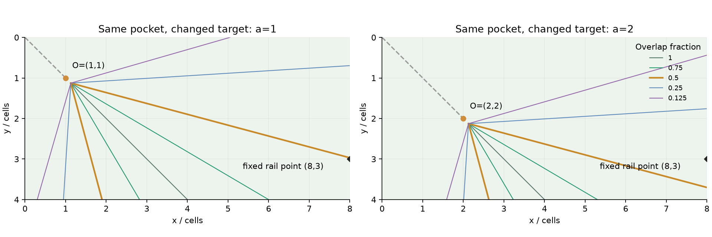
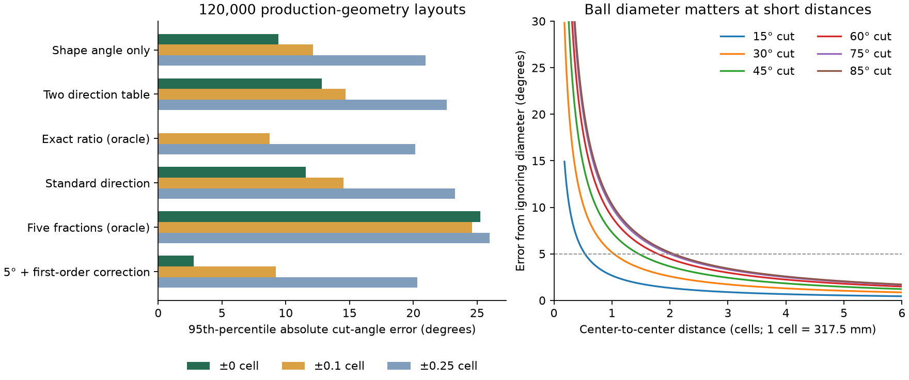

# 台球颗星几何估角与分点瞄准体系：首轮研究

日期：2026-10-20。状态：数学模型、规则筛选、批量仿真和独立实验页已完成；真人实战效果未验证。未接入正式 App、未改变物理参数、未提交或发布。

## 研究结论

**可以建立“方向识别 → 厚薄分区 → 连续微调”的训练体系；当前证据不支持“一套固定颗星口诀，普通球手全台几秒内达到 ±3°～5°”。**

最有希望的起点是**已知标准进球方向，尤其是45°角袋，先判断比半球厚还是薄**。五档分点适合充当视觉锚点，不能直接覆盖所有角度。通用双方向颗星查角的精度不足；准确的距离比例公式又依赖难以目测的投影，不能把数学简单等同于实战简单。

核心证据：

- 主实验共 **240,000 个有效球型**：理想模型、项目几何各120,000；每套模型六袋各20,000。11种实现、0/±0.1/±0.25格三种输入误差，同球型配对比较。
- 项目几何下，精确公式在±0.1格估位扰动后的角误差 MAE **2.99°**、P95 **8.71°**；±0.25格时为 **6.94° / 20.16°**。这说明输入误差本身已是主要限制。
- 五档即使由真值选择最接近的一档，限制在0°～61.045°内，角误差仍为 **MAE 3.93° / P95 8.05°**。全角域更差，因为五档没有61°以上的锚点。
- 已知45°进球方向的专项实验，使用1/4格修正，±0.1格坐标噪声下为 **MAE 1.40° / P95 4.36°**，95.54%的全体样本落在±5°内；但仍有近球极端反例。这是指定合成分布的结果，不是球手达标承诺。
- 最值得真人试验的是“标准方向 + 半球厚薄判断”；最值得保留为解释工具的是等厚度射线。固定颗星点不能充当所有目标球位置的通用半球分界。

入口：[交互实验页](index.html)、[完整统计表](results/metrics.csv)、[运行清单](results/manifest.json)、[专项结果](results/supplement.json)。`index.html`是单文件离线页面，可直接用浏览器打开。

## 1. 坐标与项目真源

研究采用横桌俯视系：左上为(0,0)，x向右、y向下，单位为一格。有效台面严格8×4，所有绘图等比例；外框和控件不计入台面。理想袋口为(0,0)、(8,0)、(0,4)、(8,4)、(4,0)、(4,4)，索引与项目0…5一致。

实际参数由[导出器](export_geometry.py)直接执行当前Swift几何构造函数，输出[geometry.json](geometry.json)，没有手抄另一套库鼻模型：

| 参数 | 当前项目值 | 来源 |
|---|---|---|
| 有效长度/宽度 | 2.540 / 1.270 m | `BTPhysicsConstants.swift` |
| 一格 | 0.3175 m | 有效长度÷8 |
| 球径/半径 | 57.15 / 28.575 mm | `BallPhysics` |
| D | 约0.180000格 | Float导出会保留微小舍入差 |
| 四角袋心 | 世界 X=±1.312，Z=±0.677 m | 生产`TableGeometry+QiuJi` |
| 两中袋心 | 世界 X=0，Z=±0.67596474 m | 当前实测近沿+43mm |
| 直线/圆弧 | 44段/12段 | 当前生产库鼻、jaw与喉壁构造器 |
| 捕获入口 | 各角17点、各中袋13点凸多边形，与深部圆取并集 | 当前实测台呢口沿 |
| 18颗星 | 沿库317.5mm等分，离库鼻约91.6～91.9mm | 已校准USDZ的测量证明，当前资产SHA吻合 |

换算：`x=(X+L/2)/(L/8)`，`y=(Z+W/2)/(L/8)`。SceneKit水平面为X–Z，Y是高度；此研究没有用高度作为平面坐标。归一化Canvas坐标再乘8即为本网格。

核对发现旧注释仍存在“+Z为画面上”“AngleSceneCalculator尺寸已引用常量”等历史描述；当前代码实际上保留同值常量。研究按实际方法、实际值与当前横桌坐标运行，没有因注释改动生产代码。角袋**视觉交互标记**仍有12mm偏移，本研究选生产孔心P；页面明确称“袋心”，不把视觉标记圆心当同一个点。以后做实物实验须先说明“袋口中心”指入口中点还是深部孔心。

**颗星标记不在库鼻上。**把射线与内框边界的交点叫“颗星前方对应点”是可以的，把它直接叫“经过实体颗星的线”则不准确。本轮也单独计算了实体颗星与其库鼻垂足的方向差，保存在专项JSON中。

## 2. 从三个可见点推导精确模型

输入只有母球C、目标球O、袋心P和已知球径D。以下辅助量全部由程序或推导产生，不要求球手观察、输入假想球中心。

设`u=(P−O)/|P−O|`，`n=(−u_y,u_x)`，`C−O=−B u+a n`，`A=|a|`。

目标球按u方向出球时，等径球的中心连线必须平行u。母球在接触瞬间的位置由O沿−u退D得到。因此母球从初始位置到接触时的位移为：

`v = O−C−D u = (B−D)u−a n`。

令`H=B−D`，实际入射方向`e=v/|v|`。于是：

`α = atan2(A,B)`，`θ = atan2(A,H)`。

α是向量`O−C`与`P−O`的夹角，取0…180°；三角形内角`∠COP=180°−α`，不可混用。有效普通直切时θ≥α，只有满球或D趋零等情形才相等。

### 2.1 有效域与不可达

本研究采用正向、一次、无先吃库的理想碰撞：

1. P≠O，C、O球心在半径内缩后的台面矩形内；两球中心距r>D。贴球单列，不能套自由飞行公式。
2. **H>0**，从而0≤θ<90°。H=0且A>0为擦边，法向相对速度为零，理想模型不能把静止目标球推向袋口；H<0会使指定接触位置成为背面的离开交点，而不是先碰到的位置。
3. 接触瞬间的母球中心也必须位于保守合法矩形内。此限制有意排除了部分袋嘴凹区里的特殊合法位置，不宣称覆盖全物理可达域。
4. 实际几何组额外检查母球直线到接触位置、目标球直线到最早捕获入口，在球半径膨胀意义下不碰44条有限线段或12条圆弧。圆弧最小距离用端点、径向候选、段法线候选及交圆点计算，没有把圆弧替换成少量采样点。
5. 到达捕获入口只代表几何进入，不保证随后入袋。速度、台呢摩擦、碰撞抛掷、旋转、弹性、袋口三维接触、其他障碍球、球杆可达性均不在本轮真值中。

理想组的P在矩形边界，视为理想开放点袋；不使用一整条实心边界去封住P。实际组使用真实有限库鼻及入口。两组统计不可理解为同一组球型的真实进球率对照。

### 2.2 分点厚度与接触点

实际运动直线到O的最短距离：`s=D sinθ`。两球沿e方向作等尺度正投影，横向轮廓都是宽D的区间，重叠宽度为D−s：

`f=(D−s)/D=1−sinθ=1−A/√(A²+H²)`。

这是**线性投影宽度比例**，不是圆交叠面积，也不是从任意眼位看到的透视面积。

| f | θ | A:H | 瞄准偏移/R | 接触点投影偏移/R |
|---|---:|---:|---:|---:|
| 满球 | 0° | 0 | 0 | 0 |
| 3/4 | 14.4775° | 1:√15 | 0.5 | 0.25 |
| 1/2 | 30° | 1:√3 | 1 | 0.5 |
| 1/4 | 48.5904° | 3:√7 | 1.5 | 0.75 |
| 1/8 | 61.0450° | 7:√15 | 1.75 | 0.875 |

建立实际入射方向的横轴`n_e=(−e_y,e_x)`。真实表面接触点`K=O−(D/2)u`；其横向投影为`κ=−(D/2)u·n_e`。球杆运动线在经过O且垂直e的参考平面上对应`ξ=−D u·n_e`，即：

**ξ=2κ**。

实验页蓝色十字画ξ，红点画κ。半球瞄准参考在目标球边；比半球更薄时十字落在轮廓外，红色接触点仍在球面投影内。所有横移跟随e建立局部轴，未使用球桌固定x轴替代。此图是几何正投影，不宣称模拟真人眼高、透视和球杆遮挡。

### 2.3 独立验证

对主实验所有240,000球型，另解“母球射线与以O为圆心、D为半径的圆”的二次方程，取**第一个**交点，再从碰撞法线反算θ；与A/H推导最大差约`1.52×10⁻⁷°`。同时核验交点位置，不只核验角度。

12项Python测试通过，包含10,000组随机构造的已知切角、首次接触之前不相交、五档轨迹、局部瞄准偏移、边界拒绝、镜像/旋转/平移不变量、圆弧与线段遮挡、球径上界和1/4格修正上界。另以120个保存球型跨Python/JavaScript核对几何及有效域，并对360组观测×11方法逐项对拍通过。日志在`test-python.log`、`test-js.log`。这是研究几何验证，不是iOS全套回归。

## 3. 规律发现

### 3.1 等厚度轨迹：两条射线，而非一条固定颗星线

固定O、P、f，令`k=tan(arcsin(1−f))`，则：

`|a|=k(B−D)`，`B>D`。

它是局部坐标内的两条射线；满球时两支重合。射线方向固定，但平移位置由O、P决定。其共同起点只是内部构造量，**不是球手输入**。画到台面边界不意味着边缘上球心都合法；实验页将轨迹裁到球半径内缩区域，实际球位仍单独做可达判断。

与“过O的同角度射线”相比，真实等厚度线有一个法向平移量`D sinθ`。半球的平移量恰为**半个球径=一个球半径**。这可作训练解释，但要求球手目测斜向一球半径偏移，仍有认知难度，不能暗中视为已知。

45°角袋、O=(a,a)时，半球浅斜率支为：

`y=(2−√3)x+(√3−1)(a+D/√2)`。

另一支交换x、y。方向斜率约0.267949与3.732051，接近1:4与4:1，**方向近似不能消除截距变化**。在右库x=8处：

- a=1，半球线交于y≈2.96882；
- a=2，交于y≈3.70087。

同一个固定库边点(8,3)，对前者对应约29.76°，对后者约36.55°。所以不能把“右库第三颗星”固化成所有目标球位置的半球线。该点只是射线参照，边界上的C本身不作为合法击球样本。

如果**固定一个练习目标球位**，预先标定一个颗星前方参照点，判断母球在线的厚侧/薄侧是可行的；目标球移动后，参照必须更新。远离分界线才能较稳健地二分类，靠线附近应回答“半球附近，需微调”。

### 3.2 颗星、半颗星、1/4颗星的代价

专项对多目标球位置、六袋和两侧射线进行了边界交点取整。只隔离**半球射线端点取整**的误差，在参照射线长≥1格的组中，12个袋口/左右分层里最差一层的P95如下（不是总体P95）：

| 边界交点取整步长 | 理想模型 | 项目几何 |
|---|---:|---:|
| 1颗星 | 16.63° | 18.21° |
| 半颗星 | 8.38° | 9.36° |
| 1/4颗星 | 4.27° | 4.78° |

即使O/P准确、参照由程序预制，整颗星和半颗星对全台也过粗；1/4颗星还只是勉强控制这一项误差，未加入球心估位和人眼画线误差。短参照线更敏感。精确交点一般为连续实数，不会普遍落在简单分点上。

### 3.3 标准进球方向：用整数线性组合代替旋转投影

若`u=(m,n)/√(m²+n²)`，用**有符号**整数m、n表示0°、26.565°、45°、63.435°、90°，令`dx=Cx−Ox`、`dy=Cy−Oy`：

`tanθ = |m·dy−n·dx| / [−m·dx−n·dy−D√(m²+n²)]`。

分母必须>0。这样可把二维投影改成少量加减、倍数关系；轴向只需一个差值，45°用和与差，1:2/2:1用“一个方向加倍”。方向不符合时强行归档，会引入明显误差；主实验“标准方向近似”已测这一损失。

### 3.4 45°角袋：和差、扣四分之一格

P=(0,0)、O=(a,a)时：

`Δ=|x−y|`，`S=x+y−2a`，`tanθ=Δ/(S−√2D)`。

项目D≈.18，`√2D=.25455844`，可近似为：

**“横竖差作横距，横竖和扣双目标，再扣四分之一格。”**

这里“横/纵距”是缩放后的局部量Δ和`S−.25`，不是台面固定横向/纵向两条实测距离。口诀准确但仍需读三个数x、y、a并做加减；它是待测试的实战候选，不能凭短句就称几秒能算完。

避免反三角函数，可直接比较：

| Δ : (S−.25) | 对应θ | 理想厚度 | 可记忆解释 |
|---|---:|---:|---|
| 0 | 0° | 满球 | 差为零 |
| 1:4 | 14.04° | 75.75% | 约3/4球 |
| 3:5 | 30.96° | 48.55% | 半球附近 |
| 1:1 | 45° | 29.29% | 约三成厚，不能叫精确1/4球 |
| 2:1 | 63.43° | 10.56% | 约一成厚，略薄于1/8球 |

若坚持传统五档，较准确的比例是1:4、3:5、8:7、9:5，分别代替3/4、半球、1/4、1/8；这些比例本身引起的角偏差约−0.44°、+0.96°、+0.22°、−0.10°。后两项不如1:1、2:1易观察，需在真人试验中比较“记忆精确锚点”与“简单比例+微调”。

**只判半球厚薄：比较`5Δ`与`3(S−.25)`。**小于→偏厚，大于→偏薄；接近则保留“半球附近”，不硬分。真实30°边界对应1:√3，这条口诀实际把边界放到约30.96°，应明确承认约1°系统偏移。

取.25代替.254558，在136,627个有效45°样本里产生MAE .0519°、P95 .1489°，但最大9.39°出现在极近球。若H≥.25格，最大观察值降为.3665°，解析上界约.367°。不能因总体误差很小就把近乎贴球情形也放行。

另一个独立81,887样本的45°专项加入噪声；已知目标球在对角线，观察a取两个受扰动目标坐标的均值：

| 每坐标误差 | MAE | P95 | 返回率 | 全体样本±5°内 |
|---|---:|---:|---:|---:|
| 0 | .052° | .149° | 100% | 99.993% |
| ±.1格 | 1.40° | 4.36° | 99.35% | 95.54% |
| ±.25格 | 3.30° | 10.21° | 98.35% | 81.10% |

这相当于利用了“已知标准方向”的先验，不是任意球型通用公式。它未包含把非45°误认成45°的错误；那一项在主实验标准方向法中单独体现。

### 3.5 球直径修正：可记忆的适用距离

令r=|CO|：`θ=atan2(r sinα,r cosα−D)`。忽略球径会偏厚。对给定r且可达的全部α，误差上确界为：

`sup(θ−α)=asin(D/r)`。

故**只控制忽略球径这一项**时：

- r≥2.065格（约65.6cm），其误差不超过5°；可保守记“超过2.1格”。
- r≥3.439格（约109.2cm），其误差不超过3°；可保守记“超过3.5格”。
- r=2格的最坏界仍为5.16°，不能直接说两格就保证5°。

这些界不包括球型角估计、袋心识别、出杆或抛掷误差，不能转成总精度保证。小角度的实际修正通常更小。

一个可用的新候选是远距一阶修正：

`θ≈α+(D/r)sinα`（弧度），即`θ≈α+10.31°·sinα/r格`。

简化版取10°、把α估到5°、sinα取0/.25/.5/.75/.875/1六档。它在精确输入条件下的P95约2.78°，但这个数字假设**球手已经能把α估准到5°量级**，而不是证明颗星教会了这项能力。加入±.1格噪声后P95约9.21°，所以仅作已有估角能力者的修正法，不是本研究的通用解。

### 3.6 六袋统一与中袋差异

角袋之间用x→8−x、y→4−y镜像，距离、θ、f不变，切侧符号可能反转。中袋也用相同u、A、B公式，先把P平移为局部原点再选标准方向即可。旋转是局部坐标变换，不能把8×4桌旋成仍按原宽高解释的8×4全局桌。

**向量公式统一，参照点表不统一。**中袋位于长库中点，局部可用方向、边界截取及真实袋角入口与角袋不同；真实几何中浅角中袋路径常先碰袋鼻。需要单独训练中袋入口与方向识别，不能把角袋的固定颗星编号照搬过去。

## 4. 仿真设计与比较

### 4.1 可复现口径

主实验种子20261020，理想/实际分别使用相邻种子。C/O独立均匀落在半径内缩矩形，拒绝不合法球型；按每袋保留前20,000个有效样本。它是**按袋均衡的条件均匀空间分布**，不是常见实战球型频率。

实际组为取得120,000有效样本一共生成1,250,000组候选；最后一批合格但超过配额者未保留。生成数、筛选数与截取数均在manifest逐袋记录。不同距离/角度并未强制均衡，因此报告各层样本数，不使用加权总体掩盖近球。

每个噪声幅度，对Cx/Cy/Ox/Oy独立加入U[−ε,+ε]；P固定不扰动，所有方法共享同一组观测。没有把出界估计钳回台面，没有重新抽样困难观测。每档噪声是一组独立合成观察；没有模拟透视偏差、两点相关误差、习惯性偏厚、手眼方向误差、记忆错误或时间压力。

预测出现非正分母、观测两球重叠或方法超出查表域时记录拒答。MAE/P95/厚度误差只对返回结果计算；**返回率单列**，±3/±5成功比例用全部真实有效样本作分母，拒答不算成功。CSV另含切侧误判率、带符号角度P95及成功率，避免绝对角度掩盖打错侧。

### 4.2 主结果：项目几何，120,000球型

下表为返回预测的MAE / P95，单位度。完整返回率、厚度误差、分层统计见[指标表](RESULTS.md)与CSV。

| 方法 | 精确坐标 | ±.1格 | ±.25格 |
|---|---:|---:|---:|
| α直接代θ | 3.52 / 9.42 | 4.32 / 12.14 | 7.35 / 20.97 |
| 双方向颗星角表 | 5.25 / 12.80 | 5.90 / 14.70 | 8.46 / 22.62 |
| A/H精确公式（对照） | 0 / 0 | 2.99 / 8.71 | 6.94 / 20.16 |
| A、H估至1/4格 | 1.74 / 5.23 | 3.42 / 10.07 | 7.09 / 20.55 |
| 10项比例表+插值 | .67 / 1.77 | 3.15 / 9.00 | 7.09 / 20.24 |
| 最近标准进球方向 | 5.66 / 11.56 | 6.44 / 14.51 | 8.91 / 23.27 |
| 五档最优选档（乐观对照） | 8.04 / 25.26 | 8.56 / 24.59 | 10.50 / 25.98 |
| 1/4颗星预制轨迹模板 | 8.09 / 25.32 | 8.58 / 24.63 | 10.49 / 25.96 |
| 一阶修正（精确α对照） | .33 / 1.08 | 3.00 / 8.74 | 6.94 / 20.11 |
| 5°估角+简化修正 | 1.48 / 2.78 | 3.31 / 9.21 | 7.08 / 20.31 |
| 双方向+一阶修正 | 4.00 / 9.38 | 5.07 / 12.40 | 8.12 / 21.83 |

比例表的优秀无噪声数字不能独立排名：它拒答A/H>8的超薄球，精确坐标时返回率只有90.3%，而五档选档返回100%。所有方法用同一个真值，但输出域不完全相同。没有把拒答默认为零误差。

“双方向”具体使用斜率0、1/4、1/3、1/2、2/3、1及倒数、轴向的方向表，分别量化CO和OP再作有向角差；不是对世上所有颗星估角体系的穷举否定。“标准方向法”只量化OP到0/26.565/45/63.435/90及镜像，然后用当前球位计算；它已经是偏乐观的实现。

“轨迹模板”对观测O/P生成每个标准厚度射线，把内框交点取到1/4格，按观测C方向选最近一条，然后输出对应厚度。程序提供了目标球专属模板，球手并没有因此自动获得模板；它用于研究离散参照损失，不能当裸眼方法的实测成绩。

### 4.3 球径误差的距离和角度分层

以下是实际几何组**精确坐标直接用α**时，只由忽略球径产生的误差：

| 球心距离/格 | 样本数 | MAE | P95 |
|---|---:|---:|---:|
| .18～.5 | 1,844 | 21.44° | 43.55° |
| .5～1 | 7,428 | 9.38° | 17.06° |
| 1～2 | 25,635 | 4.80° | 8.59° |
| 2～4 | 55,261 | 2.65° | 4.46° |
| 4～10（实际受台面对角线限制） | 29,832 | 1.48° | 2.37° |

| 真实θ区间 | 样本数 | MAE | P95 |
|---|---:|---:|---:|
| 0～15° | 11,182 | .78° | 2.20° |
| 15～30° | 16,022 | 1.90° | 4.94° |
| 30～45° | 21,071 | 2.81° | 7.34° |
| 45～60° | 23,643 | 3.70° | 9.46° |
| 60～75° | 24,005 | 4.61° | 11.36° |
| 75～90° | 24,077 | 5.25° | 13.18° |

在探索性子集r≥2、OP≥1、θ≤60°（44,781组）里，±.1格时精确公式P95仍为5.44°，简化一阶修正为6.15°。因此连这个较温和子集也不能直接宣布95%达到±5°。子集使用真实参数筛选，**不是已验证的球手在线筛选器**；不能把它作为新的产品承诺。

### 4.4 半球二分类更容易，但仍有模糊区

对全台理想局部距离执行`5A`与`3H`比较，项目几何主样本的返回结果误分类率：

| 观测误差 | 全部角度 | 去掉真实30°±3° | 去掉真实30°±5° |
|---|---:|---:|---:|
| 0 | .97% | 0% | 0% |
| ±.1格 | 3.70% | 1.66% | 1.01% |
| ±.25格 | 8.96% | 6.63% | 5.40% |

后两列仅解释边界敏感性：球手不知道真实θ，不能神奇地排除这些样本。实战应允许“半球附近/不确定”回答，再以观察到的模糊带验证拒答率与剩余误判率。A/H仍依赖投影，所以优先在45°和轴向球型试验这一比较。

### 4.5 不能保证全台±5°的直接反例

P=(0,0)、O=(2,2)，观测C=(2.35,2.35)。同一个±.1格观测允许以下两个真实母球位置：

- C₁=(2.35,2.35)：θ=0°；
- C₂=(2.45,2.25)：θ≈24.18°。

两个球型均合法，观察输入相同且差异远大于10°。任何只使用这种精度坐标的确定性算法，不可能同时保证两者误差≤5°。这不是所有人眼方法的不可行性证明——球手可能还看得出球的相对对齐细节——但足以否定“仅靠这些带误差坐标就能全台保证”的说法。

## 5. 实战可用性：哪些保留，哪些淘汰

以下是实现流程的任务分析，**不是计时或眼动实验测量**。一次加/减/乘/除各算一步；查表、画心理线、判断方向另外列出，不能简单相加成秒数。

| 方法 | 主要视觉估计量 | 心算负担 | 隐含难点 / 记忆 | 处理意见 |
|---|---|---|---|---|
| α直接估计 | 2个方向或1个夹角 | 0 | 需已有估角能力；近球偏差大 | 远球粗分区保留 |
| 双方向颗星表 | CO/OP两组纵横差 | 4差值、2比例、1角差，另查表 | 5核心斜率+倒数/象限；方向误差叠加 | 不作主方法 |
| 精确A/H | 进球方向、A、B | 1减1除+反正切/根号 | 依赖垂足或旋转投影 | 仅真值与解释 |
| 1/4格A/H | 同上 | 取整+比例+查角 | 两次长度量化，近球敏感 | 不作通用承诺 |
| 标准方向 | OP方向、局部横纵位置 | 轴向少；1:2时需加倍组合 | 3种非轴向方向；认错方向会失败 | 只用于明确标准方向 |
| 45°和差 | x、y、a三个数 | 1差、1和、1加倍、2减；再比例比较 | .25修正和3～4个比例；仍要估坐标 | 优先真人试验 |
| 半球二分类 | 标准方向下两个组合量 | 和差后2个整数倍比较 | 记3:5；允许模糊回答 | 第一教学目标 |
| 五档厚度 | 实际沿杆球面重叠 | 选档0，档间需调整 | 5锚点；不能把连续角硬分五档 | 保留为视觉锚 |
| 预制轨迹模板 | 专属参照线、C在哪侧 | 模板已知时仅比较 | O变化模板就变；任意球位无有限固定表 | 固定球位练习，不作普适口诀 |
| 一阶修正 | α、r | 1查sin、1乘、1除、1加 | 六sin档；前提是α已估准 | 已有估角能力者可选 |

拟议实战流程：

1. **先看目标球到袋口的方向。**明显平行库边、1:2、45°、2:1时才进入相应标准规则；处于两方向之间时承认需插值，不强行归类。
2. **先判断距离风险。**近于1格、目标球近袋、极薄切或临库口的球，不使用粗颗星规则下确定结论。这里是待验证的训练分层，不是硬物理界。
3. **先分半球两侧。**45°球用和差净量及3:5比较；轴向用明显的横距与回退一球径后的纵距。接近边界回答“半球附近”。
4. **用3/4、半球、约三成、约一成建立范围。**传统1/4、1/8锚点可在训练后补精确映射。
5. **下到击球位置看沿杆重叠，做连续微调。**满球指球心、半球指球边、更薄用球外参考。不可直接指着表面接触点出杆。

口诀候选：**“先认方向，再比厚薄；近球修一球，半球看球边。”**它只总结流程，不含尚未证实的精度承诺。“修一球”是沿进球方向的投影距离减一个球径，绝非让球手去找一个看不见的点。

## 6. 独立实验页与验证范围

已实现：严格8×4台面、六袋选择、C/O拖动和键盘微调、颗星/网格、CO/OP/辅助投影独立开关、实际入射线、α/θ/f读数、五档等厚度射线、局部正面瞄准图、11种规则对照、坐标噪声切换、实际几何筛选、隐藏答案的实战模式、场景JSON导出。页面不显示或要求输入假想球中心。

理想与实际模型分开；只看颗星模式隐藏网格、辅助线、坐标与答案，保留两球和固定颗星，点击揭示后恢复解释。无效球型明确提示不可直切，不能输出看似可用的瞄准厚度。

浏览器验证范围见[QA记录](QA.md)。这是独立网页研究工具，未运行原生iOS构建、模拟器或真实击球引擎；未把研究几何“可直切”写成“保证进袋”。

## 7. 真人试验与训练产品设计（仅方案）

**下一步先验证“人能否在几秒内使用”，而不是立刻接入正式训练流程。**

建议先做12～20名球手的可用性预试验，分初学/有基础两层；这个人数用于发现操作与理解障碍，不足以单独证明总体精度。若需要正式精度结论，先由预试验的方差和目标置信区间做样本量规划，再预注册独立验证集。

同一球手比较自然判断、双方向法、45°和差二分类三个条件，顺序交叉平衡；练习球位与评估球位分开。第一轮先不击球，仅记录5秒内作答、厚薄方向、连续厚度估计、把握程度及“无法判断”；不要让出杆误差掩盖视觉判断。之后再做击球实验，分别记录出杆偏差与进球结果。

球位覆盖六袋、近/中/远、靠近30°分界、非标准方向和超过61°的薄球；45°专项必须单独报告，不把它混进全台汇总造成印象偏差。球手只看实桌、袋口、颗星和C/O，评估时不用尺、计算器或辅助线；研究者在作答后独立测量位置获得真值。

主要指标：回答时间中位/P95、±3/±5全体通过率、连续厚度MAE、厚薄误判率、拒答率、1周保持和陌生球位迁移。通过标准需在看正式结果之前约定；不能在试验后挑出一小部分球型宣布普适成功。

若预试验支持，再分阶段设计App课程：

| 层级 | 训练任务 | 渐退辅助 | 验证重点 |
|---|---|---|---|
| 1 | 沿杆五锚点：分清接触点/瞄准点 | 先并排示意再隐藏标签 | 半球在边、薄球在外 |
| 2 | 固定45°目标球位，只判半球两侧 | 射线→边界参照→只留颗星 | 判断速度、模糊带 |
| 3 | 移动对角线上的目标球 | 更新参照后逐步隐藏 | 不死记一颗星 |
| 4 | 轴向、1:2、2:1及六袋 | 明示标准方向→自主识别 | 错方向拒答与迁移 |
| 5 | 档间连续厚度 | 档位提示逐渐移除 | 不能只选五档 |
| 6 | 近球、近袋、极薄球的限制 | 明确风险反馈 | 知道何时不用粗规则 |
| 7 | 真实物理修正 | 几何值与实际出球分开显示 | 再研究抛掷、速度、旋转 |

当前未创建这些正式训练页，也未改变现有App教学文案、训练记录、模型或会员功能。

## 8. 资料、复现与证据

外部交叉核对仅用于已有瞄准概念：Dr. Dave的[分点瞄准资料](https://drdavepoolinfo.com/faq/aiming/fractional/)明确区分标准球厚与连续切角，指出有限瞄准线需要档间调整；其[接触几何资料](https://drdavepoolinfo.com/faq/aiming/ghost-ball/)说明接触位置与母球运动线的区别。本报告的C/O/P推导、轨迹反例、界限与随机实验由本次独立计算，不把网站示例当作本项目统计证据。

复现见[README](README.md)。主要产物：

- `export_geometry.py`、`geometry.json`：生产参数快照、资产身份与源码SHA。
- `model.py`、`simulate.py`、`supplement.py`：精确模型、11方法、主样本与专项实验。
- `results/manifest.json`：种子、筛选数、独立解算残差、样本字节SHA、球径与45°专项。
- `results/metrics.csv`：1,914行；含模型×噪声×方法×距离/角度/球厚/袋口/目标球到袋距离等分层。
- `results/supplement.json`：81,887个45°扰动样本、648组轨迹取整分层、18颗星鼻前/实体方向差。
- `geometry.js`、`app.js`、`page.html`、`build_page.py`、`index.html`：可编辑源与离线研究页。
- `test_model.py`、`test_js.cjs`、`results/fixtures.json`：独立几何测试与跨语言对拍。
- `results/errors.*`、`results/loci.*`：可导出PNG/SVG图，非生成式几何图片。

局限：有限方法库、特定空间采样、独立坐标噪声、保守合法域、精确固定P、没有人类计时/记忆/感知实验。未测试所有可能的直觉估角策略，不能据此证明不存在更好的方法；当前结论是**保留有边界的可训练规则，拒绝未经验证的全台精度承诺**。
