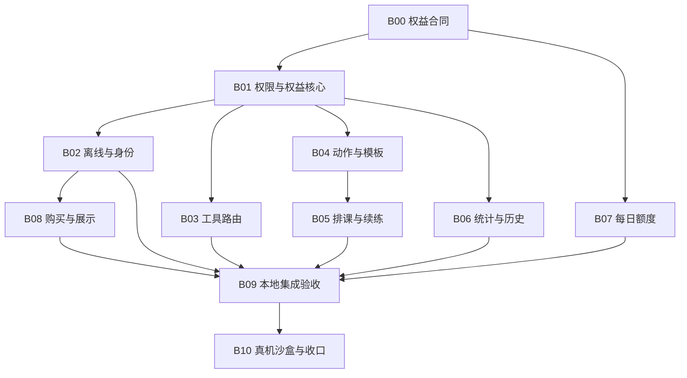

# Pro 权益与购买闭环方案 v1.2

> **本文件是本轮需求真源。** 日期：2026-10-17。状态：**用户已授权实施，D01–D06 建议已采纳；B01–B08 代码已接入，B09 部分通过、B10 未验收**。
>
> 本文件组织本轮 Pro 审计与后续修复，不取代 `docs/04`–`docs/08` 中未涉及的产品规格。用户先回复“好的，开始吧”，再明确回复“采用这些建议”，确认 §4 六项建议。当前授权包含分批实现与验证，不包含真实扣款或发布。
>
> 排期前置：B00 六项方向已确认；实际验收与细则状态见执行记录。D01 选择 Apple 购买权益方案，C01/C02 本轮不启用；不能把登录门槛描述为球迹账号购买绑定。

执行入口：[逐批状态与验证](PRO-ENTITLEMENT-EXECUTION-20261017.md)。2026-10-19 SE/iOS17 本地定向回归 **334项通过（0失败/0跳过，包含实际 SKTestSession 交易）**，三商品页面购买及冷启恢复通过；B09 UI矩阵继续补验，B10真机尚未验收。用户已授权借用默认机、iOS17 SE及iPad，并授权已连接iPhone16 Pro安装测试版，已备A/B测试账号和Apple沙盒账号。授权不等于验收完成。

2026-10-19 范围对齐：后续已确认的 DR408r5 将翻袋解球、颗星解球纳入 Pro，当前为11工具路由、12项权益；本文件§2原审计清单保留10-17历史快照，以此增量覆盖当前测试范围。订阅购买/状态页采用当前品牌固定深色规范，测试浅深指进入前的系统/用户外观及返回后的恢复。

## 1. 需求回显与本轮边界

用户已确认的要求：

1. 整体分析 Pro 涉及哪些内容，有没有不合理之处。
2. 结合当前代码判断，必要时通过测试验证评估。
3. 先不动代码。
4. 使用 `issue-collection-restructure` 技能，将问题整理成详细、可分会话执行的方案。
5. 2026-10-17 追加授权：开始实施，并采用 §4 六项建议。此前“先不动代码”属于方案阶段，现已由实施授权取代。

本轮交付：权益现状、问题分级、产品待定项、共享层设计、依赖批次、测试矩阵、代码锚点及验收边界。**没有把“方案已写”记作“问题已修复”。**

范围约束：

- 本轮不重新定价，不调整现有动作/计划收费标记，不把当前免费文章、模板、分享、可选同步改成收费功能。
- 不改物理、球形、题目生成、训练剂量和训练统计口径；`drill / cognitive / tool` 数据语义保持独立。
- 不删除用户训练、排课、模板、进度或历史快照，不以清库解决到期问题。
- 不扩展为内容 OTA 或全面服务端改造。当前内容以 Bundle 为实际来源；服务端权益体系仅是 D01 选择绑定方案后的条件范围。
- 仓库已有多项未提交修改，实施时以当时文件复核为准，保留其他任务成果。

## 2. 当前权益清单与产品判断

### 2.1 实际内容矩阵

| 内容域 | 当前免费范围 | 当前 Pro 范围 | 核对结论 |
|---|---|---|---|
| 动作库 | 44 个动作 | 30 个动作 | 共 74 个；L0 为 7/0，L1 为 18/0，L2 为 15/18，L3 为 4/11，L4 为 0/1，数字为免费/Pro |
| 官方计划 | 基本功、准度Ⅰ·近中台、杆法Ⅰ·高低杆 | 其余 9 套 | 共 12 套；索引/正文收费标记一致，3 套免费计划引用 Pro 动作数为 0 |
| 判断训练 | 角度预测、2D 角度、瞄准点训练、2D 瞄准点，共享每天 20 道 | 四入口不限量；3D 两入口直接要求 Pro | 配额在同一进程共享，跨日刷新存在缺口 |
| 练习与工具 | 现有其他免费入口维持 | 下表 9 个入口 | 首页收费标记存在，但目标分发未统一保护 |
| 统计 | 记录能力免费；付费统计应展示清晰预览 | 训练统计、角度误差趋势等 | 角度趋势当前落在保护范围之外 |
| 历史 | 规格描述最近 60 天 | 更早历史 | 当前仅球台训练详情执行限制，认知/工具口径待明确 |
| 用户数据能力 | 自定义模板、训练录入、分享、登录后的可选同步 | 不另设独占 | 状态页旧权益描述需要修正 |

9 个 Pro 入口以 `AngleRoute` 为核对键：

| 路由 | 用户可见功能 |
|---|---|
| `separationAngleAtlas` | 分离角图谱 |
| `cushionEnglishAtlas` | 加塞吃库图谱 |
| `sceneAiming3D` | 3D 角度训练 |
| `aimPointScene3D` | 3D 瞄准点训练 |
| `snakePractice` | 蛇彩练习 |
| `positionPlayComposer` | 自由走位 |
| `ballExtraction` | 拍照建球形 |
| `planThree` | 打一走二想三 |
| `snookerTactics` | 防守 |

9 套 Pro 官方计划：准度Ⅱ·远台切角、力度、杆法Ⅱ·加塞挤偏、准度Ⅲ·带塞、分离角、走位Ⅰ·短距到一库、走位Ⅱ·多库与蛇彩、特殊球、全能精选。具体 ID 与扫描结果见 [catalog.json](../output/pro-audit-20261017/catalog.json)。

三种商品共享同一 Pro 权益。`Products.storekit` 的本地测试价格为月 18、年 88、终身 198，无 introductory offer；线上页面使用 `Product.displayPrice`，本文件不把本地配置作为线上价格确认。

### 2.2 合理性判断

当前“基础训练免费、进阶内容与分析付费”的方向可以保留；没有证据表明需要重划全部免费/收费内容。主要问题是**用户看到的收费承诺、实际可进入的内容、会员状态变化后的行为尚未一致**。

修复优先级应是：付费用户可靠使用与权限闭环 → 交易状态和数据保全 → 权益说明一致 → 视觉细节。首页加更多 Pro 徽章不能解决互链和服务调用绕过。

## 3. 问题登记与证据等级

优先级定义：P1 为本轮上线验收前必须闭环的权益/使用问题；P2 为可靠性、产品一致性及扩展防护。待定项先确认政策，再判定实现是否缺陷。证据等级：S＝源码调用链；H＝宿主隔离测试；I＝当前 iOS 运行；A＝真实 Apple 沙盒/设备。当前没有 I/A 通过证据。

| ID | 问题与具体触发 | 级别/证据 | 处理批次 |
|---|---|---|---|
| PR01 | 免费文章的 `PracticeCTA` / `LearnDocTextLink` 直达 Pro 图谱、防守；`MainTabView.angleDestination` 不再授权 | P1 / S | B01、B03 |
| PR02 | 自由训练与自定义模板共用 `DrillPickerSheet`，可选所有动作；`DrillRecordView.openTutorial` 直接开 Pro 精讲 | P1 / S | B04 |
| PR03 | `StatisticsView` 免费分支及无球台训练分支均可显示完整 `AngleHistorySection` | P1 / S | B06 |
| PR04 | 60 天限制只覆盖 `.session`，认知明细与工具行行为不同 | 待 D03 / S | B06 |
| PR05 | Pro 官方计划激活后，已排课程启动不复核权益；模板/排课服务也没有统一内容授权 | P1，续练细则待 D04 / S | B04、B05 |
| PR06 | 冷启动恢复账号网络失败 → `sessionUnavailable` → 清空且不查询 StoreKit，本地有效购买也不能解锁 | P1 / S+H；离线全链未测 | B02 |
| PR07 | 同一 Apple 权益可在球迹 A、B 账号登录后分别解锁；没有实际账号绑定 | 待 D01 / S+H | B00；条件 C01/C02 |
| PR08 | 同一会话的旧查询晚于新查询返回，可把已清空的权益重新覆盖为有效 | P1 / H | B01 |
| PR09 | 配额只在 `init` 换日；存活实例日期变化后仍用旧计数，写入时还会带到新日期 | P1 / H | B07 |
| PR10 | 任意已验证、未撤销商品均可贡献 Pro；当前仅 3 个 Pro 商品，属未来扩展防护 | P2 / H | B01 |
| PR11 | 回前台不主动刷新权益；续费、到期、退款、宽限期覆盖不足 | P1 验证缺口 / S | B01、B09、B10 |
| PR12 | 购买页与会员状态页权益不同；状态页将免费模板、分享、同步列作已解锁特性 | P2 / S | B08 |
| PR13 | StoreKit `.pending` 最终走“购买失败”；`purchase` 查询后直接返回 true，未以当前会话实际解锁为成功条件 | P1 状态正确性 / S | B08、B09 |
| PR14 | Release 空商品提示包含 Xcode 配置说明；统一 `isLoading` 混合商品加载/购买/恢复 | P2 / S | B08 |
| PR15 | 已有月/年 Pro 时整体禁用购买；终身权益存在时隐藏系统订阅管理，即使可能仍有续订商品 | 待 D06；管理可达性 P2 / S | B08、B09 |
| PR16 | 规格的内容数量/计划名/旧试用草稿漂移；UI 测试仍断言已移除的会员元素 | P2 / S | B00、B08、B10 |

PR01、PR02、PR03 是实际调用链缺口，但本轮未通过 iOS 点击复现。PR07 与 PR10 的红项不能混写成“4 个已经上线的严重购买故障”。

### 3.1 已有测试基线

- Bundle 扫描：74 动作、12 计划，免费计划夹带 Pro 动作 0，计划索引/正文收费标记不一致 0。
- macOS 隔离 XCTest：**16 执行，12 通过，4 未通过**。包含原样复制的 9 项额度测试，全部通过；新诊断发现存活实例换日、同会话乱序覆盖，另有账号绑定政策断言与未知商品健壮性断言未满足。
- 使用当前 `SubscriptionManager`、`StoreKitService` 字节相同副本；`AngleUsageLimiter` 仅补 standalone 所需 `import Combine`。AuthState 为最小 publisher 替身，权益 loader 注入，未真实购买或访问商店网络。
- 换日诊断仅改变测试进程时区并恢复，未改系统时钟，也不是等待真实午夜的 UI 测试。
- 当前 iOS 测试执行 **0**：统一模拟器管理器在测试启动前因受管容量已满拒绝。后续只通过生命周期管理器申请可用设备，不抢占其他任务或绕过上限。
- 2026-09-08 的 StoreKit 诊断是历史参考，不算当前版本验收；其中部分失败注入后的异常可在直接 SDK 调用复现，不能一概判为 App 缺陷。

证据：[审计报告](../output/pro-audit-20261017/REPORT.txt)、[宿主日志](../output/pro-audit-20261017/host-tests.log)、[源码指纹与适配说明](../output/pro-audit-20261017/host-manifest.json)、[iOS 启动阻塞](../output/pro-audit-20261017/focused.log)。

## 4. 产品决策与建议来源

**2026-10-17 已确认**：用户在包含以下六项建议的提问中选择“采用这些建议”。表中“推荐方案”为本轮采用方向，“备选”保留为决策背景。D04 跨重启续练的具体时效、D03 工具摘要展示细则在对应批次细化，不能自行扩为无限续练或历史数据删除。

| 决策 | 推荐方案 | 备选与代价 | 阻塞范围 |
|---|---|---|---|
| D01 会员归谁 | 本轮保持 Apple 购买权益为依据，球迹登录作为使用入口；明确同一 Apple 购买可在不同球迹账号使用，用户数据仍各自隔离 | 若要“绑定一个球迹账号”，新增服务端归属、历史购买认领、换绑/注销/恢复策略及 C01/C02；这是另一档工程量 | B02 的离线身份规则、B08 归属提示、最终验收预期 |
| D02 离线已购用户 | 曾成功登录的可信本地 owner + 当前 StoreKit 已验证权益允许离线使用；服务端 API 仍要求有效在线身份。显式退出/注销清理本地离线资格 | 坚持每次在线恢复账号才能用 Pro：实现更少，但付费用户断网冷启仍不可用，须明确接受并告知 | B02 |
| D03 历史范围及天数 | 产品文案统一为 60 个本地日、包含今天；球台/认知/工具采用一致“详情访问”规则，旧记录不删除。实施前确认工具行可显示哪些摘要 | 仅球台历史付费：保留认知/工具当前免费行为，将文案明确收窄；无需扩大收费面 | B06 历史部分；角度趋势修复可先做 |
| D04 到期后的排课/进行中训练 | 未开始的 Pro 内容再次开始时需要权益；本次已合法开始的训练允许完成和保存，后续新训练重新判断。切换 owner 后不得继续写入旧 owner | 一律立即中止会损伤正在训练的体验；永远放行已排课会形成永久解锁。跨重启是否续练及许可最长时效需定值 | B05；不得用无限期 `inProgress` 当许可 |
| D05 每日额度 | 本轮保留本机共享 20 道与本地日期口径，仅修生命周期换日；继续沿用现有答题计数语义。跨设备、改时间防刷另议 | 账号/服务端统一额度需新增同步和离线冲突规则，不能只改一个 UserDefaults key | B07 不依赖扩展决策；更改配额归属需另批 |
| D06 终身升级 | 允许月/年用户单独购买终身；保留系统订阅管理，明确购买终身不会由 App 自动处理既有续订 | 本轮不开放升级，仍应保留管理入口并明确暂不支持；不能承诺自动退差价/自动取消 | B08 升级部分、B09 并存测试 |

D02 的离线资格不是永久缓存 `isPremium=true`：StoreKit 当前验证结果仍为权益依据，离线无法确认/缓存不可用时应展示待确认及恢复路径。具体缓存身份字段、保存期限与清除规则在 B02 设计记录中列明，不擅自将网络失败变成后端认证成功。

D03 选择统一历史范围会改变部分当前免费行为，必须经确认再实施。当前 `HistoryAccessController` 是 `now - 60 days` 的时间点判断；若选择“含今天 60 个自然日”，边界应是今天起点往前 59 天，二者必须用测试区分。

## 5. 目标设计

### 5.1 一份权限决策，多处复用

建议新增 `ProAccessPolicy`（**拟新增名称，当前不存在**），作为纯决策层，输入权益状态、当前 owner、目标能力/内容元数据及操作类型，输出允许、需登录、需 Pro、待确认或内容不可用。UI 决定如何提示，服务层决定是否执行，策略本身不弹窗、不写库。

- 路由策略集中维护上表 9 个收费路由。首页标记、目标分发、文章 CTA 使用同一映射；映射对全部 `AngleRoute` 做穷举/覆盖检查，新增路由必须明确归类。
- 动作/计划收费状态读取 Bundle 的 `isPremium`，不再维护第二份 ID 白名单；商品白名单独立使用 `StoreKitService.allProductIDs`。
- “访问付费教学内容”“启动 Pro 课程”“保存自己已完成的记录”是不同操作。前两者受保护，保存用户数据不因会员过期而失败。
- 未识别 ID、解码失败不能当免费内容；返回内容不可用。训练快照仍保留原动作、剂量和文本，不因重新授权而重写历史内容。
- 对含 Pro 动作的自定义模板，模板创建/编辑能力仍免费；新选择或启动受保护内容按策略判断。既有模板可保留、删除/替换其中受限项，不强制删除整个模板。

### 5.2 权益状态与网络身份分开

`SubscriptionManager` 继续做主线程状态协调，`StoreKitService` 继续封装 StoreKit。先以最小改造建立可测试边界，不拆成多个互相维护布尔值的单例。

建议权益状态至少区分未知/查询中、免费、有效 Pro、需恢复/确认；有效状态保留商品来源与可显示的有效期信息。`isPremium` 可以保留为兼容投影，不能成为唯一事实源。商品加载、权益刷新、购买、恢复分别表达状态。

权益刷新要求：

1. 用会话版本阻止退出/换号后的结果落地；用请求版本或串行合并机制阻止同一会话旧结果覆盖新结果。
2. 只接受已验证、未撤销且在 Pro 商品集合中的当前权益；过滤未知商品，并保留其他有效 Pro 商品。
3. 首启、允许使用权益的身份变化、交易更新、回前台统一进入刷新接口；合并重复刷新，避免连环查询和 UI 闪烁。
4. 显式有效空集合与暂时未完成/不可确认不是同一状态；不能把离线/读取中直接显示成“购买已失效”，也不能以错误为由无限保留过期权限。
5. `currentEntitlements` 可能包含宽限期有效订阅，不能只用 `expirationDate > now` 二次过滤。展示续订/宽限期状态需使用对应 StoreKit 状态并核实可用性。
6. DEBUG 强制会员只做 UI fixture，不作为真实购买或离线权限证据；Release 无对应开启路径。

官方依据：[currentEntitlements](https://developer.apple.com/documentation/storekit/transaction/currententitlements)、[appAccountToken](https://developer.apple.com/documentation/storekit/product/purchaseoption/appaccounttoken(_:))。本轮审计于 2026-10-17 查阅；实施时按目标 SDK 再核对接口。Token 是关联信息，单独使用不等于服务端归属校验。

### 5.3 入口检查与执行检查

- **入口层**：Pro 徽章、锁态、价格页与返回路径表达清楚；登录完成后可回到待操作内容，购买动作必须由用户明确触发，不能因登录自动扣款。
- **路由目标层**：`MainTabView.angleDestination` 在实例化受保护工具前统一判断；文章跳转、程序化 navigation、恢复导航都覆盖。已打开页面在会话/权益变化后重新决策，保存当前用户状态后关闭受限操作。
- **内容层**：`DrillTutorialView` 等可直接 sheet 展示的内容不能只依靠动作详情页的锁；共享内容入口必须判断。
- **执行层**：激活计划、加入训练、启动已排课等在服务操作/统一启动入口再次检查。同一请求内先完成内容与 owner 校验，再变更数据。
- **长任务层**：按 D04 对已开始训练发放受限范围的会话许可（拟设计），绑定 owner、训练实例与已授权内容；不能拿旧许可添加新 Pro 内容或无限续开训练。

这是一套客户端商业权限闭环，不把 Bundle 内置内容描述为无法提取的安全边界。若以后改成服务端分发付费内容，服务器需独立授权，另开范围。

### 5.4 排课与历史数据保全

`startScheduledItems` 当前先解码，再修改 `state / startedAt` 并保存。应插入**所有项目授权完成后再写入**的步骤；混合免费/Pro 队列中有一项不允许时，整次请求不启动、不写半份状态，不悄悄跳过付费项。

授权要覆盖 `sourceKind` 的官方课、模板、单动作，以及从昨日结转和恢复训练的路径。按原始 plan/drill ID 判定访问资格；如需要把访问等级保存入快照，应新增兼容字段/版本，并测试旧 payload 缺字段读取。不得据此回填或覆盖历史剂量、目标、完成数据。

历史范围的 UI 锁与 `TrainingUtilityStore` 的编辑授权需一致。已有手工补录的旧日期提醒流程保留；保存刚结束的训练不进入“过去历史编辑”的收费判断。任何 owner 不匹配都不得读写其他账号的数据。

## 6. 执行批次与依赖

以下为后续实施建议，每批均含实现与定向验收，不把整个 Pro 改造塞进一个会话。中等批次只读取本域文件及共享合同；B09/B10 单独承担跨域验证。默认串行实施；图中的独立性仅表示可以换序，不表示本轮启动多智能体或并行改同文件。

| 批次 | 范围 | 量级/边界 | 前置 |
|---|---|---|---|
| B00 | 固化权益矩阵、D01–D06 决策与验收口径 | 小；文档与现状清单 | 本方案评审 |
| B01 | 共享权限决策、权益刷新竞态、商品白名单、前台刷新 | 中；不改全量页面与离线 owner | B00 中基础权益矩阵 |
| B02 | 离线身份恢复、可信 owner、退出/换号隔离 | 中；仅身份/权益联动 | B01、D01/D02；若绑定则等 C01/C02 |
| B03 | 9 个工具与全部跳转入口门控 | 中；路由、CTA、目标容器 | B01 |
| B04 | 动作选择、模板引用、精讲和试打边界 | 中；不同时改排课状态机 | B01 |
| B05 | 计划激活、排课启动、到期续练、快照兼容 | 中偏高；不改统计/交易 UI | B04、D04 |
| B06 | 统计/角度趋势、历史类型与日期边界 | 中；保持统计公式 | B01；历史部分需 D03 |
| B07 | 每日额度跨日与共享实例生命周期 | 小；4 免费入口及共享 limiter | B00 的现有额度口径，可独立先做 |
| B08 | 交易结果状态、购买/恢复 UI、权益文案、终身管理 | 中；以现有 StoreKit 层为边界 | B01、B02 或明确现有身份策略、D06 |
| B09 | 当前版本本地 StoreKit + UI 集成矩阵 | 中；只处理本轮范围问题，发现大问题退回对应批 | B02–B08 完成且有受管模拟器 |
| B10 | 真机沙盒、离线/跨设备验收与规格收口 | 中；外部环境不具备则保留未验项 | B09；沙盒账号/设备/商品配置可用 |



确定性修复可先推进 B01 的竞态/白名单、B03、B04、B07，以及 B06 的统计保护。D01–D06 未定时，不擅自实施改变归属、历史收费范围、续练时效或终身升级的部分。

### B00：权益合同与问题基线

范围：复核本文件表格与 Bundle；给 D01–D06 逐项记录采用方案、确认来源、尚未确定的细则；规格按“当前有效规则/历史草案”分开。

完成标准：

- 74/44/30、12/3/9、9 路由、4 入口共 20 道可由扫描重现，免费计划夹带 Pro 动作及索引冲突为 0。
- 每个 PR 有所属批次和验收场景；每个待定项有明确状态，不用“按常规处理”代替决定。
- D01 若选择绑定，先创建 ADR 并启用 C01/C02；没有决定的依赖批次保持待开始。

### B01：共享权限与权益刷新

范围：`SubscriptionManager`、`StoreKitService`、`QiuJiApp`；拟新增纯策略对象与可注入测试接口。保留外部 `isPremium` 调用兼容，逐批迁移，不一次改遍全仓。

完成标准：

- T01–T05 通过：两种乱序、退出/换号晚到、未知商品混合、前台刷新/请求合并、宽限期语义均有断言。
- `sessionRevision` 与请求代次共同保证当前状态；身份变化必须使旧回调失效。
- 商品白名单仅 3 个现有 Pro ID；未验证/撤销不能解锁，未知商品不会消除其他有效 Pro 权益。
- Debug 定向 XCTest 和目标编译通过；Release 构建确认强制会员测试开关不进入正常授权路径。不得用 `forcePremium` 验证权益算法。

### B02：离线与账号隔离

范围：`AuthState.bootstrap`、`CurrentOwnerContext`、`KeychainService` 与 manager 身份输入。现有钥匙串没有完整离线 owner 合同，不能把某个现有 token 当作可靠 userID。

完成标准：

- 明确状态表：初次游客、在线已登录、可信账号暂时离线、主动退出、凭据失效、注销、A→B 切换。
- T06/T07 通过；网络不可用不等同主动退出，认证明确无效也不得伪装暂时离线。
- 仅可信 owner 的离线数据可见；API 同步/资料修改保持在线认证要求。退出/删除账号清除离线资格，旧请求/旧 owner 训练不会写入新账号。
- 使用真实 `AuthState` 加注入服务测试，而非只用上一轮 publisher 替身。现有 AuthState/owner isolation 用例回归通过。
- 若离线身份影响整个 App 数据域超过本批边界，先补 ADR、拆出独立数据隔离子批，不以仅放宽 `allowsPremiumSession` 结束。

### B03：工具路由闭环

范围：`MainTabView.angleDestination`、`AngleHomeView.open`、`PracticeCTA`、`LearnDocTextLink` 及直接构造受限目标的调用处。入口标签复用策略，实际保护放在目标分发/共享授权容器。

完成标准：

- T08 覆盖 9 个收费路由的免费/Pro 两态；所有 `AngleRoute` 的分类检查防止遗漏。
- 免费文章→两种图谱、理论 T08/T10→防守的真实互链均锁定；购买/登录返回来源合理，取消不丢阅读位置。
- 直接追加路由、恢复导航栈、页面打开后退出/到期均重新判定；未授权时不先初始化受限 3D 场景。
- 所有原免费工具与文章导航继续可用；不把整个“练”Tab 锁住。
- iPhone 定向 UI 与关键锁态截图通过；跨尺寸完整回归留给 B09。

### B04：动作、模板、精讲与试打

范围：`DrillPickerSheet`、`CustomPlanBuilderViewModel`、`DrillTrainingPlanService`、`DrillRecordView.openTutorial`、`DrillDetailView` 及精讲/试打展示入口。

完成标准：

- T09 覆盖动作详情、自由训练 picker、自定义模板 picker、训练记录精讲、直接内容入口；Pro 标识、点击行为一致。
- picker 展示 Pro 项并清楚标记；新选受限教学内容需授权，服务层直接调用亦不能绕过。保留仅记录本人训练结果的能力。
- 会员到期后原模板不丢失，可浏览自己的模板信息并删除/替换受限内容；不借模板 ID 获得 Pro 精讲。
- 不影响已有免费动作剂量、模板去重/排序、手动记录。相关模板与动作计划服务测试通过。
- 引用不存在的动作不自动当免费，不写入半成品模板；新建/加入失败后内容一致。

### B05：排课、到期与续练

范围：`PlanProgressService.activateOfficialPlan`、`TodayTrainingScheduleService`、`TrainingHomeView.startScheduledItems`、`ScheduledTrainingBlock`、`AppRouter.startTraining/resumeMinimizedTraining`。

完成标准：

- T10/T11 通过：官方计划、含 Pro 动作模板、单动作加入、昨日结转、已排课降级、进行中恢复均覆盖。
- 授权完成前不创建/改变有效业务记录；尤其 `requiredToday` 及 `state/startedAt` 写入必须放在正确阶段。拒绝后不能残留本次新增的空排程或误变更原有队列。
- 混合队列启动原子性成立；失败时不启动任一项，不保存部分 `inProgress`，不错误推进计划。
- 合法开始的训练按已确认 D04 完成/保存；新加 Pro 动作、新开下一课需重新判断；许可不能跨 owner 或无限复用。
- 旧 payload 解码、历史剂量/完成值、进行中与完成记录保留；没有权限不是损坏快照，错误提示必须区分。
- `V54ScheduleDomainTests`、`V29W7PlanProgressTests` 相关用例与新增权益用例通过；至少一条真实 UI 的到期后开始/恢复路径通过。

### B06：统计与历史

范围：`StatisticsView`、`AngleHistorySection`、`HistoryCalendarView.dayItemRow`、`HistoryAccessController`、`TrainingUtilityStore`。

完成标准：

- T12–T14 通过；“无球台记录但有角度成绩”与“有球台记录”都按相同权益决策显示趋势。
- 免费用户看到稳定锁态与说明，不通过遮罩下的可访问性树、图表手势读到受限统计；Pro 正常显示。
- D03 采用的历史范围在列表、详情、编辑入口一致；测试 cutoff 前后、当天、手工补录 reportingDate、时区/DST。
- 统计指标数值、认知/工具类别、训练量/准确率定义不改变。蛇彩本地结果不擅自迁移进 SwiftData 统计。
- 已完成训练可保存、已有数据不删除；原有旧日期补录提醒保留。历史与统计 VM 回归通过。

### B07：每日额度换日

范围：`AngleUsageLimiter` 与 4 个免费训练消费点；将时间/Calendar 注入便于确定性测试。

完成标准：

- T15 通过：同一对象耗尽→跨午夜→恢复 20；不重建对象、不改系统时间。
- 提交前换日再计数，读取/回前台触发日状态更新；避免在 SwiftUI 求值中直接发布状态导致重入警告。
- 4 入口共享同一额度；20/21 边界、重复提交、重启持久化、Pro 升降级、时区改变均有断言。
- 现有 9 项测试继续通过，新用例明确覆盖其未覆盖的“对象存活跨日”。本批不引入服务器防刷或跨设备额度同步。

### B08：购买状态与权益展示

范围：`StoreKitService.purchase` 返回契约、`SubscriptionManager.purchase/restore`、`SubscriptionView`、`SubscriptionStatusView`、`ProfileView` 及定向 UI 测试。

建议结果区分：成功且当前身份已解锁、用户取消、待批准/处理中、购买完成但权益待确认、失败。只有第一种走“已开通”与自动关闭；其他状态给对应信息，禁止用统一 Bool 丢失语义。

完成标准：

- T16–T20 通过；取消不报失败，pending 不诱导重复购买；批准后由交易更新完成解锁。
- 购买过程中换号/退出时，不把旧会话结果显示为当前账号开通成功；交易完成但 loader 暂无权益时显示确认中，可刷新/恢复，不发起第二笔购买。
- 购买/恢复操作有服务层互斥或明确串行策略，重复点击/直接重复调用不创建重复流程；商品刷新不错误结束购买的 loading。
- Release 空商品/失败提示面向普通用户，保留重试；开发配置说明只在诊断上下文出现。检查 8 秒超时实际取消/返回行为，未复现前不把协作取消疑点定为已知故障。
- 购买页与状态页共用权益定义，准确包含蛇彩等工具；移除免费能力“购买后才解锁”的暗示。价格继续来自 StoreKit，不擅增试用承诺。
- 根据 D06 处理终身升级；终身和自动续订并存时仍能进入系统管理，不能只根据 lifetime ID 隐藏入口。
- 改正旧测试定位，但保留购买成功、交易数、恢复后使用能力的语义断言；失败机理与替代断言见 §7.3。

### B09：本地 StoreKit 与 UI 总体验收

范围：执行 §7 矩阵的本地层，补齐各批未覆盖的组合状态；不以手工改 `isPremium` 代替实际本地 StoreKit 交易。

完成标准：

- 月、年、终身分别购买/重启/恢复；订阅到期、撤销、pending→批准/拒绝、商品异常与重试、已有订阅购买终身按支持能力验证。
- 明确环境不支持的注入场景，转 B10 或可信服务替身验证，不能记为通过。
- 定向 XCTest/XCUITest 记录精确 selector、执行数、通过数、跳过数及 `.xcresult`；构建成功不能替代测试执行。
- iPhone 普通尺寸、小屏、iPad 的免费/Pro 两态；购买/锁态/状态页浅深色，关键页面大字号与 VoiceOver 可读性。复用共享组件，页面域只查影响面。
- 完成 `verify-gate`、`verify-doc-size` 及本批 diff 检查；路由签名变化经审查后更新，不能盲目重建基线绕过。
- P1 均有修复证据；未通过项退回对应批，环境阻塞保留为未验收。

### B10：真机沙盒与文档收口

范围：真实 StoreKit 沙盒、真实 AuthState 网络恢复、设备安装/重启；更新 `docs/08` 的有效权益表、相关测试说明与进度。

完成标准：

- T06/T07、T16–T20 的关键组合完成真机沙盒核验，明确 Apple 测试账号与球迹测试账号，记录系统版本、构建 SHA、商品状态。
- 至少实际验证断网冷启、回前台更新、退出/换号、购买恢复及订阅生命周期。跨设备恢复以可用第二台设备验证；缺设备时单列未验，不推定通过。
- 续订失败/宽限期等需后台配置的场景，记录配置前提；没有环境不能写“已支持全部状态”。
- 规格保留历史决策但当前矩阵唯一；不把本地测试价或早期试用草案写成线上承诺。
- 用户视觉/体验验收与自动测试状态分列；本批不自动发布、不进行真实费用购买。

### 条件批次 C01/C02：仅 D01 选择球迹账号绑定时启用

- **C01（中）归属模型与服务端核验**：先 ADR，确定原始交易标识、稳定账号关联 token、已验证交易与用户的唯一关系、重复请求幂等、A/B 争抢、撤销/退款更新、历史无 token 购买认领、注销后权益处理。当前后端未发现这一实现，具体接口/模型文件需实施前定位或明确标为新建，不能杜撰现有 API。以签名验证和归属冲突服务测试为 DoD。
- **C02（中）客户端绑定与兼容恢复**：以 C01 接口为前置，购买附关联信息，恢复/登录展示冲突与认领路径；离线使用已核实的所属账号。旧购买迁移可回滚、不误绑定；两球迹账号/两 Apple 测试账号矩阵通过。单独传入 `appAccountToken` 不满足 DoD。
- 任一批超过一个会话可实现并验收的规模时，按服务端核验、历史认领、客户端接入细分新版计划；不得混入 B01 偷做。

## 7. 测试计划与执行纪律

### 7.1 场景矩阵

以下 T 编号是**待实现/待执行的验收场景，不是已经存在的测试方法名**。自动化应断言实际结果与副作用，避免仅测试与实现相同的枚举映射。

| 场景 | 操作与关键断言 | 主要层级 |
|---|---|---|
| T01 刷新乱序 | 旧有效→新空→旧返回，最终免费；旧空→新有效→旧返回，最终 Pro | 注入 loader 的 XCTest |
| T02 会话隔离 | A 查询中退出/切 B，A 结果晚到不覆盖；购买中切换同理 | XCTest + UI |
| T03 商品与验证 | 月/年/终身分别有效；未知商品单独无权、与有效商品混合仍有权；撤销/未验证无权 | StoreKit 适配层 + manager |
| T04 生命周期 | 首启/交易更新/前台刷新，重复事件合并；后台到期后回前台锁定且数据保留 | XCTest + 本地 StoreKit/UI |
| T05 宽限期 | StoreKit 报有效宽限期时仍可用；失效/退款后不继续授予；显示状态准确 | 状态 fixture + 沙盒 |
| T06 离线冷启 | 曾登录已购→终止→断网重启，按 D02 使用；无可信 owner 不凭缓存布尔值开通 | 真实 AuthState 单测 + 真机 |
| T07 归属切换 | 游客/A/B、主动退出、无效凭据、账号删除；各自数据及权益按 D01/D02，禁止越 owner 写入 | 单测 + 真机沙盒 |
| T08 工具互链 | 11 路由免费/Pro 两态（含DR408r5翻袋/颗星）；首页/文章/理论/程序路由；页面打开后到期/退出 | 策略单测 + XCUITest |
| T09 内容互链 | Pro 动作正常详情、自由 picker、模板 picker、记录精讲、试打；受限内容不能绕入 | 服务单测 + XCUITest |
| T10 排课降级 | 先有权排课再到期；官方/模板/单动作/结转；启动被拒后状态/时间/队列无本次写入 | SwiftData 内存库 + UI |
| T11 训练续练 | 合法开始后到期、最小化/恢复/重启、添加动作、A→B；保存正常，许可范围受限 | VM/服务单测 + UI |
| T12 统计入口 | 无球台记录但有角度数据、有球台记录、完全空数据、只有 tool；免费/Pro 对照 | VM 回归 + UI/AX |
| T13 历史边界 | 每类记录 cutoff 前/上/后、本地日期变化、DST、手工 reportingDate | 注入时间的单测 |
| T14 历史保全 | 降级后旧数据/进度仍在；详情/编辑按政策；新保存及既有补录提醒不受误伤 | 数据测试 + UI |
| T15 每日额度 | 4 入口合计20/21、对象存活跨日、回前台、重启、时区、重复提交、Pro升降级 | limiter/调用点单测 + UI |
| T16 三商品购买 | 各商品购买一次、关闭后重启、恢复后进入真实 Pro 功能；交易数与可用性均核验 | SKTestSession + 沙盒 |
| T17 取消/pending | 取消不错误；pending 不显示失败、不重复收费；批准后解锁、拒绝后未解锁 | 本地 StoreKit + UI |
| T18 购买已完成待确认 | verified 返回但查询延后/暂空，页面不能假成功；刷新/重启后收敛，交易只有1笔 | 注入服务 + StoreKit/UI |
| T19 失败与恢复 | 无商品、商品加载失败、恢复失败/空/成功、连续点击、重试；不误清已验证权益 | 单测 + StoreKit/UI |
| T20 订阅并存 | 月↔年系统管理、月/年+终身、终身仍有续订；显示权利正确，管理入口可达 | StoreKit + 沙盒 |
| T21 发布与显示 | Release无测试解锁、无Xcode文案；权益描述一致、价格动态；小屏/大字/浅深/AX | Release构建 + UI截图 |

### 7.2 复用现有测试与隔离执行

优先复用现有 `AngleUsageLimiterTests`（位于 `AngleTrainingTests.swift`）、`AuthStateTests`、`HistoryAccessControllerTests`、`StatisticsViewModelTests`、`CustomPlanBuilderViewModelTests`、`DrillTrainingPlanServiceTests`、`V53OwnerIsolationTests`、`V54ScheduleDomainTests`、`V29W7PlanProgressTests`。具体方法以执行前枚举为准，不把文件名一律当测试类名。

现有 `V53ProfilePreferencesTests` 可复用的方法：

- `testEntitlementSnapshotShowsExpirationAndLifetimeTruthfully`
- `testRestoreLoadingTransitionsPreserveExistingEntitlementLabel`
- `testStoreKitConfigurationLoadsMonthlyYearlyAndLifetimeProducts`
- `testStoreKitLocalSubscriptionsPurchaseAndExpire`
- `testStoreKitLocalLifetimePurchaseSurvivesRestore`

UI 基线：`OnboardingProUITests.testProPresentation`、`testStoreKitPurchaseAndRestore` 与 `P7_SubscriptionUITests` 中仍符合现行页面的断言。展示测试不能算购买取消测试，强制会员截图不能算真实交易测试。

执行前读取 `scripts/simulator-lifecycle/README.md`，使用受管入口。以下为单个已存在方法的命令模板；本轮未执行：

```bash
make -f scripts/Makefile sim-test \
  SIM_TASK=pro-entitlement-local \
  ONLY_TESTING=QiuJiTests/V53ProfilePreferencesTests/testStoreKitConfigurationLoadsMonthlyYearlyAndLifetimeProducts
```

`ONLY_TESTING` 当前接受一个 selector。需要多个 selector 时，使用生命周期包装的明确 `xcodebuild -only-testing:...` 列表或逐组执行，不能把空格拼接成一个 selector。

`QiuJi.xcscheme` 当前同时包含单测和 UI target，默认执行集较广。本方案不要求盲跑全量后“工作区零 diff”。实施前应枚举选中方法中的写盘/烘焙/导出行为，测试使用独立 UserDefaults、内存数据库和测试产物目录；若改为全量测试与零 diff 验收，必须先按 PD-027 盘点全部写盘测试及 scheme/testplan 默认集合，再明确允许产物范围。不能因其他任务已有 dirty 状态就清理或回退工作区。

### 7.3 过时断言的修正合同

当前 `OnboardingProUITests.swift:260`：

```swift
let membership = app.staticTexts["profile.membershipSummary"]
XCTAssertTrue(membership.waitForExistence(timeout: 12), "Successful StoreKit purchase returns to profile")
XCTAssertTrue(membership.label.contains("Pro 会员"))
```

失败机理：当前 `ProfileView.subscriptionRow` 已改成 `profile.subscription` 的菜单入口，旧 `profile.membershipSummary` 元素不存在。即使购买成功，该等待也可能超时。这是源码确认的定位漂移，**本轮没有实际执行该 UI 用例，不能宣称已复现支付失败**。

替代方案：按实际 AX 层级定位 `profile.subscription`，核对权益状态显示，再点击进入状态页验证商品/有效状态；同时保留原交易数等于 1、购买页关闭、恢复成功断言，并验证受保护功能可进入。不能简单删掉会员状态断言，也不能把“按钮存在”当“权益已生效”。

### 7.4 验收报告最小字段

每批报告记录：代码版本/相关文件指纹、已决定政策版本、测试层级、selector、执行/通过/失败/跳过数、日志与 `.xcresult`、截图、未验项、阻塞及下一步。真实沙盒记录使用脱敏账号代号，禁止保存身份 token/收据敏感原文。

## 8. 代码锚点索引

核实日期：**2026-10-17**，均基于当前含未提交变更的工作区。行号仅辅助定位，实施前按符号重新检索；拟新增类型已在正文标注，以下不将它们伪装成已有文件。

| 文件/行 | 已核对符号或入口 | 本方案用途 |
|---|---|---|
| `QiuJi/Data/Services/StoreKitService.swift:3` | `StoreEntitlementSnapshot`；28 商品 ID，42 purchase，70 currentEntitlements | 权益来源、白名单、交易状态 |
| `QiuJi/Data/Services/SubscriptionManager.swift:87` | bind；106 updateSession；127 loadProducts；253 checkEntitlements；280 purchase；302 restore；327 listener | 会话与刷新、购买状态 |
| `QiuJi/Data/Services/AuthState.swift:172` | bootstrap；252 sessionUnavailable；267 login；297 logout；306 invalidateSession | 在线/离线身份 |
| `QiuJi/Data/Models/OwnerIdentity.swift:41` | `CurrentOwnerContext`、useGuest/useAccount | 本地 owner 隔离 |
| `QiuJi/Data/Services/KeychainService.swift:4` | 现有凭据键、保存及 clearAll | 离线身份存储设计，当前无完整离线合同 |
| `QiuJi/App/QiuJiApp.swift:130` | scenePhase active 分支 | 回前台刷新 |
| `QiuJi/App/AppRouter.swift:83` | startTraining；89 resumeMinimizedTraining | 启动/恢复执行边界 |
| `QiuJi/App/MainTabView.swift:178` | angleDestination | 工具目标统一门控 |
| `QiuJi/Features/AngleTraining/Views/AngleHomeView.swift:5` | AngleRoute；495 open；669 PracticeCTA | 路由映射、首页和文章 CTA |
| `QiuJi/Features/AngleTraining/LearnDocChrome.swift:162` | LearnDocTextLink | 正文互链 |
| `QiuJi/Features/AngleTraining/Views/SpinAndEnglishView.swift:197` | 通往加塞吃库/分离角图谱（234）的链接 | PR01 复现路径 |
| `QiuJi/Features/AngleTraining/Theory/TheoryT08View.swift:153`、`QiuJi/Features/AngleTraining/Theory/TheoryT10View.swift:173` | 防守工具链接 | PR01 复现路径 |
| `QiuJi/Features/DrillLibrary/Views/DrillDetailView.swift:55` | isLocked；200 startTryout；622 addDrill；632 addDrillToToday | 正常动作保护及操作 |
| `QiuJi/Features/Training/Views/ActiveTrainingView.swift:895` | DrillPickerSheet；153 调用入口 | 自由训练动作选择 |
| `QiuJi/Features/Training/Views/CustomPlanBuilderView.swift:52` | DrillPickerSheet；264 saveAndAddToToday | 模板选择与排课 |
| `QiuJi/Features/Training/ViewModels/CustomPlanBuilderViewModel.swift:98` | addDrill；176 save | 模板数据边界 |
| `QiuJi/Data/Services/DrillTrainingPlanService.swift:55` | addDrill；85 createPlan；123 activate | 动作加入/创建模板服务 |
| `QiuJi/Features/Training/Views/DrillRecordView.swift:144` | openTutorial；sheet 内容展示 | 训练记录→精讲 |
| `QiuJi/Features/DrillLibrary/Views/DrillTutorialView.swift:21` | DrillTutorialView | 精讲直接展示边界 |
| `QiuJi/Features/Training/Views/PlanDetailView.swift:242` | fixedActivateButton；1042 activatePlan | 官方计划入口 |
| `QiuJi/Data/Services/PlanProgressService.swift:165` | activateOfficialPlan | 计划激活服务 |
| `QiuJi/Data/Services/TodayTrainingScheduleService.swift:125` | ScheduledDrillSnapshot；226 addOfficialLessons；296 addTemplate；331 addLibraryDrill；385 markStarted；426 carryForwardLatestUnfinished | 快照、队列与结转 |
| `QiuJi/Features/Training/Views/TrainingHomeView.swift:1072` | startScheduledItems；2001 startFreeTraining | 排课实际启动与自由训练入口 |
| `QiuJi/Features/Training/ViewModels/ActiveTrainingViewModel.swift:123` | TrainingMode；158 ScheduledTrainingBlock | 训练启动值与旧快照 |
| `QiuJi/Features/History/Views/StatisticsView.swift:32` | 无训练分支；43 免费分支；90 angleStatsSection | 统计保护 |
| `QiuJi/Features/AngleTraining/Views/AngleHistorySection.swift:13` | AngleHistorySection | 认知成绩聚合 |
| `QiuJi/Features/History/Views/HistoryCalendarView.swift:280` | dayItemRow，session/cognitive/tool | 历史类别与详情 |
| `QiuJi/Features/History/Views/HistoryAccessController.swift:4` | freeDaysLimit；isAccessible/cutoffDate | 60 天边界 |
| `QiuJi/Data/Services/TrainingUtilityStore.swift:36` | saveManual；87 saveNote；117 saveJournal | 历史编辑与补录 |
| `QiuJi/Features/AngleTraining/AngleUsageLimiter.swift:19` | remainingToday；26 init；39 recordQuestion | 额度换日 |
| `QiuJi/Features/Profile/Views/SubscriptionView.swift:16` | 权益清单；241 购买禁用；370 handlePurchase | 购买页 |
| `QiuJi/Features/Profile/Views/SubscriptionStatusView.swift:70` | 管理订阅；115 权益列表 | 状态页与终身并存 |
| `QiuJi/Features/Profile/Views/ProfileView.swift:333` | subscriptionRow；346/359 profile.subscription | 当前会员菜单定位 |
| `QiuJiTests/V53ProfilePreferencesTests.swift:273` | 状态标签；295 恢复；324/346/368 StoreKit 测试 | 现有定向测试 |
| `QiuJiUITests/OnboardingProUITests.swift:245` | testStoreKitPurchaseAndRestore；260 旧断言 | 测试漂移修复 |
| `QiuJiTests/AngleTrainingTests.swift:196` | AngleUsageLimiterTests | 原有 9 项额度基线 |
| `QiuJi/Resources/Plans/index.json`、`QiuJi/Resources/Drills/` | Bundle 标记及引用 | 内容矩阵 |
| `docs/08-商业化与合规.md` | 免费/Pro 规则及历史草案 | 规格收口 |
| `.kiro/steering/content-data-contract.md` | §5.3 数据分类与当前 Bundle 来源说明 | 禁止改变统计/内容数据语义 |
| `scripts/Makefile:171`、`:518` | test / sim-test | 定向测试和受管模拟器 |
| `QiuJi.xcodeproj/xcshareddata/xcschemes/QiuJi.xcscheme` | TestAction 两个 target | 默认执行集边界 |

## 9. 总体验收与回退要求

本轮实现完成必须同时满足：

1. 已确认权益矩阵在入口、目标、服务操作中一致；所有确定性 P1 问题关闭。
2. 付费用户离线/前台/身份切换行为符合批准规则，购买状态不误报成功或失败。
3. 降级不删除数据、不损坏队列/快照，不阻断已完成训练保存；账号数据保持隔离。
4. 定向自动化、本地 StoreKit、真机沙盒、用户体验各自标明证据状态；不能互相代替。
5. 产品文案与代码矩阵一致，现有免费范围的任何改变都有明确产品确认。

回退以独立批次变更为单位；新增快照字段必须可向后读取，身份缓存升级不能误清用户数据。若发现错误锁付费用户，优先回退本批错误策略/状态转换，保留交易和训练数据；不采用全局永久开 Pro、清空所有用户数据或忽略验证作为恢复方案。

## 10. 版本记录

| 版本 | 日期 | 变更原因与状态 |
|---|---|---|
| v1.0 | 2026-10-17 | 根据当前代码、Bundle 扫描及 16 项宿主隔离诊断，登记 PR01–PR16、D01–D06，拆为 B00–B10 与条件 C01/C02；仅方案，未实施 |
| v1.1 | 2026-10-17 | 用户授权开始并确认六项建议；启用 B01，Apple 权益归属方向不启用条件 C01/C02。实施与实际验证另见执行记录 |

| v1.2 | 2026-10-19 | 对齐后续DR408r5的11工具/12权益与品牌固定深色；记录SE/iPad/真机借用授权，更新334项本地验证及真机环境准备边界；D01–D06不变 |

后续修改产品定义、批次边界或验收要求时升版本并记录原因；较高版本覆盖较低版本。执行报告与本文件分开保存，不能用“已讨论”覆盖测试未完成状态。
