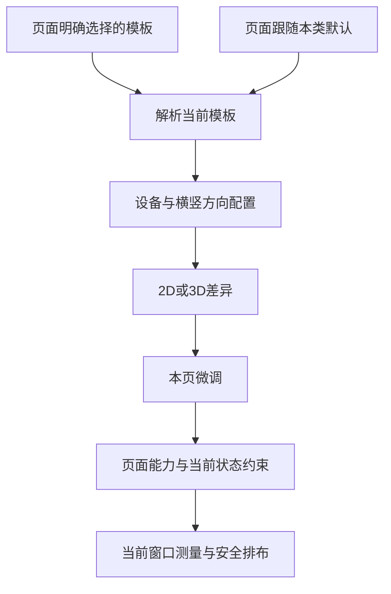
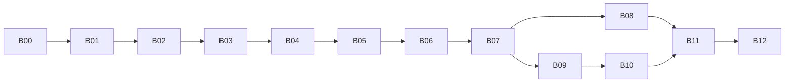

> **历史归档，不再作为执行真源。** 2026-10-19 起使用 [v2.0 返工方案](TABLE-CONTROL-LAYOUT-PLAN-20261017.md)。下文保留归档前原文，包含已撤回的规则和完成记录。

# 球桌操作布局自定义与模板共享方案

版本：v1.2。日期：2026-10-18。状态：⚠️ 需求偏差待返工（FL-181）；B00–B12为旧实现历史记录。

> 2026-10-19 用户纠偏：自定义编辑指在画面上选择单个按键，直接二维移动和放大/缩小，参考王者荣耀局内按键编辑。当前控件组侧栏偏移方案未满足核心需求，撤回整体完成结论，状态为待返工。旧B00–B12测试仅证明旧实现所测行为，不证明用户目标达成；保留原代码和证据。本轮查阅网络资料及代码，未修改App实现。 单按键二维移动与缩放的最新用户要求优先于本文原有区域、组和尺寸限制；详细返工批次尚待重排。

**本文件是本轮需求真源，v1.2覆盖v1.1/v1.0。** 覆盖球迹 2D/3D 球桌操作布局的自定义、模板管理、跨页面应用、页面微调及实施验收。用户先授权使用 `issue-collection-restructure` 技能制定并修订方案，随后明确要求“好的，开始执行吧”，现已授权按本方案推进实施。首批从 B00 开始；此授权不包括发布或恢复其他暂停任务。下文区分用户诉求、当前代码事实与本次修订采用的设计合同。

**v1.2执行裁定（2026-10-18）**：用户明确“继续全部开发，VoiceOver留作最终人工验收”。因此B03/B05/B12中的真实VoiceOver实操保留到最终实机人工验收，不阻断后续开发；每批仍完成可执行的AX、非拖动、原生UI和其他验证。不得把技术实施完成标成VoiceOver通过或最终用户验收。 最终实机检查见[人工验收清单](table-control-layout/FINAL-HUMAN-ACCEPTANCE.md)。

建议采用：**当前布局作为内置默认模板，页面内调整，通用设置集中管理；相近页面共享通用控件布局，特殊页面保留微调，并可另存独立模板。** 默认用户无需配置，首次进入保持现有布局。

排期前置：实施前完成 B00 的操作清单、原生基线与编辑交互定稿，核对同期通用设置及球桌代码变化。本方案不恢复其他已暂停任务，不沿用旧方案的实施授权。当前执行入口、产物和进度统一维护在第 13 节。

## 1. 需求回显与决策状态

### 1.1 用户明确提出的需求

| 编号 | 原始诉求 | 本方案对应内容 |
|---|---|---|
| U01 | 当前 2D 和 3D 的按键布局固定，希望把当前布局作为模板 | 内置默认模板与旧版行为兼容，见第 4、9 节 |
| U02 | 允许用户自定义并保存自己的模板 | 布局编辑、保存、另存、管理，见第 5、6 节 |
| U03 | 综合所有相关页面分析如何做 | 18 个全屏入口及外围消费者分类，见第 3 节 |
| U04 | 比较通用设置入口、页面独立入口和跨页面共享 | 两处入口共用同一系统，见第 5 节 |
| U05 | 适用页面共享，不适用的可以微调保存新版本 | 能力匹配、本页差异、独立模板，见第 4、6 节 |
| U06 | 使用 issue collection 技能写详细方案 | 真实代码锚点、批次依赖、完成标准、交接台账，见第 10 至 13 节 |
| U07 | 按代码审核结果完善规则、调整实施批次和首阶段范围，只更新文档 | 六项修订映射、阶段范围及新增验收合同，见第 1.3、1.4、11、12 节 |

这里将用户原话中的“案件布局”按上下文理解为“按键布局”，涵盖按键及相邻仪表、操作组的位置与排列，不扩展为球形、训练计划或课程模板。

### 1.2 本次修订采用的规则与授权边界

用户已授权按修订方案执行；以下作为 v1.1 的设计合同，不登记为已经实施或视觉验收通过：

1. 页面内是主要编辑入口，通用设置是统一管理入口；两者使用同一模板库。
2. 同一页面内 2D/3D 共用属性默认联动；独立答题入口通过共享模板联动，本页微调独立。短暂俯视保持原操作布局。
3. 本页保存不修改其他页面；共享更新保留其他页面微调。当前页明确提升或另存合入的覆盖按第 6.1 节清除，恢复后续跟随。
4. 首版按设备类别与横竖方向保存布局差异，按实际窗口动态适配；不做云同步、模板市场或分享码。
5. 本轮开放已声明区域内的受限拖动、左右交换、有限尺寸和排序；组内复杂排列、任意布局自动避让及新增快捷项收纳后置。保留必要动作、现有收纳和训练限制。
6. 本轮不新增 Pro 条件。模板权限若以后商业化，另行定义，不由实现者自行加门槛。

本文件允许用户逐项调整上述建议；变更时修改相关合同与批次，提升版本，不让后续执行者同时消费两套规则。

### 1.3 阶段范围与明确后置项

本文“第一阶段”指 B00–B05 的三个真实入口闭环；“本轮标准版”指 B00–B12，最终覆盖 P01–P18。“后续增强”不属于这 13 批的交付门槛，也不能据本方案自动启动。

| 维度 | 第一阶段 B00–B05 | 后续推广 B06–B12 | 后续增强，未排实施批次 |
|---|---|---|---|
| 页面 | P01 每日清台、P02 自由击球、P07 思路训练；两种真实宿主 | 接入其余 15 个入口，复验首批三页 | 其他独立需求另评估 |
| 模板 | 内置默认、本页微调、另存/复制命名、显式共享应用、恢复、基础管理及共享更新 | 沿用同一合同，补各页能力与状态 | 模板市场、云同步、分享码不在本轮 |
| 排布 | 固定可用区域、组间排序、左右交换、受限拖动、少量经测量可用的尺寸档位 | 在同一能力边界内增加页面专属组/整键盘 | 复杂组内横竖排列、通用自动避让、新增可收纳快捷项 |
| 编辑预览 | 独立展示数据、球桌背景及真实控件；受控点按/滑动/展开、取消、基础撤销/重做 | 新页面的必要状态样例，不复制整套业务状态机 | 完整训练模拟、全状态可玩样例 |
| 设备 | 三页均支持手机横屏、iPad 横竖；本域编辑、域隔离、缺省和窄窗安全回退 | 扩展到全量页面与设备矩阵 | 显式跨设备/方向复制及目标预览工具 |
| 可靠性 | 保存失败保护、原子提交、修订检查、暂停/恢复、训练计时隔离、非拖动编辑和基础 VoiceOver | 补升级、各状态及全量回归 | 可视化差异合并等复杂冲突界面 |

第一阶段不是只完成基础设施：B03 必须在每日清台形成真实编辑/保存/返回闭环，B04 完成自由击球与思路训练，B05 完成集中管理及三个入口的阶段验收。B11/B12 只补全量矩阵，不替第一阶段补做基本设备与辅助功能验证。未接入入口保持现有默认，在模板选择器中标明尚未支持且不可应用，不显示虚假的成功状态。

### 1.4 审核问题与修订落点

| 审核项 | 本次修订 | 实施/验收落点 |
|---|---|---|
| R01 编辑与退出训练混用、计时未定义 | 独立暂停/恢复及幂等计时合同 | §5.5；B03/B04/B06；A15 |
| R02 独立 2D/3D 入口联动与本页保存冲突 | 模式属性范围和页面应用范围分开 | §4.4；B09/B10；A16 |
| R03 另存/提升后旧覆盖继续遮住模板 | 同事务清除已合入覆盖，明确保留项及预览 | §6.1；B01/B03/B05；A17 |
| R04 自由移动与固定球桌之间缺空间合同 | 固定区域、有限档位、确定性回退 | §7.3/7.4；B00/B02；A18 |
| R05 两个同宿主试点不足以验证复用 | 思路训练前移，B02 即验证两个宿主 | B02/B04；A19 |
| R06 编辑器与基础设施前置过重 | 真实闭环提前、分阶段存储/管理、增强项后置 | §1.3/11；A20 |

## 2. 当前代码事实与约束

核实日期：2026-10-17；检查基于当前工作区，HEAD 为 `c31fad98`，包含大量既有未提交及未跟踪改动。HEAD 不足以还原本轮代码事实。下列锚点见第 10 节；执行前重新定位符号与差异。

| 事实 | 对方案的影响 |
|---|---|
| `FreePlayView` 的核心模板分支承载每日清台、自由击球、分离角与走位、蛇彩、自由走位及详情试打 | 同一接入点收益高，但页面绑定不能直接用 Swift 类型名；本轮六个产品入口需独立身份；同期新增自定义球形练习/编辑暂不纳入18页范围 |
| `BTTeachingTablePage` 承载规划、求解和交互教学；`SolverStageChrome` 再组合翻袋与颗星 | 可以共享布局渲染，不能把求解动作、步骤或教学读数改成自由击球动作 |
| 两个答题宿主分别承载固定 2D/3D 角度与瞄准点入口 | 布局设置不能切换题型、合并成绩、开放被题型禁止的辅助 |
| `DailyLayoutMetrics` 已处理基础区域、安全区、球库、双列、尺长、面板容量 | 现状是固定设计规则加自适应；新增配置应复用默认计算，不从散落的绝对坐标重做 |
| `TablePreferencesStore` 已有稳定页面 ID、支持字段、通用值及页面值 | 可复用页面身份；布局需要自己的有类型配置与保存规则，不能塞入 `[String: Double]` 偏好字段 |
| `TablePreferencesStore.write` 的通用写入会删除所有支持页面对应字段的局部值 | 这是另一任务已确认的产品行为，不是本轮要修的缺陷；布局继承需独立设计 |
| `FreePlayView` 与教学壳在击球、播放、拖动等忙碌阶段推迟应用显示偏好 | 布局应用也要有安全时机；不能在正在按住的击球键或滑杆下面移动控件 |
| 特写接收真实保护区域，菜单与相机按钮依赖测量后的控件框 | 布局变化必须贯通避让、浮层和命中；只改 `.offset` 不足以完成 |
| `FreePlayView.onDisappear` 会结束蛇彩尝试、退出只读序列并结算每日计时；教学壳退出也有暂停回调 | 编辑暂停不能直接复用离页逻辑；呈现方式与业务退出原因须分开 |
| 每日计时与 `ToolUsageSessionModifier` 各有活动记录，当前没有布局编辑暂停入口 | 冻结场景输入不等于暂停计时；需要同时接入，不新增一条编辑训练记录 |
| `BTTeachingTablePage` 接收整块 `leftContent` / `pairedLeftContent`，并非统一的可移动控件目录 | B02 需用思路训练验证真实操作组边界，不能等管理器完成后才发现适配不成立 |

现有显示设置合同见 [通用设置覆盖与页面独立记忆方案](PROFILE-SETTINGS-IMPLEMENTATION-PLAN-20261017.md)。本方案**不改变**“通用项覆盖相关页面局部值”的现行规则；只为新建的操作布局模板定义跟随与微调。两种概念在界面中分列为“显示与辅助”和“操作布局”。

当前布局与设计约束继续从 [每日交接](daily-adaptive/CURRENT.md)、[跨页面清单](table-page-adaptation/PAGE-INVENTORY.md)、[跨页面方案](table-page-adaptation/PLAN.md) 核对。旧 `output/table-page-adaptation` 包已清理，历史报告不能当作当前可打开截图；B00 必须取得新的原生基线。

## 3. 页面范围与共享矩阵

### 3.1 本轮全屏页面

“页面族”决定默认模板与专属区域；“功能能力”决定能借用哪些配置。不同页面族允许显式复用通用控件，不能只因都显示 3D 就自动互通全部配置。

| ID | 产品入口 | 实际宿主及身份 | 共享内容 | 必须保留的页面差异 | 接入批次 |
|---|---|---|---|---|---|
| P01 | 每日清台 | `FreePlayView` / `dailyClearance` | 击球基础模板 | 比分、合法目标、开球、撤销、结果与换玩法 | B03、B06 |
| P02 | 自由击球 | `FreePlayView` / `freePlay` | 击球基础模板 | 手动开球确认、球库与自由对局 | B04、B06 |
| P03 | 分离角与走位 | `ShotSimulationView → FreePlayView` / `shotSimulation` | 击球基础模板 | 教学读数、无开球及球数限制 | B06 |
| P04 | 蛇彩 | `SnakePracticeView → FreePlayView` / `snakePractice` | 击球基础模板 | 首杆摆母球、目标顺序、失败/下一组及 Pro 入口 | B06 |
| P05 | 自由走位 | `PositionPlayComposerView → FreePlayView` / `composer` | 击球基础模板 | 摆球、录制、序列及编排动作 | B06 |
| P06 | 动作详情试打 | 同上 / `drillTryout` | 击球基础模板 | 作者球形、重摆、独立/连续序列、上一杆/下一杆 | B06 |
| P07 | 思路训练 | `BTTeachingTablePage` / `silu` | 规划基础模板；借用方向/杆速/打点/相机位置 | 目标区域、求解与自由操作切换 | B02 验证、B04 接入、B07 回归 |
| P08 | 打一走二想三 | `BTTeachingTablePage` / `planThree` | 同上 | 三球角色、袋选择、步骤、撤销及完成标记 | B07 |
| P09 | 防守 | `BTTeachingTablePage` / `snookerTactics` | 同上 | 障碍、规划目标、选球与区域工具 | B07 |
| P10 | 翻袋 | `SolverStageChrome → BTTeachingTablePage` / `bankShot` | 同上 | 目标球/袋、库数、解目录、自由微调 | B07 |
| P11 | 颗星 | 同上 / `diamondSystem` | 同上 | 与翻袋不同的选球/选袋能力及解球目标 | B07 |
| P12 | 角度与瞄准 | `BTTeachingTablePage` / `angleDynamic` | 教学基础模板；借用相机和通用操作位置 | 教学读数、拖球、选袋与遮挡示例 | B08 |
| P13 | 分离角图谱 | 同上 / `separationAngleAtlas` | 教学基础模板 | 轨迹/读数与现有禁用打点入口语义 | B08 |
| P14 | 加塞吃库图谱 | 同上 / `cushionEnglishAtlas` | 教学基础模板 | 参数选择、竖向打点与专属轨迹 | B08 |
| P15 | 2D 角度训练 | `SceneAimingView` / `sceneAiming2D` | 角度答题模板 | 固定视图、数值输入、提交、答案、总结 | B09 |
| P16 | 3D 角度训练 | 同上 / `sceneAiming3D` | 与 P15 可引用同一模板，本页覆盖独立 | 固定 3D 题型及其成绩归属 | B09 |
| P17 | 2D 瞄准点训练 | `AimPointSceneTrainingView` / `aimPointScene2D` | 瞄准点答题模板 | 瞄准输入、提交、误差反馈与验证 | B10 |
| P18 | 3D 瞄准点训练 | 同上 / `aimPointScene3D` | 与 P17 可引用同一模板，本页覆盖独立 | 固定 3D 题型及其成绩归属 | B10 |

P01–P06 共用模板并不表示六页必须绑定同一个自定义模板。P15/P16、P17/P18 只有引用同一共享模板且未被本页覆盖的属性才随该模板更新；不建立隐式双向同步。本页微调、记录与训练配置仍按现有入口独立。

### 3.2 相关但本期不开放自由布局的消费者

| 场景 | 本轮处置与原因 | 回归要求 |
|---|---|---|
| 动作详情、训练记录中的 `DrillSceneView` | 嵌入播放布局，暂不放入全屏模板选择器；试打跳转后按 P06 生效 | 播放、切换视图及返回仍正常，不能读到全屏尺条位置 |
| 接触点表、瞄准原理/方法/修正、杆法、球感及理论文章内图解 | 阅读内容与标注排布由文章承担，不能被个人操作模板改写 | 静态和嵌入图解维持原尺寸、标注和交互 |
| 图解角度测验 `GeometricAngleQuizView`、图解瞄准点 `AimPointTrainingView` | 与 P15–P18 的全屏场景答题不同；先保留自身表单/图解结构 | 不因名称相似误接入或合并成绩 |
| 普通/批量拍照提取 | 原图映射、校正、确认具有专属操作顺序，后续单独评估 | 确认球形进入 P05 后可以使用布局；提取过程本身不受影响 |
| 批量编排台 `BatchAuthoringView` | 内部工具有独立工作栏与写入动作，本期不暴露模板入口 | 共享默认组件变化后做布局冒烟，不能意外写入内容 |
| 封面、缩略图、图片/视频导出、外观预览 | 输出应使用显式规格，不读取个人按键配置 | 同一显式输入不因个人布局变化而改变导出构图 |
| 同期新增自定义球形练习/编辑 | B00 冻结源码已有 customFormationPractice/customFormationEditor 身份和 FreePlay 宿主接入 | 暂保持默认，不自动扩入已批准18页；未来补能力与验收后接入 |

外围消费者是明确不适用/后续评估项，不能在交付时称为“全 App 均支持自定义布局”。本轮全量是 P01–P18。

## 4. 模板与继承规则

### 4.1 用户看到的模板

内置模板按当前页面类型提供“球迹默认”。可在模板详情显示“击球 / 规划 / 教学 / 角度答题 / 瞄准点答题”，不要求用户理解代码宿主。五种基底共享设计语言，各自保留现有页面差异。

内置默认只读、不可删除。首次调整可直接保存为本页微调，也可另存个人模板。首版无需制作大量预设皮肤；“左右交换”是编辑动作，不预先承诺另一套已验收的左手视觉模板。

个人模板含名称、适用范围、布局配置、格式版本和修订号。另存为新模板是**复制独立配置**，不是建立会随父模板继续变化的继承链；来源只作说明。复制原模板已有配置域，将当前页明确保存的微调合入对应域，未配置域仍按各自内置默认解析；不将当前窗口纠偏后的 frame 烘焙成其他设备的位置。自动保存的内部修订用于可靠写入，用户无需为每次调整命名“v2/v3”。

### 4.2 默认选择与页面绑定

每个页面首先选择模板，再覆盖本页微调：

1. 新用户及未配置页面默认跟随所属页面族的内置默认。
2. 页面可以保持“跟随本类默认”，也可以明确绑定某个个人模板。
3. 在通用设置更换“击球类默认”，只影响跟随该默认的击球页；已明确选择其他模板的页面保持原绑定。
4. 跨页面族应用时，由用户选择目标页面；只映射相同语义的控件，其余保留目标页默认。选择器列出“可完整应用 / 只应用通用控件 / 不支持”，不自动增加工具。
5. 模板可以逐步添加某页面族的专属配置；首版不要求用户提前配置所有页面。
6. 当模板缺少某项配置，回到目标页的内置默认；页面暂时没有该控件时不展示，保留模板数据供其他页面使用。

### 4.3 本页微调按属性覆盖

保存的是用户明确改过的控件属性，例如相机组的锚点/偏移，而不是整个最终屏幕的所有 frame。

| 场景 | 预期行为 |
|---|---|
| 本页只改相机组位置，共享模板后来改击球键大小 | 本页接受新的击球键大小，相机位置保留 |
| 本页已改击球键位置，共享模板也改同一位置 | 本页位置优先；界面仍标“本页已调整” |
| 用户明确微调后又设为与模板相同的数值 | 保留明确覆盖意图；用“恢复跟随”删除覆盖，不靠数值相等猜测 |
| 模板变化使原微调不再放得下 | 本次布局按第 7 节安全回退并提示，保留原保存值；不把自动纠偏写回 |
| 页面换用另一个模板 | 默认保留可兼容微调，应用前可选“清除本页微调”；无效属性停用并列出，不悄悄丢失 |
| 更改本类默认模板 | 跟随页面接受新模板，兼容的本页微调仍优先；明确绑定其他模板的页面不变 |

### 4.4 2D 与 3D

编辑器分开显示两个维度：**属性范围**（2D/3D 共用 / 仅 2D / 仅 3D）与**应用范围**（当前入口 / 共享模板及引用页面）。选择“共用”不等于同时修改两个独立入口。

同一页面内正式切换 2D/3D 时，共用属性默认联动，两种模式可各有差异层。固定答题入口继续复用现有独立页面 ID，不新增页面配对绑定层：

| 操作 | 固定 2D/3D 答题入口的结果 |
|---|---|
| 在 2D 页修改共用属性，选择仅保存到本页 | 只修改该 2D 入口，不修改独立 3D 页 |
| 两页引用同一模板，更新模板共用属性 | 两页中没有对应本页覆盖的属性一起更新 |
| 更新模板的仅 3D 属性 | 只影响引用该模板的适用 3D 状态，不改 2D 位置 |
| 一页恢复跟随或换模板 | 只影响该入口；不改变另一页绑定和覆盖 |

固定入口的页面编辑只提供当前模式和共用属性；另一模式的展示样例与模板编辑从模板管理进入。编辑器必须显示真实受影响入口，不能把独立 3D 页标成已同步。

- 默认操作共用布局；方向、杆速、打点入口、击球和回放位置在正式切换视图后稳定。
- 3D 相机组只在支持它的页面/状态显示，拥有独立位置；2D 不保留空相机占位。
- 用户切换到“仅 3D”修改击球键位置后，该属性覆盖共用值；“恢复联动”只删除该属性的 3D 差异。
- 页面微调同样可作用于共用或单个模式。解析顺序固定为模板共用 → 模板模式差异 → 本页共用 → 本页模式差异。
- 按住临时俯视属于观察状态，继续使用进入前的布局上下文，不加载另一套模式配置。
- 固定视图答题页可在布局管理中预览另一视图的样例，但不能在真实题目中因编辑布局切换题型、显示答案或改变辅助记录。

### 4.5 设备、方向与窗口

首版独立配置域：手机横屏、平板横屏、平板竖屏。支持中的临时窄窗口按当前容器处理；本方案不顺带实现手机完整竖屏球桌。

- 选择域依所属设备及当前容器方向，容量仍以真实窗口宽高、安全区与内容测量判断。
- 一个域没有配置时使用该域内置默认，不把手机绝对位置拉伸成 iPad 位置。
- 本轮在实际设备/方向域内编辑；显式“复制到另一方向/设备”及目标预览工具后置，不是 B12 验收前置；不隐式同步。
- 持续缩窗、键盘、字号或安全区变化只是运行时重排，不产生新的个人模板，也不改写保存值。
- 首版保存本机应用级布局偏好，延续现有本机偏好边界；不引入账号隔离、跨设备同步或云端冲突协议。

## 5. 入口与编辑流程

### 5.1 页面入口

在现有“更多”菜单的显示相关区域添加“操作布局”，复用原有菜单样式和导航方式，不挤入常驻球桌按钮列。

进入后包含：当前模板名称、使用方式（跟随本类默认或已选模板）、是否有本页微调，以及“调整布局”“更换模板”“恢复跟随”。模板库入口可到“管理模板”。

当前已在击球、运杆、自动播放、拖球、持触调整、临时俯视、求解不可中断阶段时，保持入口可发现但不可开始编辑，给出简短原因。不得强行结束一杆或重新加载球形来进入编辑。

### 5.2 通用设置入口

在现有“练习显示”组新增一行“操作布局”，进入独立管理页。管理页包括：

1. 按页面族选择默认模板。
2. 内置模板与个人模板列表；缩略示意标明设备/方向和布局类型。
3. 模板详情：名称、预览、哪些页面跟随、哪些有本页微调。
4. 复制、重命名、编辑、应用到页面、删除。
5. 用独立展示数据、球桌背景和真实控件编辑/预览；不复用用户正在进行的局面作为试验场，不挂载各页完整训练状态机。

现有显示偏好及“再次统一应用某项”入口不接管布局模板；“默认玩法”仍保留其原有新局语义。

### 5.3 编辑器的完整过程

1. **打开草稿**：记录当前有效配置、模板修订号、页面绑定修订号与业务状态标识；按第 5.5 节暂停输入、活动和计时，场景本身保留。
2. **选择控件**：可编辑控件显示边框和名称，固定区域说明用途。普通球桌中不通过长按启动编辑，避免与拖球、相机和持触俯视冲突。
3. **调整**：在声明区域内拖动、选择可用尺寸档位、组间排序或左右交换；提供槽位/边缘吸附及草稿内基础撤销/重做。复杂组内排列和新增收纳入口后置。
4. **检查状态**：预览 2D/3D、打点盘展开、更多面板、相机组和本页专属工具。答题只使用独立示例显示键盘/结果布局，不揭露当前题答案。
5. **交互预览**：真实控件绑定独立的展示值，验证命中、滑动和面板展开；击球/提交只反馈已触达，不启动真实物理、求解、出题或记录。允许静态球桌背景；如需动态背景，同一时刻最多一个活动渲染场景。完整训练模拟和全状态可玩样例后置。
6. **保存**：选择“仅保存到本页 / 另存为新模板 / 更新共享模板”，明确范围后提交；通常默认“仅保存到本页”。
7. **返回**：恢复原场景输入和相机控制。球位、杆速、打点、题目、得分、选择、播放阶段与进入前一致。

取消编辑直接丢弃草稿；有修改的关闭/返回提示“放弃修改 / 继续编辑”。前后台切换保留当前会话草稿但不自动提交；应用被终止后仍用最后一次成功保存的配置，不宣称未保存草稿可恢复。

### 5.4 辅助功能和手势

- 除拖动外，提供移至左侧/右侧、上移/下移、恢复位置等可访问动作；VoiceOver 用户不必依赖二维拖动。
- 焦点顺序按任务语义稳定，不仅跟随屏幕坐标排序。不可把“击球/提交”移动到不可访问区域。
- 拖动手势仅作用于编辑层选中控件；不得给正常球桌加全屏零距离手势抢输入。
- 测量实际触控范围而非只有可见图标框；项目默认交互目标至少 44pt，原击球等更大的默认目标保留。
- 文字和颜色沿用现有 Design Token；尺寸档位调整外框/间距，不以缩小正文挤出空间。

### 5.5 编辑暂停、返回与计时合同

布局编辑是一种临时暂停原因，不是离开训练。B03/B04 接入前分别核对 `FreePlayView.onDisappear`、教学壳的 `suspendActivity` 及页面计时消费者，不能用统一调用“退出/停止训练”代替暂停。

1. **进入条件**：先通过第 5.1 节忙碌检查，再创建一次编辑会话；不自动结束一杆、取消求解或切题。保存业务身份及相机控制状态，停止真实输入和非必要更新。编辑器呈现方式须使原业务实例存活；若原视图会收到 disappear，必须依据明确的退出原因跳过训练结束副作用。
2. **必须禁止的副作用**：编辑及管理页往返不能调用蛇彩 `finishAttempt()`、序列 `exitSequenceMode()`、重开球/下一题或训练完成写入。真正返回上级离开训练仍执行原退出行为，不能为了编辑而全局屏蔽生命周期清理。
3. **计时口径**：编辑、由编辑进入的模板管理及交互预览时间不计入每日训练时长和工具使用时长，不新增“布局编辑”训练记录。进入时结算进入前有效时段、暂停计时；回到原训练后从新时间点继续。已有退出/后台结算继续有效，但同一时段只结算一次，不因编辑往返新增训练完成次数。工具计时在同一次前台访问内累计有效秒数，编辑暂停不单独新增 tool 行或重复取整；真离页/后台仍沿用原有分段落库。
4. **恢复条件**：保存成功或放弃草稿均走同一个恢复出口。仅当编辑已关闭、App 前台且原业务身份仍有效时恢复输入和计时；后台返回而编辑器仍开着时保持暂停。嵌套管理/预览退出不能提前恢复背景训练，重复回调必须幂等。
5. **保存失败/冲突**：留在草稿且保持暂停，不应用半套配置。用户明确退出编辑时可丢弃草稿并恢复旧布局；从当前模板继续编辑与保存重试遵守修订检查。
6. **被终止或真正离页**：编辑期间 App 被终止不补计暂停时段，未保存布局丢弃；训练自身是否可恢复沿用原业务合同，不承诺新增会话恢复。用户真正离页时按原规则完成清理，但不能把编辑时间补入训练。

返回后球位、杆速、打点、题目、得分、选择和已暂停的播放阶段应一致；不要求 FPS、提示消失时间等瞬时显示逐值相同。用可控时钟覆盖“训练 → 编辑 → 后台 → 编辑 → 训练”、保存失败、取消及嵌套预览，分别验证每日计时和工具使用计时。

## 6. 保存、应用、恢复与删除

| 操作 | 写入对象 | 影响范围 | 约束 |
|---|---|---|---|
| 仅保存到本页 | 本页当前配置域的差异 | 当前入口 | 不修改模板正文，不改变其他页面 |
| 另存为新模板 | 新 ID 的独立模板及当前页绑定 | 当前页；其他页面另选应用 | 包含当前生效的人工布局意图，不包含运行时自动避让结果；原模板不变 |
| 更新共享模板 | 原个人模板新修订 | 引用它的默认绑定和页面绑定 | 显示页面清单及域/模式；本页独有属性不会无提示推广；内置模板不支持 |
| 设为本类默认 | 页面族默认绑定 | 正在跟随本类默认的页面 | 明确选择另一模板的页面不变；保留兼容微调 |
| 应用到所选页面 | 所选页面的模板绑定 | 用户勾选入口 | 列出完整/部分兼容；默认保留本页微调，可显式选择清除 |
| 恢复选中控件 | 删除所选属性的本页或模式差异 | 显示的当前层级 | 操作名称明确“恢复跟随”，不能混淆恢复出厂 |
| 恢复本页跟随 | 清除本页微调并改为跟随本类默认 | 当前入口 | 其他页面、模板和显示偏好不变 |
| 本页使用球迹默认 | 当前页显式绑定内置默认并清除本页微调 | 当前入口 | 不修改本类默认，也不改变其他页面 |
| 删除个人模板 | 模板及相关绑定的原子事务 | 详情所列引用 | 使用中的模板先选替代模板并展示影响，默认建议内置默认；保留兼容微调；取消不产生部分写入 |

名称仅用于展示，模板身份使用稳定 ID；重命名不影响绑定。空白名称禁止，重名可提示但不能当作同一模板。内置模板无删除入口。

更新共享模板时，以编辑起点修订号检查冲突。同一 App 不同窗口或另一入口已修改模板时，不静默覆盖：保留草稿，提供重新载入或另存为新模板。写入成功后再发布修订通知，失败保留草稿并允许重试，不显示成功提示。

“更新共享模板”只提交本次明确编辑的共享属性；页面专属工具以能力命名空间存储。若要把现有本页微调一并提升为共享配置，在影响预览里列出并由用户选择。新模板可收录当前页配置，其他类型只取能兼容的通用项。

### 6.1 保存后覆盖归属与跟随恢复

下述变更以“页面 ID × 设备/方向域 × 共用/模式层 × 控件属性”为最小范围。不能把清理已提升覆盖扩大为清空全页，也不能靠数值相等推断用户要取消覆盖。

| 操作 | 保存成功时的覆盖处理 |
|---|---|
| 仅保存到本页 | 保留/新增用户明确修改的属性；即使等于模板值也保留，除非执行恢复跟随 |
| 另存为新模板并应用到当前页 | 将预览中明确合入的人工属性写入新模板相应层，同时切换当前页绑定、清除这些已合入的本页覆盖；其他域、未合入专属项及未激活项保留并列出 |
| 将当前页微调提升到共享模板 | 只写入用户选中的属性与原层级，并在同一事务中清除当前页这些覆盖；其他页面的覆盖一律保留 |
| 更新共享属性但未选择提升某本页覆盖 | 该覆盖继续生效，预览明确显示当前页因此仍不同于模板；不自动清理同值覆盖 |
| 换模板、设为族默认或批量应用 | 默认保留兼容微调；列出将改变、仍被本页覆盖、未激活的控件，可显式清除选定范围，不能悄悄跨域清空 |
| 仅复制模板（管理页） | 新建独立模板，不改任何页面绑定或覆盖；随后应用按换模板规则处理 |

新模板、绑定切换及已合入覆盖的清理作为一次原子保存。任何写入失败/修订冲突保持旧模板、旧绑定和旧覆盖；成功后再通知页面并刷新“本页已调整”标记。不能先清覆盖再写模板。

合入时默认保持共用/2D/3D 原层级，不把仅 3D 微调自动推广到共用层。多个来源属性将写入同一目标时，保存预览须给出唯一结果；未能确定的冲突不允许提交。提升一个模式层不连带清除其共用层或另一模式层；若仍有覆盖，继续标明。

验收例：本页将击球键移到 A → 另存或显式提升 A → 已合入的本页覆盖消失 → 后续共享模板改到 B → 当前页跟随 B。另一页原本有 C 的微调仍保持 C。普通“设置成同值”仍保留覆盖，与明确提升操作区分。

## 7. 可编辑范围与安全排布

### 7.1 控件权限

| 控件/区域 | 本轮标准版权限（按接入批次开放） | 不可越过的规则 |
|---|---|---|
| 方向尺 | 移动、左右换位、受限尺寸档位 | 保留数值映射、精调和触觉语义；默认尺长不变，其他行程须单独验证 |
| 杆速、读数、打点入口 | 作为稳定操作组在声明区域内移动，选择有限档位 | 杆速条与读数不拆散；打点值及力学参数不属于模板 |
| 击球/提交等主动作 | 独立移动、受限尺寸档位 | 不能隐藏、改动作、解除禁用或缩到低于可用触点 |
| 重打、回放、上一杆/下一杆 | 操作组移动及组间排序；内部排列和现有收纳保持 | 相同位置仍执行该页真实动作；序列的上一杆不变成撤销比分 |
| 相机组 | 在已验证相机槽位内整组移动或左右换位；不拆内部按钮 | 不保存相机姿态或改变相机控制权；临时俯视保持持触语义 |
| 规划工具、方案/步骤组 | 整组移至页面声明的可用区域 | 不拆散步骤关系；必要选择、撤销和继续操作保持可达 |
| 教学读数、题目状态 | 在明确允许的区内整体调整 | 标签与对应数值成组；结果/警告不能永久隐藏 |
| 答题键盘 | 作为完整键盘调整停靠位置 | 不允许拆键或缩小到难点；提交/下一题不因调整重复触发 |
| 顶部返回、更多、球库和必要状态 | 首版固定，作为排布障碍 | 返回和恢复入口始终可达；球库/球序保持既有位置与容量规范 |
| 打点大盘、设置浮层、瞄准特写 | 自动相对锚定和避让，首版不自由摆放 | 消费新控件边界；特写出现条件与保护球/袋/轨迹规则保留 |
| 球桌、球、袋口、轨迹、教学几何标注 | 不进入布局拖动层 | 不改变物理位置、比例、求解及教学内容 |

第一阶段在 P01/P02/P07 开放已验证的通用组与思路专属整组；教学读数/键盘按各自批次接入。每页明确显示哪些固定、哪些可移动。复杂组内排列、新增收纳和顶部球库/大盘自由位置不在本轮标准版；不得用只做静态预览替代真实按键自定义。

### 7.2 保存布局意图，不保存最终 frame

每项配置使用页面本地逻辑 pt 下的区域/槽位标识、区域内位置、有限尺寸档位和组间顺序。一个区域仅采用一种位置表达：二维可移动区用归一化位置，一维列用排序及受限偏移；不同时保存互相竞争的绝对 frame 和多个锚点。本轮不为后置的复杂排列/收纳预建通用编辑接口。最终 frame 由当前真实区域和测量结果解析。

- 区域必须是已定义的安全操作区，不能依相机运动投影出的瞬时球桌边缘来拖动按钮。
- 默认布局沿用现有 `DailyLayoutMetrics.Foundation` 等计算结果；未配置时不产生新的偏移。
- 首版不允许任意旋转控件或直接键入无限坐标。非法值、非有限数、越界范围都要在数据和布局层拒绝。
- 控件移动不扩大/缩小真实球桌、不修改相机机位，不改变射线投影和球位坐标。
- 编辑时测量可见区域、命中区域和展开区域；控件框、拖动边框、真实事件区域使用同一解析结果。

### 7.3 空间不足与冲突处理

本轮采用确定的有限规则：按声明区域/槽位和保存顺序排布 → 仅作该区域定义的边缘夹紧与槽位吸附 → 检查必要控件、命中区域和展开保护范围 → 不满足时使用该页当前窗口的安全默认布局，并提示“当前窗口已临时调整布局”。不搜索任意位置组合，不自动把控件移到另一个区域，也不为了放下个人布局临时隐藏控件。现有默认布局自带的收纳保持原语义。

拖到非法位置时提供阻挡/吸附反馈，不允许保存明显重叠或不可达的草稿。安全默认本身也放不下的极小窗口，要显示可返回的空间不足提示，不能裁掉主动作或整体缩小整个球桌页。

夹紧、吸附及安全回退不持久化。窗口恢复后重新从原保存意图计算；同一窗口和内容给出相同布局，不能因缩窗历史不同产生漂移。结果/错误等重要浮层可暂时覆盖操作层并拦截输入，关闭后恢复，不删除被遮挡控件配置。特写与展开面板继续使用既有专用避让，不把这些算法扩成通用控件排布引擎。

控件在正常训练中的显隐变化不得让其他主操作频繁跳位；布局合同声明哪些区域保留空间、哪些次要组可收纳。页面缺少某能力与同页某阶段暂时禁用必须分开处理。

### 7.4 固定球桌下的可用区域合同

`DailyLayoutMetrics.Foundation` 当前以 60pt 操作列、仪表高度和球库共同计算球桌；`CameraLane` 又依赖杆速仪表实测边界。这是现状依据，不等于个人布局可以任意放大或简单镜像所有偏移。

- **默认路径**：保持当前 Foundation、球桌/渲染区域、尺长和相机组默认锚定。无个人配置时不因引入编辑器重排既有页面。
- **普通操作区**：以当前布局测得的左右列及明确空余区域为候选，扣除导航、球库、状态、系统安全区及桌面交互保护区。普通组不能拖入桌面交互区；不能靠缩球桌换取容量。
- **既有覆盖例外**：现有相机/教学浮层若占用桌面边缘，保留其已验默认槽位和原保护逻辑，不把整个桌面开放为操作区。相机左右交换需分别验证目标槽位，不沿用仅适用于右侧仪表的相对偏移；没有合法目标则该动作不可选并说明原因。
- **可移动单位**：方向尺、杆速打点组、主动作、回放组和页面声明的规划整组各有稳定边界。普通拖动只在本区内；跨左右侧通过明确交换动作，交换后一起校验整组及关联相机/展开区。组内按钮顺序首轮保持现状。
- **尺寸与排序**：档位逐组定义并测量，不以通用缩放缩小文字/触点。只展示当前窗口可用档位；无额外空间时仍允许合法排序/换位，不能虚构可用的放大档位。必要控件及其触点优先，装饰间距其次；不通过删除必要操作或扩大到桌面解决冲突。
- **展开状态**：打点盘、菜单、特写使用最终控件 frame 重新定位。默认布局可接受的模态遮挡沿用原规则；非模态展开不能无替代入口地遮住必要动作。收起后主操作位置不跳动。

B00 必须交付 P01/P02/P07 的区域表：区域 ID、容器坐标与计算来源、可用控件、位置表达、允许档位/顺序、跨区动作、保护区域、各状态及容量失败处理；附手机小屏/标准屏、iPad 横竖的实测范围。后续页在各自接入前补同类表。B02 使用两种真实宿主验证上述合同；未证明合法的尺寸或交换不开放。此处不凭静态代码猜坐标或承诺所有组在所有窗口均可左右交换。

## 8. 实现结构建议

以下名称均为**拟新增设计名**，目前不视为已有 API；B01/B02 可在不改变产品语义的前提下按项目命名调整，并更新本节。

| 拟新增职责 | 建议名称 | 内容与边界 |
|---|---|---|
| 模板定义 | `ControlLayoutTemplate` | ID、名称、schemaVersion、revision、来源说明、分设备方向配置及页面族差异 |
| 页面能力 | `ControlLayoutCapabilities` | 稳定控件 ID、支持状态、允许区域、尺寸/收纳限制；从各实际宿主声明 |
| 页面绑定 | `ControlLayoutBinding` | 页面稳定 ID、跟随本类默认或显式模板 ID、属性级微调 |
| 持久化与通知 | `ControlLayoutStore` | 本机模板、默认绑定、页面覆盖及修订；明确解码/写入错误与原子发布 |
| 有效配置计算 | `ControlLayoutResolver` | 模板选择、域/模式叠加、兼容性过滤；纯值输出，可独立测试 |
| frame 计算 | `ControlLayoutPlacement` | 消费真实窗口和组件测量，输出最终框、保护区域与安全回退原因 |
| 编辑草稿 | `ControlLayoutDraft` | 起点修订、修改集合、基础撤销/重做；与正式存储和业务 VM 分离 |
| 编辑/管理界面 | `ControlLayoutEditor`、`ControlLayoutManager` | 复用同一草稿和模板服务，页面入口与通用设置不各建一套实现 |

### 8.1 与现有层的连接

1. 保留现有 ViewModel、训练控制器、SceneKit 场景与动作闭包。布局层只负责呈现和输入区域，不获取修改分数/球位的通道。
2. 页面身份优先复用 `TablePreferencePage` 已有枚举值；不要把 `FreePlayView` 的六个入口合成一个键。内部编辑/导出不因复用组件自动获得绑定。
3. 配置持久化延续本地轻量偏好方式，使用独立版本化归档；不新增 SwiftData 实体或第三方依赖。具体编码容器与写入策略由 B01 验证后定稿。
4. 默认计算由现有布局函数适配；个人模板路径输出相同类型的最终区域信息，菜单、特写、真实命中统一消费。
5. 拖动草稿只更新轻量布局状态；不在每个触点事件写磁盘、重建场景、加载模型、计算物理或全局广播。
6. 保存时原子更新模板/绑定/微调并发布修订。已打开页面遇到活动手势/出杆/播放时等待安全边界，只应用最新待生效修订。
7. 多窗口共享持久化服务时做修订冲突检查；关闭一个编辑器不能提交另一个窗口未保存的草稿。
8. 编辑暂停由宿主适配，不让通用编辑器直接调用训练结束 API；遵守第 5.5 节生命周期与计时合同。独立预览只持有展示状态和真实控件，不创建完整训练 VM 或真实记录上下文。
9. B01 先实现本页保存、另存及显式绑定所需最小存储闭环；B05 在相同归档上补族默认、共享更新和删除事务。原子写入、基础修订检查、失败恢复从第一笔保存就具备，不能后补。首轮冲突只提供重新载入/另存，不做自动合并或协作编辑系统。

### 8.2 三种状态必须分开

| 状态 | 是否持久化 | 示例 |
|---|---|---|
| 用户布局意图 | 成功保存后持久化 | 击球键在右下、相机组移到左侧 |
| 编辑草稿 | 首版仅当前会话内 | 拖动中、撤销栈、尚未保存的尺寸变化 |
| 运行时呈现 | 不写回模板 | 缩窗避让、当前菜单展开、暂时禁用、特写避让后的实际位置 |

不能把透明度、轨迹开关、当前视图偏好等既有功能状态悄悄复制进布局模板；也不能把“有资格使用某能力”存成用户可编辑的布尔值。

## 9. 兼容、升级与恢复

1. **首次升级**：无布局归档时，解析为空覆盖并使用现有默认；不读取旧显示偏好推断左右手或位置。
2. **默认模板升级**：区分归档 schemaVersion 与默认模板 baselineVersion。已保存个人模板保留原人工值；缺项使用兼容默认。应用更新不能把个人布局全部重置。
3. **新增控件**：默认进入页面声明的安全位置或次要菜单；必要动作不能因旧模板没有该 ID 而丢失。
4. **移除/改名控件**：通过显式 ID 迁移表处理。暂时不支持的配置保留为未激活项，不因切页面就删除。
5. **坏数据/未知版本**：保留原始归档用于恢复，给出错误记录和可恢复默认路径；不能静默覆盖损坏的个人模板或用空模板伪装成功。
6. **存储失败**：保留当前草稿及旧归档；显示未保存，重试不产生重复模板或半套绑定。
7. **使用中的模板删除**：模板、族默认和页面引用一起校验并提交；任何失败保持原状态，禁止悬空引用。
8. **清缓存/退出账号**：不附带清除本机布局；专门的布局恢复操作才修改布局数据。跨账号是否隔离留作未来账号偏好议题，本期不扩展。
9. **实现回退**：个人配置路径与默认路径分开；回退到默认呈现时保留个人归档。开发开关若需要，只用于调试与分批验收，不新增用户设置项。

## 10. 当前代码锚点与测试入口

以下行号于 2026-10-17 核实；后续漂移按符号定位。表中当前文件为既有代码，新模块仅见第 8 节，不伪造其文件路径。

| 锚点 | 用途 |
|---|---|
| [`MainTabView.swift:155`](../QiuJi/App/MainTabView.swift#L155) | 每日、练习、固定 2D/3D、提取及内部工具的真实导航分支 |
| [`FreePlayView.swift:28`](../QiuJi/Features/PositionPlay/Views/FreePlayView.swift#L28) | 六个产品入口的偏好身份与忙碌时应用边界 |
| [`FreePlayView.swift:525`](../QiuJi/Features/PositionPlay/Views/FreePlayView.swift#L525) | 离页时蛇彩尝试结束、退出序列及每日计时结算；编辑须分离退出原因 |
| [`DailyClearanceController.swift:201`](../QiuJi/Features/PositionPlay/ViewModels/DailyClearanceController.swift#L201)、[`ToolUsageTracker.swift:95`](../QiuJi/Data/Services/ToolUsageTracker.swift#L95) | 每日与工具使用计时，编辑期间分别暂停且不得重复累计 |
| [`FreePlayView.swift:1585`](../QiuJi/Features/PositionPlay/Views/FreePlayView.swift#L1585) | `dailyLandscapeBody` 及左右操作列、相机与面板布局 |
| [`ShotSimulationView.swift:16`](../QiuJi/Features/AngleTraining/Views/ShotSimulationView.swift#L16) | 分离角与走位适配到核心球桌 |
| [`PositionPlayComposerView.swift:51`](../QiuJi/Features/PositionPlay/Views/PositionPlayComposerView.swift#L51) | 自由走位/试打的编辑业务注入 |
| [`SnakePracticeView.swift:10`](../QiuJi/Features/SnakePractice/SnakePracticeView.swift#L10) | 蛇彩配置后进入共用球桌 |
| [`BTTeachingTablePage.swift:5`](../QiuJi/Core/Components/BTTeachingTablePage.swift#L5) | 规划能力、业务动作与布局外壳的分界 |
| [`BTTeachingTablePage.swift:54`](../QiuJi/Core/Components/BTTeachingTablePage.swift#L54)、[`BTTeachingTablePage.swift:159`](../QiuJi/Core/Components/BTTeachingTablePage.swift#L159) | 整块操作视图注入和退出暂停回调；异宿主试点的适配依据 |
| [`BTTeachingTablePage.swift:173`](../QiuJi/Core/Components/BTTeachingTablePage.swift#L173) | `template`、左右组、真实内容测量及特写保护框 |
| [`SolverStageChrome.swift:168`](../QiuJi/Features/AngleTraining/Views/SolverStageChrome.swift#L168) | 翻袋/颗星的二级组合适配 |
| [`SiluTrainerView.swift:25`](../QiuJi/Features/PositionPlay/Views/SiluTrainerView.swift#L25)、[`PlanThreeView.swift:28`](../QiuJi/Features/PositionPlay/Views/PlanThreeView.swift#L28)、[`SnookerTacticsView.swift:19`](../QiuJi/Features/SnookerTactics/Views/SnookerTacticsView.swift#L19) | 三个规划页的共用壳调用与专属动作 |
| [`AngleDynamicView.swift:12`](../QiuJi/Features/AngleTraining/Views/AngleDynamicView.swift#L12)、[`SeparationAngleAtlasView.swift:9`](../QiuJi/Features/AngleTraining/Views/SeparationAngleAtlasView.swift#L9)、[`CushionEnglishAtlasView.swift:9`](../QiuJi/Features/AngleTraining/Views/CushionEnglishAtlasView.swift#L9) | 三个教学消费者的能力差异 |
| [`SceneAimingView.swift:33`](../QiuJi/Features/AngleTraining/Views/SceneAimingView.swift#L33)、[`SceneAimingView.swift:132`](../QiuJi/Features/AngleTraining/Views/SceneAimingView.swift#L132) | 固定题型身份与角度答题模板 |
| [`AimPointSceneTrainingView.swift:458`](../QiuJi/Features/AngleTraining/Views/AimPointSceneTrainingView.swift#L458) | 瞄准点两入口、操作模板和结果状态 |
| [`DailyLayoutMetrics.swift:5`](../QiuJi/Features/PositionPlay/Views/DailyLayoutMetrics.swift#L5) | Foundation、Controls、Palette、CameraLane、SpinPad、Panels |
| [`ShotTableLayout.swift`](../QiuJi/Core/Components/ShotTableLayout.swift)、[`BTShotInstrumentColumn.swift`](../QiuJi/Core/Components/BTShotInstrumentColumn.swift)、[`BTAimWheel.swift`](../QiuJi/Core/Components/BTAimWheel.swift) | 共用几何、仪表和方向操作 |
| [`BTAimCloseupHUD.swift:149`](../QiuJi/Core/Components/BTAimCloseupHUD.swift#L149)、[`AimCloseupPlacement.swift`](../QiuJi/Core/Geometry/AimCloseupPlacement.swift) | 特写触发、真实控件保护框与几何避让 |
| [`TablePreferencesStore.swift:5`](../QiuJi/Data/Services/TablePreferencesStore.swift#L5)、[`TablePreferencesStore.swift:92`](../QiuJi/Data/Services/TablePreferencesStore.swift#L92) | 页面枚举、能力字段、现有通用覆盖行为 |
| [`SettingsView.swift:319`](../QiuJi/Features/Profile/Views/SettingsView.swift#L319) | 通用“练习显示”组接入位置 |
| [`DrillSceneView.swift:866`](../QiuJi/Core/Scene/DrillSceneView.swift#L866)、[`BatchAuthoringView.swift:424`](../QiuJi/Features/BatchDrillStudio/BatchAuthoringView.swift#L424) | 首期不接入的播放/内部编排消费者，核对共享层影响 |

既有测试是候选回归入口，不表示已覆盖新模板功能。执行时查实际 test target、方法及写盘行为，不按文件名猜测：

- `QiuJiTests/DailyLayoutMetricsTests.swift`：容量、真实比例、相机区、浮层、窗口往返与禁用状态。
- `QiuJiTests/ShotTableLayoutTests.swift`：球桌矩形、投影及默认定位不变量。
- `QiuJiTests/W1BTeachingEditingTests.swift`：规划编辑、临时视图、投影与方案目录。
- `QiuJiUITests/DailyStandardFreePlayUITests.swift`：普通/试打入口；同文件的 `TablePreferencesUITests` 明确验证通用覆盖和本页记忆。
- `QiuJiUITests/DailyStandardQuizEditorUITests.swift`：包含批量编排写盘截图辅助及瞄准点题目验证，不能因文件名有 Quiz 就整套无差别执行。
- `QiuJiUITests/DailyLayoutLifecycleUITests.swift`、`DailyAdaptivePanelUITests.swift`、`ATeachingStandardsUITests.swift`、`SnakePracticeUITests.swift`：按本批实际动作选用。

新增测试以第 12 节的行为合同为依据；拟新增测试类/方法在实现时登记，不把本方案描述当作已经存在或已经通过的测试。

## 11. 实施批次与依赖

### 11.1 拆分原则与总表

按“区域与暂停合同 → 最小存储 → 两种宿主验证 → 首个真实保存闭环 → 三页复用 → 基础管理与阶段验收 → 页面推广 → 全量矩阵”推进。保留 13 个批次编号，但 v1.1 的 B03/B04 等范围已改变，不能按 v1.0 批次名称直接续做。

第一阶段为 B00–B05，覆盖 P01/P02/P07；B06–B12 完成本轮标准版。每批包含自身验证。B03 不再先造完整独立试用系统，B01 不再先做全套管理事务，B02 提前验证 `FreePlayView` 和 `BTTeachingTablePage`。基础失败保护、暂停计时、辅助功能与手机/平板适配不随增强功能后置。

批次量级按当前源码估算，不是工时保证。若一个批次无法在一次会话内完成实现及验收，先在本文件按可独立验收的边界拆子批，并同步依赖与交接；不能为保留 13 这个数量跳过验收。批次合并也须依据上下文和同一宿主的实际复用程度。

| 批次 | 范围与量级 | 前置 | 主要产物 | 初始状态 |
|---|---|---|---|---|
| B00 | 中：18 入口差异盘点、三页区域/暂停合同与原生基线 | 实施授权（已取得） | P01/P02/P07 精确区域表、状态表和流程样例 | ✅ 2026-10-17，见B00记录 |
| B01 | 中：最小模板/绑定/覆盖归档与可靠保存 | B00 | 本页保存、独立另存、显式绑定及覆盖清理测试 | ✅ 2026-10-18，见B01记录 |
| B02 | 中至大：固定区域排布、两种真实宿主适配验证 | B01 | 共享 placement、真实控件组边界、默认兼容证据 | ✅ 2026-10-18 |
| B03 | 中至大：轻量编辑器与每日清台真实闭环 | B02 | P01 编辑/预览/保存/取消/返回及暂停计时 | ✅ 2026-10-18，VoiceOver留最终人工验收 |
| B04 | 中至大：自由击球、思路训练接入与跨宿主共享 | B03 | P02/P07 完整闭环，三页显式模板应用 | ✅ |
| B05 | 中至大：集中管理、共享更新与第一阶段收口 | B04 | 基础管理及三页手机/平板/辅助功能验收 | ✅ 2026-10-18，VoiceOver留最终人工验收 |
| B06 | 中：其余核心页接入及特殊生命周期 | B05 | P03–P06 接入、蛇彩/序列/计时回归 | ✅ 2026-10-18 |
| B07 | 中至大：其余规划/求解页与思路回归 | B06 | P08–P11 接入、P07 回归及专属工具合同 | ✅ 2026-10-18 |
| B08 | 中：交互教学与两图谱 | B07 | P12–P14 接入及教学状态回归 | ✅ 2026-10-18 |
| B09 | 中：2D/3D 角度答题 | B07 | P15/P16 独立入口与共享模板合同验证 | ✅ 2026-10-18 |
| B10 | 中：2D/3D 瞄准点答题 | B09 | P17/P18 瞄准/提交/验证及暂停恢复 | ✅ 2026-10-18 |
| B11 | 中：手机组合矩阵与外围消费者 | B08、B10 | 18 入口手机报告及设置隔离回归 | ✅ 2026-10-18 |
| B12 | 中至大：平板全量矩阵、升级与交付收口 | B11 | 平板报告、最终覆盖表与用户试用包 | ✅ 2026-10-18 |

默认串行；依赖允许 B08/B09 换序，但共用文件改动仍串行。不自动创建智能体、工作树或新任务。B05 是可独立审阅的第一阶段成果；完成它不等于 18 页全部交付，也不自行扩大已授权的实施范围。

### B00 原生基线与区域、暂停合同

范围：轻量核对 P01–P18 的真实入口、身份和差异；详细完成 P01/P02/P07 的控件组、区域、尺寸档位、展开状态、生命周期与计时合同。后续页面的专属区域在接入批次前细化，不先为 18 页建设编辑器样例。

完成标准：

- 18 入口及排除项与当前路由相符；三页每个控件列明动作语义、允许区域、档位、跨区条件及保护框。
- 依第 7.4 节形成可实施的区域表；不能仅写“安全操作区”。核对相机默认锚点与可交换目标，不扩大球桌、不凭脑算承诺容量。
- 三页有手机小屏/标准屏与 iPad 横竖基线及编辑流程样例，包含适用 2D/3D、展开面板和必要忙碌状态；既有原图与概念图分开。
- 盘点三页实际退出、前后台、计时及恢复调用；蛇彩/序列作为共享宿主的受保护旁路记录，编辑暂停不会误走退出分支。
- 确认模式范围和页面范围、保存后覆盖清理及取消返回路径；记录源码、导航、设备、窗口与证据。此批不启动 App 布局实现。

### B01 最小配置与可靠保存

范围：独立版本化归档、模板/页面绑定/属性覆盖、纯值解析、本页保存、另存、显式应用及恢复。族默认先解析为内置默认；族默认变更、共享更新与删除事务在 B05 扩充，不提前实现管理 UI。

完成标准：

- 无配置与既有默认一致；设备域及模式层隔离，缺失能力不产生新操作。
- 本页保存与同值覆盖、另存独立性、绑定切换、已合入覆盖清理、未合入覆盖保留可测试。
- 原子写入、修订检查、失败保留旧状态、重试不重复建模板从首个写入具备；坏归档不静默覆盖。
- 新模板后续更新时，已合入属性可跟随；未选提升及其他页覆盖不被误清。此时可用纯值/存储调用验证，不宣称已有共享管理 UI。
- 明确实际编码容器及可验证的失败处理；iOS 目标编译和定向存储/解析测试通过。现有显示偏好不迁移。

### B02 固定区域排布与两个宿主验证

范围：依 B00 区域表适配默认计算、有限排布及保护框；在 P01/P02 的 `FreePlayView` 和 P07 的 `BTTeachingTablePage` 使用显式测试配置验证，不全量开放入口。

完成标准：

- 空覆盖保持默认位置、尺长、球桌区域和投影；基线容差事前按测量精度定义。
- 两种宿主都能分别移动主动作与至少一个操作组；从教学壳的整块注入视图抽出必要边界，保留业务闭包，不以假控件证明复用。
- 确认受限拖动、组间顺序、可用档位/左右交换及容量拒绝；非有限值、重叠、窄窗回退与恢复有定向验证。
- 可见/命中/展开保护框一致，菜单、打点盘、相机与特写消费真实框；不重建场景或改变业务参数。
- 两宿主均有手机与 iPad 代表 2D/3D 原生证据及实际点击/滑动验证；构建、默认几何和配置测试通过。通用结构不能等 B07 才首次验证。

### B03 轻量编辑器与每日清台闭环

范围：P01 页面入口、草稿、区域内拖动/属性动作、基础撤销重做、独立数据交互预览、本页保存/另存与恢复。直接贯通真实消费端，不先造可玩训练样例系统。

完成标准：

- 从真实入口完成调整、取消、保存、另存应用、退出重进和重启恢复；失败不改变旧绑定或覆盖。
- 至少主动作与一个组可调整，另有非拖动动作；非法落点有反馈、必要按钮始终可达。
- 预览控件使用独立展示值；击球/提交不调用真实业务闭包，不执行物理/求解或写记录；模式和面板预览不改真实相机、打点等参数。
- 每日编辑/管理往返遵守暂停协议，保存、取消、失败、后台再返回均保持局面；可控时钟证明编辑时间不计入每日及工具使用时长，重复回调不重复结算。
- 在标准/小屏手机、iPad 横竖完成默认/自定义及一次正常击球；完成基础 VoiceOver 非拖动编辑。提供连续录屏、相关构建/定向测试，不能只交截图。

### B04 自由击球、思路训练与三页共享

范围：P02/P07 接入已有编辑器及保存动作，完成两种宿主的实际业务暂停/恢复；从页面模板选择器显式在三页间应用模板。P07 专属规划整组保持原任务语义。

完成标准：

- P01/P02/P07 本页值相互隔离；从击球页另存到思路训练可使用相同语义控件，缺项采用目标默认，专属工具不丢失。
- 每页完成保存/取消/重进/重启链；同页 2D/3D 正式切换消费共用及模式差异，临时俯视不换布局。
- 自由击球开球确认、思路训练目标选择/求解/自由操作按原规则工作；忙碌不可编辑，返回不重置目标或求解结果。
- 教学壳编辑不误触 planning 离页回调；工具使用计时与恢复幂等，真正退出仍清理。共享壳其他未接入页继续走默认路径。
- 新两页补齐标准/小屏手机和 iPad 横竖的代表编辑/业务操作证据，回归 P01；构建和状态/布局定向测试通过。

### B05 集中管理与第一阶段验收

范围：通用设置入口、族默认、模板库/详情、复制/重命名/删除、共享更新及显式提升、影响预览、基础冲突处理；扩充 B01 存储事务。只向 P01/P02/P07 开放应用，其他入口标记尚未支持。

完成标准：

- 两处入口消费同一模板库；族默认变更不覆盖显式绑定，跨族应用只映射兼容能力。
- 更新模板保留其他页覆盖；显式提升/另存清除本页已合入覆盖；后续模板再变化时跟随正确。应用预览列出仍被微调覆盖及未激活项。
- 更新、绑定、覆盖清理和删除引用替换原子提交；失败/取消/重试无半写入或悬空引用。旧草稿冲突提供重载或另存，不静默覆盖、不建设自动合并系统。
- 活跃页面忙碌时等待安全边界，仅应用最新修订；从训练进入管理到返回遵守暂停和计时合同。
- 第一阶段三页完成“编辑 → 另存 → 另一宿主应用 → 局部微调 → 共享更新 → 恢复跟随”连续链；手机小屏/标准屏、iPad 横竖/缩窗、大字号、浅深色与基础 VoiceOver 有覆盖记录，不能推迟至 B11/B12。
- 现有显示偏好合同保持；构建、定向测试、适用门禁和文档检查通过。交付三页覆盖表、原生图/录屏、恢复方法及未验项，明确尚非 18 页全量成果。

### B06 其余核心页面与特殊生命周期

范围：P03–P06，补 P01/P02 的特殊阶段回归；复用编辑器并为蛇彩/编排/序列补暂停适配。

完成标准：

- 六入口绑定独立；分离角读数、蛇彩重新开始/失败/下一组、编排及试打上一杆/下一杆保持原语义。
- 编辑保存/取消不调用蛇彩结束尝试、不退出只读序列、不增加作答/训练完成记录；真正离页仍执行原清理。
- 序列播放、持触、拖球、开球确认和清台终局等状态有明确准入规则；不可编辑时不强制停止业务。
- 每个新入口覆盖默认/个人模板及适用 2D/3D，补本页手机/平板原生图和动作证据；构建及定向测试通过，P01/P02 回归通过，Pro 权限不变。

### B07 其余规划与求解页面

范围：在 B04 已接入的教学壳上新增 P08–P11 与 `SolverStageChrome` 适配，回归 P07。不得把思路训练首次接入拖到本批。

完成标准：

- 各页接入前补区域/状态表；五页通用控件可借用击球模板，步骤/区域/库数/方案保持整组及原动作。
- 求解、自由微调、无解/单解/多解、播放与临时俯视分别核准入/禁用；编辑不触发离页或取消业务。
- 打一走二想三角色/袋/继续/撤销、防守选球/区域、翻袋与颗星能力差异均有实际操作验证。
- 打点盘及特写触发/避让保持；本页微调不污染其他页。逐页原生前后图、手机/平板代表动作、构建和相关测试通过。

### B08 交互教学页面

范围：P12–P14，复用已验证外壳，补教学操作组、参数/读数保护区域及状态。

完成标准：

- 无杆速/无打点/禁用入口按真实能力呈现，模板不解锁功能。
- 教学读数、专属轨迹、拖球/选袋保持，布局不改教学参数；暂停/返回不重置内容。
- 三页完成共享模板、本页微调、恢复和真实参数操作；2D/3D、面板展开、长读数和大字号代表图无遮挡，手机/平板证据、构建和定向测试通过。

### B09 固定 2D/3D 角度答题

范围：P15/P16，整键盘、题目/结果、主动作及相机的区域合同；复用编辑器，不复制训练状态机作预览。

完成标准：

- 2D/3D 入口身份、配置、成绩分开；在 2D 页“共用属性＋仅本页保存”不影响独立 3D 页。
- 两页引用同一模板时，无本页覆盖的共用属性随模板更新；仅 3D 修改不影响 2D，恢复跟随仅作用于明确层级和入口。
- 输入、提交后、下一题、总结、限额各阶段必要操作可达；预览用独立数据，不泄露真实答案、不计作答。
- 整键盘移动后输入正确，提交仅一次；保存/取消/后台往返保持题目与成绩，答案公布后不新增同题重试。
- 两入口持久化与实际作答、手机/平板、正常/大字号证据齐全；构建和定向测试通过。

### B10 固定 2D/3D 瞄准点答题

范围：P17/P18，方向、瞄准点、特写、结果及验证流程；复用 B09 的入口范围合同和编辑基础。

完成标准：

- 重复验证独立入口微调/共享模板更新/模式差异规则，不以 B09 的结果代替此宿主验证。
- 控件移动后的瞄准输入、误差和辅助口径保持；编辑不能绕过题目限制，不调用真实提交/验证。
- 作答、提交、误差结果、失败恢复、下一题/总结操作正确（当前宿主无验证击球阶段，不新增业务）；忙碌状态不可编辑，取消/保存不改变阶段。
- 特写保留原触发与保护逻辑，临时俯视不切布局或重复提交；两入口的持久化、手机/平板业务动作、构建和相关测试通过。

### B11 手机全量组合与外围回归

范围：18 个入口标准/小屏手机组合，浅深主题、大字号与原设置隔离；外围消费者按共享改动影响选代表，不重跑无关全套写盘测试。

完成标准：

- 18 入口均有默认/个人配置冒烟；每族至少一条保存→换页→重启→恢复完整链，三首批页回归覆盖。
- 边界位置、合法左右交换、面板展开、忙碌态和训练计时合同有组合证据；大字号选内容密集页并标未覆盖项。
- 详情/记录播放、图解、拍照确认、内部编排及离线导出不误读个人模板；有写入风险的工具使用隔离样例。
- 旧偏好、权限、题型和记录口径断言保持；报告分列已验/失败/未验，不用代表页冒充全页视觉通过。

### B12 平板全量、升级与收口

范围：18 入口 iPad 横竖、实际缩窗/恢复、配置域隔离与缺省、异常归档/版本升级及辅助功能补齐；不实现跨设备/方向复制工具。

完成标准：

- 每族横竖原生证据，18 入口在支持的平板容器做默认/个人布局冒烟；缺配置域回到该域默认。
- 实际缩窗、旋转、恢复不改保存值或重置场景/题目，必要动作可达；静态 frame 测试不代替真实窗口操作。
- 升级、新增/停用控件、删除及失败恢复通过；VoiceOver 至少完整覆盖击球、规划和答题代表页，未覆盖项如实列出。
- 适用构建、定向测试、verify-gate、verify-doc-size 和差异检查通过；已有门禁失败保留原因和影响，不删除断言放行。
- 交付全量覆盖表、默认/个人/微调示例、连续操作录像和恢复方法；明确后置增强、真机握持/触觉等未验项，不把实施完成标成发布或用户体验认可。

## 12. 验收矩阵与证据规则

### 12.1 核心行为合同

| 编号 | 必验行为 | 最低证据 | 责任批次 |
|---|---|---|---|
| A01 | 未配置用户与当前默认一致 | 默认计算对拍＋同条件原生图 | B00、B02 |
| A02 | 本页保存、退出重进、重启恢复且与其他入口隔离 | 存储测试＋真实三页 UI 流程 | B01、B03、B04 |
| A03 | 共享更新保留未提升局部属性，恢复跟随只清明确范围 | 解析测试＋三步跨页操作 | B05 |
| A04 | 独立另存不再随来源模板更新 | 模板版本与实际界面验证 | B01、B03、B05 |
| A05 | 不支持的能力不显示，页专属操作不丢失 | 能力表＋各页动作后置状态 | B04、B06–B10 |
| A06 | 同页 2D/3D 共用、单独调整、恢复联动和临时俯视 | 解析测试＋连续操作录像 | B03、B04 |
| A07 | 设备/方向配置隔离，缩窗不写回人工值 | 原始配置前后比较＋真实窗口操作 | B02、B05、B12 |
| A08 | 命中框、可见框、展开面板与特写一致 | 数值边界＋实际点击/滑动＋目视 | B02–B10 |
| A09 | 编辑/取消/交互预览不改变球位、参数、分数、题目与记录 | 业务快照不变量＋真实流程 | B03、B04、B06–B10 |
| A10 | 忙碌态延迟布局更新，旧草稿不覆盖新版本 | 状态/冲突测试＋活动页面验证 | B01、B03–B05 |
| A11 | 删除/迁移/坏数据/保存失败可恢复，无半提交 | 失败注入及真实编码读回 | B01、B05、B12 |
| A12 | 必要动作可达、触点够用、辅助功能可编辑 | 尺寸与 AX＋VoiceOver 实操 | B03、B05、B11、B12 |
| A13 | 原通用设置覆盖语义保持，布局不改变辅助/权限 | `TablePreferencesUITests` 相关实际方法＋新增隔离测试 | B05、B11 |
| A14 | 嵌入、阅读、提取、编排与离线输出不误继承 | 生产消费者检查＋受影响代表回归 | B11 |
| A15 | 编辑与离页分离；不结束蛇彩/退出序列；编辑及嵌套管理时间不计训练 | 生命周期调用断言＋可控时钟＋保存/取消/失败/后台往返 | B03、B04、B05、B06 |
| A16 | 固定 2D/3D 入口本页微调独立；共享模板仅传播未覆盖的适用属性 | 两宿主各跑双入口保存/共享更新/恢复，核记录仍分开 | B09、B10 |
| A17 | 另存/显式提升原子清除已合入覆盖，后续更新能跟随；未合入与其他页保留 | A→B 跟随及另一页 C 保留＋跨域/模式/失败注入 | B01、B03、B05 |
| A18 | 区域/档位明确；非法落点拒绝；个人布局不缩桌面或任意隐藏动作 | 三页区域表＋两宿主实测＋窄窗确定性回退 | B00、B02、B05 |
| A19 | 第一阶段已验证不同宿主，通用模型不依赖 FreePlay 单一结构 | 每日/自由/思路三页连续共享流程及真实业务动作 | B02、B04、B05 |
| A20 | 首阶段交付三页完整闭环，增强项后置且未接入页不误称支持 | B05 阶段覆盖表、手机/平板/VoiceOver 证据、管理入口状态 | B05 |

### 12.2 验证执行边界

- 本方案编写阶段只验证文档结构、文件/符号锚点、批次覆盖和文档体积；不启动构建/模拟器，不把历史测试列为本轮通过。
- 实施后按改动选择真正有区分力的测试，优先沿现有入口扩充，不为简单可逆文案或布局标签增加重复单测。
- 几何实现前读取 `geometry-spatial-reasoning`，明确页面坐标/viewport/世界坐标转换；测量和渲染必须共用同一契约。
- 模拟器创建/复用前读取 [生命周期说明](../scripts/simulator-lifecycle/README.md)，使用 `make -f scripts/Makefile sim-test` 或登记入口，遵守借用和释放规则。
- 每批记录准确命令、所选方法、构建和设备身份、结果及原始证据。用例中存在截图/内容写盘的，先审默认执行集与输出目录；不承诺测试后整个工作区零差异。
- 不删除旧失败断言来适配个人布局。现有默认布局断言继续测默认；新增自定义场景另验证其目标和不变量。若必须改断言，附原断言、失败机理和替代验证。
- 原生截图证明可见状态，自动化动作证明指定交互；二者不等于真机握持、触觉、性能或用户认可。
- 各批完成后仅扩大尚未覆盖或新变化影响的测试，不无限重复已过矩阵。

### 12.3 建议证据组织

实施时按批次新建 `output/table-control-layout-20261017/Bxx/rNN/`，包含报告、原生图/录像、测试日志及配置样例。B00 已创建独立证据目录；后续批次产物仍按实际生成状态登记。

每个报告至少标注：源码版本及本批相关 dirty 文件、入口与状态、设备/OS/窗口/安全区/字号、模板 ID 与修订、原始保存意图与运行时实际布局、检查结果、未覆盖项和下一入口。不要保存与布局无关的账号资料或真实训练隐私数据。

## 13. 当前状态与恢复入口

### 13.1 当前产物

| 产物 | 路径 | 状态 |
|---|---|---|
| 本轮详细方案与需求真源 | 本文件 | v1.2已获执行授权，VoiceOver留最终人工验收 |
| 项目进度索引 | [PROGRESS](PROGRESS.md) | 同步当前批次及未验证项 |
| 原生基线与编辑流程合同 | [B00记录](table-control-layout/B00-BASELINE-CONTRACT.md) | 区域/暂停/流程合同＋111张原图已交付，历史基线 |
| 新布局存储 | [B01记录](table-control-layout/B01-STORAGE.md) | 已实现，10项定向测试及iOS测试构建通过 |
| 编辑器及正式入口 | [B03记录](table-control-layout/B03-EDITOR.md) | 18入口已接入；管理与共享见B04/B05，逐页推广见B06–B10 |
| 首阶段三页设备与交互证据 | [B03记录](table-control-layout/B03-EDITOR.md) | B03–B05三页设备与共享链通过，真实VoiceOver未验 |
| 全量设备矩阵与交付 | [最终报告](table-control-layout/FINAL-REPORT.md) | 54入口单元及专项通过；真实VoiceOver/真机体验待验，未发布 |

用户已授权实施，B00 已完成；见 [B00 合同与基线记录](table-control-layout/B00-BASELINE-CONTRACT.md)。用户于2026-10-18授权连续完成B01–B12，不再逐批停下确认。B01–B12技术完成，各批独立验收记录齐全。第一阶段截至 B05，P07 已前移，B11/B12 不承担首阶段基本验收。既有工作区改动属于其他工作，不能因为它们未提交而清理、回退或纳入本任务提交。

历史核验（v1.0，2026-10-17）：38 个本地链接、18 入口、13 批次、6 项原始需求与 14 项验收合同检查通过；文档体积和定向差异检查通过。该结果不替代 v1.1 核验。

历史核验（v1.1 文档修订阶段，2026-10-17）：43 个本地链接及行号范围有效；18 入口、13 个批次表行/批次卡及依赖顺序一致；7 项需求、6 项审核修订映射和 20 项验收合同齐全；代码围栏与空白检查通过。`make -f scripts/Makefile verify-doc-size` 通过（PROGRESS 8 条、Hub 10 条），定向 `git diff --check` 通过，未跟踪的方案正文另做直接空白检查。本轮只更新本方案和 PROGRESS 对应索引，未修改 App 代码，未运行 App 构建、功能测试或模拟器。

**当前入口：[最终报告](table-control-layout/FINAL-REPORT.md)及[使用说明](table-control-layout/USER-GUIDE.md)。B00–B12技术完成，各批记录见`tasks/table-control-layout/`。** 按v1.2保留最终VoiceOver实机验收；不自动开展后置增强、新球形练习、文章或内部编排功能开发。

B00执行记录（2026-10-17）：18入口源码核对、三试点区域/状态/暂停/保存流程合同、四窗口108张基线及3张实际击球忙碌样本已交付；构建、补测与文档检查见B00记录。手机容器测试的AX读取失败与后续补测分别登记，未冒称整轮通过。正式App布局代码未改，下一批B01。

### 13.2 每批交接字段

后续更新本节时记录：当前批次、已完成 DoD、未完成项、修改文件、源码/构建身份、证据目录、已知风险、用户最新裁定和下一条具体动作。第 11 节批次表与本节一致，不另建重复进度真源。

方案调整先更新本文件的规则、受影响批次和版本记录；实际功能/API/跨模块决定形成后，按项目规范更新相关规格、DR/ADR。当前提案不回写为已经生效的 `docs/05` 产品规则。

## 14. 版本记录与参考

| 版本 | 日期 | 变更原因与范围 |
|---|---|---|
| v1.2 | 2026-10-18 | 用户明确授权连续完成全部开发和可执行验证；B03/B05/B12的真实VoiceOver操作统一保留为最终实机人工验收，不再阻断后续实施。保留原验收内容，不用模拟器AX操作冒充VoiceOver通过。其余批次依赖与验收规则不变。 |
| v1.1 | 2026-10-17 | 按用户要求落实六项代码审核：补编辑暂停与计时、独立答题入口联动、另存/提升后的覆盖清理、固定区域容量规则；首阶段限定 P01/P02/P07，B02 提前验证异宿主，B03 首个真实闭环，B05 阶段验收；跨设备复制、通用避让、复杂组内排列及完整业务样例后置。同步 13 批依赖/DoD 和 A15–A20，不改 App。 |
| v1.0 | 2026-10-17 | 按用户要求使用 issue collection，基于当前代码形成 18 入口共享矩阵、完整保存/继承/编辑合同及 B00–B12 批次。保留现有通用设置的覆盖语义，仅新增布局模板建议。 |

方案方法来自 [issue collection 技能](../.cursor/skills/issue-collection-restructure/SKILL.md)，页面约束沿用 [球桌适配技能](../.agents/skills/table-page-adaptation/SKILL.md) 和 [通用自适应参考](../.cursor/skills/swiftui-design-system/references/adaptive-layout.md)。平台安全区原则参考 [Apple Layout](https://developer.apple.com/design/human-interface-guidelines/layout)；本方案中的分组、继承、控件开放范围和排期是项目建议，不称为 Apple 强制规则。
