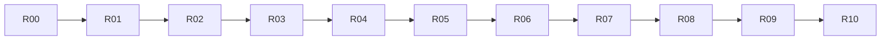

# 球桌操作布局返工方案

版本：**v2.2**。日期：**2026-10-19**。状态：**每日清台深色浮动编辑器获本轮用户认可；用户已授权开始，L00/L01实施中。旧 R08 的3D失败与iPad缺口、R09/R10及FL-181不由此次认可自动关闭。**

**本文件是需求真源，当前以v2.2推广计划为准，用户已授权实施。** v2.1及旧R批次是历史实施记录；“VoiceOver留作最终人工验收”的边界保留。后续实施使用L00–L06的新范围与证据，不自动恢复旧共享流程。

旧版归档：[v1.2 原文](TABLE-CONTROL-LAYOUT-PLAN-20261017-v1.2-ARCHIVE.md)。旧 B00–B12 的代码与测试证据保留供迁移和回归参考，不能沿用为 R 批次通过依据；[旧最终报告](table-control-layout/FINAL-REPORT.md)的整体完成结论已撤回。

## 当前推广计划：各页独立入口（v2.2，2026-10-19）

**最新用户原话**：「好的，感觉可以做其他的页面里，先规划下吧，由于我们是每个页面有单独的设置，通用设置里的就不用了」。

本节是当前工作入口，优先于后面的历史单页范围、U06–U09、§3.1通用管理入口、§5跨页应用和§9–10旧批次/验收中冲突的条款。旧记录保留作历史证据；规划轮已结束；用户随后明确“好的，开始吧”，现按L00–L06串行实施。用户认可指向已展示的每日固定深色效果，不外推为其他设备/页面已验收。

用户实施中追加裁定：**「全部替换成新的这种模式，之前的全部否决掉」**。所有相关页最终仅保留新浮动编辑流程，旧大面板/菜单选键/跨页共享/通用管理入口全部撤下；不保留运行时新旧编辑器切换。批次仅用于实施验证，旧代码只可保留必要的数据读取与转换，原始数据不因此删除。

### 统一后的使用方式

1. 每页从自己的「更多/设置 → 操作布局 ›」进入，直接编辑本页当前正式2D/3D模式；不新增全局入口。**移除通用设置中的“操作布局”及其管理导航**，默认视图、网格等其他通用显示设置和系统开关原样保留。
2. 复用同一套固定深色磨砂浮动工具栏、模板下拉、重置菜单和个人模板子菜单。保留拖动、收起、原地选键、连续缩放/精确数值、撤销/重做、取消和保存；不能退回旧大面板或“先选模板再编辑”的流程。
3. 本页默认带灰色禁用三点；文字仍可使用默认布局，点击三点不能重置草稿。个人模板三点提供使用、修改、置顶/取消置顶、删除。修改保存原模板，另存产生新模板；删除不回退当前应用布局。
4. 模板按页面与正式模式隔离，只见本页本模式；不跨页共享，不设置分类默认/批量应用/关联更新。固定视图训练只编辑该入口的模式，临时俯视不当作另一个正式模式。
5. 共用编辑器、各页独立数据和真实业务。标题返回/更多/状态/球库保留原位，真实桌面不挤小；只有该页实际存在的操作键可编辑，不能为套每日样式补造开球/击球/球库。
6. 工具栏初始锚点由页面提供：有球库的贴实际可见下沿；无球库的依据真实顶栏下沿和空闲区域选择，避免盖住答题操作。仍可手动移开/收起；小屏下拉允许滚动、靠底向上展开，子菜单贴来源三点。不把每日的坐标直接复制给所有页面。
7. 保留已有灰框/绿勾/箭头规范和原生系统开关；只调整本次操作布局流程，不重新设计各页业务菜单或全App外观。

### 现状盘点与边界

2026-10-19直接检查共享宿主、页面身份、入口开关、模板存储、通用设置入口及自定义球形宿主。下表是源码状态，不是本轮逐页运行验收。

| 范围 | 实际现状 | 本次处置 |
|---|---|---|
| 每日清台 | `usesFloatingTools`仅此页为true；本页模板四操作、固定深色、禁用默认三点已验证 | 作为认可参考和共享回归基线 |
| 自由击球、分离角与走位、蛇彩、自由走位、动作详情试打 | FreePlayView共用宿主，已有单键编辑但仍走旧编辑流程/跨页列表 | 分批切入新浮动流程，保留各自业务分支 |
| 思路训练、打一走二想三、防守、翻袋、颗星 | 教学/规划壳已有单键接入；各阶段按钮不同 | 第二种宿主先试点，随后完整推广 |
| 角度与瞄准、分离角图谱、加塞吃库图谱 | 已有单键壳；角度与瞄准2D没有可编辑操作键 | 仅实际有操作键的模式显示有效入口，不造空编辑器 |
| 2D/3D角度训练 | 已入单键名单；R08仅2D有阶段证据，3D失败及iPad仍未闭合 | 新流程下补完整答题阶段及旧失败复核 |
| 2D/3D瞄准点训练 | supports名单有，但usesFree名单没有；菜单入口据后者被过滤 | 需先完成单键接入，再开放新版编辑入口，不能只改显示开关 |
| 自定义球形：练习、摆球编辑 | 具有两个独立page ID，复用FreePlayView；均不在布局支持名单内 | 单列新增接入批，复核常驻键清单和两种编辑状态互斥后分别接入 |
| 动作详情/训练记录内嵌预览 | 只读/嵌入内容，并非独立操作训练页 | 排除，不额外添加布局入口 |
| 批量编排台BatchAuthoringView | 独立内部编辑器，有自己的菜单但未接controlLayoutHost，非自由走位composer | 本轮排除内部生产工具，不因“设置”同名自动扩入 |
| 通用设置 | SettingsView仍有settings.controlLayout进入ControlLayoutLibrary | 待实施时移除入口；收口时清理用户可达的旧管理路径，保留必要存储/迁移代码 |

覆盖口径：原18入口含每日基线，本轮推广其余17个；另有自定义球形2个新增入口，总计19个其他页面/固定视图入口。每页只覆盖实际支持的模式，不把18个身份等同于18×2模式。

### 实施范围与分组验收

| 批次 | 页面/工作 | 完成标准 |
|---|---|---|
| L00 契约与存档准备 | 逐页复核入口/常驻键/阶段；整理试点门控与旧模板过渡 | 新旧规则无歧义，原数据备份/迁移样本/撤回策略齐全；无未经接入页面提前露入口 |
| L01 两类试点 | 自由击球＋思路训练；每日清台回归 | 两宿主跑通完整浮动编辑和模板四操作；页间/模式不串；手机大小屏及iPad代表对照通过后再推广 |
| L02 其他练习页 | 分离角与走位、蛇彩、自由走位、动作详情试打 | 各页适用2D/3D；开球/序列/失败/下一组/上下杆/重摆和计时在编辑往返后保持 |
| L03 规划与教学页 | 打一走二想三、防守、翻袋、颗星、角度与瞄准、分离角图谱、加塞吃库图谱 | 每页控制集合和工具栏锚点独立核对；求解/选择/播放/图例/禁用状态不受影响；无操作键模式不出现空入口 |
| L04 训练答题页 | 2D/3D角度训练，再2D/3D瞄准点训练 | 逐数字键可选可移动，收起工具不误答题；输入/提交/结果/下一题/限额保持；固定模式隔离，R08缺口重新取证 |
| L05 自定义球形 | 练习页＋摆球编辑页 | 两个独立布局上下文；移动控件不拖动球，布局模板保存不触发球形模板保存；离开布局恢复原编辑/训练状态 |
| L06 入口与最终收口 | 删除通用布局入口，清理页内旧“管理个人模板”路径，回归全部已接入入口 | 用户操作不再进入旧全局库；原通用显示开关不变，旧数据不丢；各页有真实前后图和功能记录，完成用户复阅包 |

两类真实宿主先验证；用户追加“全部替换、之前全部否决”后，L02–L06完成各页单键/业务适配并统一清除旧运行时分支，按页面组分别验收。最终没有双轨模式或通用布局管理入口。

### 数据保护和必要验证

- 已保存的每页/模式布局先保留，切新编辑器不得自动回默认。旧跨页应用结果继续作为当前页快照；来源在别页时显示“当前布局”，用户可在本页另存。不会为列表收窄而删除旧模板或偷偷改写来源页。
- 有来源页的旧模板归来源页及模式显示；无可靠来源/旧schema不能猜归属，保留原档与备份，L00列真实样本和可恢复办法。移除通用入口前必须完成旧用户数据可达性检查；不可达问题未解决不得收口。
- 页面隔离不仅靠列表过滤：使用/修改/置顶/删除均验证目标模板的page/mode，排除残留跨页路径；取消/失败/冲突不得部分写入。
- 每页至少：默认→进入→直接选两个不同键→各自移动/缩放→收起→取消无写入→保存重进；本页模板使用/修改/置顶/删除，默认三点无作用；2D/3D及其他页状态不串。
- 每批相关页面在标准手机逐一核验；紧凑手机及iPad横竖/缩窗按宿主与风险组合，含固定视图训练。浅/深系统下编辑器都保持深色，普通/长模板名/大字号/空库/多模板/键盘输入可达；不宣称全笛卡尔积覆盖。
- 每批提供真实原生图；首批含“编辑前→收起预览→保存返回”对照及拖动录屏。源码、构建、交互、目视、用户认可分别记录。真机与VoiceOver仍按原最终人工边界单列。
- 验收沿用每日DC01桌面优先、DC13覆盖层与输入隔离、通用自适应容量规则；操作布局固定深色/默认三点/本页模板以当前用户裁定覆盖历史浅深与跨页共享约定。

### 当前交接

- 工作模式：L00–L06实施与定向验证完成，待用户复阅。原始源码备份及构建日志：`output/layout-local-rollout-20261019/`。前轮每日固定深色源与图仍是参考，不作为其他页通过依据。
- 参考：`output/settings-affordance-20261019/fixed-dark-light-system/2D-default-template.png`、`3D-default-template.png`；功能来源见每日单页记录r09及DR-410后续修订。
- 下一执行入口：用户复阅20入口/34适用模式效果；全量接入、旧运行时分支/通用入口移除及定向验证已完成，记录见table-control-layout/LOCAL-ROLLOUT-20261019.md；不恢复旧跨页共享R批次。
- 设计无需再选浅深或是否保留通用库：固定深色、各页入口、无通用操作布局入口已明确。尚未实施页面的具体锚点和阶段适配由本批源码/原图检查确定。

## 历史裁定：每日单页简化试用（2026-10-19）

本节优先于下文v2.1的U06–U09及菜单选键/跨页推广描述；旧批次记录保留为历史证据。

- 取消模板跨页共享，个人列表只显示当前页面、当前2D/3D模式；默认模板仍是本页默认。
- 直接手选真实按键，滑杆/百分比立即切换到该键当前比例；切换选择不改键的布局，无菜单选键。
- 个人模板右侧⋯：使用、修改、置顶/取消置顶、删除。修改保存更新原模板；删除保留已应用快照；置顶排序持久化。
- 浮动工具条贴球库可见下边沿，深浅磨砂，支持拖移、收起。真实页面底图与安全区外摆放要求保持。
- **先只落地每日清台供用户试用**；其他页面新交互不推广，旧跨页数据/已应用布局不清空。每日模板不再对其他页面共享。后续页面迁移须遵循本节简化规则，不继续旧共享方案。
- 实现、证据及用户复验入口：[单页记录](table-control-layout/DAILY-FLOATING-TOOLBAR-20261019.md)。R08–R10广泛批次仍暂停，FL-181未关闭。

## 1. 用户已明确的规则

| 编号 | 用户确认的要求 | 本轮合同 |
|---|---|---|
| U01 | 选择按键后直接放大、缩小、移动，参考王者荣耀 | 真实页面画布上逐个选键；实时二维拖动、连续缩放；禁止以控件组纵向偏移或几个尺寸档位代替 |
| U02 | 可以拖到安全区外，由用户按设备和喜好判断 | 整个 App 窗口作为画布；安全区仅作可选参考线，不因越出安全区、重叠或覆盖球桌拒绝保存、自动挪回或回退默认 |
| U03 | 2D、3D 分别设置，在什么模式打开就设置什么模式 | 入口锁定当前正式模式；独立草稿、模板和页面应用结果；删除“2D/3D 共用”编辑层 |
| U04 | 用户命名之外增加 2D、3D 后缀 | 展示名称为“用户名称 · 2D”或“用户名称 · 3D”；模式是独立字段，不能靠解析名称判断 |
| U05 | 各页面初始只能看到自己的默认模板 | 内置区仅本页、本模式默认；没有个人模板时列表仅这一项；不得展示其他页面或页面族的默认模板 |
| U06 | 自定义模板在其他页面可以看到 | 所有已接入相关页面使用同一份个人模板库；不按来源页面/页面族隐藏；模式差异明确标出 |
| U07 | 应用时只应用两页共有按键 | 依据语义稳定 ID 求交集；共有按键的位置和大小采用模板值，目标独有按键保留应用前值，来源独有按键忽略 |
| U08 | 点个人模板有“使用当前模板”“在当前模板基础上修改”两个选项 | 前者应用到当前页；后者进入独立草稿，保存生成新个人模板，不覆盖原模板；操作标签见 §3 |
| U09 | 其他页面不合适时可以微调另存新版本 | 新版本是独立模板，获得新 ID；不向其他已使用页面自动传播，不建立模板联动更新链 |
| U10 | VoiceOver 留最终人工验收，全部开发可继续 | 各批完成可执行的辅助功能与非拖动操作验证；真实 VoiceOver 未验单列，不阻断后续开发，也不冒称通过 |
| U11 | 设置操作布局时以当前完整页面为底图，球库、球桌、设置、帧数、左上标题和返回键等都显示，能看到真实修改效果 | 保留当前页面完整可见内容及实际构图，在同一画面实时移动/缩放真实控件；编辑预览与保存后的布局一致，不能省略页面装饰或非编辑元素 |

U01–U09、U11 是本轮纠偏的核心。下文坐标格式、应用快照、迁移及批次是为落实这些规则制定的实施合同，不冒称用户指定了底层字段。

## 2. 返工边界：保留什么，替换什么

代码核实日期：2026-10-19，依据当前共享工作区实读。工作区有大量其他任务改动；实施时记录实际源码快照，不以 HEAD 代替未提交内容，不回滚或纳入无关变更。

| 当前实现与证据 | 返工处置 |
|---|---|
| `ControlLayoutGroup` 键控整个 direction/instrument/primary/replay/planning/camera 等组 | 替换为逐控件语义 ID 和每个控件的布局记录；重打和回放、多个相机按钮等必须可分别编辑 |
| host 对原内容使用 `opacity(editing ? 0 : 1)`，FreePlay/教学壳同时隐藏场景；editor 用圆角矩形代替球桌 | 编辑态保留完整真实页面和场景呈现，只隔离业务输入；修复不能仅在 editor 背后添一张空球桌图 |
| `ControlLayoutEditor` 手势只有 `onEnded`，只消费 `translation.height` | 替换为实时横纵拖动、单键选中框、连续尺寸控制；默认预览使用真实页面结构和控件 |
| `ControlLayoutPlacement` 按左右列重排，拒绝非 automatic 尺寸，越界/相交会回退 | 替换自定义布局定位分支；保留原生默认布局计算，不让旧夹紧/避障逻辑继续覆盖用户选择 |
| `common/twoD/threeD`、familyDefaults、模板引用＋局部覆盖、共享提升更新 | 换为单模式模板＋页面/模式应用快照；旧结构只用于迁移读取 |
| `ControlLayoutLibrary` 包含页面族默认、引用计数、更新/提升/替换传播等流程 | 收敛为本页默认＋个人库，个人模板两种主操作；管理只保留基本改名/删除，不做批量应用与自动传播 |
| `ControlLayoutStore` 原子写入、读失败保留、版本冲突和备份 | 复用可靠性机制，重做数据合同与事务；不得直接复用旧 apply/restore/delete 的联动语义 |
| `ControlLayoutDraft` 私有快照、撤销重做 | 保留隔离原则，替换绑定/分组/共用层结构；手势结束形成一个撤销步骤 |
| 四宿主已有页面入口、忙碌判断、暂停与计时接入 | 尽量保留并逐页回归；编辑不能触发退出训练、结束蛇彩或退出只读序列 |
| 默认几何、题型/权限、训练记录、显示偏好隔离测试 | 保留有效断言；对旧“越界拒绝/共用联动”等过时合同逐条注明替换理由，再增加新合同验证 |

不得仅在旧编辑器里加一个缩放滑杆后宣称完成。模型、真实控件渲染、命中、模板应用和保存读回必须贯通单按键。

## 3. 页面入口、模板列表与操作流程

### 3.1 入口

主入口保留各页面“更多 → 操作布局”。进入时冻结当前页面 ID、正式 2D/3D 模式和原练习状态，先展示模板选择浮层，保留当前页面作背景；进入编辑后收起列表，完整页面作为画布。模式直接写在标题中，不再提供“共用/仅 2D/仅 3D”切换器。需要改另一模式时，返回练习、正式切换模式后重新进入。

临时俯视是观察动作，仍归属原正式 3D 模式；其过渡/持触期间不能进入编辑。固定 2D/3D 答题入口保持独立题型、成绩和页面身份。

通用设置保留“操作布局”作为个人库管理入口，可查看、改名、删除；无当前页面上下文时不执行“使用”。要调整布局，引导到明确的相关页面及模式后使用相同入口，不另造一套脱离真实页面的编辑器。

### 3.2 列表规则

- 内置区只有“本页默认 · 2D/3D”，使用当前页当前模式原生默认布局；不可改写内置内容，可以从其创建个人模板。
- 个人区展示已有个人模板，跨页面可见，显示自动模式后缀和来源页面信息。当前模式的模板优先，其他模式仍可见但两种主操作禁用，说明“请在 2D/3D 模式下使用”；不自动切换练习模式，也不把异模式模板转换后应用。
- 没有个人模板时，只显示本页默认与从它开始自定义的入口；不预置其他页面的默认或伪造个人模板。
- 点击个人模板，显示且仅显示两种主操作：**“使用当前模板”**、**“在此模板基础上修改”**。关闭/取消不是第三种模板行为；改名和删除放在单独的管理入口，不混入此二选一流程。
- 同模式但无共同可编辑控件时仍可看到模板；明确“当前页面没有可应用的按键”，不能显示应用成功，不能只改页面标签。

### 3.3 使用当前模板

读取当前页当前模式的最新布局快照，合入共同控件的位置和大小，原子保存，返回原练习。页面未处于可应用状态时不强制停止击球/播放；入口禁用并说明原因，恢复后由用户再次操作，不排一个未来突然生效的隐藏任务。

使用不修改模板本身，也不修改其他页面/另一模式。结果是当前页面独立快照；以后来源模板改名或删除，不重排已使用页面。应用失败保留原布局并显示原因，不关闭到一个看似成功的界面。

### 3.4 在此模板基础上修改

1. 以当前页布局为底，先在私有草稿合入模板共同控件；当前页独有控件沿用进入前值。
2. 进入当前页真实画布，选择单键、移动、缩放，可撤销/重做，支持恢复选中键或当前草稿全部默认。
3. “保存为新模板”输入用户名称，旁边固定展示模式后缀；保存成功同时将该草稿应用到当前页。
4. 新模板新 ID，原模板内容不变，其他页面不变。保存失败保留草稿，取消回到应用前状态；不得先应用再打开编辑器导致取消失效。
5. 新模板收录当前页该模式可编辑控件的有效布局，包括当前页独有控件。来源模板中当前页没有的条目在派生副本中原样保留，避免换页编辑后丢失来源页的设置；这些条目不在当前页创建控件。

从本页默认开始自定义遵循同一保存流程。无修改也可另存副本。首版不提供“覆盖原模板”“更新所有引用页面”“提升局部覆盖”等额外动作。

### 3.5 名称与恢复

保存 `baseName` 和 `mode`，展示时拼接一次后缀。名称输入去除首尾空白，空名不能保存；不因名称相同覆盖模板，ID 才是身份。重复名称用来源/创建信息辅助区分，不强迫用户改名。重命名只改用户部分，模式后缀不可编辑。

“使用本页默认”明确恢复本页当前模式的全部自定义布局；这与个人模板“仅合入共有按键”是两种不同语义。它不删除个人模板，也不改变其他页面或另一模式。

删除个人模板只移出模板库；已应用快照仍保留，页面显示“自定义布局”，不能回退默认或要求选择替代模板。草稿编辑过程中来源被删除，也可保存为新模板；目标页面已发生新写入则按 §6 冲突规则处理。

## 4. 单按键画布与布局合同

### 4.1 编辑粒度与真实呈现

- 可独立触发的操作按钮分别登记、选中、移动、缩放。例如重打与回放不能再共用 `.replay` 组；相机按钮不能整体镜像代替单键移动。
- 方向轮、力度尺、打点盘等连续输入控件可以作为一个完整控件移动/等比缩放；其旁边独立按钮仍单独登记。题目、比分、只读说明不冒充按键。
- 数字键盘内可独立点按的按键纳入逐键清单，不能悄悄把“整键盘移动”当作 U01 完成。阶段互斥按钮按语义分别记录，编辑器可选展示阶段，不改变真实答题阶段。
- R00 逐页列出真实控件、状态、语义 ID 和不可编辑项理由。球桌、球、教学轨迹与文章内容不是操作布局对象；移动按键不缩放球桌或改变世界坐标。
- 编辑以**当前完整真实页面**为底图：球桌与当前球形、球库、设置/更多入口、帧数及页面已有状态读数、左上角标题和返回键、其他当前可见元素都保留。各页按自身实际内容呈现，不能只留下球桌和待编辑按钮，也不能给原本没有某元素的页面凭空补一套。
- 进入编辑时保留当前正式模式、相机视角、球桌构图、页面尺寸、背景、字号和原有固定元素位置。可见与可编辑分开登记：不可编辑内容仍显示，可编辑按钮在原位置被选中、实时移动/缩放；这条要求不等于把球桌/球库内容/标题文字本身全部开放为可移动对象。
- 真实页面和编辑预览共用控件布局渲染及变换；不能另画近似页面。若冻结场景采用截图，只能承载不变背景，移动控件不得在截图原位残留“旧按钮”，也不得把真实页面压缩成缩略图。禁止圆角矩形假球桌、通用示例背景或隐藏非编辑元素。
- 编辑工具条悬浮且可收起，不挤压原页面或永久盖住标题、返回、球库和帧数等参照元素；收起工具条/选中框后可检查完整效果。除编辑专用标记和动态读数外，同一窗口/模式/状态下，编辑预览与保存返回后的可见位置、大小、层级和遮挡效果必须一致；取消恢复进入前布局。
- 编辑期间暂停练习业务，不等于隐藏画面。返回、设置/更多等原按钮仍可见，但原业务动作被拦截，编辑退出走编辑器自己的保存/取消流程；不能误退出训练或打开真实设置。帧数等读数保留实际呈现，暂停时允许保留最近真实值，不伪造读数，也不要求为预览继续运行训练物理。

### 4.2 移动、缩放、安全区

原点为当前 App 内容窗口左上角，x 向右、y 向下；布局覆盖完整窗口，包含安全区外可显示区域，不使用扣掉安全区的左右侧栏作边界。窗口以外没有额外画布，但控件边缘越出窗口时不据此拒绝已保存布局。

拖动跟随手指同时更新 x/y；连续大小滑杆实时等比缩放，可配合拖拽缩放手柄。滑杆显示百分比，并提供可访问的增减/数值调整，不能只有“紧凑/标准/自动”。不加入自动吸附、避障或强制保持默认触点大小来抵消缩放；比例必须有限且大于零，实际控制范围在 R00 样例中明确验证，不能把缩放本身后置。

允许覆盖球桌、按钮相交和进入安全区外；安全区参考线及重叠提示不拦截保存。系统保留的手势区域由操作系统决定能否接收事件，不伪称 App 可以覆盖系统手势；这些限制不转化为强制挪回按键。

编辑工具条与退出/恢复入口属于编辑器自身，不随用户布局移动；可收起工具条，避免它挡住要编辑的位置。重叠控件可从控件列表选择，临时突出选中项不写入业务层级。重叠命中采用确定的原生层级，未命中控件的区域继续允许原球桌操作；不在整个画布铺透明业务拦截层。

### 4.3 坐标、大小和窗口变化

本轮采用完整窗口归一化中心坐标及相对原生控件默认大小的等比系数。每个模板记录源窗口尺寸作预览信息，应用时按目标窗口换算中心；目标控件按自身原生尺寸乘相同比例。这样不会把手机绝对像素硬搬到 iPad，也不会跨页改写控件文字或业务样式。

首版每页每模式一份布局，不再维护三套隐藏设备域，也不做跨设备复制向导。旋转/缩窗按实际窗口换算显示，不反写保存值；在新窗口明确编辑保存时才更新布局。个人模板不能因为缺少某个方向域而从列表消失或自动回到默认。此规则不意味着新增云同步，本轮仍是本机库。

未设置布局时沿用原生默认适配；个人布局不得因为旧 `defaultFits`、障碍矩形或安全区检查被整体回退。原业务确实不支持的窗口尺寸仍遵守该页面既有准入，不能借此新增个人布局容量限制。R01/R02 要验证坐标往返和真实命中，不能只测存储数值。

### 4.4 渲染与命中一致

实际可见框、触摸命中、辅助功能框、展开面板锚点和特写保护框使用同一变换后的几何。缩放仪表后输入换算仍按本地坐标，不能改变真实力度/方向值的含义。相机按键的布局坐标不包含相机姿态；移动/缩放不能重建场景或重置练习。

用户有意重叠的按键不由系统挪开；弹出菜单/特写可沿用自身显示适配，但不能通过它们的避让反馈反过来改用户保存的按键位置。

## 5. 跨页应用算法与模式隔离

登记目录使用语义稳定 ID。ID 表示实际动作，不按按钮文字、图标、数组位置或旧组名匹配。“击球”与“提交答案”即使都叫 `primary` 也不能互配；“下一题”与“下一杆”也不能因文字相近合并。相同语义的控件在四宿主之间复用 ID；页面专属动作使用独立 ID。候选 ID 在 R00 反查实际闭包后定稿，本文不编造已存在的代码符号。

设模板条目为 S，目标页面当前模式登记的可编辑控件为 T，应用交集为 K：

1. 先检查模式相同；不相同不应用。
2. K = S 与 T 的语义 ID 交集，且控件实现支持同一位置/缩放合同。T 包含本页该模式合法的各阶段控件，不仅是此刻可见控件。
3. 对 K，覆盖其位置和比例；对 T−K，保留当前值；对 S−K，当前页忽略。
4. 暂不可见/暂禁用的合法控件保存其布局，未来按原业务规则出现；模板不强制显示、解禁、解锁 Pro 或开放辅助。
5. 同一事务保存当前页当前模式快照。再次应用从最新快照合入，不遗留旧局部覆盖来遮住刚选模板；不修改库中模板。

示例：A 模板有“击球、重打、回放”，B 页面有“击球、重打、下一杆”。B 使用 A 后只变更击球/重打，下一杆保留使用前位置和大小，不创建回放。B 再修改并保存新模板，A 原模板和 A 页面均不变。

2D 与 3D 只共享语义 ID 字典，不共享布局值。某页 2D 的保存、恢复、应用及删除库记录不能改其 3D 应用结果；固定答题双入口还要分别验证。

## 6. 数据、草稿、迁移和业务保护

### 6.1 最小数据结构

| 对象 | 必需内容 | 明确排除 |
|---|---|---|
| 内置默认 | 页面 ID、模式、当前原生默认提供器 | 可写共享默认、页面族默认 |
| 个人模板 | 新 ID、用户名称、单一模式、源页面/窗口信息、按语义 ID 保存位置和比例；可选来源 ID | common 层、业务值、实时引用传播链 |
| 页面布局 | 页面 ID＋模式、当前布局快照、来源模板 ID（仅溯源） | 依赖模板存活才能解析的绑定、覆盖优先级链 |
| 编辑草稿 | 进入前快照、当前草稿、选中控件、撤销/重做及基础修订 | 在拖动过程中写正式库、直接执行练习闭包 |
| 归档 | schema 版本、修订号、模板库、页面快照 | 用户账号/成绩/球位/相机姿态/训练参数 |

保存新模板和应用当前页必须一次原子提交；写失败不发布部分内存状态。保留读错误诊断、坏文件备份、显式恢复，不静默清空个人数据。多窗口或重复点击用修订/同一提交 ID 处理，避免生成两个副本；过期页面草稿提示重载或保留副本，不做自动字段合并。重载前不得丢草稿；另存副本不能顺带覆盖已变化的页面，重新检查当前页修订后才应用。

### 6.2 旧 v1 数据迁移

旧归档有共用层、设备方向域和组级位移，不能准确声称已具备单键坐标。R00 先确定旧版本实际分发范围和已有归档样本；不假设“从未发布，所以可以清掉”。

迁移流程采用：保留原始归档备份 → 读取已知 v1 → 以旧 resolver/placement 在相应页面、模式、窗口的实际几何展开 → 将组内每个真实控件换算为独立坐标和比例 → 写入新版快照。已配置页面可在首次挂载且测量有效时迁移，不能用猜测框替代实际测量。

旧模板按实际可用 2D/3D 分开迁移，添加对应后缀；旧 familyDefault 先物化到曾受其影响页面，再取消跟随关系。多个旧设备域不得随意丢弃：可转换成分别命名的独立个人模板，选择项仍标模式；不在新运行时恢复隐式域继承。

无法可靠转换的旧条目保留为待迁移记录并说明原因，不放入“可使用”新模板列表，不以默认值覆盖原数据。只迁移已知版本；未知版本或损坏记录保留并提示恢复。迁移重复执行幂等，失败不留下半迁移状态；旧名称/来源和未映射条目可追溯。具体样本与映射表列在 R00，自动迁移验证列在 R04。

### 6.3 暂停与业务不变量

进入模板列表、编辑器或嵌套管理均属于布局会话：暂停训练输入、物理/播放及该会话对应计时，保存/取消/后台往返幂等恢复。保留原场景、球位、选球、方向/力度/打点、求解结果、题目、成绩和记录。编辑不能算作新作答/训练，也不能绕过每日、蛇彩、序列和答题的权限规则。

忙碌准入沿用真实宿主状态；不能为编辑强制结束正在执行的动作。真正离开练习仍走原退出流程；编辑覆盖层不触发业务离页清理。显示与辅助设置继续使用 `TablePreferencesStore` 原合同，操作布局不借用通用设置“清除各页覆盖”的写入路径。

## 7. 页面范围与首阶段

本轮仍覆盖原 18 个全屏入口。首阶段 R00–R04 必须完成 P01/P02/P07 的真实闭环，两种宿主各有业务验证；R01 是贯穿单按键的最小实现，不是最终三页成果。其余页面在接入新版前保持可用默认/旧数据保护路径，不展示一个仍只有组级能力的新版编辑器。

| ID | 页面／稳定页面身份 | 真实宿主 | 新版接入 |
|---|---|---|---|
| P01 | 每日清台 `dailyClearance` | FreePlayView | R01–R04 |
| P02 | 自由击球 `freePlay` | FreePlayView | R02–R04 |
| P03 | 分离角与走位 `shotSimulation` | FreePlayView | R05 ✅ 2026-10-19 |
| P04 | 蛇彩 `snakePractice` | FreePlayView | R05 ✅ 2026-10-19 |
| P05 | 自由走位 `composer` | FreePlayView | R05 ✅ 2026-10-19 |
| P06 | 动作详情试打 `drillTryout` | FreePlayView | R05 ✅ 2026-10-19 |
| P07 | 思路训练 `silu` | BTTeachingTablePage | R02–R04 |
| P08 | 打一走二想三 `planThree` | BTTeachingTablePage | R06 |
| P09 | 防守 `snookerTactics` | BTTeachingTablePage | R06 |
| P10 | 翻袋 `bankShot` | SolverStageChrome / BTTeachingTablePage | R06 |
| P11 | 颗星 `diamondSystem` | SolverStageChrome / BTTeachingTablePage | R06 |
| P12 | 角度与瞄准 `angleDynamic` | BTTeachingTablePage | R07 |
| P13 | 分离角图谱 `separationAngleAtlas` | BTTeachingTablePage | R07 |
| P14 | 加塞吃库图谱 `cushionEnglishAtlas` | BTTeachingTablePage | R07 |
| P15 | 2D 角度训练 `sceneAiming2D` | SceneAimingView | R08 暂停 |
| P16 | 3D 角度训练 `sceneAiming3D` | SceneAimingView | R08 暂停 |
| P17 | 2D 瞄准点训练 `aimPointScene2D` | AimPointSceneTrainingView | R09 |
| P18 | 3D 瞄准点训练 `aimPointScene3D` | AimPointSceneTrainingView | R09 |

不扩展到文章/图解、详情或记录的嵌入播放、照片提取、内部批量编排、离线媒体导出；同期自定义球形练习/编辑另有任务，也不因共享宿主自动接入。受共享修改影响的外围消费者做代表回归。

本轮不做云同步、模板市场、分享码、透明度、任意控件新增/删除、自动避让、自动排版、版本树或批量套用；**单键实时移动与连续缩放、跨页共有控件应用不是后置增强。**

## 8. 已核实代码锚点

以下为 2026-10-19 的现状行号，实施前按符号重新定位；“拟新增字段”不在此伪装成已有 API。

| 文件与行号（相对仓库） | 已核实事实／返工范围 |
|---|---|
| `QiuJi/Data/Models/ControlLayout.swift:9` | 18 入口白名单及固定模式；继续作范围入口，清理 family 联动 |
| `QiuJi/Data/Models/ControlLayout.swift:29` | domain/layer/group/property/size 定义；需要新版单键模型 |
| `QiuJi/Data/Models/ControlLayout.swift:138` | resolver 合并模板、局部覆盖、common 与 mode；替换应用语义 |
| `QiuJi/Data/Models/ControlLayoutDraft.swift:4` | 私有草稿、历史栈、模板/页面绑定快照；替换结构，保留隔离 |
| `QiuJi/Data/Services/ControlLayoutStore.swift:14` | 原子文件存储、备份；v1 文件路径与 schema 读取 |
| `QiuJi/Data/Services/ControlLayoutStore.swift:92` | savePage/saveAs/apply/save 及后续管理事务；重做快照语义 |
| `QiuJi/Core/Components/ControlLayoutEditor.swift:178` | 遍历组、纵向 onEnded 拖动，非单键实时移动 |
| `QiuJi/Core/Components/ControlLayoutEditor.swift:328` | common 模式、上/下移及换侧等旧交互 |
| `QiuJi/Core/Components/ControlLayoutPlacement.swift:11` | group 默认框、列、障碍，非自由画布 |
| `QiuJi/Core/Components/ControlLayoutPlacement.swift:60` | 拒绝非 automatic 尺寸；后续越界/相交回退 |
| `QiuJi/Core/Components/ControlLayoutHost.swift:48` | 组级测量/offset、仪表继承位移、保护框 |
| `QiuJi/Core/Components/ControlLayoutHost.swift:101` | host 输入裁切、编辑遮罩、容量/默认回退 |
| `QiuJi/Core/Components/ControlLayoutLibrary.swift:56` | 个人库、页面族默认与详情入口；替换为两种主操作 |
| `QiuJi/Features/PositionPlay/Views/FreePlayView.swift:279` | 编辑暂停；入口约 1393，host 约 1794，组级控件约 2124–2321 |
| `QiuJi/Core/Components/BTTeachingTablePage.swift:152` | 暂停生命周期；组接入约 257–284，host 约 345 |
| `QiuJi/Features/AngleTraining/Views/SceneAimingView.swift:201` | 相机、信息、动作、整键盘布局；host 约 248 |
| `QiuJi/Features/AngleTraining/Views/AimPointSceneTrainingView.swift:639` | 方向、相机、主动作等组；host 约 713 |

复杂仪表/页面专属动作的逐键清单、所有闭包及迁移样本仍需 R00 实读定位；不能因为上述宿主已查就声称每个按键全部核实。旧基线见 [B00 合同](table-control-layout/B00-BASELINE-CONTRACT.md)，只复用默认事实及暂停要求，其组级/区域合同已被本方案替代。

## 9. 实施批次与依赖

各批按一次会话内“实现＋定向验证”估量；批次较大时在同一 R 编号下按明确 DoD 分子卡，不把未验项写成完成。当前 R00 已完成源码目录、三页规则样例与脚本校验；R01 手机/iPad 两个真实按钮闭环通过，R02–R05 已完成，R06 开始，其余待开始。

| 批次 | 范围 | 量级／主要上下文 | 依赖 | 验收出口 |
|---|---|---|---|---|
| R00 ✅ 2026-10-19 | 控件语义清单、逐键状态、坐标/迁移样本、三页交互样例 | 中：四宿主清单＋三页样例，不重建全量旧图册 | 无 | 新规则与真实控件一一对应，首阶段边界清楚 |
| R01 ✅ 2026-10-19 | 单键数据/渲染/编辑/保存最小纵向贯通 | 中：模型、store、host、editor＋P01 两个相邻真实按钮 | R00 | 选单键→斜向拖动→缩放→安全区外保存→重启保持 |
| R02 ✅ 2026-10-19 | P01/P02/P07 全部登记操作与两模式接入 | 中大：两个宿主及仪表/相机/规划分解 | R01 | 三页逐控件编辑、默认不变、输入与暂停正确 |
| R03 ✅ 2026-10-19 | 共享库、模式后缀、两种主操作、交集合入、派生另存 | 中：library/store/draft＋三页跨宿主 | R02 | U03–U09 完整跨页操作链 |
| R04 ✅ 2026-10-19 | 迁移、失败恢复、基本管理及首阶段验收 | 中：旧新归档、三页手机/平板与生命周期 | R03 | 三页完整可用且数据保护有证据 |
| R05 ✅ 2026-10-19 | 其余 FreePlay 入口 P03–P06 | 中：共享宿主、蛇彩/序列特殊状态 | R04 | 逐页编辑和原业务回归 |
| R06 ✅ 2026-10-19 | 规划/求解 P08–P11 | 中：教学壳与 SolverStageChrome、专属按钮 | R05 | 共享交集正确，求解/播放/规划状态保持 |
| R07 ✅ 2026-10-19 | 交互教学 P12–P14 | 中：教学控件、参数和禁用差异 | R06 | 独立按钮/仪表编辑不改教学内容 |
| R08 暂停 | 固定角度答题 P15/P16 | 中：独立宿主、逐键输入、阶段动作 | R07 | 2D/3D 隔离及真实输入/提交验证 |
| R09 | 固定瞄准点答题 P17/P18 | 中：独立宿主、方向/相机/提交 | R08 暂停 | 隔离、误差/辅助规则及原题目保留 |
| R10 | 增量全量矩阵、外围回归与收口 | 中大：复用前批证据，补未覆盖组合 | R09 | 18 页覆盖表、新旧证据隔离、人工待验明确 |

本轮采用串行收敛，避免多个批次同时改共享 host/model。后续页面虽有局部独立性，也不默认开启多智能体或并行改同一工作区。

### R00 完成标准

交付逐控件目录：页面/模式/阶段、实际组件与业务闭包、语义 ID、默认框来源、单按钮或连续控件、是否可编辑及理由；覆盖 18 页，共享按键必须有语义依据。交付三页交互样例与流程图，展示安全区外单键、连续缩放、个人模板二选一及跨页差异结果；同时列出完整页面可见元素，逐项核球库/球桌/设置/帧数/标题/返回等，不可编辑项也保留在画面。列出迁移样本及无法直接转换项、大小调节范围和坐标合同。样例是实施依据，不能标为 App 已实现。

### R01 完成标准

选 P01 两个相邻且独立的真实按钮，仅拖其中一个斜向移动，另一个框完全不变；拖动过程中就跟随。比例连续变化，保存后原生视觉/命中/AX 框一致；移到安全区外仍可保存，退出重进及重启保持。至少一次手机与 iPad 代表原生录屏，验证 2D/3D 键隔离、取消无写入、写失败不丢原值。提供同状态“进入前 → 编辑工具收起后的预览 → 保存返回”的整页对照，完整球桌、球库、顶栏、设置入口与读数不得缺失，移动处无旧按钮残影，预览与落地位置/大小一致；该要求必须在首个闭环完成。该批只证明纵向贯通，不能宣称整个页面所有按钮完成。

### R02 完成标准

完成三页已登记按键与连续控件的实际接入，包括分拆相机/重打/回放/规划按钮，不能只替换选择框。默认无配置时与原生基线一致；三页完整底图分别核验，不用 P01 的整页对照代替 P02/P07。三页分别验证两模式、实际击球或规划操作、布局编辑暂停/计时、取消/保存/后台返回；手机小屏/标准与 iPad 横竖各有代表证据。可非拖动选择和调整 x/y/比例，重叠时仍可在列表定位并恢复控件。

### R03 完成标准

从空库验证每页只有自己默认；A 新建后 B/C 均能看到，跨模式能看到但不能误用。两种主操作各跑通：应用交集保留目标独有设置；基于模板修改可取消，保存新 ID、原模板及其他页面不变，后缀正确且不重复。至少构造“共有两键＋目标独有一键＋来源独有一键”，并验证零交集、暂不可见控件、重复名称和再次应用。

### R04 完成标准

三页完整首阶段链：创建 2D 模板→另一宿主使用→在其基础上修改另存→返回来源页使用新模板→切 3D 保持原配置→重启确认。迁移用实际 v1 样本，验证旧域/共用展开、备份、重复执行、部分不可映射与未知版本；失败注入验证保存/读取/恢复/冲突/重复点击。基本改名和删除不重排已应用页。安全区外、重叠、旋转/缩窗不回退和原练习不变量必须有原生证据。首阶段报告清楚列已接入三页、其余待接入、真实 VoiceOver 待验。

### R05–R07 完成标准

每批逐页补齐对应控件清单、默认和个人布局、适用模式、实际业务动作与保存恢复。R05 特别验证蛇彩失败/下一组、编排录制及只读序列上下杆不会因布局编辑结束；R06 验证选球/区域/袋/库数、求解无解/多解/微调/播放，不把专属按钮误配；R07 验证教学参数/读数/禁用辅助不被模板改变。每批手机与平板代表证据＋相关测试和构建，回归受共享改动影响的三试点，不重复无关全量矩阵。

### R08–R09 完成标准

两个宿主各自验证固定 2D/3D 独立保存/应用/恢复，不能用另一个宿主测试代替。R08 验逐数字键/退格/提交等真实输入，单键缩放后正确命中且只执行一次；R09 验方向调整、提交、误差结果与下一题，保留现有辅助口径，不新增验证击球流程。题目、输入、成绩、限额和阶段在编辑往返后保持；跨页模板不把击球坐标误配为答题提交。每批两入口、手机/平板代表原生证据及相关测试/构建。

### R10 完成标准

18 入口均有默认/个人布局和适用模式覆盖；逐控件接入清单无未说明遗漏。手机标准/小屏、iPad 横竖和真实缩窗/旋转补齐，浅深色、大字号、重叠、安全区外、重启及异常恢复按风险组合，明确哪些组合仅代表覆盖。外围嵌入播放/图解/通用偏好/权限不误继承。适用构建、定向测试、`verify-gate`、`verify-doc-size` 和差异检查完成，既有失败单列原因。更新使用说明与人工清单，FL-181 仅在用户核心操作目标具备新证据后申请关闭；未验真机/VoiceOver/用户体验不写通过，未获发布授权不发布。

## 10. 验收追踪与证据要求

| 验收 ID | 必验内容 | 对应需求／批次 |
|---|---|---|
| A01 | 单键实时二维移动，邻键不动，真实控件连续缩放与命中一致 | U01；R01/R02，推广批次 |
| A02 | 安全区外、遮桌、重叠可以保存读回，不夹紧不回退 | U02；R01/R04/R10 |
| A03 | 当前模式编辑且 2D/3D 应用、恢复、重启相互隔离 | U03；R01/R03/R08/R09 |
| A04 | 名称自动单次模式后缀，改名不改模式，同名不覆盖 | U04；R03/R04 |
| A05 | 空库只见本页默认，个人模板跨页可见，无其他页内置默认 | U05/U06；R03 |
| A06 | 交集覆盖、目标独有原值保留、来源独有不创建、零交集不假成功 | U07；R03 及每个新宿主 |
| A07 | 两种主操作明确；修改先草稿，取消原状态，保存新 ID 原模板不变 | U08/U09；R03/R04 |
| A08 | 应用快照不受来源改名/删除影响，默认恢复仅本页本模式 | U09；R04 |
| A09 | 归一化换算/窗口变化不反写配置，个人布局不触发旧容量回退 | U01/U02/U06；R01/R04/R10 |
| A10 | 布局会话暂停计时，业务值/权限/记录/场景不变，离页仍清理 | 所有接入批次 |
| A11 | 迁移/异常/并发冲突/写失败保留原始数据，无半提交 | R04/R10 |
| A12 | 所有操作可非拖动完成；真实 VoiceOver 独立待验 | U10；各批可执行验证，最终人工验收 |
| A13 | 18 页清单与真实控件一致，外围不误接入，默认适配保持 | R00/R05–R10 |
| A14 | 当前完整页面可见；球库/球桌/设置/帧数/标题/返回等不缺失；编辑不挤压构图，无旧按钮残影；收起工具后的预览与保存结果一致 | U11；R00 清单、R01 首验、R02 三页、R05–R10 逐页核验 |

当前文档阶段只验：规则一致性、代码锚点、18 页/11 批次及依赖、链接/空白/文档体积；没有 App 功能验证结论。

实施证据使用新目录 `output/table-control-layout-rework-20261019/Rxx/rNN/`，不得覆盖旧 B 证据。每份报告记录实际源码身份及相关 dirty 文件、入口/模式/阶段、设备/OS/窗口/安全区/字号、模板与快照 ID、保存前后值、真实操作与结果、失败/未覆盖项。截图只能证明外观；实时拖动、保存重进、缩放命中和跨页流程须连续录屏/自动化动作及持久化读回互证。

实施前读几何技能与模拟器[生命周期说明](../scripts/simulator-lifecycle/README.md)。测试选择前盘点可能写入内容/截图的测试及执行集，不承诺全仓零 diff，不运行无关内容烘焙。旧默认/业务断言继续保留；替换旧区域或联动断言时，记录原断言、被新合同替代的原因、失败机理和新的对应测试，禁止为变绿直接删掉。

[最终人工验收](table-control-layout/FINAL-HUMAN-ACCEPTANCE.md)沿用用户许可后置，但内容改为本轮单键自由编辑和两操作合同。模拟器 AX 测试不替代真实 VoiceOver。技术完成、用户体验认可、真机验证和发布是独立状态。

## 11. 当前断点与版本记录

v2.0 文档检查（2026-10-19）：7 个本地链接有效，18 页、11 个有序批次、17 个代码锚点及代码围栏/空白检查通过；`verify-doc-size` 通过，PROGRESS 当前状态与 Hub 最近完成各 10 条，定向 `git diff --check` 通过。未运行 App 构建、功能测试或模拟器。

当前完成：R00 控件目录/规则样例；[R01 两个单键纵向闭环](table-control-layout/R01-IMPLEMENTATION.md)，3 个数据测试＋手机/iPad 各 1 个 UI 测试通过，14 张阶段图及连续录屏已核。[R02 三页接入](table-control-layout/R02-IMPLEMENTATION.md)已验，6 次定向原生运行通过；[R03 共享模板](table-control-layout/R03-IMPLEMENTATION.md)已验（8项数据测试＋原生三页链）；[R04 首阶段已验](table-control-layout/R04-IMPLEMENTATION.md)，[R05已验](table-control-layout/R05-IMPLEMENTATION.md)，[R06已验](table-control-layout/R06-IMPLEMENTATION.md)，R07已验，R08复验暂停（手机2D通过、3D失败待查、平板未验），R09–R10未开始，FL-181 保持打开。

每批交接更新本文件批次状态与 [PROGRESS](PROGRESS.md)索引，写清已完成/未完成 DoD、源码与证据身份、用户新裁定和下一动作。旧 B 报告是历史证据，当前使用说明需在新版实现完成后重写，不能把未来合同当现有功能。

| 版本 | 日期 | 变更 |
|---|---|---|
| v2.1 | 2026-10-19 | 用户补充完整页面所见即所得：球库/球桌/设置/帧数/标题/返回等保留可见；补 U11、§4.1、R00/R01/R02 和 A14，复核旧 host/场景隐藏路径；同步人工验收，仅改文档 |
| v2.0 | 2026-10-19 | 按用户纠偏全面返工：单按键实时移动/连续缩放、允许安全区外、模式独立及后缀、本页默认＋跨页个人库、交集应用、个人模板两操作与派生另存；取消组级区域限制/共用层/族默认/共享联动；重排 R00–R10，首阶段三页；只更新文档 |
| v1.2 | 2026-10-18 | 连续开发授权，VoiceOver 后置；原文与 B 证据现为历史，完成结论撤回 |
| v1.1/v1.0 | 2026-10-17 | 原分析/代码审核与 B00–B12 排期，错误收窄自由编辑目标，已被 v2.0 替代 |

方法：[issue collection 技能](../.cursor/skills/issue-collection-restructure/SKILL.md)。交互调研曾参考[王者荣耀历史官方说明](https://www.taptap.cn/moment/15229708975212337)、[按键大小教程](https://www.9game.cn/news/12109184.html)及[公开操作示例](https://www.dvg.cn/news/106290.html)；仅参考“选键、移动、尺寸、保存”流程，不声称实操或验证了最新版游戏客户端，也不照搬英雄、技能或透明度功能。

执行检查点（2026-10-19）：[R00 控件目录与样例](table-control-layout/R00-CONTROL-CATALOG.md)已落盘；三页历史构图已查看，坐标数值示例通过；交互样例脚本核验通过，浏览器策略限制与原生验收边界见下。

R00 验收：目录覆盖18页，三页B00整页参考已查看；交互样例脚本通过空库、两操作、取消、交集、目标独有保留、模式隔离，坐标数值验证通过。浏览器安全策略拒绝 file://，未做浏览器视觉验收；样例只作规则演示，原生验收在R01。
