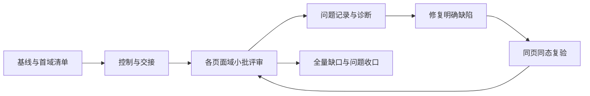

# 全 App 十设备实时评审与问题闭环方案

**v5.2｜2026-10-13｜本文件是本轮需求真源。**

状态：用户已确认重新开始、每批修复复验闭环及由主控决定模型/技能配置（D025）。当前L00/L01准备完成，正在L02动作库与精讲评审；已完成项以CURRENT与覆盖表为准。按L00→L01→L02→后续批次原顺序执行。进入正式批次后，明确缺陷已获处理授权，无需逐项重复请示；设计/业务取舍另议。D024 覆盖 v4 的截图生产、Figma 导入与交付要求；原方案见 [v4 存档](PLAN-history-before-v5-20261012.md)。实际断点只看 [CURRENT](CURRENT.md)。

## 1. 目标与用户决定

目标：用真实 App 在十个代表环境中现场对比，覆盖整个 App 的页面、重要状态与交互，发现问题后可定位、可修复、可复验。

用户已明确：

1. 主要方式换为十台模拟器并排查看，窗口放在外接显示器。
2. 由脚本统一准备和切换设备页面；用户可以直接滚动长文章、点击控件查看。
3. 发现问题时用户发截图和说明，AI负责记录、关联页面与设备，整理后续修复。
4. Figma不再保存本轮评审内容；不再为评审批量拆分长页截图。
5. 核心仍是全 App 覆盖；不能因为换了工具而只看已有快捷入口的页面。
6. 先讨论方案、做小试点，再推广；不提前重构脚本或把方案请求当成全量执行授权。
7. 本轮重新开始：建立独立轮次`LIVE-20261012-R1`，所有页面/设备/模式初始为未审阅；旧工具和盘点可复用，旧审核和试点不自动计入。旧问题按本轮重新确认，旧状态不覆盖。
8. 每批采用“统一切页→用户反馈→修复→技术复验→明确验证范围→用户验证→关闭”闭环；默认解决本批问题后再推进下一批。多智能体按§9.1分工，主控统一调度与记录。

沿用之前约定：浅色/深色均覆盖；使用真实字体、图标与资源；模板重复实例按结构变体选代表；已有问题和证据保留。十个窗口代替原五窗口作为本轮核心矩阵。点击一台自动广播到其他台、同步每一像素的滚动，不作为当前前置。

主流程：**核对版本和范围 → 脚本定位同一页/状态 → 交给用户实时查看 → 记录反馈与覆盖状态 → 修复明确缺陷 → 技术复验 → 告知验证范围并打开新版 → 用户复验关闭。**

## 2. 已有能力与真实缺口

| 项目 | 当前证据 | 本方案处理 |
|---|---|---|
| 十设备清单 | `scripts/simulator-preview/devices.json` 已有稳定编号和UDID | 复用，首次正式运行核对真实设备、Runtime、方向和窗口 |
| 设置页定位 | `output/live-preview-20261012/settings-pilot/`：10台启动、进程存活；16 Pro画面确认 | 作为最小入口样例，不算全矩阵视觉验收 |
| 动作详情定位 | `output/live-preview-20261012/drill-pilot/`：10台打开c001；16 Pro Max画面及标题确认 | 作为带内容参数的样例；当前用户正在查看 |
| 长文章 | “30°法则”旧XCTest导航通过，但测试结束退出App | 未形成可交接能力；单列工具任务，不把测试成功当可预览成功 |
| 控制器草稿 | `scripts/simulator-preview/preview.py`有status/start/restart/theme/install/shutdown | 仍为草稿；未实现通用页面/状态定位，不宣称正式可用 |
| 历史盘点 | 117覆盖条目/38页面族；453个App、163个TABLE候选状态 | 作为防漏输入，存在包装重复、待核与条件项，不能直接相加充当最终分母 |
| 历史原生图/Figma | 原v4已有大量证据与未完成项 | 只作历史参考；不再补导、不再以截图数计进度 |

试点使用之前冻结的模拟器App，可执行SHA为 `9e5ebf64b05bf627361da6eaf62952cfa85bbdd4525dfdb7f581afac8a838455`，不等于当前工作区最新版本。各设备历史偏好可能不同；正式视觉对照前必须建立可重复数据基线。

## 3. 设备与模式

| 编号 | 模型 | 本轮目标方向 |
|---|---|---|
| 01 | iPhone SE 第三代 | 竖屏 |
| 02 | iPhone 16 Pro | 竖屏 |
| 03 | iPhone 16 Pro Max | 竖屏 |
| 04 | iPhone 13 标准版（替换异常mini） | 竖屏 |
| 05 / 06 | iPad Pro 11英寸 M4 | 竖屏 / 横屏 |
| 07 / 08 | iPad mini 第六代 | 竖屏 / 横屏 |
| 09 / 10 | iPad Pro 13英寸 M4 | 竖屏 / 横屏 |

2026-10-12用户要求换刘海屏对照：04改为标准iPhone13，实测390×844pt；旧mini停机保留，异常另列APP-I028，不能宣称mini适配已覆盖。旧04矩阵106行均未用户评审，备份后迁移新设备身份，不继承通过。控制配置为`scripts/simulator-preview/devices.json`。

这是7种模型、10个预览环境，不是全型号/全系统兼容性认证。当前配置Runtime为iOS 26.3；运行前读回。实际窗口大小、安全区和方向以运行值为准，不能用配置名称、PNG宽高或窗口外框代替。三个目标横屏及整组外接屏排布仍待正式核验。

- 页面与关键视觉状态在十台对比浅/深色；同一流程内连续查看，不把每次点击都扩成十台任务。业务功能按§5.1选择代表设备；系统主题和App实际外观分别核对。
- 页面强制横屏时按真实业务行为旋转并登记；完成后恢复该设备的目标方向。手机横屏专项不冒充已由竖屏覆盖。
- iPad缩窗/分屏、动态大字号、低版本Runtime、系统权限和真机能力列补充检查，不从本轮十台结果推断通过。
- 不新增20台用于同时展示浅深；10台常驻，按批切换。

## 4. 全 App 覆盖如何防漏

沿用 APP/P-ID、TABLE/P-ID、DAILY 命名空间。[页面清单](PAGE-INVENTORY.md)、[v4映射](COVERAGE-v4.csv)、[App候选状态](STATE-ATOMS-v4.json)及[TABLE矩阵](TABLE-STATE-MATRIX-v4.json)是迁移输入，不改写旧结果。正式建立 `LIVE-COVERAGE-v5.csv`，不另造第二份产品页面目录。

视觉适配义务为 **页面/关键视觉状态 × 内容代表 × 设备编号 × 有效模式**；业务功能义务按完整流程及代表环境登记，不再要求同一业务逻辑在十台重复执行。一条长文章默认正文只有一项评审义务，按顶部/正文中段/底部及特殊段落检查，不再把每段滚动视口计为独立任务；弹层、媒体全屏、答题结果等真实状态另列。

建议字段：`caseId, domain, sourceId, page, state, contentId, fixtureId, entryKind, normalEntry, device, appearance, baselineId, applicability, prepareStatus, reviewStatus, issueIds, evidenceRef, reviewedAt, notes`。

| 字段 | 状态与含义 |
|---|---|
| applicability | REQUIRED / N_A（附真实理由）/ UNRESOLVED（仍是缺口） |
| prepareStatus | TODO / PREPARING / READY / FAILED / BLOCKED；READY须核页面和关键状态，不仅进程存活 |
| reviewStatus | NOT_REVIEWED / PARTIAL / REVIEWED_OK / REVIEWED_WITH_ISSUES / RETEST_PENDING |
| 问题状态 | 在APP-ISSUES单独记录，不拿“已看过”替代“已修复” |

去重规则：

- 共用页面模板选普通、长标题/正文、多球形、免费锁定、有无精讲、媒体等真实结构变体；其他实例登记代表映射，不逐个机械复看。
- 不同教学文章的独有图解、公式、交互必须纳入；长页直接滚动看完整内容，不能只看首屏。
- 共用弹层有主条目和宿主关系；宿主造成布局或行为差异时补状态。
- 系统、外链、不可正常到达的内部工具分别登记；测试入口打开并不能证明用户正常能到达。
- 每个业务域开始前补齐其状态分母即可，不要求先把全部候选考古完才继续评审。已知缺口不能删除来提高覆盖率。

进度分别报告：已登记义务、已就绪、用户已审、待审/部分审、阻塞、未决适用性，以及未关闭问题数。只有分母冻结后才报完成率。旧图片已审数和过去的Figma导入数不计本轮用户已审。即使历史有用户批准也不直接继承；本轮首验完成后，后续修订才可按影响分析复用本轮未受影响的结果。

## 5. 每轮实际操作

1. **选定完整流程**：通常1个页面族的一条连续用户路径，一次交接创建/添加/重复/返回等相关步骤；说明内容、版本、模式和待看重点。用户说“换一个动作库内容”即可选一个真实代表，不要求用户填表。
2. **准备设备**：基线建立或构建/设备配置改变时核十台；同基线连续评审复用已核结果，只读取当前目标及变化项。业务功能默认03手机与07 iPad，十台仍保留视觉适配范围；不重启整组。
3. **统一定位**：脚本使用稳定页面/状态ID和业务内容ID。一次返回十台结果，失败设备明确列出。
4. **确认可交接**：目标设备一次核页面标识/关键状态；没有变化不重复探测。失败一次即列明设备与手动路径，交接其余已就绪设备；人工进入结果单列，不拿PID记READY。
5. **交还控制**：明确“已交给你查看”。用户操作期间，不自动切页、滚动、重启、调整窗口或重复UI探测抢焦点。
6. **用户评审**：自由滚动、进入详情、查看精讲、操作弹层。你说“下一页”允许切页，但不等于刚才所有设备/模式通过；范围不明确时记PARTIAL或NOT_REVIEWED。
7. **反馈记录与修复**：收到图和说明立即编号，按§9.1派发；明确缺陷直接诊断修复，不重复索要授权。主控合并同根问题，设计取舍另给具体选项。
8. **技术复验和交付**：先完成相关构建/测试与独立复核，再部署新版到目标设备，按§8.1告诉你验证范围、步骤和预期；未安装不能声称可验证。
9. **用户验证与关闭**：你确认后关闭对应问题，未通过继续返工。本批问题解决后再推进下一批；你明确要求先跳过时保留待闭环及原因。
10. **结束/继续**：你说“这页十台浅色看完，没有问题”才登记对应范围已审；深色和未看交互仍待审。保留断点，下一轮从缺口继续。

可用口令包括：“打开某页”“这次只看01和07”“切深色”“回到页顶”“下一页”“先保持现状”。这些是自然语言约定，尚非已实现的CLI命令。“回到页顶”等能力按真实控制入口验证，不作虚假承诺。

长页不追求设备间相同滚动百分比：不同宽度换行和高度不同，应对齐同一章节/小标题/题目。按章节定位为后续可选增强，不阻塞先手动滚动评审。

### 5.1 连续评审与代表功能验证（D027，优先于旧逐状态执行）

- **一次交接完整流程**：用户连续检查后集中反馈；无缺陷时一次记录并推进，不把创建、计数、重复加入、返回拆成四轮等待。已有本轮明确验收不重复要求。
- **分开两种覆盖**：十台主要看排版、截断、滚动可达与关键状态的浅深适配；业务功能默认03手机+07 iPad各跑整条流程。代表不适用时选择实际可用设备并记录。键盘、弹层、旋转、尺寸分支或跨设备复现的问题，按影响范围扩测（含01小屏、04刘海、iPad横屏，必要时全部十台）。
- **失败不阻塞整组**：每台切页失败一次即转手动补齐，提供入口和目标；保留其余设备现场。不反复找窗口、切焦点、重启或补同样的截图。没有稳定入口时直接交用户导航，控制器改进与评审分开。
- **保持数据**：在当前App进程内正常导航；已有模版/项目不清空，不为统一为1项而重建。添加预期按实际基数N→N+1，重复仍N+1；内存夹具不得用restart/open-page续接。
- **轻量记录**：每个流程一份简要交接/反馈，引用现有基线；无问题不截图。CURRENT只留现态和下一步，详细历史留原记录；不每次重读整套文档/重建全矩阵证据。
- **验收语义**：在清单明确的交接后用户“可以了”按该清单范围登记；单独“继续”不自动通过。代表功能通过不写成十台实测。覆盖表保留旧行，在notes明确视觉义务、功能代表映射/代表结果；未操作设备不得改成实测通过，也不删除未审视觉或异常状态来提高覆盖率。
- **集中修复**：用户一轮反馈多个问题，主控合并同根项，按影响安排修复、构建一次、明确复验范围；阻断当前流程的问题及时处理。主控独占UI和中央台账，其他角色仅在确有诊断/实现/复核工作时启用。

## 6. 脚本能力与实现顺序

### 6.1 先复用，按需要补入口

优先级：已有启动参数/现有路由 → 已验证正常UI导航 → 最小测试入口补充。

- 设置与动作详情已有启动参数，直接复用。参数按页面白名单组装；不能携带首页夹具导致RootView提前返回别的页面。
- 没有直达入口的页面，先验证现有导航是否能持久交接。当前“30°法则”导航结束退出App，根因待定向查，不能笼统承诺删一行terminate即可解决。
- 必须新增入口时，仅在获准实施后补最小可控的测试能力，并保证隔离于正常启动/发布行为；不复制业务View、不伪造UI。需要正常业务依赖的页面由真实宿主加载。
- 所有直达入口另外验证至少一条正常进入/返回链；十台视觉准备可直达，功能导航测试单列。
- 不把屏幕绝对坐标缩放后广播到十台；布局不同，按钮未必在同一位置。使用语义目标/业务ID；必要的坐标操作限制于已读到的当前设备画面。

### 6.2 最小控制器

先整合设备检查、选设备、装同一构建、启动、切主题、定位页面和结果记录。`preview.py`草稿仅作复用候选；正式接口在实施批确定，本方案不宣称命令已经存在。

执行状态：`IDLE → PREPARING → READY/PARTIAL → USER_REVIEW → IDLE`。用户接手后无后台UI操作；收到“先保持现状/停”即停止后续调度，保留现场。开始切页时短暂接管，交接后立即释放控制。

输出保持轻量：`run.json`记录版本/设备/页面/模式/数据，`results.json`逐台结果，命令日志记录失败依据。不为每个成功页面保存一套截图、视频、xcresult和网页；真正诊断需要时定向取证。

### 6.3 并发与资源

同一构建可用于十台，不为每台重编。设备寻址的simctl操作可在小规模试验后有限并行，先以2路为候选并记录耗时/失败率，稳定再决定是否增加。十台已打开并不等于应同时运行十个测试Runner。

前台UI控制始终串行；同设备单写；不启用子智能体抢桌面。3D动态页面出现资源压力时先停止不必要回放并分组准备；若必须减少同时运行的设备，明确告知并保留未看义务，不偷偷关闭窗口。

日常切页一次失败即留简要原因、列MANUAL_ASSIST_REQUIRED并交接具体手动路径，不重试、不当场展开工具诊断；集中修复控制器另开明确范围。页面入口不好用时优先短路径或手动辅助，不重新建立大型截图框架。按实际记录报告提速，不预先承诺倍速或完成时长。

## 7. 基线与数据

正式首批登记：源提交、相关未提交变更、App版本/构建、产物SHA/资源清单、Runtime、UDID、语言、主题、字号、方向、有效窗口、fixture。完整基线登记一次，每轮引用baselineId。

- 试点可继续用当前冻结包；正式全 App 第一轮应明确采用哪个可追溯基线。不能静默称当前试点为最新代码。
- 比较组统一动作/文章ID、训练记录、订阅/账号状态及影响画面的设置；现有Pro夹具不能覆盖免费锁定状态。
- 内存测试数据用于快速准备；保存/编辑/重启后仍存在等持久化行为单列测试。不得因为统一数据清空用户真实账号或其他任务数据。
- 用户操作改变了状态时只重置选中的评审设备，先保存当前反馈，不每轮全量恢复。
- 修改代码后构建一次、更新需要对比的设备、重启App即可；一般不需重启模拟器。安装失败等环境异常单独处理。
- 新旧构建的评审状态分开；受影响条目进入RETEST_PENDING，其他条目只有经影响分析才可复用结论。

## 8. 问题记录、修复与复验

继续使用 [APP-ISSUES](APP-ISSUES.md) 的APP-I编号，不重编号、不另起竞争台账。原图存到 `tasks/ui-reviews/assets/<issueId>/`（实施时按现有仓库资产规则确定大小与版本管理方式），保留用户原始附件；标注图与原图分开。大文件可用明确本地路径和hash关联，不能只引用易失临时文件。

每项记录：用户原话、截图、页面/内容/状态、设备方向/主题/版本、复现步骤、预期与实际、影响范围、确定性、优先级、关联共享组件（待定位时如实写）、修复授权与验证状态。未知设备先暂记未知，再根据本轮上下文核对，不能从截图猜成确定事实。

分类：产品缺陷 / 设计改进建议 / 测试数据差异 / 工具或环境问题。D025已授权正式流程中直接处理明确缺陷，不重复逐项审批；新的视觉方向或业务规则取舍需向用户给出具体选项。当前模型/技能配置不自动开始操控或改码。

处理链：`待定位 → 已确认/待决策 → 待修复 → 修复中 → 待复验 → 已关闭`；无法复现保留依据，不删除。P0阻断、P1明显影响使用、P2体验或一致性、P3建议；优先级是排期建议，不冒充用户决定。

进入修复后：先说明根因与影响消费者，做最小修复，运行相关构建/测试，再在原问题设备及状态复验。共享布局问题扩展到十环境适用浅深；单内容改动测该内容和共用模板代表。重开同一现场给用户看，确认后关闭；机器检查通过与用户认可分别记录。明确无问题不强制生成截图；修复需要前后比较时只保存必要证据。

### 8.1 每次修复后的用户验证单

每次交付明确列出：问题编号与修改结果、已安装构建/设备、必看设备/方向/模式、页面/内容/操作步骤、预期表现、关联回归范围及依据、已做技术检查与未验证边界。共享布局通常十环境适用浅深及受影响宿主；单内容修改聚焦该内容与模板代表，不让用户每次重审全App。

示例格式（非已修事实）：`APP-Ixxx｜改动：…｜版本/已更新设备：…｜请验证：01/04/07等，浅/深，页面/操作…｜预期：…｜关联检查：…｜AI已验/未验：…`。

本轮复用旧APP-I编号时追加`LIVE-20261012-R1`子记录，分开记录本轮复现、修复与用户确认；历史关闭不能自动关闭本轮问题。

## 9. 分批计划

每个页面域都是可拆的小批队列，不要求整域一次会话完成。每次1–3页族，保持准备、用户查看与反馈闭环。

| 批次 | 范围/量级 | 依赖 | 完成标准 | 模型（按§9.1） |
|---|---|---|---|---|
| L00 基线与清单迁移 | 十设备；旧APP/TABLE/DAILY目录与状态逐域映射 | 方案确定并进入实施 | 版本明确，十设备方向/外接屏/主题核实；覆盖表结构可用，首域义务齐全，剩余域有迁移待办；不要求全域迁移后才开始看 | 主控；离线清单Sol/high |
| L01 最小控制与交接 | 设置、c001详情、1篇长文章共3类入口 | L00首域就绪 | 十台定位、选设备重试、浅深切换；逐台身份可核；命令结束App仍可交互；用户接管期间无干扰；文章手动辅助时不记自动化完成 | Sol/high；复杂诊断或高风险复核Astra/high |
| L02 动作库与精讲 | APP/P14–P16、P27；列表/筛选/收藏/详情/多球形/精讲/加入训练 | L01，域状态迁移 | 结构代表、长内容、锁定和弹层的适用矩阵已评；正常进入/返回链已核；遗漏/问题单列 | Sol/high；复杂诊断或高风险复核Astra/high |
| L03 训练首页与计划 | APP/P02–P06、P13；五Tab壳关联；空有/创建编辑/选择器/搜索排序 | L01，域状态迁移 | 首屏到页尾、表单键盘、选择确认取消均覆盖，既有隐藏入口说明可达性 | Sol/high；复杂诊断或高风险复核Astra/high |
| L04 训练过程 | APP/P07–P11；记分/休息/最小化恢复/结束/心得/总结/分享/补记 | L03相关fixture | 关键前后状态及保存读取独立验证；动态计时不按静态截图同一性判定 | Sol/high；复杂诊断或高风险复核Astra/high |
| L05 练习与阅读 | APP/P17–P18；学理练打解、教学及理论文章、测验 | L01长页入口，域迁移 | 每篇独有结构看全；图解/公式/交互/末尾可达，重复模板注明代表关系 | Sol/high；复杂诊断或高风险复核Astra/high |
| L06 记录与统计 | APP/P19–P23；空有/周期/详情/编辑/删除确认/认知记录/免费Pro | L04记录fixture或独立seed | 数据口径、键盘、图表、确认取消与持久化对应义务闭合 | Sol/high；复杂诊断或高风险复核Astra/high |
| L07 我的与设置 | APP/P24–P26、P28–P35、P12；账号/目标/订阅/收藏/装备等 | L01，域迁移 | 设置子页及有效状态均覆盖；系统购买/账号外部依赖单独标明，不执行真实扣费 | Sol/high；复杂诊断或高风险复核Astra/high |
| L08 每日与球桌 | APP/P36/P37 → DAILY/TABLE具体页面；2D/3D、菜单、编辑、回放、结果 | L01，专项状态迁移 | 专项清单逐项有去向；静态布局与实际交互分验，不能用十台模拟器判断真机性能 | Sol/high；复杂诊断或高风险复核Astra/high |
| L09 条件/系统/可访问性 | 首启权限、系统弹窗、外链返回、内部页、旧Runtime、大字号/缩窗 | 对应域可用 | 条件满足有结果；不适用有理由；未能执行仍BLOCKED，不假完成 | Sol/high；复杂诊断或高风险复核Astra/high |
| L10 全量收口 | 漏项、正常入口、双模式、问题、历史结果复用核对 | L02–L09 | 全清单无失踪项；用户已审与质量关闭分别结算，未验/未修及延期决定完整交接 | Astra/high复核；主控收口 |
| R 修复小批（循环） | 本批APP-I集合；共享根因优先合并 | 根因和期望明确；D025已授权明确缺陷 | 相关检查通过、原问题与受影响环境复验、用户结论落账；不等待全App看完再处理严重问题 | Sol/high；复杂诊断或高风险复核Astra/high |

依赖示意：

业务域顺序可随用户当前兴趣调整；L03→L04有数据依赖，独立seed可解耦。用户评审时不得同时派另一个程序操作其窗口。脚本可批量准备设备，AI可离线整理清单；实际页面切换与用户查看串行交接。

### 9.1 已确认模型、技能与分工

用户于2026-10-12回复“好的，你来定吧”，授权主控确定以下配置。仅适用于本工作包，不覆盖全仓其他任务；不继承Cursor旧Grok/Claude默认。后续按表执行无需重复询问模型，实际不可用时报告，不静默替换。

| 角色 | 模型 / 推理强度 | 读取的技能与角色规则 | 输出与边界 |
|---|---|---|---|
| 主控 | 保持当前会话模型，不宣称已切换 | cursor-project-adapter、app-live-review；拆批时issue-collection-restructure | 统一现场控制、覆盖/问题台账、版本部署、用户验证单；对子智能体结果验收 |
| 诊断（按需） | `gpt-6-astra` / `high` | app-live-review；按问题读取架构/SwiftUI/数据/几何技能与对应角色文件 | 根因、源码/运行依据、影响消费者；默认只读，不操作模拟器 |
| 实现 | `gpt-6.1-sol` / `high` | app-live-review、swiftui-design-system；对应swiftui-developer或其他专项角色 | 允许范围内代码/必要测试、检查结果、影响范围；默认唯一代码写者 |
| 独立复核 | `gpt-6.1-sol` / `high`；高风险改用`gpt-6-astra` / `high` | app-live-review、simulator-matrix-qa；QA/UI Reviewer/Test Engineer按检查对象加载 | 原始问题→修改→回归独立核对，返回缺陷及验证范围；不得自行修改后自审通过 |

简单明确问题省独立诊断，保留实现与独立复核；普通布局由Sol先定位，跨模块状态/共享布局大改/球桌几何/重复返工由Astra诊断或关键复核。不是每个问题都开满三个子智能体。当前最多主控加三个子智能体，实际按依赖调度。

技能按需加载：所有角色先读项目适配器和本流程；布局实现与复核均读swiftui-design-system及其[通用自适应参考](../../.cursor/skills/swiftui-design-system/references/adaptive-layout.md)，架构变更读ios-architecture，坐标几何读geometry-spatial-reasoning，数据/内容按适配器路由。角色`.md`与规则`.mdc`不是额外安装的技能，派发前由主控读取并指定。Figma复建技能不参与本轮。

派发单固定带本轮ID、APP-I、用户原话/原图、基线、已知证据/假设、允许修改文件、共享资源禁区、完成标准和报告格式。指定模型使用独立上下文时显式传入这些资料，不假定继承长会话。所有子智能体不得自行再扩派；确需新任务由主控安排。

同一问题按诊断→实现→复核推进；独立代码分析可并行。默认一个代码写者；前台、模拟器、安装和集成构建由主控串行调度。子智能体先返回需要的运行检查，由主控执行并给回证据；不得抢用户正在操作的窗口。台账只由主控合并。用户明确缺陷的修复授权已确认，写入边界由本批任务单限定。

流程技能：`/Users/song/.codex/skills/app-live-review/SKILL.md`（v0.1.0）。具体设备/模型真源留本方案，技能只保留流程与交接约束，基于实际问题窄范围更新并校验。

## 10. 文档、进度与收尾

- `PLAN.md`：唯一当前方案；版本变更记录在本文件与DECISIONS。
- `CURRENT.md`：当前页/模式/设备、版本、控制权、已知失败、下一步；保持短小。
- `LIVE-COVERAGE-v5.csv`：实施阶段建立，逐项覆盖与用户审阅事实；本轮不伪造十台已审记录。
- `APP-ISSUES.md`：唯一问题台账；`output/live-preview-<日期>/<run>/`：运行证据；必要截图按问题归档。
- `EXECUTION.md`：执行速查；原v4方案/断点/协议已完整存档。
- Figma组织规范仅作历史说明；原文件、原图、映射与评论保留。未完成导入、全量备份或云同步不再是本轮前置，不宣称已解决，不删除现有资产。

页面域“已看过”与“闭环完成”分开：前者只说明用户已审，后者要求本批问题经技术复验及用户确认关闭。默认达到闭环完成再推进下一批，用户明确跳过的保持未闭环。全 App 无条件完成必须无未决覆盖缺口；用户选择延期的列明范围，不包装成验证通过。

复盘只追踪有用数据：批量切页耗时、失败设备、人工辅助次数、用户已审义务、未关闭问题。无需重新建立大型网页平台、全量图片图册或Figma设计系统。

## 11. 已核实锚点（2026-10-12）

| 锚点 | 用途/已知限制 |
|---|---|
| `QiuJi/App/RootView.swift:111` | 设置测试入口，直接加载真实SettingsView |
| `QiuJi/App/RootView.swift:137` | 首页fixture优先返回，通用导航需避免参数串用 |
| `QiuJi/App/RootView.swift:209` | 动作详情按drillId加载DrillDetailView |
| `QiuJiUITests/ScreenshotTourUITests.swift:579` | 旧可配置导航/截图混合执行器；长文章导航可复用，持久交接需另验 |
| `scripts/simulator-preview/preview.py:38` | 草稿控制器CLI，仅环境操作，暂无通用页面动作 |
| `scripts/simulator-preview/devices.json` | 当前十台身份与目标方向；目标不是实测值 |
| `output/live-preview-20261012/settings-pilot/open.py:1` | 设置页一次性串行定位试点 |
| `output/live-preview-20261012/drill-pilot/open.py:1` | c001一次性定位试点；未升级为正式控制器 |
| `output/live-preview-20261012/article-pilot/02-16Pro/result.json` | 长文章导航试跑结果；通过不等于用户可接管 |

精讲正文/章节的可控入口、逐台低成本页面读回与持久导航实现：**待L01定位**，不预先指定未经核实的组件或技术方案。

## 12. 版本记录

- v4.0 / 2026-10-11：全量原生截图、Figma评审、有限并行采集。
- v5.0 / 2026-10-12：按用户决定改为十设备实时评审；退出Figma和全量截图生产，保留全App覆盖、问题编号及复验；补充控制权交接、现有试点限制与实施批次。只重写文档，未实施正式控制器或产品修复。
- v5.1 / 2026-10-12：D025明确本轮重新开始、每批修复/复验闭环，明确缺陷不重复请示；确定Sol/Astra模型路由与按需技能，新增app-live-review及验证范围交付要求。配置完成不代表正式评审已启动。

- v5.2 / 2026-10-13：D027改为完整流程一次交接；十台视觉适配与03/07代表功能分开，设备相关问题按影响扩测；切页失败一次转手动；复用基线、保留现场与测试数据、轻量记录。保留旧验收及未闭环项，不重新开始。
