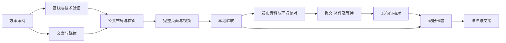

# 有球科技公司官网建设完整方案

**版本：v1.18｜日期：2026-11-12（北京时间）｜状态：用户同意先完成首版上线、后续持续优化；独立私有仓库已创建并推送，首次CI已通过。公司域名已购并实名、网站备案已提交腾讯云审核；发布构建与部署候选已备，公司邮箱已验，三份法律草案已补齐；正式法律核对及部署待完成。**

**最新用户反馈（C10）：具体配图缺失、目录藏深，且不要使用所示的球形缩略图。已据此修正内容版。此前C9对A的偏好与科技感不足反馈继续有效，A2候选及内部ship不代表用户视觉验收；“不用科技”标题反馈也继续有效。**

**本文件是本轮需求真源。** 负责官网建设范围、技术取舍、批次依赖和验收；[文案 v0.4](首版栏目与文案草稿.md)负责候选正文，[长期方向](公司长期发展方向.md)负责内部发展记录。与旧建设说明、23.website 九月旧方案不一致时，本方案优先；不覆盖 App 产品规格、已确认的后台事实及后续用户决定。方案变更递增版本并记录原因。

目标：为无锡有球科技有限公司建立长期运营的正式官网。先交付可审阅、可操作的本地网站，办理网站备案，再部署现有上海服务器并验收 HTTPS。正式公开后的 Apple 会籍办理属于外部交接，不决定网站内容。

## v1.18 备案复查、适用邮件条款与App入口验证

11/12 09:04:36北京时复查：网站订单总览仍“审核中”，详情明确实名信息尚需2–3天同步，全部同步后自动进入审核；未获号、无新增补件。按提示设置11/14 10:00及11/15 17:00人工复查点，非平台截止、未创建提醒。用户确认备份Mac mini实际位于中国大陆。

已读取官方企业微信隐私指引，旧腾讯企业邮指引限定非企业微信登录用户，因此修正官网邮件隐私链接；具体回收站恢复/服务商安全备份删除窗口仍待确认。官网c5fa28c已推送，8页271引用、正式发布正反例及CI43133655551通过。三份法律页仍为草案，现服未部署。

App入口定向构建/测试见[独立记录](App入口核验-20261112.md)：r1快照遗漏包已修复，队列41测试通过（FL-257）；r2单元测试编译器崩溃独立保留；r3采用App/UI源码不变的UI专用方案，iPhone17ProMax/iOS26.2构建安装及3UI通过、两张原图已审；真机邮件跳转、Login/Subscription UI及完整单测构建仍未验收。

11/12 09:56补验：定位并拆开自定义球形测试中的抛错map元组构造，正式Scheme/编译配置不变，完整测试目标构建已恢复；法律URL校验与受影响球形测试2项通过、0失败/跳过，不等于全量回归。公司邮箱权威DNS的MX/SPF已核，未修改解析。详见同一[App入口记录](App入口核验-20261112.md)。本次是v1.18验收补全，建设范围未变化。

## v1.17 保留规则与部署配置验收

2026-11-12：用户授权继续落实规则并补部署准备。官网日志采用独立目录、最少JSON字段（不记录查询串/UA/Referer）、每日200天轮转，覆盖HTTP/HTTPS/www/未知Host；普通结案邮件180天后月度复查，未结或有明确留存依据的事项单独管理。既有备份30/7/2天规则及最后有效副本保护不变，历史包形成处置流程，未删除真实数据。

补齐证书成功续期后验配置重载钩子、官网current原子切换/回滚工具。Ubuntu22.04隔离CI实际执行Nginx/TLS、跳转/404/Host/ACME/CSP/去参数日志、199天保留与202天删除、重开日志、同日不重复轮转，以及版本切换/回滚/预览拒绝，均通过（0514cb1，Actions43130384261）。App法律3/3和备份边界6/6通过。

公司站与App草案已同步邮件保留规则，正文仍未生效。待现服安装和次日轮转、正式证书、邮箱供应商适用条款/删除恢复安排、历史副本实际处置及法律核对。无生产部署、无自动邮箱删除、无提醒任务。规则与证据：[运维保留规则](/Users/song/projects/23.website/company-site/docs/OPERATIONS-RETENTION.md)。

## v1.16 法律正文与有效联系入口

公司与产品统一使用已验收的contact@youbilliards.com，不购买邮件高级功能、不再研究阿里，support@cuephys.com暂缓。网站三份法律页已由状态占位改为完整中文审阅草案，带章节目录、相关政策链接及独立待核对项。App两份正文沿后端模板导出并保留来源哈希，未启用正式生效状态。

App未来法律链接统一使用已备案申请的公司域名下 `/legal/cuephys-privacy/` 和 `/legal/cuephys-terms/`；支持页 `/support/`。当前Config仍为空，须正式匿名HTTPS验收后启用。备份、邮件和日志保留边界不编造完成情况。8页271引用、发布门槛正反例、后端3项测试及四宽度法律页面检查通过；无服务器部署或正式发布。

具体正文、事实来源与缺项：[法律审阅记录](/Users/song/projects/23.website/company-site/docs/LEGAL-REVIEW.md)。

## v1.15 首版发布准备与独立仓库

用户同意将重点转为“先完成首版上线，再持续优化”。视觉后续改进不再要求全部收敛后才准备发布，但不把现有内容版或A2美学记为用户已接受。

私有仓库：[xinkuansong/youbilliards-website](https://github.com/xinkuansong/youbilliards-website)，本地`23.website/company-site`独立Git根，默认main；已推送首个版本8aff476。源码/网站资产/构建及检查/素材摘要已纳入，dist、review原件和凭据排除。干净检出构建与自建临时服务检查通过；缺图负例会拒绝。CI只构建/检查，不部署。

发布顺序按仓库[首版上线清单](https://github.com/xinkuansong/youbilliards-website/blob/main/docs/RELEASE-CHECKLIST.md)执行：公司域名订单→网站备案→有效联系与法律页面→正式构建→现有上海服务器与HTTPS。最新外部实查与人机分工见[上线准备与仓库](上线准备与仓库.md)。本轮未购买域名、未提交备案、未改DNS/服务器。

## v1.14 内容可发现性与真实配图

用户指出完整目录双层折叠、展开后具体图片缺失，并明确拒绝独立的低分辨率球形缩略图。C10在 [company-site](/Users/song/projects/23.website/company-site/review/c10/BRIEF.md) 修正实际内容版：动作库8分类、策略7主题始终可见，一次切换对应图文；补充目录直接列名称与摘要，不再套折叠层。

动作8类每类1张真实iPhone17ProMax/iOS26.2深色详情；策略7主题8张同设备原生图解。被拒绝的DrillThumbnails全部撤除。动作精讲全屏采集r1–r3失败保留，r4独立详情采集成功，不能声称精讲全屏已完成。其余分组继续使用代表性真实截图，不冒称57细项全部逐项配图。

本地 [动作库](http://127.0.0.1:8234/products/cuephys/#library) / [策略](http://127.0.0.1:8234/products/cuephys/#strategy)。8静态页构建、242链接检查无错误；7宽度105次图文切换、方向键/Home/End、深链、减少动态、无JS可读通过。已完成两轮电脑/手机取证，独立复审为C10范围内ship，整体美学与用户视觉认可仍待，见[验收记录](/Users/song/projects/23.website/company-site/review/c10/REVIEW.md)。此轮不是A2全站视觉落地；A2未改、未批准。无发布、域名购买或远端仓库操作。

## v1.13 A方向字体与动态加强

[A2双端动态预览](http://127.0.0.1:8236/review.html)支持电脑1440/手机440切换和开场重播。候选工程在 [design-concepts-c9](/Users/song/projects/23.website/design-concepts-c9/BRIEF.md)，原A/B保留。A2仍只覆盖首屏与核心展示：自托管中文重字与窄方英文、斜切标题、实心/轮廓字标、图片与标题叠层；首屏入场、桌面指针视差、产品面板滚动转正及三标签图文过渡。手机降低空间旋转，减少动态模式保留颜色状态反馈。产品原图未改，不将概念首图当实景或App画面。

两端实拍与六宽度、指针/键盘切换、快速重复选择、减少动态和跨断点校准已验证；独立审查要求修正初始选中线及动作合同，两项已评分resolved，ship仅限该修正范围。第一轮产品滚动截图无效、减少动态测试口径错误均保留失败及诊断，不能据此声称完整自动流程或真机性能通过。字体/图片来源、最终截图和运行证据见候选工程evidence。仍待用户对动态风格的实际认可，之后再延展整站。

## v1.12 双端设计选型

候选工程：[design-concepts-c8](/Users/song/projects/23.website/design-concepts-c8/BRIEF.md)，本地对照入口 http://127.0.0.1:8235/。A以台球材质近景构图，B以瞄准关系SVG构图；各有1440电脑与440手机完整截图，手机分别重排。核心段落均以真实深色App画面切换物理模拟、球形推演、专项练习，保留原网站四栏目链接。首版无视频，暂不延展整站或替换当前官网。

两轮截图、六宽度布局与三标签/键盘/辅助线开关验证记录在候选工程 evidence；独立审查与整改评分单独留档，仍待用户最终比较。A首图仅为项目已有视觉参考，不冒充App或公司实景；B只说明瞄准关系，不声称标准球桌或物理引擎轨迹。来源与哈希见 evidence/provenance.json。Impeccable launcher权限拒绝已披露，未宣称自动detector通过。

## v1.11 首页图文入口

用户指出首页四栏纯文字缺少展示，确认增加真实截图：动作库、训练计划、专项练习、统计与回顾按桌面两列两行、手机单列排列。动作库/计划/统计以CSS窗口呈现关键局部，明确标注局部画面，原图文件不变；专项练习使用完整角度与瞄准画面。图片及文字整体进入对应产品栏目，产品页仍保留完整截图入口。统计继续注明示例记录、非用户实际成绩。

C6仅修改首页模板和相关CSS，不改App与既有产品页交互。两轮手机390/440与桌面1440截图自查，第二轮修正第一轮取景残边；8页184引用无错误，七宽度无横溢，24次图片/标题点击和3次键盘激活通过。独立审查见网站review/c6/finish-review.md，用户效果验收独立记录。

## v1.10 当前交互与返工边界

- 用户明确选择：栏目内切换功能介绍和对应画面，完整目录作为补充。撤销C4的57个相似独立详情页；本站恢复8页。
- 六组练习原地切换，保留1–2张真实截图；先介绍、再画面、最后补充目录。动作库/计划/练习/统计合计57项可在栏目内展开，无须跳转浏览。
- 截图本身与“查看完整截图”文字均可打开原图；键盘方向键切换分组，无JS仍显示全部内容。
- 首屏背景改用同色系清晰矢量曲线，移除铺满宽屏的小尺寸位图。
- C5已按用户选择完成栏目内图文切换、目录补充展开，撤销57个独立详情页；8页/180引用、三宽度6组切换/57项展开/键盘及七宽度布局通过。双端54图独立审查与设计文档整改已闭合。地毯根因是过早缓存1pt占位比例；已修正稳定首帧前的缓存时机，6项17ProMax原生验证通过，五张横屏重拍替换。用户效果审阅及真机Safari/完整转屏动画仍待。 生产App两处逻辑回写，保留原始前后证据；采集任务、设备、临时worktree与快照已收尾。
- C4技术通过不代表用户接受；拒绝稿及其报告仅作历史证据。用户最终审阅单独记录。

## v1.9 历史视觉与审核要求（覆盖历史三风格待选）

用户选定App欢迎页的深墨绿背景风格，复用IntroBackgroundDark原图与深色Q素材；官网深底、绿色重点、浅色正文。所有App画面改为iPhone17ProMax深色模式，不做图片反色。内容顺序保持动作库→训练计划→六组练习→统计，首版无视频。官网文案默认App已上线。

用户要求手机、电脑均经过多轮实际截图审核：记录问题、逐轮整改、同尺寸复验，构建/溢出检查不能替代目视。C3已落页：复用欢迎页原背景，10张深色画面已替换；5张横屏使用正确方向的XCUIScreen附件，5张竖屏使用window附件。统计用明确标注的示例记录展示真实界面，不能充当用户成绩。8页/160引用检查通过，四栏目×7宽度无横溢；独立审查45张390/440/1440整页与产品分段图，发现一处手机副标题断词，整改后同尺寸复审resolved；ship仅覆盖修正项，用户最终认可独立记录。主工程生产源码不改；采集作业、临时设备与私有副本已收尾，证据归网站review/c3。

## v1.8 当前发布文案前提（覆盖历史未上线措辞）

用户确认：官网与App同步正式上线，官网文案默认App已经上线。使用“有球科技推出的台球训练App”，移除“正在开发”“尚未上线”和产品发布状态标签/问答。实际App Store链接待核实后补充；这项写作前提不等于App已完成上架或官网已部署。内容版继续本地审阅。

## v1.7 当前执行覆盖（优先于下文历史批次措辞）

用户否定C1纯文本，要求直接做图文内容。C2在23.website/company-site实施，主线为动作库→训练计划→六组练习→统计。六组每组1–2项实拍，其他三段各配对应页面；本版共10项（六组为1/1/2/1/1/1张，加动作库/计划/统计）。物理模拟、求解、图谱和攻防通过对应分组具体介绍，不弱化为“看清一杆”式泛称。

仅采iPhone 17 Pro Max；本轮Mac mini iOS26.2独立快照与受管临时机，App生产代码不改。实际截图需逐张核对，原始证据、文件哈希和网站资源对应表归档。统计空账号如实标初始状态，不虚构成绩。

**首版视频已暂缓。** 下文旧B1选片、B3播放器、B4视频兼容及B6播放负载验收在本版不执行，也不作为阻塞项；后续用户重新选择加入视频时再立批。正式联系、法律、域名、备案、HTTPS与发布门禁保留。

C2交付须包含真实图文网站、可点开完整截图、分组导航、移动/桌面及链接检查、独立审查和用户待审项。不能把截图采集通过当成全App回归或用户接受。

本轮结果：10张画面已接入，8页/161引用检查无错误，360/390/768/1440宽度无横向溢出。独立审查指出的手机首屏隐藏截图已修复，整改复核为ship（仅C2整改范围）。统计使用真实空账号画面。原始证据、失败采集说明和临时资源回收记录见网站docs/CAPTURE.md；用户内容、截图与最终视觉验收仍待。

## 1. 需求回显与边界

| 编号 | 用户已确认的要求 | 本方案落点 |
| --- | --- | --- |
| R01 | 建正式公司官网，公司与 CuePhys 并重 | 首页公司身份与产品入口、独立关于页；不做 Apple 专用说明站 |
| R02 | 采用 YouBilliards；CuePhys 是产品品牌 | 网站标识候选 YouBilliards · 有球科技；法定名称保持无锡有球科技有限公司；现有 Q 图标用于 CuePhys |
| R03 | 公司域名选 youbilliards.com，保留已购 cuephys.com | 两域职责分开；购买、实名和实际路由有各自状态，不做 cuephys.com 全站跳转 |
| R04 | 简体中文先行，结构预留英文 | 中文完整首版；内容分离以便翻译；无空英文入口 |
| R05 | 产品按动作库、训练计划、练习Tab目录、统计展开，保留核心能力细节 | 练习依基础/准度/控球/走位/进阶/策略六组组织；每组1–2项实际画面，不退回泛化口号 |
| R06 | 最新决定：首版暂不放视频，不强调视频 | 删除本轮选片/播放器实施与播放验收任务；旧视频想法仅留历史 |
| R07 | 长期业务记录，但尚未做的暂不全部放官网 | 不列竞技游戏、教练助教、约球、斯诺克赛事等未来服务菜单或“即将上线”承诺 |
| R08 | App 尚未上线，沿用现有产品标识 | 明示开发状态；不显示无效下载按钮、价格、发布日期或虚构成果 |
| R09 | 用现有上海服务器；不买新服务器或发布临时托管站 | 本地预览，备案后现服发布；不注册/上传/部署临时 Sites 项目 |
| R10 | support@cuephys.com 尚未开通 | 页面暂不把它作为可用邮箱；公开前完成真实收发验证 |
| R11 | 先考虑完整，再按问题整理技能形成方案 | 先形成方案，后按用户继续指示制作局部视觉样稿；各批次交付、依赖、用户参与和验收见第 7 节 |
| R13 | 截图使用 iPhone 17 Pro Max，不用 SE | 每组截图核真实页面、机型与来源；不得以SE裁图或其他机型冒充 |
| R12 | 每个子任务开始前说明，结果同步上线方案 | 每批先说明目的、步骤、分工、验收；结束回写批次状态及交接入口 |

不扩大到网站账号、在线支付、论坛、留言表单、邮件订阅、CMS 后台或在线运行 App 的物理引擎。网页呈现已有能力，不为宣传改造 App 功能。执行人仅用户与 Codex。

用户认可的是文案方向；v0.2 具体句子、视觉、截图和视频尚未最终验收。完整方案允许有明确的待办，但不能将未核事实当成实施输入。

## 2. 当前资产与差距

### 已有基础

- 本项目已整理建设说明、文案 v0.2、公司长期方向和域名研究；公司主体、现服和账号手续沿用[交接卡](../launch-20261110/官网与账号迁移交接.md)。
- `/Users/song/projects/23.website` 存在早期本地网站：React/Vinext、公共布局、首页、关于、支持、隐私/协议状态页、404、样式和素材账本。它以“球迹”为主品牌，内容偏学习与记录，尚无独立 CuePhys 产品页。
- 旧站 `layout.tsx` 设置 noindex；隐私页只是状态说明。旧实施记录写构建/浏览器验收待完成；本轮没有重跑，不能把旧源码存在视为可运行或可发布。
- 旧站 `package.json` 的启动脚本用 Wrangler；`vite.config.ts` 默认加载 Cloudflare 插件，另有开发预览分支。这证明存在平台依赖，**不证明不能自托管**；迁移成本需 B0 实测。
- 在 23.website 根执行 `git status` 返回“not a git repository”。B0 需核 web 子目录或其他版本记录，再建立准确的源码基线；不能承诺已有完整回滚能力。
- 后端实际拥有 `/privacy`、`/terms`、`/support` 和 `/legal.css`，前三者有发布配置门禁；API 路径包括 `/auth`、`/user`、`/training-sessions`、`/angle-tests`、`/custom-formations`、`/drills`。官网配置不得覆盖它们。

### 当前缺项与影响

| 缺项 | 处理方式 | 阻塞点 |
| --- | --- | --- |
| 新域名尚未购买/实名 | B5a 形成准确订单资料，按用户当时授权办理 | 网站备案与正式域名发布；不阻塞本地制作 |
| 旧站运行与可移植构建未验证 | B0 小范围验证并冻结技术路线 | 正式网站编码 |
| 最终文字、截图和视频未选定 | B1 内容清单，B2/B3 随布局审阅 | 完整内容验收；视频可先试放一条 |
| 公司邮箱未启用 | B5a 确定一个有效渠道并验证收发 | 公开联系页面 |
| 服务器资源/反代配置未实查 | B5a 只读核实，形成精确改动与回滚清单 | 部署；不阻塞本地页面 |
| 网站备案与既有 App 草稿关系待核 | 先检查同账号在途订单再选择路径 | 正式提交与发布 |
| 正式法律文本及网站数据处理范围待核 | 复用 App 法律页真源，另核网站访问日志等实际处理 | 正式法律入口，不允许以旧状态页替代 |

## 3. 网站结构与内容层级

主导航：**首页｜CuePhys｜关于我们｜联系与支持**。各页面最终正文从[文案草稿](首版栏目与文案草稿.md)审定；此处规定信息结构，避免再维护一份全文。

| 页面 | 建议路径 | 内容顺序与重点 | 主要行动 |
| --- | --- | --- | --- |
| 首页 | `/` | 公司身份及方向 → CuePhys 简介和真实画面 → 三项核心能力 → 公司介绍入口 → 联系入口 | 了解 CuePhys、认识公司 |
| CuePhys | `/products/cuephys/` | 产品定位与开发状态 → 物理模拟 → 球形推演与求解 → 专项交互练习 → 可视化球理 → 实台工具 → 小块视频 → 发布状态 | 浏览产品能力、联系支持 |
| 关于我们 | `/about/` | 公司主体与所在地 → 当前产品与内容工作 → 把问题讲清楚、允许尝试、连接理解与实练 | 查看产品、联系公司 |
| 联系与支持 | `/support` | 产品反馈、合作交流、真实邮箱、基本 FAQ、权利请求入口 | 实际联系 |
| 网站隐私说明 | `/privacy` | 网站实际处理范围：服务器日志、邮件联系、媒体请求；按实际服务核定 | 查阅说明、联系主体 |
| 产品法律入口 | 页脚标明“CuePhys 隐私政策”“CuePhys 用户协议” | 指向已正式发布的产品政策，不另抄一套 App 文本 | 查阅有效政策 |
| 404 | 未知路径 | 说明页面不存在，返回首页/产品 | 找到有效入口 |

`/privacy` 与 `/terms` 的职责按域名区分：拟定 youbilliards.com 的 `/privacy` 为网站说明；cuephys.com 的 `/privacy`、`/terms` 保留产品法律入口。旧站的 `/terms` 状态页不作为正式法律页发布；B5a 冻结它是准确重定向至产品协议还是经核定的独立网站条款。B3 本地可呈现清楚的待发布状态，B6 发布清单不得有死链或将占位当正式政策。

公司首页展示当前工作，但不把公司的长期边界定义成“只做训练 App”。公司 Q 图标另创不是首版任务；可先使用 YouBilliards · 有球科技文字标识，产品处沿用 Q。

### 产品能力与素材配对

| 能力 | 至少让访问者看清什么 | 首选真实素材 | 表达边界 |
| --- | --- | --- | --- |
| 物理模拟 | 同一球形下，打点/力度/方向变化如何改变路线 | 分离角与走位，俯视与 3D 对照 | 不承诺完全还原或未经证明的精度 |
| 球形推演与求解 | 落区要求、求解方案及后续球衔接 | 走位求解、打一走二想三；翻袋/颗星作辅助 | 不承诺任意球形有解；不展示延期防守求解 |
| 专项交互练习 | 用户能亲自判断、击球、看反馈并重试 | 准度/走位/攻防代表画面；明确展示每日清台 | 不把各练习统一说成都有评分、示范 |
| 可视化球理 | 从概念到条件变化 | 瞄准方法、分离角或加塞吃库图谱 | 区分图文与可交互内容 |
| 实台工具 | 照片建球形、校准、推演、保存 | 拍照建球形流程；训练安排/记录为辅 | 不暗示无须校准的自动准确识别 |

截图优先检查已有素材版本和清晰度，缺失再按 simulator-use 技能采集。初次目标约 6–10 张有效画面，数量是布局预算而非硬凑指标；不整页堆小截图。媒体清单记录来源、版本、画幅、说明、选用状态和公开依据；旧账本中 local-preview-only 不自动转为可公开。

视频从现有台账选，不启动新视频制作。首轮试放一条，用户结合页面决定；原片不覆盖。网页副本记录压缩参数/大小/时长；点击才加载播放，保留暂停、进度、音量/静音、全屏和失败反馈，不有声自动播放。保持原画幅，按内容补必要字幕或文字说明。若选用来自其他项目的片子，不能暗示其功能在 CuePhys 内。若最终没有合适片目，由用户决定延后，不擅自删掉已提出的视频需求。

## 4. 设计与技术方案

### 历史视觉比较（已由v1.9用户指定方向覆盖）

最新用户修订：官网和 App 配色不是同一回事，要求多做几种适合公司的风格。网站不再以绿/金或浅色作为硬约束，保留产品身份与正式标识。已形成[三种概念稿与比较页](/Users/song/projects/23.website/previews/20261111-directions/README.md)：A白蓝清晰科技、B深色运动科技、C浅色品牌编辑。均突出物理模拟/推演求解/专项练习；生成画面仅作视觉比较，不作为真实参数、轨迹或最终宣传素材，尚未选定。

另已确认内容主次：三核心能力必须以具体案例和画面承担主体；不能被瞄准场景主视觉挤成几段说明。用户随后指示先按方案把内容做出来：允许先完成四栏目正文和阅读路径，不等风格选择；真实媒体需求保留，补齐案例后再做正式视觉验收。

用户反馈：“太丑了吧”“其他的，感觉太素了”；指出旧模拟器球房/球桌配置未核，官网不必保留App操作界面，可以参考已有视频。原20261111-light样稿的视觉结论失效，先前技术检查不能作为用户设计验收。

新[场景版样稿](/Users/song/projects/23.website/previews/20261111-scene/README.md)重新组织首屏与产品区：浅色公司介绍配宽幅纯场景，深绿色产品重点区、App辅助金与Q；手机独立取景。视频5秒处真实画面取自V014 r6，球桌/球杆模型hash与当前工程一致，外观接线有记录；使用该片温润木质球房，不冒称App默认赛事房。网页展示观察/瞄准关系，不冒充走位求解或练习反馈。前三核心专项宣传素材仍需另行制作。

本次已核实际素材来源、部分参数、模型和外观代码；并未重新运行完整物理测试，不能宣称旧图尺寸错误或所有视频参数完全等同于现版。独立旧稿审查要求rebuild，当前新稿另做完整复查，用户验收待完成。

以下为早期浅色候选参数，仅供历史参考；不再约束当前内容版或后续独立配色。

| 设计维度 | 建议呈现 | 用途与待验 |
| --- | --- | --- |
| 整体基调 | 白色与 App 浅灰阅读底，真实球桌画面形成局部深色区域 | 公司介绍清楚易读，深色区域承载真实球桌画面；具体深浅比例看样稿 |
| 配色 | App btPrimary #1A6B3C 与 btBG #F2F2F7 为来源；网页正文 #18221D；App 辅助金 #C6A15B 仅作候选 | 绿色集中用于按钮、选中态和少量强调；Q 图标保持现有资产颜色，正文/按钮组合实施时核对比度 |
| 字体 | 中文系统无衬线，标题中等偏粗，正文常规；英文品牌保持清楚易读 | 桌面主标题约 48–64px、手机 32–40px；正文 16–18px 为试排起点，按中文断行和设备调整 |
| 版式 | 大幅产品画面配短段说明；章节间留白，密集能力说明与安静公司介绍交替 | 首页明确公司与产品各自身份，产品页前三组能力获得最大画面面积 |
| 图形与装饰 | 细分隔线、小圆角、少量阴影；真实球桌、球和线路成为视觉主体 | 不另造与实际 App 不符的球路或控件；不添加装饰性复杂交互 |
| 动效 | 导航与按钮简短反馈；图片切换如有需要再做 | 内容默认可见，适配减少动态；无强制滚动或自动播放有声视频 |
| 视频 | 产品正文中的小幅封面与播放入口，播放时保持原画幅 | 图片与播放器布局一致，片名取实际内容，视频不抢首屏和主导航 |

此前首屏候选构图（已被本轮重建替代，不再作为实施合同）：上方为 YouBilliards · 有球科技及四项导航；正文先说公司方向与实际产品，下方或右侧用一幅足够大的 CuePhys 球桌画面承接，注明产品名及开发状态。桌面考虑文字与画面约四比六，手机按公司标题、简短说明、产品画面和行动入口依次阅读；这是构图建议，需用实际文案长度验证。

CuePhys 页的识别点：物理模拟用同一球形的实际结果对照，推演求解展示落区与线路，专项练习以每日清台/走位/攻防代表场景展开。真实界面可大幅呈现，必要时辅以完整截图和可辨认的局部特写；不把所有功能塞进小手机框。网站按钮与截图中的 App 控件清楚区分。

关于页与支持页沿用同一导航、文字与色彩，采用舒适的窄正文和短段落。中文内容独立维护，预留英文扩展，不显示不可用语言切换。

**历史 B2 顺序（v1.6起被“内容先行”局部覆盖）**：先提供首页首屏和 CuePhys 核心段落的桌面/手机版样稿，包含实际文案与真实画面，让用户看见配色、字号、图文比例和滚动顺序。样稿可以在本地页面中实现，但不得把用户尚未看过的视觉风格视作已确定并扩展到全站。用户反馈形成一轮明确修订，再固定公共样式并推进 B3。需要方向比较时，只比较影响体验的构图差异，不预制整站的多套皮肤。

本轮已读旧站 PRODUCT.md、DESIGN.md 与 site.css；Impeccable 上下文加载器因执行权限限制未运行，按技能降级流程直接阅读。现已新增并运行独立静态样稿，完成桌面/手机截图及基本布局检查。独立审查提出三项能力标题层级问题，修复后复核该项 resolved；用户视觉验收待完成。检测器同样权限失败，未声称自动检测通过。

### 技术建议与决策门

**推荐静态多页面输出，在现服 Web 服务中按域名托管。** 官网首版无服务端业务需要，不新增网站数据库或账号系统。Astro 静态构建是候选首选；官方文档说明构建产物默认位于 `dist/`，适合部署静态产物。[Astro 部署说明](https://docs.astro.build/en/guides/deploy/)

B0 做一次短验证：盘点旧站 → 冻结副本/基线 → 核旧栈是否能以维护成本合理的方式产生自托管产物 → 必要时验证一个 Astro 样页的构建、深链和媒体引用。根据结果记录保留旧栈或迁移静态构建的理由、锁定依赖和目录。不为保住旧脚手架引入长期 Worker 服务，也不未经验证直接抹掉旧工程。若需迁移，旧站归档，当前网页源码仍在 23.website 管理；具体新目录在 B0 定位后登记，现阶段不伪造已存在的组件或文件。

复用对象是已核素材、可用布局/样式思路和来源账本；旧品牌、旧首页主次、获取球迹按钮、状态法律页不能直接照搬。建立独立网站版本控制和忽略规则，密钥、证件、运行状态、原片不入公开产物。当前没有已验证的远端仓库；不自动创建公开仓库。 用户提出官网独立 GitHub 项目，建议私有仓库 `youbilliards-website`；已核 23.website 与 web/ 均无 Git，连接可见范围未发现官网仓库。本轮未创建、初始化、提交或推送。网站源码与设计说明归网站项目，App 项目保留交接入口。

技能分工：issue-collection-restructure 组织本方案；实施时 Sites 仅采用本地工作流，Impeccable 用于视觉设计与检查，采集 App 界面才加载 simulator-use。用户的现服/本地要求优先于托管默认流程。无需为本方案安装新技能或创建托管站。

### 域名与路由合同

| 主机/路径 | 拟定职责 | 必须保留的边界 |
| --- | --- | --- |
| `youbilliards.com` | 公司官网主域名 | 购买、实名、备案后才能成为实际生产配置 |
| `www.youbilliards.com` | 同站别名，统一到主域名 | DNS 和证书均覆盖后才启用跳转 |
| `cuephys.com/` | CuePhys 产品入口，建议只根路径跳转到公司站产品页 | B5a 检查现有用途后定，不做全路径跳转 |
| `cuephys.com/support`、`/privacy`、`/terms`、`/legal.css` | 产品支持与法律服务 | 使用现有正式发布流程，不被静态站抢占 |
| 现有 API、授权回调及服务子域 | App 服务 | 保持现有路径和方法；域名迁移另有明确方案才改 |
| 邮箱相关 DNS | 邮件收发与验证 | 新增 A/CNAME 不覆盖 MX/TXT；已有所有记录先导出 |

服务器反向代理软件、配置路径、已有虚拟主机和证书任务尚未实查；B5a 才填写可执行配置。若使用 Nginx，按主机区分站点，静态 fallback 不能吞掉 API/法律请求；按[官方 server names 文档](https://nginx.org/en/docs/http/server_names.html)核对主机匹配。不把源码中的路由等同于生产已部署路由。

网站内容、产品状态、联系方式、域名和法律链接集中维护；视频列表可以为空而不渲染空播放器。正式版校验拒绝占位链接、未启用邮箱、假下载地址和未知产品状态。开发环境保持 noindex；正式站在 B6 设置准确 canonical、站点地图、分享信息及索引策略，不把 noindex 当访问控制。

## 5. 发布条件、费用与外部事项

### 域名与费用

youbilliards.com 在 2026-11-11 的腾讯云查询为可注册普通域名，首年 88 元、当前续费 95 元/年；不是锁价或已购买，见[查询记录](DOMAIN-RESEARCH-20261111.md)。实际购买前重查拼写、可用性、所有者、期限、税费/优惠和自动续费设置。方案编写不包含支付授权。

预算分项：公司域名、已有 cuephys.com 续费、现有服务器续期、邮箱、可选媒体存储/CDN、可能的专业文本核对。后几项未报价，不填总价；不将现有服务器成本写成零。首版不新增服务器、付费分析工具、CMS 或默认购买 CDN。先以现服实际带宽和媒体大小判断容量，超出时压缩/减少同时加载，再形成有报价的增量选择。

### 备案与公开顺序

维持“本地网站 → 网站备案 → 现服正式公开”的顺序。可提前准备资料、域名和收信渠道，但不以公网 IP 或临时域名开放预览。腾讯云官方说明未完成 ICP 备案前不应开通内地服务器网站访问。[备案场景](https://cloud.tencent.com/document/product/243/18910)

现有 App 备案草稿不能当网站备案已完成。腾讯云当前说明一个账号只能有一个流程中的备案订单，并区分网站与 App 信息；B5a 先核现有订单能否合并/调整或需顺序办理，再操作，不重复建冲突申请。[网站/APP 信息](https://cloud.tencent.com/document/product/243/19644)

网站名称、公司主体、域名实名、服务内容、服务器资格与有效期、负责人、真实页面内容由实际表单/接入方要求核定；本方案不自行判定教育/游戏等服务许可适用性。正式网页只呈现真实公司与产品介绍；咨询使用真实功能说明，不为过审改称不存在的业务。

所有外部等待记录北京时间，包含提交/收到回执时间、平台要求日期、估算、下次复核点、实际完成时间。实名后数据同步和备案审核按当时规则与回执记录，不在尚未购买时算出虚假的通过日期。公开后适用的公安联网备案等事项同样按官方要求建立具体期限与台账，不把 ICP 通过等同于全部手续结束。

### 联系方式与政策

先启用一个可接产品反馈和公司合作的邮箱即可，不要求首版多个账号。核 MX/SPF/DKIM/DMARC 配置适配实际服务、外部来信、回复和垃圾箱表现；不虚构响应时限。

App 法律页沿用 `backend/public/README.md` 和实际数据流核对流程。该现有发布说明明确要求运营主体和专业法律人员核对实际业务；将其列为 B5 的依赖，不由改文案替代。网站隐私说明按实际日志、邮件和第三方请求编写；没有注册表单也不能直接宣称“完全不处理个人信息”。不因装饰需要增加分析 SDK、Cookie 弹窗或新数据收集。

## 6. 执行方式与状态规则

先审本方案，再开始执行批次。每批由 Codex 说明为什么现在做、范围、步骤、双方分工和可验收结果；用户只参与真实需要其决定/本人操作的部分。普通可逆实施与检查按已授权范围继续，不反复确认相同决定。

状态统一为：未开始 / 进行中 / 技术验收通过、待用户审阅 / 已验收 / 等外部结果。每批记录文件、命令与输出、页面截图/预览、未验范围和下一步。构建通过、视觉认可、正式上线分别记录。无代码改动的文案批不跑 App 全量测试。

外部等待不是一整段阻塞会话：B5a、B5b、B5c 各为可独立续接的检查点；每次只推进有条件的事项，不创建自动跟进任务。内容、视觉或素材若超出单次会话容量，按页面/素材集合拆子批，先在本方案升版，不把未完成记为验收。

## 7. 分批实施计划

量级是任务规模，不是交付日期或平台处理时长。原批次验收标准保留；v1.6新增C1内容先行批，已覆盖部分B1/B2/B3，不等于原批次全部通过。

| 批次 | 范围与交付 | 量级 | 前置 | 用户参与 |
| --- | --- | --- | --- | --- |
| B0 基线与技术验证 | 核 23.website 指令/现状，建立可恢复基线，验证自托管构建，冻结栈与目录 | 小，1 次会话 | 本方案审阅后执行 | 只在路线改变成本/范围时作取舍 |
| B1 文案与媒体清单 | 审定页面正文，核已有截图与候选视频，形成来源及缺图清单 | 中，1 次会话；集中补采另列 B1a | 本方案；可先于 B0 完成 | 审公司表达、产品重点及试放视频 |
| B2 公共布局与首页 | 共享导航/页脚/样式，完整首页，产品页核心段落样式，本地手机/桌面预览 | 中，1 次会话 | B0+B1 可用素材 | 看一个实际方向并反馈 |
| B3 全站内容与视频 | 完整五组产品介绍、关于/支持/404、法律入口本地状态、视频与图片优化 | 中，1 次会话；超量按产品页/附页分 B3a/b | B2 方向审阅 | 看核心产品展示与选片效果 |
| B4 本地验收与修订 | 路由、响应式、交互、可访问性、媒体、性能检查；反馈修复 | 中，1 次会话，失败按影响项复验 | B3 | 操作完整本地网站，确认内容和视觉 |
| B5a 发布材料与环境核对 | 域名订单准备、邮箱、现服只读审计、DNS/法律/备案草稿关系、精确部署及回滚稿 | 中，1 次会话；外部操作单独留回执 | B4；只读盘点可提前，正式备案在本地审阅后 | 按实际授权购买；本人资料核验 |
| B5b 提交与补件 | 经审材料提交、实名/备案本人核验；记录等待与补件 | 每次小，按回执续接 | B5a 事实齐备 | 本人签署、核验及平台要求操作 |
| B5c 发布门核对 | 备案结果、域名/邮箱、正式政策、成本、服务器容量与发布包逐项核对 | 小，1 次会话 | B5b 审核结果及相关条件满足 | 审最终公开版本 |
| B6 现服部署与公开验收 | 域名/HTTPS、静态产物、路由保护、匿名实测、回滚验证、搜索配置 | 中，1 次会话 | B4+B5c、公开版本已确认 | 验证外网访问及实际收信 |
| B7 维护交接与外部衔接 | 更新操作说明、续费/证书/备份台账、首轮上线复核；给上线会话交付网址与证据 | 小，1 次会话 | B6 | 接收维护说明；需要时另行指示 Apple 回复 |

依赖关系：

### 各批完成标准

**B0**：记录旧文件及锁文件基线、确切源码位置、恢复方法；选定路线能构建并在本地访问一个样页及其深链/资源；记录实际命令、版本、产物和错误。仅 dev server 可访问不算生产构建可用。无云注册、无公开发布。

**B1**：每个正文区段有明确文字及事实依据；核心三组能力都有可用画面或具体补采项，B2 所需图片不得仍为空；每日清台与拍照建球形有明确位置；视频完整观看并核版本/字幕/片名，用户未选定则标待选；未核素材不伪装最终素材。可进入布局的文字与媒体有版本号。

**B2**：公共导航与公司/产品标识正确；首页与核心产品段落在 390、1440 CSS 像素预览，内容顺序和截图可读；用户反馈写入同一批并闭环后再扩面。显示开发状态，主要按钮有真实目标，不出现无效下载入口。

**B3**：所有约定页面和五组产品介绍完成；404 有实际错误状态；视频点击、暂停、进度及失败提示可操作；未点击不拉取整段视频；图片尺寸声明、延迟加载和替代文字完成；法律入口按状态显示，不拷贝旧占位政策为正式正文。文字与状态集中配置，中文完整、无空英文切换。

**B4**：实际构建与本地产物预览通过；全路由刷新/深链/导航、360/390/768/1440 CSS 像素、200% 文字缩放、键盘焦点和减少动态设置检查；桌面 Safari/Chrome 及实际手机 Safari 视频播放检查（设备不可用则明确待验，不能替代成已通过）。无横向溢出、遮挡正文、死链或误导按钮。开发者工具核资源体积、网络请求、布局跳动和主要加载耗时，记录测试环境；优化首屏图片和非必要脚本，视频独立加载，不以单一跑分冒充真实体验。记录用户接受的完整本地版本。

**B5a**：形成主机×路径映射、DNS 当前记录备份、服务器进程/端口/反代/磁盘/带宽/证书与备份任务核查，字段只记录必要信息而不输出密钥。已明确公司站、产品支持、政策和 API 的归属。现服待执行命令、配置差异、回滚与验证步骤可逐条审阅；购买订单/备案材料可由用户核对。邮箱和法律依赖未完成即标待办，不作发布就绪声明。

**B5b**：每次记录实际提交/补件/受理回执和时间；保存材料在私有位置，只在项目记录非敏感状态；核已有订单关系后再提交。尚未通过时本批为等外部结果。B5c 的前置必须有正式结果，不靠估计日期。

**B5c**：所有公开域名已满足对应备案/实名条件；正式可收发邮箱和经核法律内容就绪；DNS/HTTPS/现服路径、网页媒体容量、版本与回滚明确；公开版本不包含草稿标记、测试资料、无效入口；用户已看过要公开的版本。缺项列明阻塞的具体路径或动作，不静默省略。

**B6**：先备份配置和当前服务基线，测试配置再重载；独立版本目录部署后切换，失败撤回本次站点/路由变更。匿名 HTTPS 验首页、产品、关于、支持、正式政策、媒体、404 与 www 跳转；证书主机名/有效期/续期方式正确，无混合内容。产品 API 和已有授权路由按基线做不改用户数据的检查，法律发布门禁未被旁路。加载产品图片期间对照 API 延迟、错误和服务器负载；数据库与备份服务保持正常。只读 health 成功不等于 App 登录已恢复。保存产物版本/校验值、部署时间、检查证据；首发无旧官网时验证撤下新站也不影响既有服务。

**B7**：交付修改文案/媒体/产品发布状态、构建、备份、部署、回滚、证书与域名续费的具体入口；明确网站文件/配置纳入何种备份并至少验证一次可恢复。基于真实到期日登记时间，不自动创建提醒。上线首轮复核页面/证书/邮件/日志；后续维护频率建议月度和每次变更后复核，由用户采用，不自动安排任务。将正式网址、公司主体可见性和匿名访问证据交给上线会话；Apple 邮件只准备草稿，未获得发送指示不代发。官网上线不宣称 Apple 迁移或 App 登录完成。

## 8. 代码与资料锚点索引

核实日期均为 2026-11-11。以下为本轮实际读取的位置；行号随修改会变化，实施前按符号复核。新源码文件、部署路径、生产 Nginx 文件仍待 B0/B5a 定位。

| 路径与锚点 | 当前事实及用途 |
| --- | --- |
| `/Users/song/projects/23.website/web/package.json`：scripts、dependencies | Vinext/React 与 Wrangler 启动，B0 决定复用或迁移 |
| `/Users/song/projects/23.website/web/vite.config.ts:15`、`:45` | Worker 绑定配置与本地预览分支，不可仅据开发预览推断生产可移植 |
| `/Users/song/projects/23.website/web/app/layout.tsx:6`、`:24`、`:47` | 旧品牌、noindex、公共导航/页脚，B2 重点替换 |
| `/Users/song/projects/23.website/web/app/page.tsx:7`、`:54`、`:105` | 旧首页公司弱、计划记录重；B2 按新文案重组 |
| `/Users/song/projects/23.website/web/app/site.css:19`、`:48` | 滚动及焦点样式，复用需经响应式与减少动态复核 |
| `/Users/song/projects/23.website/web/app/support/page.tsx:17` | 当前未公开联系方式的状态文案，B3/B5 接真实渠道 |
| `/Users/song/projects/23.website/web/app/privacy/page.tsx:9` | 正式政策未发布，不能直接当正式法律入口 |
| `/Users/song/projects/23.website/docs/assets-manifest.json:1` | 原素材来源/哈希及 local-preview-only 状态，B1 重核 |
| `QiuJi/Features/AngleTraining/Views/AngleHomeView.swift:244`、`:272`、`:300` | 球理、走位求解/三球思路/照片建球形、进阶练习公开入口 |
| `QiuJi/App/MainTabView.swift:181`、`:289` | 每日清台和求解/三球/照片页面实际导航 |
| `QiuJi/Resources/Assets.xcassets/BrandLogoMark.imageset/Contents.json:4`、`:11` | 现行产品 Q 图标深浅资源，B1 使用真源 |
| `backend/src/app.js:32`、`:36`、`:46` | 健康、法律、API 路由，B5/B6 防覆盖合同 |
| `backend/src/services/legalDocuments.js:22`、`:34` | 发布配置验证及未就绪 503；不绕开 |
| `backend/test/legalDocuments.test.js:23`、`:34` | 未发布拒绝/缺字段/正式渲染的现有定向测试；仅改法律服务时按影响执行 |
| `backend/public/README.md` | 正式政策发布条件及客户端地址配套流程 |
| `tasks/company-website/首版栏目与文案草稿.md` | v0.3 候选文字与素材建议，不等于用户最终批准 |
| `tasks/company-website/公司长期发展方向.md` | 内部长期方向，排除未开展业务公开菜单 |
| `tasks/company-website/DOMAIN-RESEARCH-20261111.md` | 域名可买与价格的历史查询证据，交易前重新核 |
| `tasks/launch-20261110/官网与账号迁移交接.md` | 现服、域名、备案草稿、邮箱与 Apple 外部交接 |

## 9. 当前可执行结论与验收记录

完整方案已具备，尚未决定的片目、最终文案、视觉、邮箱供应商及部署参数都已对应到具体批次和阻塞点，不需要继续无止境前置讨论。

**当前下一步：审阅[完整内容版](http://127.0.0.1:8234/)，先定栏目、正文和主次；核对本版10张实际截图，再落实正式视觉；首版不放视频。** 三套概念尚未选定。内容版位于 `/Users/song/projects/23.website/company-site`，旧web与样稿保留。

### v1.6 / C1 内容先行批

用户要求优先按方案实现内容，暂不等待视觉方向裁定。本批将v0.2候选正文落为四个主栏目，另有三页法律发布状态及404；CuePhys三核心能力展开，包含每日清台、照片建球形/校准及辅助球理/实台训练。文案集中在content/zh-CN.json，后续样式独立调整。新增介绍项为原稿内容拆分，不增加功能承诺。

为内容审阅采用零第三方依赖的Node静态模板构建，8页HTML输出到dist；现服静态托管目标不变。旧Vinext代码和锁文件保留，未测试其生产构建，不断言它不能自托管；Astro仍可在工程定型时评估。关键旧源码hash及回退边界见[技术基线](/Users/song/projects/23.website/company-site/docs/TECHNICAL-BASELINE.md)。未初始化Git/创建远端，B0版本管理尚未完成。

已实测构建8页、131处本地链接/资源引用零错误；4主路由在360/390/768/1440宽度无横溢出，桌面/手机截图已核；键盘跳转正文焦点可见、FAQ折叠可操作，未知路由HTTP404。root字号烟测不是完整200%文字缩放验证；Safari/真机/B4全项仍待验。独立内容版审查见[本批记录](/Users/song/projects/23.website/company-site/README.md)。

核心真实图、视频片目/压缩播放、有效邮箱、正式法律文本、最终风格仍待处理；本批不生成假球路、不挪用瞄准图为求解证据、不渲染空播放器。详细缺项见[内容审阅清单](/Users/song/projects/23.website/company-site/docs/CONTENT-REVIEW.md)。C1完成的是正文与阅读结构，不将B1–B4全批标为完成。

方案初稿阶段只做本地源码/资料读取、官方文档核对和文档写作；后续已运行独立样稿。仍未构建旧站、登录服务器、购买域名、提交备案、启用邮箱、改 DNS、部署或发邮件。已核本方案 5 处本地链接、19 处文件锚点存在及必备结构；目标文档 `git diff --check` 与 `python3 scripts/verify_doc_size.py` 通过（PROGRESS 94 KB/当前状态 8 条，Hub 57 KB/最近完成 10 条）。方案入口已同步建设说明、项目进度、上线台账、交接卡与 Hub；这些文档检查不能据此标记 B0–B7 通过。

## 10. 版本记录

| 版本 | 日期 | 原因与范围 |
| --- | --- | --- |
| v1.9 | 2026-11-11 | 指定欢迎页深墨绿风格及深色App截图；要求手机/电脑多轮截图审核，C3本地审核及断词整改复审完成 |
| v1.8 | 2026-11-11 | 用户确认官网文案默认App已经上线，移除开发中/未上线表述与产品状态入口；正式下载链接待核实 |
| v1.7 | 2026-11-11 | 用户纠正纯文本、指定17 Pro Max、暂缓视频；产品依动作库/计划/六组练习/统计重组，六组每组1–2项截图，C2图文已接入，待用户审阅 |
| v1.6 | 2026-11-11 | 用户要求内容先行；新增四栏目可浏览正文、法律状态页和404，静态内容输出及本地检查；视觉/真实媒体/版本管理与发布继续待办 |
| v1.5 | 2026-11-11 | 用户要求多风格比较，解除官网必须照搬App配色的限制；三核心能力回到展示主体，新增三套视觉概念待选 |
| v1.4 | 2026-11-11 | 用户否定首版：太素且媒体不当；核视频外观/模型来源，重建纯场景、深绿重点区及手机取景，用户验收仍待完成 |
| v1.3 | 2026-11-11 | 用户选择浅色与 App 品牌方向；新增局部本地样稿、参考截图证据与独立私有仓库建议，正式工程/发布仍未完成 |
| v1.2 | 2026-11-11 | 用户提出先找网页效果与 GitHub 技能；增加参考对照前置、三项候选技能源码审阅与现有技能复用建议，视觉预览未完成如实留待验 |
| v1.1 | 2026-11-11 | 用户指出风格与样式未具体展开；补充待审视觉简报及 B2 桌面/手机样稿要求，明确未批准、未实施 |
| v1.0 | 2026-11-11 | 用户认可核心能力方向并要求完整方案；整合四栏目/五组产品能力、旧站审计、双域职责、静态构建决策门、媒体、外部手续、分批验收与维护；各执行批次未开始 |

| v1.10 | 2026-11-11 | 用户选定栏目内切换图文，完整目录补充；撤销57详情页，修正背景与原图入口；地毯根因修正、六项原生采集及C5双端复审完成 |
