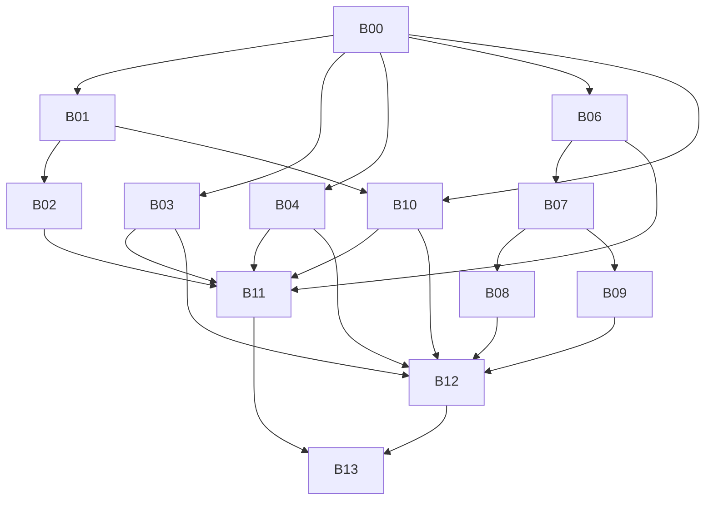

# CuePhys 改名完整整改方案 v1.1

> **本文件是本轮需求真源。** 日期：2026-11-24（Asia/Shanghai）。状态：**方案已修订，13 个有效批次待执行；B05 按用户决定取消**。按 `issue-collection-restructure` 技能编制，后续可由 `plan-batch-execution` 接续。
>
> 本轮授权：系统分析并编写完整方案；没有授权在本轮启动代码整改、数据迁移、部署或发布。此前模型修复属于既有成果，不能据此把本方案其他批次标为完成。
>
> 排期前置：执行时重新确认工作区、当前签名与平台状态。微信审核、付费协议等仅阻塞依赖它们的批次；本地批次可先做。产品尚未上线，按用户决定不开发复杂的历史用户数据兼容；以 CuePhys 新安装和当前版本生成的数据为验收基线。本轮不执行任何数据删除。

## 1. 需求回显与范围

用户原始要求：

1. App 与相关内容改名 CuePhys 后，出现球桌消失，担心还有其他遗漏。
2. 参考“产品上线准备事项补全”会话，重新系统分析改名影响。
3. “先不要动手改，先系统分析”。
4. 本轮“使用 issue-collection-reconstructure 技能写一个完整的方案”，希望解决所有相关问题。仓库技能实际名称为 `issue-collection-restructure`。

5. 最新拍板：“由于我们产品还没有上线，所以对于一些历史用户数据，无需做复杂的处理”。据此取消跨旧 App 的存档搬迁、旧数据库恢复、旧身份/凭据自动迁移及旧测试交易连续性等发布前置；当前版本正常持久化、账号安全和购买恢复仍须通过。

本方案覆盖改名涉及的工程、资源、内容生产、测试工具链、本地数据、身份凭据、云端账号、支付、系统能力、公开资料和发布验收。目标是逐项关闭迁移问题，而不是把搜索到的所有旧名字删除。

不因本轮改名重做 Logo、球桌模型、物理算法、教学几何、布局和交互设计；已有相关功能必须保持。与改名无关的旧缺陷单列，有证据证明不影响本轮时才允许独立跟踪，不能用“历史问题”掩盖新的回归。

## 2. 事实基线与完成口径

### 2.1 已核实的本地事实

- 当前工程为 `CuePhys.xcodeproj`，源码/测试/扩展目录已改为 CuePhys；主 Bundle ID 为 `com.youbilliards.cuephys`。
- 此前模型故障根因：`.gitattributes` 仍指旧目录，生产 USDZ 变成 LFS 指针；源码模型及新 Debug 包已修复，有定向验证证据。见 [模型修复记录](CuePhys模型资源修复-20261124.md)。这些成果应复用，不重复重做模型。
- 2026-11-24 本地只读检查发现 `build/CuePhysReleaseArchive/CuePhys.xcarchive/Products/Applications/CuePhys.app` 仍含 134 字节球桌与 132 字节球杆 LFS 指针。该归档只保留为失败证据，禁止作为后续候选包。
- 四类 Application Support 路径改变，但未见旧目录桥接；Mac mini 队列和若干在用内容脚本仍依赖旧目录。
- Keychain 有旧键回退，没有显式共享访问组，也没有回退读取后写入新键的动作；不能据此证明跨 Bundle ID 凭据迁移。
- SwiftData 迁移测试由当前模块创建旧 schema 夹具，不等于真实旧二进制存量库已经验证。
- 全量迁移映射、首发方案追加记录、Hub 当前介绍存在时间和状态差异，需收敛有效版本。

### 2.2 外部状态的证据边界

本方案引用现有记录，未在编写期间重新操作 Apple、微信或服务器：

- ASC 现有记录 Bundle ID 已切换并保存；不能再按旧映射表写“未切换”。
- App 备案已提交，处于腾讯云审核中；微信移动应用也已提交审核。不能把早期“未提交”段落作为当前状态。
- API HTTPS、官网法律页面、微信 Universal Links 源站已按已有报告验证；Apple CDN 与真实微信回跳仍需闭环。
- 付费协议、正式商品、Apple/微信生产凭据与真实交易/登录的完成状态，执行时按最新平台证据核实，不从代码常量或健康检查推断。
- 用户确认产品未上线，历史测试数据不需要复杂迁移。旧测试数据、账号与交易无需成为新版本验收输入；已有记录和失败证据不因这次方案修订自动删除。

### 2.3 两种里程碑

- **本地整改完成**：本地实现、当前数据读写、工具链及可执行回归通过；外部事项逐项列为阻塞。不能称“全部解决”或“可上线”。
- **完整整改完成**：所有仍在范围内的问题都有验收结论；历史迁移按用户决定标为取消，不伪称已实现；外部登录/购买闭环、新签名 Release 候选包及最终矩阵均通过。确实不适用的项目必须有产品范围与代码证据，不能把未测试写成不适用。

## 3. 问题全集与批次对应

状态定义：F=已确认缺口；V=风险待验证；E=外部依赖；R=已有修复需集成复验；S=按用户决定移出范围，不是已修复。优先级 P0=会阻止可信构建、破坏资源/数据/账号或发布；P1=必须在完整整改收口前处理。优先级表示影响，不等于每项已经发生损失。

| ID | 分类/优先级 | 问题与影响 | 批次 |
|---|---|---|---|
| I01 | R/P0 | LFS 路径遗漏，模型指针进入 App；保留现有修复并补干净来源证明 | B01 |
| I02 | F/P0 | 旧 Release 归档仍坏，构建成功被误作资源可用 | B01、B13 |
| I03 | F/P0 | Mac mini 快照漏掉新目录、测试选择器拒绝新模块 | B02 |
| I04 | F/V/P0 | 快照遗漏 `.gitattributes`，提交归档缺少明确 LFS 实体化闭环 | B02 |
| I05 | F/P1 | 在用题库/精讲/引擎导入脚本仍读写旧路径 | B03 |
| I06 | V/P1 | 其他资源：字体内部名、声音、贴图、图标、教学图、题库、离线内容及缓存需按消费者核查 | B00、B01、B03、B10 |
| I07 | V/P1 | 四类路径统一以 CuePhys 为准；旧目录不迁移，核当前版本保存/重启/续练 | B04 |
| I08 | S/不阻塞 | 跨旧 Bundle ID 数据容器搬迁取消，不开发旧 App 导出/导入桥接 | B05 取消 |
| I09 | V/P0 | 当前版本数据库、游客 ID、namespace、同步锚点需保持一致 | B04、B12 |
| I10 | S/不阻塞 | 真实旧 QiuJi 模块数据库兼容不作为首发验收项；当前库创建/重开仍必验 | B05 取消；当前库见 B04 |
| I11 | V/P0 | 只保证当前 Keychain 读写/失效/退出；旧跨组凭据迁移取消，迁移描述需纠正 | B06 |
| I12 | E/V/P0 | Apple 新身份、服务端受众、账号归属、token 撤销链未闭环 | B07 |
| I13 | E/V/P0 | 微信 AppID/链接/签名/服务端身份绑定未真机闭环 | B08 |
| I14 | E/V/P0 | 正式商品、购买/恢复/撤销与 appAccountToken 归属未闭环 | B09 |
| I15 | F/V/P0 | 生产预检为独立命令，部署/重启容易漏跑；健康检查不代表业务就绪 | B07 |
| I16 | V/P1 | 当前数据库、头像、备份、加密密钥若被顺手改名可能断链；不追加旧授权迁移 | B07 |
| I17 | V/P1 | 系统通知、Live Activity、外链/回调、权限重新申请与双 App 并存需核查 | B10 |
| I18 | F/P1 | 文档、脚本说明、当前技能引用与实际实现不同步 | B00、B03、B13 |
| I19 | E/V/P1 | 商店/官网/法律支持入口/备案材料的最终身份对应需统一 | B10、B13 |
| I20 | V/P0 | 旧命名残留没有按“必须改/必须留/历史材料”分类，存在误改持久化契约风险 | B00、全批次 |
| I21 | V/P0 | 局部模型/构建成功不能覆盖全部实际球桌消费者及非球桌主流程 | B11、B12 |
| I22 | V/P1 | 计划中的通用深链和 App Store 通知不一定有当前实现，需判定真实首发合同 | B00、B09、B10 |

新发现问题用 I23 起追加，必须映射到批次和验收；不得以本表未列出为由忽略同一改名根因的影响。

## 4. 迁移原则与需在执行前锁定的选择

### 4.1 按首发阶段简化

1. **历史迁移不做复杂处理**：不开发 QiuJi→CuePhys 跨沙盒数据搬迁、旧数据库转换/恢复、四类旧目录自动迁移、跨 Keychain 访问组桥接、旧 Apple subject 归属转移或旧商品测试交易恢复工程。缺旧样本不阻塞发布。
2. CuePhys 使用当前目录、Bundle ID 和正常初始化流程；需要登录时重新登录。允许旧测试安装与新安装彼此独立，不承诺带入旧训练历史、设置或登录状态。
3. 当前版本创建的数据必须能保存、重启恢复、正常同步；游客与账号隔离、当前账号再次登录、购买恢复/撤销都保留完整验收。这些是首发功能，不属于历史兼容。
4. 已有零成本兼容和稳定内部标识不必为统一名称专门删除：例如 schema 类型、旧商品枚举、旧键回退。若确有冲突按证据最小处理，不追加迁移框架和旧样本专项测试。当前 appAccountToken 算法不因品牌再次变化。
5. 不为品牌一致重建 Mongo 数据库、换部署目录、轮换加密密钥、拆分模拟器租约登记。字体内部名、shader、资源键与内容 ID 按真实依赖保留。
6. 此次范围缩减不等于执行清理：本轮不卸载旧 App、不删除设备数据、不清库。后续可用新隔离测试容器从零验收，不要求拿用户现有设备数据作输入，也无需再次确认是否必须做历史迁移。
7. 首发仍为永久非消耗型商品、Apple 与微信登录；不借简化历史处理改变这些产品范围。

### 4.2 决策与边界

| 决策 | 当前结论 | 关闭时点 |
|---|---|---|
| D01 历史数据 | 用户已确认无需复杂处理；不取旧库、不开发跨 App 导入，取消 B05；B04 验当前数据读写 | 已拍板，B00 回写范围 |
| D02 Keychain | 只核当前签名权限与当前凭据读写；不新增历史共享访问组，失效/无凭据正常重新认证 | B06 |
| D03 Apple 身份 | 不构建旧 App subject 转移与旧账号合并；新 CuePhys 账号应可再次登录同一身份，并正常绑定/注销 | B07 |
| D04 服务端支付通知 | 按首发真实权益刷新/撤销合同判断。需要时实施验签/去重/归属；当前 StoreKit 方案已满足时记录边界及证据，不为了旧测试交易增建服务 | B09 |
| D05 外部权限与发布 | 本方案不触发接受协议、购买或上传；后续按当时授权推进，外部等待不阻塞无依赖批次 | 相关批次 |

历史迁移已经移出本轮范围，不再作为待用户决定或发布阻塞。尚未明确的生产服务架构和外部操作另按具体需求处理。

## 5. 批次表与依赖

量级为单次会话内“读取→实施→定向验收→记录”的相对工作量，不承诺外部审核时长。默认单主控串行推进，图中的分支仅表示技术依赖，不授权并行智能体。外部等待可让位给已满足依赖的批次。

| 批次 | 范围 | 量级 | 依赖 | 初始状态 |
|---|---|---|---|---|
| B00 | 冻结实际迁移清单、数据策略、入口与证据基线 | 中 | 无 | 待执行 |
| B01 | 模型及全资源打包、LFS、工程生成与候选禁用 | 中 | B00 | 待执行；已有模型成果可复用 |
| B02 | Mac mini 队列、源码快照、LFS 与测试选择器 | 中 | B00、B01 | 待执行 |
| B03 | 内容导入/生产脚本及当前文档引用 | 中 | B00 | 待执行 |
| B04 | 当前存储路径、数据库与重启恢复 | 中 | B00 | 待执行，移除旧数据迁移 |
| B05 | 跨旧 App 数据与旧数据库恢复 | 取消 | 无 | 用户已取消，不占执行批次 |
| B06 | 当前 Keychain 与正常认证状态 | 小至中 | B00 | 待执行，移除跨组迁移 |
| B07 | 后端生产配置与 Apple 账号闭环 | 中偏大 | B06；真实闭环需生产凭据 | 待执行/外部依赖 |
| B08 | 微信身份、Universal Links 与真机回跳 | 中 | B07 后端基线；微信审核/凭据 | 待执行/外部依赖 |
| B09 | 永久商品、支付归属、恢复与撤销 | 中偏大 | B06、B07；正式商品/协议 | 待执行/外部依赖 |
| B10 | 通知/扩展/权限、公开入口和品牌资源一致性 | 中 | B01、B00；微信项复用 B08 | 待执行 |
| B11 | 所有球桌入口的改名相关回归 | 中偏大 | B01–B04、B06、B10 本地部分 | 待执行 |
| B12 | 账号/内容/训练/支付端到端数据回归 | 中 | B03、B04、B06–B10 | 待执行/外部依赖 |
| B13 | 最终签名 Release、发布资料与总验收 | 中 | B00–B04、B06–B12 全部关闭 | 待执行 |

有效执行批次为 13 个；保留 B05 编号仅用于追踪已取消范围，不补做、不等待旧数据。若 B09 确需新增完整服务端交易系统，应先拆出具名子批并更新依赖与版本，不能塞入一次会话并略过验收。其余批次按实际失败与工作量调整，禁止为了批次数量省略闭环。

## 6. 每批工作与完成标准

### B00 — 冻结基线与迁移合同

**工作**：记录分支、HEAD、已有修改/未跟踪文件、关键文件摘要；只冻结本次整改输入，不提交他人改动。扫描当前源码、配置、脚本、在用技能/README 的旧品牌、Bundle ID、路径、资源键、URL、UserDefaults、Keychain、数据库/备份标识。每条归类“当前执行引用需改／兼容保留／内部稳定标识／历史材料”。列出实际主入口、所有球桌消费者、内容工具调用者和本轮默认测试集合。同步纠正文档当前结论，历史执行记录保留日期。

**产物**：同目录工作包的 `CURRENT.md`、问题清单、标识保留清单、页面/工具入口矩阵、当前数据读写清单与证据索引（这些文件为未来执行产物，目前未创建）。

**完成标准**：I01–I22 全有责任批次、源码/平台证据和状态；没有“旧名全部清零”门禁；D01 的历史迁移取消范围已回写，旧数据不再成为阻塞；新旧标识与当前签名/配置核对；不把未读的脚本列为已审。回滚只撤销本批新增文档/清单，不触碰既有数据。

### B01 — 资源与构建闭环

**工作**：复用现有 LFS 修复，核 `.gitattributes`、`.gitignore`、`project.yml` 与生成工程。检查生产桌/杆、所有房间、球/材质/字体/音效/教学图/题库资源的实际消费者与进包路径。扩展现有门禁覆盖确有风险的资源，不另造重复体系。干净检出实际取回 LFS 对象，检查受控文件已被版本管理而非仅本机存在。Debug/Release 构建路径都接入内容门禁；旧坏归档显式标为不可发布，保留证据不自动删除。

**完成标准**：真实 LFS 二进制、ZIP/USD/CRC 与已冻结哈希匹配；源配置与生成工程各自构造错误时门禁会失败；已知坏包必须被拒绝；缺资源、指针、错误排除路径不能只靠“文件存在”通过。干净来源与构建包有可追溯摘要；实际 SceneKit 导入通过。最终发布配置归档留 B13，不把本批 Debug 成功当发布就绪。回滚保留原始模型与规则证据，不回退成指针。

### B02 — 远端快照与执行入口

**工作**：修 `mac_mini_queue.py` 的 ROOTS、EXCLUDED、默认测试、选择器校验及所有实际消费点。快照纳入构建必需配置（含 `.gitattributes` 与需要的隐藏配置），明确 working-tree 与 commit 两种模式；提交归档不得把 LFS 指针当实体模型。保持共享租约数据库路径稳定，不因品牌换名创建另一套资源登记。

**完成标准**：分别用真实命令入口验证两种快照；清单包含新 App/扩展/测试/工程/配置与真实资源；缺必需根应报错，不能静默略过；新测试名可执行、无效名被拒绝。至少一次 Mac mini 受管构建与代表性测试成功，读回快照/包内模型摘要。若远端不可用，只能标本地逻辑已验、远端阻塞。回滚使用本批快照/配置备份，不删除其他任务的设备和租约。

### B03 — 内容工具与当前引用

**工作**：先修已确认的 `import_bank_practice.py`、`tutorial_copy_facts.py`、`import-engine-export-to-app.py`；按 B00 调用者清单扩展到仍在使用的内容/品牌素材工具。脚本默认路径、验证路径、输出路径与技能示例同步，不只改注释。历史视频/研究脚本按是否仍被入口引用判断，退役脚本给明确入口状态，不为数量清零而批量重写。

**完成标准**：在隔离副本用代表题库、精讲图和引擎导出数据运行真实 CLI；读取和输出均落到当前目录，验证分支正常，缺输入明确失败；App/校验器能读回产物，无孤儿引用。不得重写教学文案、序列几何或生产全库以验证路径。重复执行幂等；禁止意外生成 `QiuJi/`。涉及项目 15 的输出约定，在实际修改时同步双方 Hub 卡。回滚仅本批工具与隔离产物。

### B04 — 当前数据存储与恢复

**工作**：统一并核查 BoardMemory、TrainingCheckpoints、TrainingQuota、SpatialPractice 的当前 CuePhys 读写路径。检查当前 SwiftData 容器创建/重开、游客 ID 和 namespace 稳定性、草稿/historyID/轨迹文件对应关系。以新隔离安装生成数据，不读取或搬迁 QiuJi 旧目录；没有记录时正常初始化。

**完成标准**：新安装→生成训练/球形/额度/上一杆→退出重启→恢复可用；当前账号切换不串数据；计数/去重符合当前规则。缺文件、损坏、写失败有可定位且合理的处理，不静默清空整个数据库。至少覆盖一次真实默认路径入口，不只测注入 root。当前版本自身产生的数据不能丢失；无须旧二进制样本和两目录冲突合并测试。回滚仅本批代码及隔离测试产物，不改真实设备历史数据。

### B05 — 已取消：跨旧 App 数据与旧数据库恢复

**范围处置**：用户明确产品未上线、历史数据无需复杂处理，取消原跨容器导入、真实旧库兼容和旧游客身份恢复工程。I08/I10 标记范围取消；不做实现、不要求迁移样本、不占执行会话，不列为发布阻塞，也不声称已经修复。

当前 SwiftData、游客身份、同步与持久化功能由 B04/B12 验收；本次取消未删除任何数据。

### B06 — 当前 Keychain 与正常认证状态

**工作**：核当前 CuePhys 签名访问权限及新凭据的保存、读取、刷新、清理。缺少旧登录状态时正常要求重新认证；不新增旧 App 共享访问组或旧键迁移标记。现有旧键回退若无冲突可保持，不为了迁移旧测试账号追加机制；有冲突则优先保证当前身份明确且安全。

**完成标准**：当前新安装无凭据、成功登录后重启、token 过期/撤销、写失败、退出及注销清理均可验证。真机签名包能访问自己的安全项，mock 不代替签名验证；重新认证前不暴露另一账号私有数据。B07 验证当前 CuePhys 同一账号反复登录归属一致，不要求衔接 QiuJi 旧账号。回滚仅本批实现，不清除其他 App 的安全项；token 不进入证据。

### B07 — 后端与 Apple 身份

**工作**：核 API 地址、TLS、客户端与服务端受众、Team/Key/私钥路径/加密密钥，实际值仅受控存放。把生产预检纳入发布/启动前的实际执行路径，明确缺失能力的关闭行为，不以 `/health` 代替就绪结论。保留 Mongo 库名、头像根、删除队列、备份/恢复合同；验证当前 Apple grant 的交换、存储和撤销，不增加历史 grant 迁移。按 D03 完成当前 CuePhys 登录与绑定。

**完成标准**：错误受众/占位凭据/不匹配密钥在发布前被拒绝，报告脱敏；有效配置通过。新用户、当前 CuePhys 已注册用户再次登录、取消、token 过期/刷新、重复绑定、登出、注销与授权撤销都有真实或明确分层证据；当前 CuePhys 同一账号再次登录后的服务端 user ID、数据与购买归属连续，不要求与旧 App 对接，无按邮箱自动合并。备份恢复在隔离环境演练，不修改生产数据库名称。生产联调需要实际凭据，缺失保留阻塞。回滚恢复前一服务版本及相容配置，不随意轮换加密密钥。

### B08 — 微信全链路

**工作**：真实 AppID/Secret 获批后，校准 iPhone/iPad Bundle ID、URL Scheme、SDK 注册参数、Universal Link、AASA 的 Team+Bundle、服务端 appID+openid 归属。核源站和 Apple CDN，再通过真实签名包授权。已有占位值关闭入口的行为保持。

**完成标准**：真机已装/未装微信、冷/热启动回跳、用户取消、重复/过期回调、无网/服务失败、绑定冲突均有记录；不能串到旧 App 或错误账号；微信与 Apple 绑定同一账号后训练数据与权益一致。iPad 若存在平台能力差异，记录真实可用路径与证据。不可只用 AASA 200 关闭本批。回滚恢复客户端与服务端成套配置，不把 Secret 写进 App。

### B09 — 支付与权益归属

**工作**：只读核对正式商品后准备 CuePhys 永久非消耗型商品与所需资料；当前商品使用稳定 appAccountToken；现有旧商品枚举可保留，不开发旧测试交易迁移。落实 D04 的支付架构边界，若需服务端通知，先补设计与验收子批。核所有会员入口、路由、目标页门禁和购买说明，不只检查商品常量。

**完成标准**：真实沙盒验证商品加载、成功/取消/待处理、重复点击、恢复、重装、换设备、账号切换、退款/撤销后权益变化；交易必须验证，未验证交易不得授予权益；非当前账号交易不能错误解锁。只要求 CuePhys 当前商品真实购买与恢复，不以旧商品测试交易样本作为验收前置；旧交易迁移列范围取消。本地 StoreKit 与平台沙盒结果分列。若采用通知，附验签、重复事件、乱序、环境隔离与归属测试。回滚保持已购识别，不能靠重置购买数据回退。

### B10 — 系统入口与公开身份

**工作**：核主 App/Live Activity 的 target、profile、entitlements、Info.plist、资源与显示名；审查通知标识的创建/点击/取消链、URL 与 Universal Link 的实际注册/处理链、权限文案、首次启动和设置恢复。核官网支持/法律/下载入口、商店截图/文案/图标、隐私清单和备案材料中的身份值；沿用既定 Q 标志与配色。

**完成标准**：当前 Bundle 下提醒/休息计时/实时活动开始、结束、前后台和点击入口正确；旧新 App 并存时不宣称可取消另一个 App 的通知，不尝试跨 App 越权清理。需要重新申请的权限在正确业务时机出现。通用深链若本就没有正式合同，不为了映射表虚构功能；实际消费者必须全接通。签名权限与声明一致；公开资料中当前品牌一致，历史证据保持原样。外部页面状态按最后实测时间记录；最终平台生效留 B13。回滚成套恢复扩展/主 App 配置与公开素材候选。

### B11 — 球桌页面回归

**工作**：以 B00 的真实路由与共享加载器消费者清单逐项验，不预设只有每日清台。所有实际入口检查桌体/球/球杆/房间及资源错误日志；状态组合按页面支持能力覆盖 2D、3D、第一人称、临时俯视、教学/编辑/回放。共享机制深入验证代表宿主，各入口仍做加载与首个核心动作检查。

**完成标准**：每个入口有版本、设备、状态与证据；每日清台开球/击球/重打/回放、训练页作答/示范、编辑页保存重入、求解页加载与执行均走真实路径。小屏 iPhone、标准 iPhone、iPad 横竖覆盖实际受影响机制；最低支持系统从工程读取，不凭记忆。遵循球桌规范的受影响项及依赖，保持页面例外；不借修复改布局、手势和物理。截图与场景节点/资源日志相互佐证，不能只看背景或 HUD。真机观感与操作另列，不能由模拟器替代。

**失败与回滚**：保留失败包、截图和现场，按根因退回对应实现批次；仅回滚本轮造成回归的变更，不调物理参数或改变页面合同来通过资源验收。修复后复跑该共享消费者的受影响入口。

### B12 — 非球桌与数据端到端回归

**工作**：覆盖首次启动、全部顶层导航、动作/精讲/理论资源、训练记录、设置、账号与会员入口。将 B04、B06–B09 的局部结果串成新安装→当前游客训练→登录/合并→云同步→换设备恢复→当前商品购买/恢复→退出/切账号/注销的业务链；不同测试账号和隔离环境避免破坏真实记录。

**完成标准**：核心链条数据数量/owner/状态正确，关闭同步时不意外上传；离线 Bundle 内容可用、在线恢复不漏不重；字体、声音、图片、图标无缺失；非会员/会员入口及目标页一致；账号 A/B 隔离。权限拒绝、网络失败、空数据和已有数据均可继续或得到明确可恢复错误。预先冻结矩阵，失败保留原回执，修复后复跑受影响链；未解决的同类问题不能以其它用例通过抵消。

**失败与回滚**：测试账号和数据使用独立快照；失败时停止后续破坏性步骤，保留同步/交易回执，恢复隔离测试环境。不得删除生产账号或用清空历史数据制造通过结果；实现问题退回其责任批次后重验整条受影响业务链。

### B13 — 新候选包与总验收

**工作**：冻结实际版本/构建号、源码清单、LFS 对象和受控生产配置摘要；生成新的签名 Release Archive/导出包。检查 App、扩展、profile、entitlements、Info.plist、API/法律 URL、模型/资源与隐私清单，拒绝验证域名/占位凭据/错误 Bundle。核所有外部配置和材料对应同一候选身份；更新当前迁移映射、首发方案、人工台账、PROGRESS 与 Hub。上传/TestFlight/提审按当时授权执行，未授权不能伪装完成。

**完成标准**：I01–I22 及新增项全部有范围/验收结论；I08/I10 按用户决定取消，其余有效项有证据；本地/远端/Release 来源一致；候选包资源门禁与真机冒烟通过，关键授权/购买走签名包真实路径。所有必需外部阻塞已关闭；有条件不适用项有合同依据。没有凭编译通过替代运行、凭 mock 替代生产、凭历史 Debug 替代当前 Release。若上传获授权，附实际平台处理结果；否则只交付“本地候选已验，未上传”，不能写成已发布。回滚保留前一可用候选及后端兼容版本，坏归档只作证据。

## 7. 验证、证据和失败处理

- 每批记录需求 ID、实际改动文件、执行命令、工具/SDK/系统、源码版本与脏工作区摘要、产物哈希、测试通过/失败/跳过数量、原始日志、截图、未验项和下一批。
- 证据建议放 `output/cuephys-rename-remediation/<batch>/<run-id>/`；执行记录放本目录工作包。当前仅方案文件存在，不把未来路径当已生成证据。
- 不要求“全仓测试后零 diff”：当前工作区有既有改动，且测试可能写产物。执行前盘点默认测试集合与写盘行为，隔离副本/临时根，按本批拥有的文件检查污染；不改断言求绿。
- 失败按“新回归／既有且无关／外部环境／证据不足”分类，每类须有依据。不能以测试名或截图存在推断成功；缺核心路径证据时该批仍未完成。
- 模拟器/远端测试执行时读取 `simulator-use`、fleet 与 lifecycle 规则，登记租约、导出证据后释放；不任意新建或清理共享设备。保留需用户复验的现场。
- 旧包、旧数据库和 Keychain 不自动删除；真实用户数据不提交 Git，日志不含 token、密钥、openid/subject 原值或完整个人记录。
- 受影响页面实际实施/验收前读取球桌适配技能和现行规范；若只是资源/路径修复不强造页面合同变更，也不机械重跑全部布局矩阵。
- 如果补测发现原方案遗漏，先补问题与失败机制、更新版本和依赖，再实施；不能降低完成标准以维持原排期。

## 8. 已核实锚点索引

核实日期：2026-11-24。以下路径与所述逻辑已通过当前代码读取/定位确认；行号会随整改变化。未给出新迁移器/测试的虚构名称，新增文件命名由对应批次落地时确定。

| 范围 | 当前锚点 | 用途 |
|---|---|---|
| 工程身份 | `project.yml:179,183,250,266,287`；`Config/Debug.xcconfig`、`Config/Release.xcconfig`；`CuePhys.xcodeproj/project.pbxproj` | App/扩展/测试 ID、签名配置、生成关系 |
| 模型门禁 | `scripts/verify_model_packaging.py:13,20,68`；`scripts/test_verify_model_packaging.py` | LFS 规则、实体资源与包内容 |
| 构建入口 | `scripts/Makefile:366,399,418` | 校验、文档门禁、归档 |
| 模型消费者 | `CuePhys/Core/Scene/ModelAssetTrial.swift`、`CuePhys/Core/Scene/TableModelLoader.swift` | 生产模型标识与实际加载 |
| 远端队列 | `scripts/mac_mini_queue.py:25,80,153,188,244` | 快照根、选择过滤、git archive、选择器 |
| 题库工具 | `scripts/import_bank_practice.py:15,98,100` | 默认输出与 verify 消费路径 |
| 教学工具 | `scripts/tutorial_copy_facts.py:55,100,103`；`scripts/import-engine-export-to-app.py:53` | 精讲图片/索引与导入默认路径 |
| 球形记忆 | `CuePhys/Core/PositionPlay/BoardMemory.swift:29` | 新默认存储根 |
| 训练续练 | `CuePhys/Core/Training/TrainingCheckpointStore.swift:19` | checkpoint 根及读取 |
| 额度 | `CuePhys/Core/Training/TrainingQuotaLedger.swift:49` | 文件根和 defaults 回退 |
| 空间练习 | `CuePhys/Features/SpatialPractice/SpatialPracticeArchive.swift:45,51,68` | namespace、目录、草稿/轨迹引用 |
| 数据库 | `CuePhys/Data/Models/ModelContainerFactory.swift:11`；`CuePhysTests/SwiftDataMigrationTests.swift:32` | 默认容器与当前模块旧 schema 测试 |
| 归属/同步 | `CuePhys/Data/Models/OwnerIdentity.swift:21`；`CuePhys/Data/Services/AccountDataCoordinator.swift:107,135`；`CuePhys/Data/Services/SyncRestoreService.swift:109,135` | 游客 ID、账号合并、恢复锚点 |
| Keychain | `CuePhys/Data/Services/KeychainService.swift:6,16,22,48`；`Config/WeChat.entitlements` | 新旧键、查询与签名能力 |
| Apple | `backend/src/routes/auth.js:19,60,131`；`backend/src/services/appleGrant.js:31,53,61` | aud、账号身份、授权交换/撤销 |
| 生产服务 | `backend/server.js:1`；`backend/src/config/index.js:21,27,34`；`backend/src/config/productionPreflight.js:14`；`backend/package.json:10` | 启动/生产预检、数据库与受众 |
| 微信 | `backend/src/services/wechatLogin.js:6,32`；`Packages/CuePhysWeChat/Sources/`；`CuePhys/App/CuePhysApp.swift` | 服务端身份、SDK 注册/回跳与 App 生命周期接线 |
| 支付 | `CuePhys/Data/Services/StoreKitService.swift:58,72,84,94,134` | 新旧商品、稳定令牌、购买与读取 |
| 内容消费 | `CuePhys/Data/Services/DrillContentService.swift:280,444,491,498` | 配图约定、错误报告、离线索引 |
| 系统能力 | `CuePhys/Core/LiveActivity/RestCompletionReminder.swift:54`；`CuePhys/Core/LiveActivity/RestTimerLiveActivityManager.swift`；`CuePhysLiveActivity/Info.plist` | 通知标识、活动管理与扩展 |
| 现有回归入口 | `CuePhysTests/TrainingQuotaLedgerTests.swift`、`CuePhysTests/SpatialPracticeRecoveryTests.swift`、`CuePhysUITests/DailyAdaptivePanelUITests.swift`、`CuePhysUITests/P7_SubscriptionUITests.swift` | 扩展现有测试，不把文件存在当已通过 |
| 状态文档 | `CuePhys全量标识迁移映射.md:13,25,26,73`；`Apple组织迁移与首发方案_v4.md:290`；`tasks/HUMAN-REQUIRED.md` | 陈旧/当前状态分离、外部依赖 |

B00 还须给实际页面消费者/在用脚本补完整索引；本表是当前已核锚点，不能代替全入口盘点。

## 9. 接续方式与版本记录

后续会话先读本文件与工作包 `CURRENT.md`（B00 建立），再读当前批次锚点及相关技能；核实 HEAD/工作区变化后，只执行依赖已满足的批次。每批结束更新“状态、证据、未验、下一步”；无证据不能打完成勾。本文不自动触发实施或委派。

本文件是“改名整改”的最新需求真源，不替代产品规格、数据合同、球桌规范及外部平台真实回执。与旧迁移计划矛盾的状态按最新证据处理；历史迁移已按最新要求取消，不再等待额外确认；本轮未授权删除实际数据或更改其他产品承诺。后续版本覆盖本文同项安排，旧证据保留。

| 版本 | 日期 | 变更 |
|---|---|---|
| v1.0 | 2026-11-24 | 按本次系统审计建立 I01–I22、B00–B13、迁移边界、外部依赖、每批验收/回滚及真实代码锚点；本轮仅编写方案 |
| v1.1 | 2026-11-24 | 用户确认未上线、历史数据无需复杂处理：取消 B05，B04/B06 改为当前存储/认证验证，移除旧 subject/grant/交易迁移前置；保留 13 个有效批次，更新依赖与总验收；仅修改方案 |
