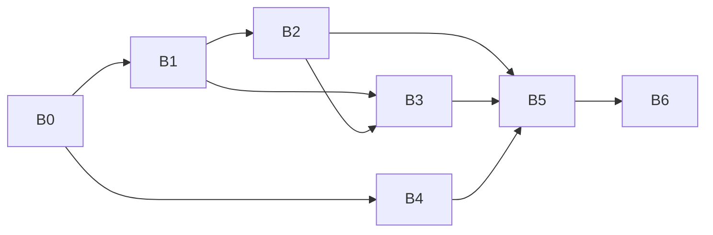

# CuePhys 改名后真机回归与入口修复方案 v2

> **本文件是本轮需求真源。**
>
> 日期：2026-11-25  
> 状态：B0 已完成；B1 已修改并通过真机构建，真机定向验收进行中；B2–B6 待按依赖执行。  
> 适用范围：CuePhys 改名后的资源、Bundle/调试入口、球桌页面、真机回归、生产鉴权配置。  
> 历史用户数据：产品尚未上线，按用户决定不做复杂迁移；保留当前新版本数据合同，不新增旧用户迁移层。

## 1. 需求回显与事实边界

用户已经确认的目标：

1. App 已改名为 CuePhys 后，球桌曾出现消失；需要系统排查改名造成的所有影响，不能只修一张页面。
2. 方案必须覆盖所有相关页面、共享资源、路由、鉴权和真机验证。
3. 当前产品尚未上线，不为历史用户数据增加复杂迁移。
4. 真实 iPhone 已连接；其余页面优先用真机验证。
5. 这轮先完整分析再修改；开始执行后持续完成当前方案，不把失败测试改写为通过。

已确认的现实：

- 真机为 iPhone 16 Pro，iOS 27.2.1，Bundle ID `com.youbilliards.cuephys`。
- Foundation 资源测试 10/10、签名 Keychain 1/1 通过；Bank、Kick、Spatial、Screenshot Tour 等真机页面能显示球桌。
- 生产 Apple audience 已切换为 CuePhys；微信登录在审核完成前明确关闭；API 健康检查返回 200。
- 当前真机失败不是单一原因：一部分是物理设备测试入口没有生效，一部分是页面初始状态/球形合同，一部分是 SceneKit 与 XCTest 的窗口和生命周期竞争。
- 本轮不把真实 Apple 用户授权、微信审核、正式支付和商店发布伪装成已完成。

明确排除：

- 不回迁或清理历史 App/数据库数据。
- 不在微信审核完成前打开微信登录。
- 不为让测试变绿而放宽球桌、权限、状态保持或几何断言。
- 不把模拟器专用深链当成真机已验证；真机必须有可审计入口。

## 2. 问题重构

### 2.1 共享调试入口在真机被编译排除（P0，已确认）

`CuePhys/App/MainTabView.swift:6-8,98-119` 将 `liveReviewLaunchRequest` 和 `-pro.route` 注入都放在 `#if DEBUG && targetEnvironment(simulator)` 内。真机 Debug 构建不会执行 `-pro.route=mergeAim`、`mergeAngle`、`mergeTwo`、`mergeThree`、`mergeSeparation`、`multiBall`、`defensePractice` 等入口。

受影响的真机测试：

- `CuePhysUITests/TrainingViewMergeUITests.swift:147-211`：6 个合并训练测试实际停在训练首页，找不到 `*.start`。
- `CuePhysUITests/DefensePracticeUITests.swift:39-57`：Defense 测试同样依赖 `-pro.route=defensePractice`，实际没有进入 Defense 页面。

这解释了训练批次 6 项失败和 Defense 失败。它首先是测试/调试入口合同问题，不能作为这些页面业务逻辑已经坏掉的证据。

约束：物理真机可以开启普通 Debug `-pro.route`，但 Live Review 请求仍须保持显式解析和受控；不能把模拟器专用批量编辑入口直接扩到生产。

### 2.2 Composer 初始球形/权限合同不一致（P1，待定位）

`CuePhys/Features/PositionPlay/Views/PositionPlayComposerView.swift:61-73,89-124` 定义 Composer 默认球形；`CuePhysUITests/SnakePracticeUITests.swift:719-727` 要求非 cue-only 页面初始至少存在母球和一个目标球。真机 `testComposer` 与 `testComposerHostIntegration` 在该断言失败，说明页面已加载但基线权限集合不足。

需要区分：

- 是默认球形没有加载；
- 是 Composer 入口使用了错误的 owner/深链状态；
- 还是测试夹具把“可编辑球”错误地当成“已在桌球”。

在定位完成前不得直接给页面塞球或删除断言。

### 2.3 K-ball 的真机菜单/视图切换未完成（P1，待定位）

`CuePhysUITests/KBallPracticeUITests.swift:29-59,142-164` 通过真实 UI 进入 K 球，再点 `kBall.cameraMode`。真机日志显示控件点击后状态仍为 2D，且 `kBall.dismissMenu` 曾出现无效点击坐标 `(-1,-1)`。

需确认菜单是否真的打开、视图切换动作是否被遮挡/转屏打断，以及生产状态是否已经写入 3D；不能仅凭最终值修生产相机状态。

### 2.4 SceneKit 页面与 XCTest AX/主线程竞争（P1，待定位）

Consumers 失败包括：

- `kAXErrorServerNotFound`；
- `XCTPerformOnMainRunLoop` 60 秒超时；
- `App event loop idle notification not received`；
- 无效 frame dimension。

涉及入口和断言位置：`CuePhysUITests/SnakePracticeUITests.swift:466-515,719-740`。Angle、Bank、Formation、FreePlay、PlanThree、Silu、Simulation、Snake、Tryout 已有通过样本，说明不是所有球桌资源或 SceneKit 页面都缺失；失败集中在部分场景初始化/转屏/AX 快照窗口。

### 2.5 每日清台与系统活动生命周期竞争（P1，待定位）

- `CuePhysUITests/V52DailyClearanceHomeSettingsUITests.swift:20-58` 在点击返回后等待 `dailyClearance.landscape` 和首页 frame 恢复，真机超时。
- `CuePhysUITests/V51ResponsiveLayoutUITests.swift:497-545` 在 Home 后等待 `.runningBackground`，真机失败；日志同时出现 SpringBoard 系统弹层干扰。
- `CuePhys/Features/Training/Views/ActiveTrainingView.swift:58-76,173-179` 和 `CuePhys/Core/LiveActivity/RestTimerLiveActivityManager.swift:25-73` 是状态与 Live Activity 的生产锚点。

需区分转屏动画、SwiftUI 状态恢复、SpringBoard 权限提示、Live Activity 延迟和产品真正未结束活动。

### 2.6 Drill Library 冷启动恢复偶发缺入口（P2，待定位）

`CuePhysUITests/P2_DataLayerUITests.swift:450-477` 首个冷启动恢复路径找不到“动作库”，但同一批次后续测试能找到并点击。需要检查启动时 Tab/NavigationStack/首帧恢复顺序，不把一次 AX 查询失败当作永久路由缺失。

### 2.7 Table Preferences 长巡游超时（P2，待定位）

`CuePhysUITests/DailyStandardFreePlayUITests.swift:512-544` 连续重启多个球桌宿主验证 2D/3D 独立记忆；真机超过 15 分钟。需拆分每个 route 的耗时和首帧等待，确认是某一页面卡住还是测试批次设计超长。

### 2.8 改名影响的已验证边界

`CuePhys/Core/Scene/TableModelLoader.swift:43-59,114-147` 通过 `ModelAssetTrial.url("TaiQiuZhuo")` 加载 USDZ，缺失时会记录 Missing TaiQiuZhuo；资源和模型测试已通过，当前没有证据表明球桌资源再次整体丢失。

改名相关共享合同仍需在方案末批复核：

- Bundle ID 与 Apple audience；
- Keychain access group / 签名身份；
- SwiftData/文件存储 owner key；
- LFS/USZD/贴图资源路径；
- App Group、Live Activity 扩展、URL scheme 和 Debug 深链；
- API/法律页/登录错误脱敏。

## 3. 批次表

| 批次 | 范围 | 量级 | 依赖 | 完成标准 |
|---|---|---:|---|---|
| B0 证据与基线冻结 | 汇总现有 xcresult、生产预检、真机备份、Git 边界；确认失败分类 | S | 无 | 结果包、设备信息、备份路径和未提交边界均有记录；不改业务代码 |
| B1 真机 Debug 路由合同 | 让物理 Debug 支持受控 `-pro.route`；将 Live Review 参数与 route 注入解耦；保留模拟器批量入口边界 | M | B0 | iPhone Debug build 成功；Training Merge 及 Defense 能找到并点击对应 `*.start`；模拟器入口不回退 |
| B2 Composer 初始球形与编辑权限 | 核对 Composer 默认 BoardSnapshot、owner、深链和 `PositionPlayViewModel` 权限；修正实现或测试夹具中的真实不一致 | M | B1 | Composer 真机进入；Batch Host 仅在模拟器验收；母球/目标球权限符合页面合同；2D 编辑与球桌显示均有截图/AX/probe 证据；不删除原断言 |
| B3 共享相机菜单与 K-ball 状态 | 核对 K-ball、Defense、Training Merge 的 menu open、cameraMode、dismiss、2D/3D 状态写入；修复共用控件或页面例外 | M | B1、B2 | K-ball、Defense、Training Merge 真机定向测试通过；每次切换前后有状态 probe；保留页面权限差异 |
| B4 每日清台与 Live Activity 生命周期 | 核对返回/转屏/scenePhase/Live Activity end；拆分系统权限弹层与产品状态；修复可确认的生产 race | M | B0 | Daily home/return、rest overlay、Live Activity end 在真机完成；系统弹层未授权时测试有明确前置，不把权限提示吞成通过 |
| B5 SceneKit 首帧与导航稳定性 | 分析 TableResourceCache/预热、SceneKit 首帧、AX readiness、Drill Library 冷启动恢复和 Table Preferences 长巡游；必要时按页面拆测试等待 | L | B1–B4 | Consumers 失败项逐一归因；球桌 `table.scene`、窗口、rendererID、route 状态均有诊断；不靠放宽 timeout 刷绿 |
| B6 全量真机回归与改名审计 | foundation/keychain/system/navigation/daily/training/consumers/specialized/other 全批次；生产 health/Apple 脱敏；更新任务台账和失败日志 | L | B2–B5 | 真机批次有逐批 xcresult；失败项全部关闭或明确外部/环境阻塞；构建、资源、Bundle、鉴权和页面入口报告可审阅 |

依赖图：

## 4. 每批详细执行与红线

### B0

只读盘点和证据冻结。使用现有 `output/cuephys-device-validation-20261124/`，不删除原始失败包；保留真机容器备份和生产预检结果。B0 已完成，当前报告不把失败改写为通过。

### B1

先重构调试入口条件，而不是把整个模拟器深链系统复制到生产：

1. 将 `MainTabView` 的 `liveReviewLaunchRequest` 访问范围与 `-pro.route` 的物理 Debug 注入分开；物理 Debug 只接受明确 route 字符串。
2. `RootView` 继续保持 Live Review 请求的受控解析；普通生产构建不包含调试入口。
3. 使用同一个 Bundle ID 和真实 iPhone 构建，不通过模拟器截图代替。
4. 先跑 1 个 Training Merge 和 1 个 Defense selector，确认入口已真实进入，再扩大到整批。

红线：不把 `-pro.route` 放入 Release；不启用批量编辑/Live Review 的物理生产入口；不把“首页有训练卡”当作 route selector 通过。

### B2

先打印/读取 Composer 初始 `BoardSnapshot`、`onTableKeys`、`editablePalette` 和 `PositionPlayViewModel` 的 owner/route，再决定实现修复还是测试前置修复。几何/坐标只使用现有 `table-geometry.md` 和页面 probe，不脑算。

完成后需要验证 Composer、FreePlay 普通页面和 Drill Tryout 的真机路径；Batch Host 在模拟器验证，其源码整体由 `#if targetEnvironment(simulator)` 限定；普通页面仍只允许母球 3D 直接拖动，目标球权限不能被 Composer 修复扩大。

### B3

共享菜单改动必须保留：菜单顺序、关闭行为、当前选择、2D/3D 页面合同和临时俯视边界。每次失败要采集菜单打开前、打开后、点击后、关闭后的 AX/probe，禁止只加延时。

### B4

系统活动测试必须把“系统通知权限是否已决定”作为显式前置；产品侧仍需验证 `endActivity()` 使用 immediate dismissal，且训练结束/返回/后台不会留下 stale activity。不能以关闭测试或跳过 Home 代替。

### B5

优先修复真实首帧阻塞或状态竞争；若测试只是在等待窗口而页面已可用，应改为等待生产状态标识（`table.scene`、rendererID、页面 route、ready probe），而不是无限增加 timeout。每个失败页面单独重跑，不用批次总绿掩盖单项。

### B6

恢复测试前设备数据后运行；保留每批 `.xcresult`、日志、设备信息。最终报告区分：代码修复、测试夹具修复、环境/系统限制、外部 Apple/WeChat 条件。

## 5. 锚点索引（2026-11-25 已核实）

| 锚点 | 用途 |
|---|---|
| `CuePhys/App/MainTabView.swift:6-8,92-119` | Tab、资源预热、Debug route 与 Live Review 注入 |
| `CuePhys/App/RootView.swift:15-39,130-149` | Live Review 与 UI 深链条件；共享页面 route |
| `CuePhys/Core/Scene/TableModelLoader.swift:43-59,114-147` | USDZ identity、预热、解析、clone |
| `CuePhys/Features/PositionPlay/Views/PositionPlayComposerView.swift:61-73,89-124` | Composer 默认球形、setupBoard、默认目标球 |
| `CuePhys/Features/Training/Views/ActiveTrainingView.swift:58-76,173-179` | 休息 overlay、scenePhase 与后台恢复 |
| `CuePhys/Core/LiveActivity/RestTimerLiveActivityManager.swift:25-73,87-93` | Live Activity 创建、结束和 stale activity 清理 |
| `CuePhysUITests/TrainingViewMergeUITests.swift:147-211` | 真机 route 注入依赖、训练 start、2D/3D保持 |
| `CuePhysUITests/DefensePracticeUITests.swift:39-57` | Defense route/start 前置 |
| `CuePhysUITests/KBallPracticeUITests.swift:29-59,142-164` | K-ball UI 入口、菜单和 3D 状态 |
| `CuePhysUITests/SnakePracticeUITests.swift:466-515,719-740` | Consumers 深链、球桌 readiness、权限断言 |
| `CuePhysUITests/V52DailyClearanceHomeSettingsUITests.swift:20-58` | 每日清台真实球堆、转屏、返回 |
| `CuePhysUITests/V51ResponsiveLayoutUITests.swift:497-545` | Home、系统休息 Live Activity、结束清理 |
| `CuePhysUITests/P2_DataLayerUITests.swift:450-477` | Drill Library 冷启动/动作库恢复 |
| `output/cuephys-device-validation-20261124/` | 本轮真机 xcresult、日志和退出码 |
| `backend/src/config/productionPreflight.js` | Apple/WeChat 生产预检 |
| `backend/src/services/wechatLogin.js` | WeChat 关闭时 fail-closed |

## 6. 版本记录

- v1（2026-11-25）：根据改名后真机 52 项回归结果建立；确认真机 `-pro.route` 编译边界、Composer 初始球形、SceneKit/AX 生命周期、每日/Live Activity 和长巡游超时的分层问题。
- 后续若批次执行改变需求语义、调试入口边界或页面权限合同，必须升版本并在此记录；只修实现或补证据不改变方案语义时，追加执行记录即可。

## 7. 执行记录

### 2026-11-25 B1 入口与测试连接恢复

- MainTabView 的普通 `-pro.route` 注入已调整至 Debug，Live Review 应用仍由模拟器条件保护。真机构建通过，定向验收尚未完成。
- 无线及有线重试均出现 Runner code 74，重建测试、重装 Runner 和重启 Mac testmanagerd 后仍出现。设备实查为 wired、已解锁，DDI contentIsCompatible 与 isUsable 均为 true。
- 重启本机 CoreDeviceService 后，`b1-coredevice-reset-152040.xcresult` 成功开始执行测试，防守训练设置页及 `defense.start` 已可定位。该恢复结果尚不能证明底层连接故障的唯一根因。
- 防守用例首次点击开始时日志记录 SpringBoard `NotificationShortLookView` 横幅覆盖，其后仍停留设置页。保留本次结果，进一步核对点击与状态转换。
- 本次原始证据在 `output/cuephys-device-validation-20261124/b1-*`，未覆盖首轮失败结果。

- `b1-confirm-152559.xcresult` 中防守击球/回放/重试完整通过（49.038 秒）；瞄准点入口已点击，后续在 AX 获取窗口时再次失败。其应用日志曾出现 AttributeGraph cycle，暂无根因结论。尝试 LLDB 栈采样未取得停止态栈，此轮瞄准点结果仅作诊断，需无调试器复验。
- `b1-coredevice-reset-152040.xcresult` 的瞄准点原始失败为 `kAXErrorServerNotFound`，无 CuePhys 系统崩溃日志；未将该失败记为通过。

### v2 验收范围纠正（2026-11-25）

- `BatchAuthoringView.swift:16` 整体限定模拟器，`RootView.swift:147-149` 同样限定其入口。v1 要求 Batch Host 真机进入与既有工具边界冲突，本版修正为模拟器验收。Composer 真机范围保持完整。
- 将原组合测试拆为 `testComposerHostIntegration` 和模拟器专属 `testBatchHostIntegration`，保留两者原有拖球断言。
- `composer-diagnostic-152806.xcresult` 中 LegalBallMovement 的 Composer 完整通过（66.360 秒）；组合用例完成 Composer 后在模拟器专属 batch 入口失败。拆分后的 Composer 待真机复验。
