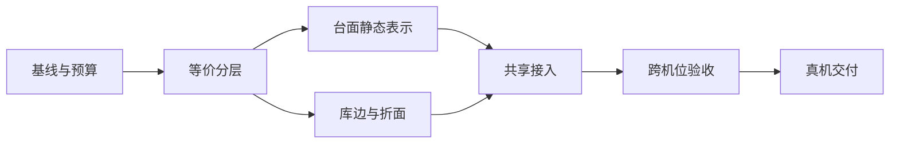

# 台呢静态基础与动态影响分离方案 v1.0

> 2026-11-26用户纠正后，以[PLAN-v3](PLAN-v3.md)为当前真源：尽量静态化，按GPU收益与感知差异联合评估；旧像素数值保留为历史事实／诊断指标，不再单独阻塞候选。

**本文件是本轮需求真源。** 日期：2026-11-26（北京时间）。状态：用户于2026-11-26授权执行并要求非必要不中断；B0/B1✅研究验收，B2✅研究结论不推广，B3✅研究验证，B4共享接入中，B5–B6待依赖验收。

范围：保持现有画质、帧率及操作响应，减少共享台呢着色中与机位、球运动无关的重复计算。继承产品规格与球桌页面规范；本文件只定义本轮渲染优化，不取代其他功能方案。

排期前置：实施时先冻结最新工作区、安装包及材质身份，核对同期共享场景修改。当前检视分支为 `main`，不是历史进度中的分支名。微信审核等外部发布事项不阻塞本方案编写。真机阶段需设备可连接、未充电和正常起始温感；缺少较低性能真机时单列未验，不代填结果。

执行入口：后续按项目 `plan-batch-execution` 流程逐批执行；不默认创建子智能体或新会话。每批预计占一个会话，量级是工作估算，不是工期承诺。实施中若发现单批无法包含验证，先升版拆批，不以压缩上下文为由省略验收。

## 1. 需求回显与边界

用户确认的语义如下：

1. 台呢和固定灯光本身不随相机或球运动改变；应把可复用的静态基础从动态计算中分离，适用于不同机位，不仅是固定相机停留时。
2. 球影、遮挡等球造成的动态影响必须保留。视角相关高光继续响应相机，不将最终外观冻结为一张截图。
3. 现有画质和帧率保持，不靠降分辨率、MSAA、纹理质量、阴影质量、关闭库边效果或降低刷新频率取得收益；操作响应和物理结果保持。
4. 复用历次优化与测试结果，不从头重跑大范围消融，不将已失败方案改名重试。
5. 目标是 GPU 实际耗时与持续使用负担下降，不是源码公式减少或开关显示开启。
6. “假如灯光各向同性”是用户解释思路时的假设，不是要求更换现有两盏面积灯、改为均匀环境光或改变材质。
7. 本轮执行已获授权。24Hz轨迹预览属于独立CPU工作项；本方案所有对照保持其行为一致，不混入15Hz调整。

工作假设：固定光照仍有可提取的几何/照明工作，新增库边积分可能扩大该空间。此假设需证伪；C1已消除一部分固定计算，不能预设还存在“大幅”收益。

## 2. 现状与可复用证据

| 已知现状 | 对方案的约束 |
|---|---|
| C1已用两张3D字段预存固定灯几何积分，查表后使用实际法线；不随球位、镜头、换色重建 | 从现有C1继续，不再把“新增静态查表”本身算作全新成果；先定位它未覆盖的计算 |
| C1只替换主照明调用；不满足空间/法线条件时保留解析积分 | 全表面覆盖需识别台面、库鼻、袋口折面及法线地平线，不能直接扩大边界 |
| H9已取消片元局部球数组复制并复用逐灯mask；已有保守遮挡筛选 | 动态部分沿用已验证能力，不恢复旧全球循环；mask不等于结果缓存 |
| LTC已共享接入，但只在已验证近景域使用，域外原算法 | 保留已交付收益；全台静态分离不等于取消LTC门控 |
| 新库边效果直接调用两次解析灯积分；床面固定库边可见率已经是纹理 | 优先核两次积分的静态依赖，不重复烘焙已有床面阴影 |
| 库侧提亮的 `railDark` 使用动态照度 `E` 与AO | 不能把整个 `finish` 当静态颜色烘焙，否则球影响应会改变 |
| MobileContactOcclusion已有变化检测，动画后取presentation球态 | 不重复做同值提交优化；任何新动态数据仍须与该帧球位置、透明度、显隐一致 |
| H17曾分离无遮挡高光与动态修正，但属于每视图表示，非跨机位世界空间场 | 只复用依赖分析、测量和同帧提交经验，不能直接宣称完成本轮目标 |

证据来源：

- [优化总账](../../docs/research/20261126-渲染优化与测试总账.md)、[手机安装核验](../RENDER-REGRESSION-20261126.md)、[手机负载与函数采样](../DAILY-PERFORMANCE-20261126.md)。当前手机高GPU计数是整机利用率，不是台呢专属GPU时间；尚无旧良好安装包同条件对照。
- [H13热点](../render-highlight-20261114/H13-R1.md)：旧Mac完整场景诊断台呢近景敏感度最高；破坏性替换的67%不能当同画质收益预算。
- [C1交付](../render-activity-20261113/C1-DELIVERY.md)及[默认接入](../render-activity-20261113/C1-DEFAULT-INTEGRATION.md)：固定字段已存在；旧时间缓存实际消费者曾慢约12%–15%。
- [H9](../render-highlight-20261114/H9-DELIVERY.md)、[H15](../render-highlight-20261114/H15-DELIVERY.md)、[H18最终接入](../render-highlight-20261114/H18-R7.md)：现有正式基线的一部分，不能在新对照中悄悄关闭。
- [H17](../render-highlight-20261114/H17-DELIVERY.md)：真实动画近景GPU约降5.46%，初次准备约2.22ms、资源约11.33MiB，低位没有可推广收益；高光缓存自身增量未稳定证明。原生Mac研究不能替代手机验证。
- [H18范围研究](../render-highlight-20261114/H18-R6.md)：低位无净收益、俯视收益与噪声相当；说明不能靠统一开关假定所有机位更快。

不重开：旧球距离缓存、寄存器压力增加的中间数组、已失败双LTC拟合、无净收益的纹理降级、固定相机截图作为全台方案。需要重开某条路线时，必须先记录与旧实验不同的新证据及待验证机制。

## 3. 目标结构与依赖契约

静态资源绑定球桌/灯光空间，而不是屏幕像素。几何、灯、材质不变时，旋转、平移相机或移动球不触发静态资源重新生成。仍需正常绘制台呢像素和采样资源；目标不是消除所有每帧读取和合成。

| 层 | 内容 | 变化来源与处理 |
|---|---|---|
| S：固定几何与灯光 | 灯的位置/形状/辐亮度对应的几何积分、固定库边遮蔽、可严格分离的库鼻光照项 | 模型、相对灯光配置或表示版本变化时准备；相机、球态不进入生成身份 |
| M：材质响应 | 台呢纹理/颜色、实际法线、粗糙度及其采样 | 尽量以系数而非最终RGB保存S；材质切换按真实依赖更新。过滤和法线抗锯齿引入的视图依赖保留在运行时 |
| V：视角响应 | 高光、掠射响应及依赖实际视线的项 | 使用当前视线/法线，保留已有LTC适用域或原路径；允许共享静态输入，不将最终高光永久烘焙 |
| D：动态遮挡 | 球对漫反射和高光的不同方向权重、接触AO、显隐和半透明影响 | 使用当前帧球态，沿用支持域及逐灯mask；不能用统一灰影同时代替漫反射与高光遮挡 |
| C：最终合成 | 现有台呢/库侧艺术修饰、HDR/显示映射、背景及输出 | 保持当前顺序和公式；动态 `E`、AO参与的非线性提亮仍动态 |

上述是依赖拆分，不是声称最终颜色可简单写成 `静态颜色×灰度阴影+高光`。B1必须依据当前shader推导逐项等价式，保留原漫反射可见率归一化、两灯权重、软边、高光遮挡和库侧非线性。

### 3.1 优先技术路线

1. 扩展已有固定灯几何系数的复用，优先保留SceneKit宿主和现有动态循环结构；不先迁移整套渲染器。
2. 对C1未覆盖的台呢部位及库鼻积分，比较表面/世界空间系数、局部解析残项两类候选。具体纹理维度、精度、UV或分区由B0/B1的有效域与成本决定，不先锁定一张低分辨率光照图。
3. 实际法线不能未经证明冻结；法线贴图采样、mip/导数和粗糙度抗锯齿随视图改变时，保持原消费者语义。必要时预存法线无关基函数，再用当前法线求响应；跨地平线的裁剪积分另处理。
4. 袋口折面、库鼻及台面各自验证映射。不能把所有TaiNi像素压到平面XZ坐标导致重叠、漏照或接缝。
5. 初版保留现有动态影响计算。局部脏区/动态阴影缓存不是必须前置；只有B5证明动态部分仍主导、且有独立新机制时另升版研究，不让本方案膨胀成全新阴影系统。

### 3.2 生命周期与失效

- 静态资源身份至少覆盖表示版本、相关模型/几何与变换、灯光配置、被烘焙的材质输入、Metal设备及资源校验。颜色/法线是否进入身份取决于B1最终分解，不能统一猜测。
- 多页面可以共享不可变资源；可变球态、视角和材质绑定不串用。资源不反向持有场景、renderer或页面。
- 同一配置下镜头连续运动、击球、纯瞄准不得产生S资源重建/上传；记录真实生成和上传计数验收，不以缓存类存在代替。
- 不随相机换shader；避免编译停顿与分支引起的寄存器退化。原算法回退也必须计时。
- 异步准备只提交完整且身份匹配的资源，旧代完成不得覆盖新场景；在途GPU读取未完成前不覆盖/释放资源。不每帧阻塞CPU等待。
- 缺失/损坏/未知模型与灯配置回退当前正式路径，明确记录原因；不静默出现灰桌或取消效果。回退是兼容机制，不算全范围优化完成。
- 如候选必须改变SCNView/SCNRenderer提交所有权，暂停当前接线批，先升版补宿主迁移对照及ADR；不能借H17离屏结果默认迁移零成本。

## 4. 批次表与依赖

量级：小/中均指一次会话内完成实现或研究、验证及交接。B2/B3拆开是因为平床面与库鼻/袋口有效域、画质风险不同；B5与B6分开是因为原生GPU时间不能替代无线手机温升证据。

| 批次 | 范围 | 量级 | 依赖 | 必须交付 |
|---|---|---|---|---|
| B0 基线与工作量合同 | 冻结当前配方；定位剩余静态运算和有效域；锁定对照矩阵与预算 | 中 | 无 | BASELINE.md、身份清单、依赖/成本表、验收阈值 |
| B1 等价分层原型 | 从真实shader拆出S/M/V/D/C，保持原结果和原动态算法 | 中 | B0 | 分解说明、研究原型、等价与编译验证 |
| B2 台面静态表示 | 在C1基础上减少仍存在的静态工作；跨机位复用数据 | 中 | B1 | 台面候选或有证据的否决、质量/成本对照 |
| B3 库边与折面 | 两次库鼻积分、固定可见率和袋口边界；保留动态提亮 | 中 | B1；复用B2已定接口 | 库边候选或否决、边界/动态原图对照 |
| B4 共享接入与失效 | 合并有收益候选，绑定资源/生命周期/动态同帧状态 | 中 | B2、B3结论明确 | Debug/Release接线、恢复/回退/多消费者验证 |
| B5 全机位画质及GPU | 完整当前场景、多机位连续变化、资源成本与尾帧 | 中 | B4 | 全量矩阵、原图录像、GPU净收益与覆盖表 |
| B6 真机与最终交付 | 同包/同条件A/B、正常一局与恢复、较低性能设备 | 中 | B5通过 | 手机报告、用户视觉反馈、推广或不推广结论 |

默认串行执行B0→B1→B2→B3→B4→B5→B6；图中独立关系不是委派指令。某候选被否决可以形成该研究批结论，但不能把缺少优化的部位标记“已完成目标”。若B2/B3均无净收益，不进入生产接入，输出剩余成本与下一决策，禁止用放宽画质/降帧凑结果。

### B0：基线与工作量合同

- 冻结当前生成后的完整shader、资源、模型、配方、源码提交与相关未提交内容摘要。当前安装包与源码若不一致，分别建基线，不用旧H18黄金件替代新增库边后的现状。
- 利用已有H13/H17/H18夹具，不重做房间等已排除项。为当前普通全台机位补最小分项对照，识别S、V、D的工作量及覆盖，不仅测近景。
- 核原生研究测试实际配置：现有H17方法显式 `clothLTCRequested = false`，只代表历史C1/H9基线。新候选必须与**完整当前默认**比较，历史测试保持独立命名和身份。
- 固定资源预算、首帧预算、统计噪声与画质评审方式；预算写入BASELINE.md后再生成候选，不看结果调门槛。
- 完成标准：已填依赖表与当前A身份；至少普通全台/低位/近景/俯视的当前AA有效；记录实际GPU时间获取能力，不能拿利用率当毫秒；旧报告已标可复用/不可替代范围。

### B1：等价分层原型

- 在研究入口分解实际shader，不先改变采样数、有效域和资源精度；推导非线性/归一化边界，不将静态与动态错误相乘。
- 记录每项依赖球态/视线/法线/过滤/灯配置与否，以及静态字段能够覆盖的坐标域。涉及坐标实现前读geometry-spatial-reasoning与table-geometry真源。
- 审查生成转换顺序：C1→H9→LTC→库边；新分解会改变SHA守卫，必须更新已验证生产者/消费者与拒绝用例，不能直接删守卫使其通过。
- 完成标准：原式与分层式的真实材质对照通过；纯重排以逐像素相同为目标，差异先归因；编译后的指令/寄存器与计时无隐藏恶化；低位、near/far边界及0.4实际粗糙度附近被覆盖。未实现GPU验证不能写已等价。

### B2：台面静态表示

- 优先提取原循环中仍重复的固定几何/灯方向权重；C1已有项直接复用。必要运行时点乘/纹理采样保留，不为“全部静态”制造巨大数据表。
- 同一S数据连续穿越普通全台、低位、近景和俯视；球移动/显隐不能使S失效。检查纹理接缝、法线与mip、跨灯地平线和投影变化。
- 先比较最小可行候选的完整成本：准备、上传、纹理带宽、片元算术、资源峰值；只有出现明确新证据才增加第二候选，避免无边界枚举。
- 完成标准：跨机位/球运动S生成与上传增量为0；有效域和回退原因可观测；新旧画质按§5通过；普通全台候选GPU净收益超过AA噪声、其他机位无可辨退化。收益不成立则留证否决，不继续堆缓存。

### B3：库边与折面

- 保留 `bedRailVisibility` 既有静态纹理；分离 `railSoftE` 两种法线的照明响应与 `railLip` 几何项，不把两个不同法线积分当可直接删除的重复。
- 对 `railDark` 保留动态E/AO输入；保持亮度B档、库侧提亮、库顶/底部接触条、UV细化和高光外观。
- 台面与库鼻/袋口采取各自适用表示，未知模型安全回退。非平面映射不能依赖屏幕位置，也不能改USDZ几何来满足光照候选。
- 完成标准：贴库球、掠射机位、六袋口、球影穿越边界、抬高/半透明球的原图及动态对照通过；两次解析积分的减少由真实生成shader/捕获确认；成本与B2分别计量，再测组合，不能相加百分比。

### B4：共享接入与生命周期

- 落到 `Core/Scene` 共享层，避免每日清台单页特例；从 `refreshClothLighting` 实际调用者盘点受影响页面/克隆/导出，不凭历史“25处”替代当前调用图。
- 保持已有球数据dirty-check与 `didApplyAnimationsAtTime` 后取presentation；多视图、变色、换桌、球容量变化后重建材质必须重新安装完整候选。
- 新资源打包核 `project.yml`、生成工程和最终Bundle三端；缺/错资源、未知shader、未知灯配置构造拒绝测试。
- 完成标准：当前及最低支持Runtime构建/定向测试通过，Debug/Release实际生成结果一致于声明；进退页、后台恢复、2D/3D往返、多场景隔离、内存压力和取消准备不残留资源/错误画面；现有静止停绘/唤醒有效。若需改变宿主先走§3.2升版。

### B5：跨机位完整验收

- 以B4最终源码跑§5矩阵；覆盖当前共享场景完整材质，不只有台呢隔离宿主。
- 连续绕台/俯仰/缩放、球运动及两者同时变化时，确认S不重建，V/D仍及时响应；远近/回退/表面边界不得闪烁或突然变色。
- 按受影响消费者选择代表页：每日清台、另一共享交互页、临时俯视/克隆和导出（如果调用图显示受影响）；不得用每日一页宣称全App通过。
- 完成标准：图像、连续录像、GPU中位/P95/P99、CPU、首次准备与内存全部留证；常用全台明确获益，其他目标机位无可辨退化；未优化/回退区域比例与原因公开。未完成全范围时只报部分成果。

### B6：无线真机与推广结论

- 按ios-device-performance技能执行，默认无线、未充电、正常起始温感；安装前保留当前包身份和数据，用户操作在录制启动后明确同步。
- iPhone16Pro同配置对照静止、瞄准、正常击球、连续相机运动、正常一局及恢复；重复轮按ABBA/BAAB交错、冷却条件一致。自动同输入对照与人工正常一局分别记录。
- 至少补一台可获得的较低性能真机；型号/系统/分辨率单列，不用模拟器或16Pro结果推断。无设备时标待验证，不声称已覆盖。
- 完成标准：实际包/资源身份与候选命中已读回；当前FPS设置不变且实际帧表现无退化，手机端GPU证据与温感/系统热状态分列。采不到App专属GPU时间则如实说明，只能结合整机计数器作辅助判断；手机净收益缺证不能宣称已降低发热。
- 最终输出“建议推广／部分保留／不推广”，附保留范围、回退方式与剩余缺口；手机安装、提交与发布独立记录。

## 5. 验收方法与停止条件

### 5.1 画质与状态矩阵

基准是冻结的当前认可外观，包含现有库边效果和显示映射，不回到旧H18无库边画面。

| 维度 | 必测覆盖 |
|---|---|
| 相机 | 每日当前全台、沿杆低位、LTC近景、俯视/正交、连续绕台/推拉及域边界 |
| 球态 | 无球、2球、16球密集与散开、重叠软影、贴库/袋口、抬高、进袋淡出、隐藏/半透明 |
| 动作 | 静止、只瞄准、固定镜头击球、只动镜头、镜头与球同时动、停手恢复 |
| 表面 | 台面中央/边缘、库鼻/库顶/库侧、袋口折面和连接处 |
| 配置 | 当前材质颜色/主题代表与最差样本、实际粗糙度边界、2D/3D、窗口尺寸变化 |
| 生命周期 | 冷/暖启动、反复进退、后台/前台、换色/换桌、资源缺失/身份不匹配、多场景 |

输出完整原图、台呢ROI、库边ROI、最大差/分位数/差异像素比例及连续误差，不让大面积房间背景稀释台呢差异。尽量逐像素等价；预计算插值存在差异时，必须检查高光位置、阴影软边、纹理清晰度、亮度和动态闪烁。历史1–2色阶只是参考，不自动视为人眼无差或本轮放宽授权。存在可见退化就修正或否决，不能以GPU更快抵扣。

### 5.2 性能

- 第一优先指标为完整当前场景的每帧GPU时间；统计实际呈现节奏与P95/P99，同时记录CPU、准备时间、资源峰值及稳定态内存。整机GPU利用率只作手机辅助指标。
- 原生每个主要机位至少六组交错配对，含AA与恢复，保留所有样本和失败轮；噪声大则判不确定，不删不利样本。合并工作、纹理读取、生成上传和同步都计入，不能只计一个快kernel。
- B0在看候选结果前冻结噪声判据与资源/首帧预算；净收益需超过同批AA波动且多数配对方向一致。主目标是常用全台机位，不接受只在近景胜出就宣布完成。任何机位尾帧或连续交互退化都必须解释并复验。
- 资源增量及准备回本帧数单列，不能假设长时间运行会自然摊平；普通进页、短操作和连续镜头改变也需评估。
- 物理、24Hz预览、画质与FPS配置保持一致；两臂同球态、同动画时钟、同相机、同可见内容。不将CPU轨迹优化收益归给本方案。

### 5.3 停止、降范围与证据纪律

- 若剩余静态工作占比很小，记录测量上限；不能预先承诺大收益，也不无休止增加候选。
- 新预计算导致带宽/寄存器/首帧更差，优先否决候选；需要新方向时升版，明确与既有失败路线的差别。
- 拆层成功但性能无收益，只能标架构研究结果，不能推广成发热修复。
- 不以关断言、放宽容差、降采样/降低更新频率或丢弃异常帧取得通过。本方案不计划删除既有断言；如确需修改，先附原文及失败机理并升版。
- 不要求全仓测试后零diff。测试可能写盘，使用独立受管证据目录；若后续需要零diff门禁，先按技能盘点全部写盘测试与scheme默认集合，限定本任务允许变更清单，保留并发工作。
- 模拟器使用fleet/lifecycle技能；真机使用独立性能技能。构建、自动化、视觉、真机、用户认可与发布分别标状态。

## 6. 已核实的代码锚点

核实日期：2026-11-26；行号为本次工作区读到的位置，实施前按符号重新定位。以下是既有组件，不是拟新增API。

| 文件与行号 | 已读取符号/作用 |
|---|---|
| `CuePhys/Core/Scene/MobileReferenceLighting.swift:413` | `refreshClothLighting`：台呢重建入口，按C1/H9/LTC/库边顺序安装 |
| `CuePhys/Core/Scene/MobileReferenceLighting.swift:814` | `analyticPanelDiffuse`及矩形灯裁剪积分 |
| `CuePhys/Core/Scene/MobileReferenceLighting.swift:1084` | `clothShader`：E/unoccludedE/S、采样积分与最终艺术合成 |
| `CuePhys/Core/Scene/StaticClothIrradiance.swift:41` | `acquire`：灯/设备身份、弱缓存与资源准备 |
| `CuePhys/Core/Scene/StaticClothIrradiance.swift:85` | `replacingDiffuse`及102行functions：主调用替换、有效域与域外解析回退 |
| `CuePhys/Core/Scene/StaticClothIrradiance.swift:145` | `ClothShadowProgram`：H9 constant球数组、逐灯mask与SHA守卫 |
| `CuePhys/Core/Scene/ClothSpecularLTC.swift:82` | `replacingSpecular`：保留原积分与LTC分支；130行现有相机域门控 |
| `CuePhys/Core/Scene/MobileRailAppearance.swift:47` | `install`：在前述优化后注入库边效果 |
| `CuePhys/Core/Scene/MobileRailAppearance.swift:82` | `attenuation`：固定床面可见率；85行finish含两次积分与动态railDark |
| `CuePhys/Core/Scene/MobileTableRendering.swift:152` | `MobileContactOcclusion`；255行动画后回调，274行球态变化检测与同帧提交 |
| `CuePhys/Core/Scene/AngleTrainingScene.swift:81` | LTC状态；138行每日配置、177行换色、410行静态字段持有、428行清理 |
| `CuePhysTests/ClothSupportPerformanceResearchTests.swift:41` | H18 R7研究入口；459/460行H17静态/动画研究入口，当前显式禁用LTC以保持历史基线 |

新增字段、生成器、测试方法和文件名由对应批次确定，均属待实现；不得将此方案中的S/M/V/D/C概念冒充已有类型。正式新资产路径与工程接线在B4前按实际工程读取核实。

## 7. 页面合同、协作与交接

本轮不改页面布局/操作；实施前按table-page-adaptation技能复核受影响TP项，至少涉及TP29资源/共享事实、TP30进出/后台/释放、TP35证据及TP36回写；相机与视口条款由B0按实际调用图补齐。规范继承，未测试不能记不适用；共享决定若变化再回填规范和来源表。本方案编写只做文档校验，不启动模拟器。

分工：Codex负责源码核对、依赖分解、候选实现、受管测试、数据与失败记录；用户在真机阶段按采集提示操作并评价当前外观、流畅与温感。不会要求用户替我们选纹理表示或LTC算法。没有设置日历截止日期；需要等待设备时记录北京时间的条件与复查点，不把预计时间写成已完成。

每批创建一份批次记录，包含当前方案版本、输入身份、变更清单、实际命令/Executed数、图像和原始数据位置、通过/失败/未验、资源收尾、下一批唯一入口。记录写入本目录，更新PROGRESS现有渲染任务行，不覆盖同期功能任务。

架构替换、宿主迁移或跨模块边界改变时按项目规则追加ADR；纯共享shader内部提取不自动引入新SDK。当前无14/15/16/18跨项目资产修改，若后续需要修改模型/设计真源再触发Project Hub同步。

## 8. 版本记录与当前交接

| 版本 | 日期（北京时间） | 变更与状态 |
|---|---|---|
| v1.0 | 2026-11-26 | 根据用户“台呢基础跨机位固定、球影遮挡动态”的澄清建立需求真源；核对C1/H9/H17/H18及新增库边代码，拆为B0–B6。方案完成，实施与收益均未验证 |

高版本覆盖本文件低版本；每次改变语义、批次边界、预算或验收方式须升版并记原因，不静默把失败候选改写成成功路线。

当前执行：B0/B1已研究验收，详见BASELINE.md/B1.md；B2无净收益不推广；B3库边复用已研究通过；B4接入包3项原生集成、6项消费者/状态单测及240态参数/图像复验通过，P01复测约3.3%–3.5%；完整Release构建及最低Runtime运行未完成，见B4.md。按用户授权连续推进已就绪批次，不改LTC门控或先装手机，不把历史结果当本轮通过。
