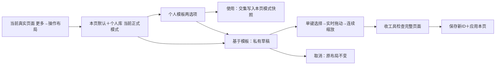

# R00：逐控件目录与实施样例

2026-10-19。依据 v2.1；下列 ID 是新版拟实现契约，不冒充已经接入。默认位置取真实组件测量值，不从截图反推生产坐标。历史 B00 图片只作完整页面构图参考，不能当新版功能证据。

## 语义目录

每个逗号分隔 ID 都是独立条目。共享的是动作语义，不以显示文案或旧 AX ID 相同为依据。普通禁用态仍可调整布局；阶段不显示的条目保留配置。菜单内部项目及打点弹层不属于常驻画布，编辑期间不能打开业务弹层。

| ID | 真实组件／闭包锚点 | 默认框／粒度 | 状态与页面 |
|---|---|---|---|
| shot.undo, shot.replay | FreePlayView.dailyLeftControls：dailyController.undoShot / snakeController.undo / vm.replayCurrent；vm.replayLastShot。规划页 action：undoLastShot / replayLastShot | dailyCompactAction 或 action 的独立按钮框 | P01–P05、P07–P11；有历史时启用 |
| sequence.previous, sequence.replay | FreePlayView.dailyLeftControls：replayPreviousSequenceStep / replayCurrentSequenceStep | 相邻两个按钮，分别登记 | 编排宿主只读序列分支；当前试打的上下杆另用 tryout ID，不得映射为重打与回放 |
| tryout.previous, tryout.next, tryout.rearrange | FreePlayView.dailyLeftControls：moveTryoutStep(by:)、重摆入口 | 各按钮本身 | P06；上下杆受序列范围约束 |
| shot.aim | FreePlayView.dailyLeftControls 的 BTAimWheel；BTTeachingAimRuler；AimPointSceneTrainingView 的 nudgeAim | 方向轮＋自身标签，连续控件 | P01–P06、P07/P08 开球阶段、P10/P11 自由阶段、P17/P18 |
| shot.spin, shot.power | BTShotInstrumentColumn.body：onSpinTap、velocity Binding / powerDragGesture | 打点入口与力度尺分别测量；力度尺包含自身读数 | P01–P11及P13/P14，按现有允许/只读状态；禁用打点保留可见 |
| shot.strike | FreePlayView 的 templateStrike；BTTeachingTablePage 的 planning.onPrimary | 实际圆按钮，不含外部占位槽 | P01–P05、P07–P11 常规击球 |
| break.entry, break.rerack, break.strike, break.confirm | FreePlayView 的常驻开球入口/runner.rerack、breakNow；教学壳 planning.onPrimary 的开球/完成 | 各阶段实际画布按钮；break.confirm 对应教学壳主按钮 | 原页面支持开球的阶段；进入布局阻塞与原流程一致。FreePlay 的停稳确认另见下方模态说明 |
| sequence.play, tryout.retry, snake.next | FreePlayView.templateStrikeTitle 对应业务分支 | 主动作按钮，互斥 ID | 只读序列播放、试打重试、蛇彩下一组；不能继承普通击球 |
| snake.restart | FreePlayView.dailyLeftControls：cancelPowerRelease / showSnakeRestartConfirm = true | 独立重新开始按钮 | P04；确认卡保持原模态，常驻入口可编辑 |
| camera.overview, camera.thirdPerson, camera.firstPerson, camera.temporaryTopDown | ShotPlayerCameraButtons.cameraButton / twoViewButton：onWholeTable、onSelect、onTemporaryTopDownBegan/Ended | 每个 44pt 原生按钮分别登记 | 正式 3D、有对应按钮的页面；临时俯视持触/过渡不能进入编辑 |
| planning.constraintTool, planning.clearConstraint | SiluTrainerView / PlanThreeView.leftControls：activeTool 菜单、clearConstraint | 独立 44pt 菜单按钮与清除按钮 | P07/P08 非开球阶段 |
| planning.solve, planning.nextSolution | 三规划页 action/TeachingSolutionButton：solve、nextSolution；SolverStageChrome.nextSolution | 独立按钮 | P07–P11；求解条件/无解状态保留，不借模板启用 |
| planning.roles | PlanThreeView.roleMenu | 角色菜单按钮 | P08；与防守选球不同 |
| defense.targetTool, defense.clearSelection | SnookerTacticsView.leftControls：activeTool / clearSelection | 两个独立按钮 | P09 |
| solver.mode, solver.cushions | SolverStageChrome.freeControls/leftControls：toggleMode / selectCushions | 独立模式按钮、库数菜单 | P10/P11；自由/求解阶段分别显示 |
| separation.legend.0…N, cushion.legend.0…N | 两图谱的 spinLegend 按钮：对应可见轨迹切换 | 每个图例按钮 | P13/P14；两图谱语义不同，不交叉套用 |
| angle.assist, angle.answer, angle.next | SceneAimingView.actionColumn：toggleAimingAssist / openAnswerInput / advanceToNext | 各 52pt 按钮 | P15/P16：观察/结果互斥 |
| angle.digit.0…9, angle.erase, angle.submit, angle.cancel | NumericKeypadHUD.digitButton/keyButton/header：append / backspace / onSubmit / onCancel | 每个数字、退格、提交、取消键分别测量 | P15/P16 输入阶段；去除画布控件祖先裁剪，非场景消费者保留原结构 |
| aimPoint.hint, aimPoint.submit, aimPoint.next | AimPointSceneTrainingView：toggleAngleHint / submit / nextQuestion | 各 52pt 按钮 | P17/P18 瞄准/结果阶段；不得与 angle.answer 或 shot.strike 共用 ID |

## 18 页覆盖与固定内容

| 页面 | 可编辑集合（上表完整展开） | 完整底图始终保留 |
|---|---|---|
| P01 dailyClearance | shot、break、camera；R01 先 shot.undo/replay | 当前球桌/球/轨迹、球库、标题返回、更多、实际状态与 FPS |
| P02 freePlay | shot、break、camera | 同 P01，使用自身标题与球形 |
| P03 shotSimulation | shot、camera | 当前演示球形、杆序、轨迹、标题/返回/更多/读数 |
| P04 snakePractice | shot、camera、snake.restart、snake.next | 蛇彩进度/失败状态及完整球桌顶栏 |
| P05 composer | shot、break、camera | 当前走位状态、球库、完整球桌顶栏 |
| P06 drillTryout | shot.aim/spin/power、tryout、camera | 当前动作、杆序、球形、完整顶栏 |
| P07 silu | shot、camera、planning.constraintTool/clearConstraint/solve/nextSolution；开球阶段集合 | 球库、约束绘图、解信息、完整顶栏、桌面与读数 |
| P08 planThree | P07＋planning.roles | 角色提示、约束、球库及完整桌面顶栏 |
| P09 snookerTactics | shot.spin/power/strike/undo/replay、camera、planning.solve/nextSolution、defense | 目标信息、球库及完整桌面顶栏 |
| P10 bankShot | shot、camera、solver、planning.nextSolution | 解状态/轨迹、球库及完整桌面顶栏 |
| P11 diamondSystem | 同 P10 | 自身库数/线路与读数、完整桌面顶栏 |
| P12 angleDynamic | 2D无可编辑操作键；3D为实际camera键（未传力度/杆法绑定） | 角度读数、球桌/轨迹、标题返回/更多 |
| P13 separationAngleAtlas | shot.spin/power、camera、separation.legend.* | 分离角读数、各线路、球桌/顶栏 |
| P14 cushionEnglishAtlas | shot.spin/power、camera、cushion.legend.* | 吃库读数、各线路、球桌/顶栏 |
| P15 sceneAiming2D | angle 全集合，固定 2D | 题目/目标袋/答题输入/结果/剩余次数、球桌/标题返回/更多 |
| P16 sceneAiming3D | angle 全集合＋实际相机按钮，固定 3D | 同 P15 的自身题目与 3D 镜头 |
| P17 aimPointScene2D | shot.aim、aimPoint，固定 2D | 题目/误差/提示/剩余次数、球桌/顶栏 |
| P18 aimPointScene3D | P17＋实际相机按钮，固定 3D | 同 P17 的自身题目与 3D 镜头 |

R02 实机重核：FreePlay 停稳后的“重开/完成”是中央模态决策卡（`manualBreakConfirmationActions`，带 `isModal`），常驻主动作槽此时为空；它与普通常驻重开按钮不是同一显示实例，不把 AX ID 相同误判为同一画布控件。该模态与菜单/设置弹层一样保留自身布局，进入布局保持阻塞。教学壳的完成仍是原主按钮实例，保留 `break.confirm` 语义登记。

标题、返回、更多、FPS、球库球项、只读题目/解信息：保留原位可见，作为完整页面参照；它们是页面导航、状态或内容，不属于训练操作按键。编辑时原业务动作拦截。调试专用按钮不进入用户目录。打点弹层内部坐标不属于画布按键坐标。

接入复核必须对照实际当前阶段，不能因为通用集合存在就生成页面没有的按钮。上述阶段集合还需各推广批次逐页运行验证，R00 源码盘点不代表运行验收。

## 坐标和尺寸契约

窗口左上角为原点，单位 pt，+x 向右、+y 向下。保存中心 `(x/W,y/H)` 与等比 scale；默认未配置控件继续用原生布局。测量与变换分离；编辑、落地、命中使用同一变换。与台球世界 XZ、物理尺寸、相机姿态完全无关。

例：窗口 874×402，中心 (100,320)，拖动 (-80,+30) 后为 (20,350)，保存 (0.0228833,0.8706468)，44pt 按钮缩至 1.4 倍为 61.6pt。其左边界 -10.8pt，允许保存。邻键 (100,370) 保持原值。窗口 1200×800 读回中心 (27.45995,696.51741)，不会反写存档。负值、超过 1 的归一化位置合法。

连续尺寸 UI 先提供 25%–250% 滑杆及精确百分比输入；存储接受所有有限正比例，不把滑杆端点当布局合法性边界。恢复选中键与列表定位用于找回过小/屏幕外控件。是否便于操作由 R01 手机/iPad 真实使用复核，不能用此设计值冒充已验证。

## 三页交互样例

交互样例位于 `output/table-control-layout-rework-20261019/R00/r01/review.html`。每页展示历史原生完整构图和明确标注的交互规则演示；原生页面不会被示意画布替换。样例不充当新版运行证据。

1. 每日清台 2D：仅选重打，斜向拖出安全区，连续缩放至 140%，回放不动；收工具看完整画面；另存“左手 · 2D”。
2. 自由击球 2D：个人库出现“左手 · 2D”；点开仅“使用当前模板 / 在此模板基础上修改”；使用只合入共有键，自己的其他布局保留。
3. 思路训练 2D：基于“左手 · 2D”修改重打与求解，取消不落地；保存新模板后原模板不变。来源独有 break.entry 保留在新模板中但不在当前普通阶段创造开球按钮。3D 模板可见但不能在此使用。

## 迁移样本及不能猜测的情况

| v1 样本 | v2 处置 |
|---|---|
| 空 archive、builtIn | 保留本页原生默认，不制造个人模板 |
| common/replay offset=12 ＋ twoD/replay offset=20 | 先按旧 resolver 展开每页/域/模式的实际结果，再以当时真实两个按钮框分别转换，不能把组中心复制给两个键 |
| familyDefault → template，页面有 override | 逐页解析最终值并保存独立快照；不继续绑定 familyDefault |
| mirrored camera / reordered groups | 必须用旧 placement 及实际默认框得到每个按钮终框；只凭偏移字段不可可靠迁移 |
| 缺旧窗口尺寸、未知页/组、无法映射 | 保留 v1 原文件与备份，记录未转换条目并告知；不静默宣称无损迁移 |
| 未知 schema、损坏 JSON、写失败 | 不覆盖原文件；原子事务失败保持已应用值及编辑草稿 |

v2 使用独立文件，R01 不删除/覆盖 v1。迁移实现及实际旧样本回放归 R04；这里是输入分类与保留合同。

## R00 核验边界

已实读四宿主、仪表、相机、规划 action、键盘、图谱图例及模式入口；已查看三个 B00 原生整页参考。目录与流程完成；App 行为、跨尺寸命中、持续拖动录屏属于后续 R01+，不能沿用旧 B 成功结论。

R05 重核补充：蛇彩常驻重新开始登记 `snake.restart`；P06 自由试打首次击球使用 `shot.strike`，已有上一杆可重试时才使用 `tryout.retry`。录制入口实际仅在独立 `BatchAuthoringView`，P05 当前菜单未提供录制开关，不能以旧目录措辞扩大到编排台。详见 R05 实施记录。
