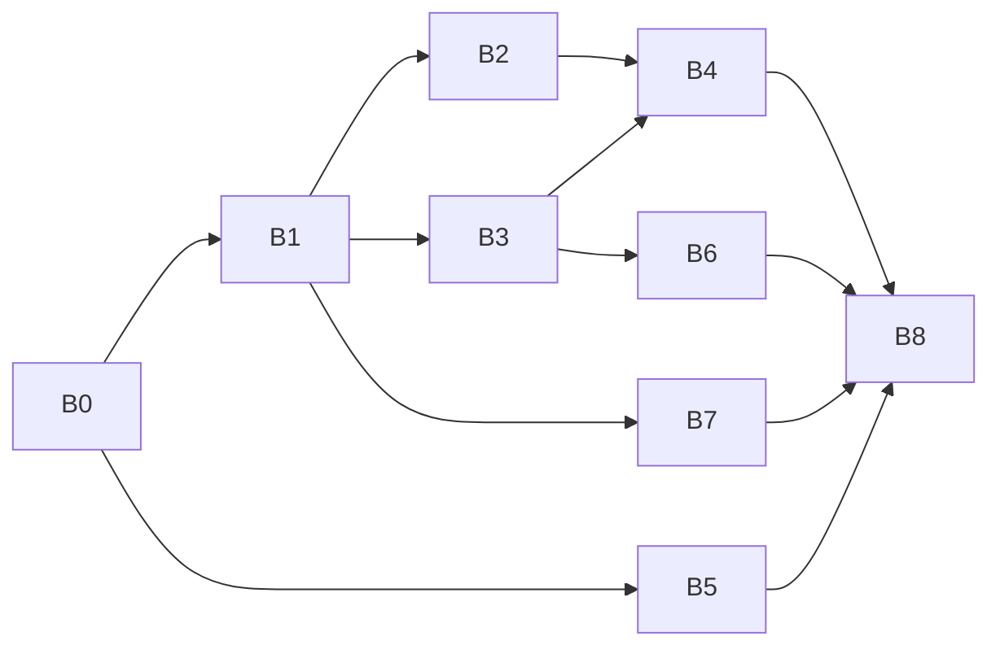

# 练习页面集中问题分析与实施方案

版本：v1.1 · 2026-10-29（Asia/Shanghai）\
设计状态：用户已批准方案及实施。工程状态：实施中。\
本文件是本轮需求真源；用户最新澄清优先于本文提案及旧页面卡。2026-10-29 用户明确「好的，开始吧」，并要求交付对应修改的实际截图；已授权代码修改、构建和模拟器验证，不含发布。

## 1. 分析结论与边界

这批问题主要来自三类不一致：页面绕过共用布局规则、同一业务名称散落在多个入口、设置与答题状态未明确区分。应先修共用定义，再处理页面差异，而不是逐张截图追加偏移量。

- **布局事实**：角度、瞄准点的右侧操作列使用独立的约200pt高容器，放在`f.table.midY`；其他击球页使用完整仪表列及底部主操作槽。二者天然不对齐。
- **命名事实**：`TrainingProject.title`已有七类正式名称，但首页卡片仍写“角度／瞄准点／准度／分离角”等短名，操作布局标题另有“训练／练习／2D前缀”。不是单一文案错误。
- **球库事实**：共享宿主有`paletteKeys`能力，未传入时默认15颗；`paletteEnabled = false`只禁交互。三球与多球已经传入题目名单，两球、分离角、准度及角度／瞄准点仍有默认满库路径。
- **状态事实**：瞄准点目前只有作答／结果两态，`submit()`明确拒绝已经提交的题。增加重打必须拆开首答记录和本次复练，不能把`submitted`简单改回false。
- **设置事实**：共享训练表单通过可选Binding决定显示“演示与参考”，三球传入了两个Binding；多球使用独立表单，当前已经没有该区块。
- **入口事实**：当前“自由走位”由`PositionPlayComposerView`适配`FreePlayView`，后者还承载每日、多球、蛇彩、自定义球形、动作试打等。删除“自由击球”产品入口不等于删除共享类。

分析时HEAD为`6d233c3c4d9d05cf857a5adf2750e78bb443bb46`，用户正在提交工作区。源码指纹和14张用户原图保存在[证据清单](references/practice-review-20261029/manifest.json)。该HEAD不是所有读取内容均已提交的保证；实施前须重新核对指纹及提交后差异。用户截图未提供构建身份，只作为反馈证据，不声称已在当前App复现。

本轮不改原有物理参数、轨迹评分公式、题库采样、付费范围或历史成绩；新瞄准点评级是展示分档。已有七类2D／3D合并、共享额度、持久化和默认2.0杆速继续保留。球桌大字号适配不纳入此次范围。

## 2. 用户要求逐项对应

|编号|要求及最新澄清|处理位置|
|---|---|---|
|R01|角度、瞄准点等右侧按钮与相关页面统一；辅助／提交／下一题下移|§3、B2|
|R02|“瞄准点练习”上行瞄准、下行练习、点在右侧上下居中|§3.2、B1|
|R03|练Tab建立命名标准；卡片与进入后的标题一致|§4、B1|
|R04|所有相关回放停止按钮由“停止回放”简化为“停止”|§3.3、B1|
|R05|蛇彩最近练习默认展开|§5.5、B3|
|R06|4443保持组内球间距，移近长库；**用户确认是截图上下长库**|§7.1、B5|
|R07|不可添加目标球的页面，球库仅列本球形实际目标球；范围七类练习|§3.4、B2|
|R08|瞄准点提交后增加ⓘ误差信息，五级评级阈值由AI制定|§6.1、B4|
|R09|瞄准点作答状态放右侧实际线图例下；均差放右上切角位置；左下加重打|§6.2–6.3、B4|
|R10|多球选中球下增加贴桌圆环、内径等于球直径、设置默认开；**用户确认按三角色配色，已选规划球都保留**|§7.2、B6|
|R11|删除提交后保留中杆选项；分离角、两球只在第一杆提交前显示中杆轨迹|§5.3、B3|
|R12|演示与参考→演示；播放击球过程→击球过程|§5、B3|
|R13|三球、多球训练设置不显示演示与参考|§5.3、B3|
|R14|相关恢复默认设置按钮→恢复默认|§5.1、B1|
|R15|有训练设置的页面增加自然易懂的练习说明，随玩法／模式变化|§5.1–5.2、B3|
|R16|统一设置顺序：玩法／训练模式（如有）、对应说明、训练量、训练条件等；走位模式→训练模式|§5.1、B3|
|R17|多球中八残局在左、顺序清台在右且改名追分|§5.4、B3|
|R18|轨迹走位的参考路线相关文案→目标路线|§5.3、B3|
|R19|删旧分离角与走位卡片；现自由走位改名分离角与走位|§8、B7|
|R20|新分离角与走位菜单删分离角辅助线／重命名／清空并重来；保留清空桌面|§8、B7|
|R21|新页面初始球形按最后一组第二张图|§8.2、B7|
|R22|删除自由击球|§8.3、B7|

原图按反馈顺序编号保存在[参考目录](references/practice-review-20261029/)。数值、位置、状态语义以本轮澄清为准；原截图不直接当成坐标数据或已通过的基线。

## 3. 球桌共用布局与球库

### 3.1 主次操作槽

统一的是动作职责与锚点，而不是强制所有页出现相同按钮。

|区域|目标规则|适用与差异|
|---|---|---|
|左上|题目及核心统计|角度、瞄准点、准度各保留自己的指标|
|左中|方向尺或本页信息|角度不补造方向尺；瞄准点信息不再推挤尺高|
|左下标准次操作槽|重打／既有测量等|瞄准点新增重打；其余页已有功能及层级不重排成另一种业务|
|右上／右中信息区|只读统计、结果图例|瞄准点均差及作答状态归此；不参与主按钮定位|
|右下主操作槽|答题、提交、下一题、总结或击球|同窗口与标准击球按钮中心对齐，状态转换保持同一锚点|
|主按钮上方辅助槽|辅助|只在有该能力的阶段出现，统一间距；收起不移动主按钮|

实施从`DailyLayoutMetrics.Foundation`与`BTTeachingInstrumentLayout`导出公共动作锚点。角度、瞄准点使用它，标准击球页作为同窗口对照。不得增加`table.midY + 某常数`的新近似方案。默认布局更新不覆盖用户保存的自由布局；既有控件ID尽量保持，新重打单独注册，恢复默认布局时才应用新默认。

小屏允许信息区在自身预算内紧凑排布，主动作槽稳定；iPad横竖／缩窗沿实际窗口测量，不能套手机绝对坐标。球桌尺寸、地板、已有字号与透明度保持。3D观察组继续使用独立相机槽，不能与下移的辅助键冲突。

### 3.2 五字标题

现有`BTTablePageTitleLayout`已经支持奇数中间字右侧居中；瞄准点调用传入`width: 80`，五字在该预算内进入单行分支。

历史R02（已被2026-10-29标题容量r2覆盖）：原本对“瞄准点练习”明确使用两行奇数布局：左上“瞄准”、左下“练习”、右侧“点”。优先统一到标准标题预算并核实际字体；若需显式排版策略，添加局部可选策略，而不是全局强制所有五字标题换行。现有“4443／球形”显式切点及短名单行不回退。完整AX名称仍为“瞄准点练习”。

### 3.3 停止文案

准度、分离角、两球、三球的ViewModel目前各自返回“停止回放”或“停止击球”。同类临时播放停止动作统一可见文案“停止”，保持原回调及停止后恢复行为。共享宿主已显示“停止”的路径只核对。序列播放器“暂停／继续”和不可中止的“击球中”语义不同，不批量改词。AX可描述“停止回放”帮助理解，可见按钮保持两字。

### 3.4 题目球库

“本球形有几颗”按**该题／该局初始目标球名单**定义，母球不放进球库；不是每帧只读取尚未进袋的节点。进袋后保留原槽位并淡化，重打恢复原槽，不因进球跳排；下一题替换整份名单。

|页面|球库名单来源与数量|交互|
|---|---|---|
|角度、瞄准点、准度、分离角|当前题真实目标球号，1颗|只读，不新增换球／添球|
|两球走位|题目`ballNumber`、`secondBallNumber`，2颗|保留①②角色圈与角标，只读|
|三球走位|现有`current.paletteKeys`，3颗|本题固定顺序，已完成淡化；保留已有选袋能力|
|多球走位|现有`rack.paletteKeys`，包括己方、对手、黑八的实际名单|按规则允许选球；对手不是可选目标，不能因过滤遗漏对手展示|

共享宿主已经提供`BTTeachingPlanningControls.paletteKeys`，补齐调用方优先于新建另一球库组件。角度、瞄准点直接创建header的两处同样改用实际名单。少球只缩短球库，不放大球径、不侵占桌体；三球、多球现有接线做回归，不重复重构。正在生成而没有题目时使用空名单，不能闪现默认15球。

## 4. 名称与入口标题规范

建议采用“训练项目一个正式名称，卡片／球桌／设置上下文／布局列表共用”的规则。`训练`用于训练设置、训练量、训练模式等分类；有答案与计分的基础专项使用“练习”；“两球走位”等已经完整表达任务的名称保留，不机械追加后缀。教学、图谱、求解、编辑按内容类型命名，不能为了统一全部叫练习。

|当前入口|建议正式名称|说明|
|---|---|---|
|角度／角度练习|角度练习|沿用`TrainingProject.angle.title`|
|瞄准点／瞄准点练习|瞄准点练习|正式球桌瞄准题|
|准度／准度练习|准度练习|入口、页面同名|
|分离角／分离角练习|分离角练习|与自由推演“分离角与走位”明确区分|
|两球走位、三球走位、多球走位|保留|完整任务名，统一各处显示|
|蛇彩练习|保留|布局列表中的“蛇彩”同步|
|旧瞄准点训练（拖假想球的独立工具）|假想球练习（提案）|源码确认与球桌瞄准点题是两个入口，不能改成同名造成混淆|
|角度预测|保留|作为独立预测工具名，内外一致|
|自由走位|分离角与走位|用户已指定；自定义序列／动作试打标题不受影响|
|思路训练|走位求解（提案）|实际为定落点反解工具，用功能名区分题目练习|
|防守|防守求解（提案）|求解类，与翻袋解球／颗星解球成组|
|自定义球形、拍照建球形、图谱与阅读类|保留现有功能／内容名|统一同一入口的跨处名称，不批量改文章标题|

七类练习直接消费`TrainingProject.title`；非七类只在确有多处消费者时集中显示名，保留现有route、枚举rawValue、历史记录ID、偏好key、额度key。模式名“两球自由走位”继续保留，它与被改名的首页工具入口不是同一对象。用户未要求改变的会员门槛保持；旧免费探索入口与新Composer Pro入口的差异要在验收表中明确，不在改名时偷偷放开或收紧权限。

同步范围含卡片、球桌、返回名称、布局库标题、搜索可见名称、相关理论页跳转说明和订阅权益文案。历史原始记录数据不批量改写；历史显示标签可用稳定映射显示新名称。三个新增命名提案集中审阅，其余已有明确要求直接按表执行。

## 5. 训练设置重新组织

### 5.1 分组规范

有玩法／模式选择：**玩法 → 训练模式 → 练习说明 → 训练量 → 训练条件 → 演示（适用时）／显示 → 最近练习（适用时）→ 恢复默认**。

没有玩法／模式选择：从练习说明开始，不补造空的玩法或训练模式区。蛇彩的顺序选择是玩法条件，放在对应说明之前；其球数放训练条件，不强行增加15题或持续练习。所有说明采用自然的一段话，先告诉用户做什么，再解释成功目标；不要把内部算法、版本、坐标与筛库过程写入操作说明。

共享表单按`TrainingProject`明确能力与说明来源，逐步替代散落的`route.hasPrefix`文案判断，但不扩成通用表单框架。保留准度逐轴互斥、两球按训练模式独立草稿、条件多选及生成失败重试。开始／取消保持完整实色设置页合同；恢复默认只改草稿，取消仍恢复原现场。

`BTTrainingSettingsResetSection`按钮统一“恢复默认”；成功提示可同步简化为“已恢复默认”。训练设置恢复默认和操作布局恢复默认是不同作用域，不能互相清除。

### 5.2 说明文案草案

以下是设置说明候选，实施时与实际动作逐句核对；不修改动作库教学正文。

|项目／模式|候选说明|
|---|---|
|角度练习|观察母球、目标球和指定袋口的位置，判断这一杆的切球角度，再提交答案。需要时可以使用辅助，提交后查看误差。|
|瞄准点练习|调整瞄准方向，让目标球朝指定袋口前进，再提交你的判断。提交后会对比目标瞄准线和实际瞄准线，并显示偏厚、偏薄及误差；重打用于复练，不改变第一次成绩。|
|准度练习|按题目指定的目标球和袋口调整瞄准，再击球尝试进袋。开放的打点可以自行调整，重打可以继续练习，成绩只统计第一次击球。|
|分离角练习|观察目标路线，调整打点和杆速，尝试让母球碰球后的走位接近这条路线。第一杆提交前可查看中杆轨迹作比较，提交后查看实际路线和得分。|
|两球·轨迹走位|观察这一球形给出的目标路线，调整打点和杆速，在打进第一颗球的同时让母球尽量沿目标路线走位。可以逐条练习不同路线，重打不覆盖首答。|
|两球·自由走位|打进第一颗球，同时把母球走到方便打下一颗球的位置。调整打点和杆速，比较不同走位的效果，提交后查看最终得分。|
|三球走位|按顺序打完三颗球。第一杆前选好第二颗球的目标袋，第二杆前选好黑八的目标袋，连续完成两次走位；两次走位得分取平均，重打不覆盖首答。|
|多球·中八残局·规划|先安排当前球和袋口，再选下一颗球及其袋口，并考虑第三颗球。打进当前球后按计划继续走位，清完己方彩球再打黑八。|
|多球·中八残局·自主|从当前残局开始，自主选择己方球和袋口，边进球边安排下一杆。清完己方彩球后再打黑八，不需要提前提交走位计划。|
|多球·追分·规划|按号码从小到大逐颗击球，并提前选好下一颗球的目标袋。打进当前球后继续完成规划的走位，每杆结束查看走位得分。|
|多球·追分·自主|按号码从小到大逐颗击球，自主调整打点和杆速，为后续球留下合适位置。逐颗完成清台，不需要提前选择下一颗球的袋口。|
|蛇彩|根据所选击球顺序连续打进桌上的目标球，同时为下一颗球留好位置。结束后可以在最近练习中查看完成情况。|

蛇彩两个顺序模式的具体动作词需在B3按`SnakePracticeConfiguration.Mode`再逐一展开，不把上述共用说明误称已完成所有模式文案。旧拖假想球页／角度预测若没有本轮这种训练设置表单，不为它们新增表单；本轮覆盖现有三个表单实现及其全部消费者。

### 5.3 演示和中杆轨迹的状态合同

|页面|训练设置目标|渲染目标|
|---|---|---|
|分离角、两球|仅保留演示→击球过程；删除提交后保留中杆参考|当前题首次有效提交前显示中杆线；提交开始后隐藏；同题重打不重新出现；新题恢复|
|三球|整个演示与参考区块删除|建议固定展示击球过程，继续维持连续击球；取消中杆参考计算及显示，旧关闭播放／保留参考偏好不再驱动此页|
|多球|当前已没有该区块，保持|正常真实击球与当前走位提示保持|
|角度／瞄准点／准度|不增加无对应能力的演示项|继续本页既有判题／真实击球合同|

分离角和两球的`shouldShowReference`目前依赖可持久偏好或`latestShot == nil`。应改为本题首答事实与可显示阶段共同决定：以当前题的首答存在性为准，避开上一题残留、重试、旧偏好和异步参考线晚返回造成的再出现。保存／求解失败回到未提交态时不凭点击就永久剥夺参考；真正提交成功后该题不再展示。

两球轨迹模式切换目标路线可能重置`latestShot`，所以不得仅靠这个字段判断“第一杆”；同一题已有首答后，换路线也不恢复中杆提示。旧存档通过现有首答记录推断，不回算历史成绩。实现前列出该题／路线实际identity与重置路径并写回归。

“参考路线”文案只在它实际表示训练目标路线时改为“目标路线”，包括标题“目标路线杆法”与尾注。中杆比较线、几何测量参考线以及理论引用仍是参考，不全仓替换`reference`代码符号或所有中文“参考”。

### 5.4 多球玩法和持久化

显示顺序显式指定`[.chineseEight, .rotation]`，标签为“中八残局／追分”。保留rawValue `rotation`和现有题库分类；只改显示名不会重新生成题库或自动实现比赛追分结算规则。说明必须准确描述当前按号清台的练法，不宣称已经包含未实现的追分记分／犯规结算。

用户只要求左右顺序，未要求改变默认玩法，因此旧用户选择与新用户当前默认值保持。新“规划球标记”设置与其他训练草稿一起保存；旧JSON缺少字段时默认true，不能因新增非可选字段导致整份配置解码失败回到默认。

### 5.5 蛇彩最近练习

`SnakePracticeSettingsView.historyExpanded`当前初始化为false，改为true；仍可手动折叠。有记录时显示最近10条，空记录显示原空态，不清除或伪造记录。训练说明、条件、最近练习之间按共同顺序整理。

## 6. 瞄准点评级、信息与重打

### 6.1 评级采用现有毫米误差

消费`SceneAimScore.measure`的有效绝对毫米误差，不另造屏幕像素误差，不重算成另一种几何答案。其当前定义是目标假想球位置横截面上的瞄准方向偏差（`transverse-v2`），不是球体表面弧长，也不是保证进球的概率。

|评级|有效绝对误差e|
|---|---|
|完美|0 ≤ e ≤ 0.5 mm|
|很好|0.5 < e ≤ 1.0 mm|
|好|1.0 < e ≤ 2.0 mm|
|一般|2.0 < e ≤ 5.0 mm|
|差|e > 5.0 mm|

这是产品反馈分档，保持现有`SceneTrainingMetrics.correct`的≤2mm正确标准。临界值用原始测量分档，不能先四舍五入；接近边界时详情按需多显示精度，避免“显示0.5却被分到很好”的解释冲突。直球显示偏左／偏右，切球显示偏厚／偏薄；小于原有一致阈值时仍可显示“一致”。

`backwards／wrongSide／missesTarget`统一归“差”，同时显示真实原因；毫米值使用“—”，不得把nil当0mm评为完美，也不随意伪造100mm。保留现有正确率分母和无有效毫米值不进入均差的口径，在训练设置的误差说明中写清。

2026-10-29后续用户反馈覆盖原ⓘ方案：提交成功后沿共享短提示机制显示“评级：完美 · 薄0.1mm”等结果约3秒；右侧结果区只读显示“评级：…”和偏差，去掉ⓘ与详情弹窗，偏差沿用“厚1.7mm／薄1.7mm”紧凑写法、不加“偏”字。训练设置在“球形条件”后直接展示“瞄准误差说明”，分为逐行评级标准与统计规则，不增加折叠或点击。复用当前圆形瞄准特写；不另建大号答案弹窗、不把路线和点重新画成另一套结果页。首次提交前不能看到答案评级。

### 6.2 信息位置

- 左上保留题目／正确率，左中方向尺保持标准尺寸，左下新增标准重打按钮。
- 右上原切角位置改为本轮首答均差。切角／厚薄重叠图不再常驻该位置；规则解释移入训练设置，不与均差挤在同一窄槽。
- 结果时右侧顺序为均差、目标线图例、实际线图例、作答状态（独立／辅助；复练时明确重打）、评级与本次偏差。未提交时没有目标／实际答案图例，但均差及当前作答状态仍显示。
- 主操作在固定右下槽，作答时辅助在上、提交在下；结果时同槽下一题／总结。信息增减不能移动主操作。

### 6.3 重打状态与计分

旧TP33禁止瞄准点同题重试；本轮用户明确要求新增重打，该限制仅对瞄准点被覆盖，角度不自动开放重试。

|状态|允许动作|计分和显示|
|---|---|---|
|首次作答|调向、辅助、提交|首答未发生，重打禁用|
|首答保存中／保存失败|等待／重试保存|不通过重打绕过保存，下一题继续沿现有守卫|
|首答结果|重打、下一题／总结|正确率／均差／额度已由首答确定|
|复练作答|同题调向、辅助、提交|球号／球位／袋口不变；恢复上一答方向供调整，答案特写暂隐藏；不清除首答提交事实|
|复练结果|再次重打、下一题／总结|更新本次误差与特写；不新增正式成绩、不增加题数、不再扣额度|
|末题结果或复练|重打、总结|额度耗尽不拦已获准题目的复练；不能自动跳总结|

VM应分开“本次展示阶段”和`run.submitted`，如新增独立复练状态及本次测量值。首答走既有`record`／持久化／额度接受路径，复练只更新可恢复的练习展示快照。`SceneTrainingCheckpoint`可增加可缺省的瞄准点复练字段，旧档默认非复练，角度页原存储不受影响。复练状态切2D／3D、打开取消设置、后台重进都要恢复；保存失败提示不能吞掉。

## 7. 球形与规划圆环

### 7.1 4443靠长库

用户确认横桌图上方和下方长库。坐标契约：Canvas x∈[0,1]、y∈[0,0.5]，两轴都按2.54m归一；SceneKit水平面X–Z、Y向上。横桌图上方为y小／Z负，下方为y大／Z正。改每组y，不改x，不整体移动整列。

“一颗球距离”按已回显的**球面至直库鼻净距等于一个直径**制定：R=28.575mm、D=57.15mm，最近球心距库=R+D=85.725mm，归一化球心距=0.03375。此处指每组靠库端球，不可能让同组所有纵向球都距同一长库一个直径。

已用Decimal独立核算目标坐标与组内距离：

|组|x|原y|目标y|整组平移|
|---|---|---|---|---|
|右上1–4|0.75|.06,.105,.15,.195|.03375,.07875,.12375,.16875|向上66.675mm|
|右下5–8|0.75|.305,.35,.395,.44|.33125,.37625,.42125,.46625|向下66.675mm|
|左上9–12|0.25|.06,.105,.15,.195|.03375,.07875,.12375,.16875|向上66.675mm|
|左下13–15|0.25|.325,.37,.415|.37625,.42125,.46625|向下130.175mm|

三球组原本更靠中间，必须比四球组多移，才能让四组端球都留同样的一颗球净距；四组内部相邻球心距仍为114.3mm。母球保持(.5,.25)，继续初始瞄准1号。不得改L型或用户已复制／保存的个人球形；本次仅更新内置模板，已有运行中的球局快照不强行重摆。

代码使用半径／桌长推导，不把本表小数再做一份几何真源。实施验证包含球数与号码、组内距离不变、各组端球57.15mm净距、无重叠／越界、母球与瞄准目标、2D／3D原图。本轮数值核算不等于原生渲染验收。

### 7.2 多球规划球标记

用户最终选择：按角色配色，已选规划球均保留，替代先前“按球自身主色”的理解。

- 第一球天蓝`#56BFF5`、第二球金黄`#F6C65B`、第三球淡紫`#C3A4F4`；复用`BallRoleStyle`。球库和袋口现行标记不变，第三角色保留虚线语义。
- 圈内径=未缩放的真实球直径。作为台呢表面上的独立平面圆环，中心跟随球心XZ，Y取真实台呢高度加最小防闪烁偏移；不能挂在随球旋转／放大的模型下，也不能画屏幕朝向的圆。
- 选球时继续`TableBallPulse`短暂放大，圆环不随脉冲放大；角色选定后持续到计划变更、进入播放或离页。重复点击同角色只触发既有定位反馈，不叠加节点。
- 成功停稳顺延后重建合法角色圈并换色；上一步保留有效计划，实际改选才清理失效角色；重打恢复原规划；进袋／失效／对手球不残留圈。
- 击球和回放期间隐藏，停稳恢复准备态时按当前计划重建；2D、3D及临时俯视保持同一世界几何语义。不得为圆环开启常驻渲染或改变碰撞半径。
- 设置名建议“规划球标记”，置于显示分组，默认开。规划模式展示可用开关；自主走位不制造三球规划，仅保留用户偏好供切回规划时使用。
- `MultiBallConfiguration`新增字段采用`decodeIfPresent ?? true`兼容旧配置，恢复默认设true，取消设置不落盘；可由既有checkpoint保存当前配置。显示偏好不能改变球局／得分。

实现入口优先`MultiBallPracticeController.refreshPresentation()`：该处现在清空`roleNodes`，适合集中维护角色圈。真正球形／角色变化时刷新，不在SwiftUI重绘中创建节点。新原语如需放到Scene层只提供绘制能力，不把多球偏好扩散给全App。

## 8. 自由探索入口整合

### 8.1 保留哪条实现

保留Composer能力，将它在练Tab的正式名称改为“分离角与走位”；删除旧`shotSimulation`卡片及独立`freePlay`卡片。当前Composer支持较完整编辑／击球能力，旧`shotSimulation`有最多2目标球限制；本轮不把旧限制强加给新入口。

Composer菜单仅删除用户指定三项。`分离角辅助线`来自共享`FreePlayView`菜单，需通过页面能力／editor配置在新探索入口关闭，并使该入口的旧分离角辅助偏好不继续渲染；不能只隐藏开关却留下旧用户无法关闭的线，也不能全局删除`.separation`影响其他消费者。正常球路与目标路线显示保留。

“重命名”“清空并重来”由Composer菜单产生，删除对应产品入口及无其他消费者的局部弹窗状态。保留清空桌面及合法母球恢复。动作试打仍显示动作标题、试打说明／序列功能；拍照导入仍优先传入球形。已有序列存档及命名数据不删除。

### 8.2 默认球形

目标是[用户指定初始球形](references/practice-review-20261029/14-requested-default.png)：母球、1号、8号三颗，母球在中下部，1号在右上区域，8号在左下区域，当前目标1号、右上角袋。

**当前`ShotSimulationView.defaultBoard`不是这张图**：它只有母球与8号，不能直接拿来复用。先查是否有该截图对应已保存球形；找不到时按真实2D投影标定从用户图量取候选位置，计算合法球位和实际切角，再给原生对照，不能凭屏幕坐标硬塞物理坐标或把截图“切角15°”当成已计算答案。

新增默认球形只给普通探索入口无外部球形时使用，放在独立默认布局提供者；通过`setupBoard`注入。禁止改`PositionPlayViewModel`全局默认，避免改变每日／求解／试打。导入球形、动作来源、已有序列恢复优先；切2D／3D与取消设置不触发重置。

### 8.3 删除后的导航兼容

四篇理论页T01–T04仍跳`shotSimulation`，必须同步转到保留的探索入口，检查ProAccessGate，不能留下旧页或绕过原Composer门槛。老路由值可保留兼容解码，显示为同一新入口；旧布局／历史存档保留备份，不强行合并两套布局覆盖。

“自由击球删除”落实为移除公开卡片、正式导航与推荐入口。旧深链／恢复导航进入可理解的已移除提示并返回练Tab，不默默跳到规则不同的每日清台。共享`FreePlayView`、物理／回放／动作试打仍保留；Debug测试启动路径与正式产品入口分开列清单。枚举rawValue和历史统计类别保留解码，不因删入口毁掉旧记录。

## 9. 批次与依赖

本轮方案不派发执行；用户当前要求分析。后续每批控制在可独立构建、验证、交付的一次工作会话内，共用文件的修改串行整合。

|批次|范围／规模|依赖|完成标准|
|---|---|---|---|
|B0 基线与合同|小：提交后源码复核、原图对照、相关TP覆盖记录|用户认可方案并开始实施|记录新HEAD／相关diff；旧规范冲突明确；不把其他任务改动带进返工|
|B1 名称与短文案|中：正式显示名、标题、停止、恢复默认|B0|卡片／页面一致；五字实际排版；四类停止恢复行为不变；无同名双入口混淆|
|B2 操作槽与球库|中：共用锚点、角度／瞄准点接入、七类球库|B1|右下主键同槽，辅助在上；1／2／3／多球名单正确、进袋不跳位，标准与紧凑手机及Pad核图|
|B3 训练设置与参考线|中大：三个表单、说明、分组、模式、三球演示、中杆时效、蛇彩|B1|全入口同序；切模式说明正确；恢复／取消／开始契约；旧偏好兼容；重打／换路线／重进不复活中杆线|
|B4 瞄准点结果与复练|大：五档、ⓘ、右栏、首答与复练分离、checkpoint|B2、B3|边界与无效方向正确；首答冻结、重打不计次；末题／保存失败／重启／2D3D全部可恢复|
|B5 4443几何|小：仅内置4443四组沿长库方向移动|B0|数值不变量、2D3D原图、复制模板与个人数据不被改写|
|B6 多球角色圈|中：配置兼容、Scene几何、角色生命周期|B3|三色持久圈；开关／取消／恢复默认；顺延、改选、重打、回放、临时俯视无残留|
|B7 入口整合|中大：Composer名／菜单／默认球形、两旧入口退役、深链|B1|一个探索入口；默认图与用户图对照；理论跳转／导入／试打不坏；会员边界和旧导航明确|
|B8 综合收口|中：定向矩阵、同版截图、路由门禁、文档回写|B1–B7|逐项R01–R22有结果；功能、视觉、真机、用户认可分列；列出所有未验，不代签认可|

依赖图：

建议执行顺序B0→B1→B2→B3→B4→B5→B6→B7→B8。B5逻辑独立，可在等待其他批次测试时提前；这不是自动开启并行子智能体的授权。若B3或B4实际差异超出单会话容量，按“共享设置／参考生命周期”和“评级UI／复练持久化”拆，不重新读全项目历史。

## 10. 验收与规范回写

### 10.1 适用性检查

本轮在已有页面卡上做局部修订；Composer产品身份整合按完整复核处理。下表是方案阶段判断，不是测试通过记录。各批把实际回调、状态、原图与结果填回受影响页面卡。

|TP|本轮判定与处理|验收重点|
|---|---|---|
|01|调整：入口合并、同名、退役路由|正式入口和返回，理论深链、导入／试打|
|02|继承：桌优先，控件不反向缩桌|相同窗口前后桌框与比例|
|03|继承：手机横桌／竖设置，Pad按窗|完整实色表单，取消回原题，横竖缩窗|
|04|调整：正式名字与五字标题|真实字体排版，AX完整，4443标题不回退|
|05|调整：本题／本局固定名单|少球不放大、居中贴顶、进袋固定槽|
|06|调整：多球规划台面圈例外|共享三色、角标、固定题只读、无额外添球|
|07|调整：主次操作槽、瞄准点信息分区|同窗位置对拍，状态不跳位|
|08|继承：原样式与按压|不顺带改字号／黑底／透明度|
|09|继承：原字号容量及必要语义|小屏主键可达，圆环非交互节点|
|10|继承：方向尺和杆速输入|下移按钮不影响调向／微调|
|11|继承：打点权限与实际可出杆|设置整理不改变准度逐轴互斥|
|12|继承：大打点盘|布局回归无覆盖；瞄准点无该能力不补造|
|13|调整：三球固定播放、瞄准点复练显式提交|无隐式出杆／提交；角度无击球能力|
|14|调整：多球圈随角色；其他资格继承|首／次／三角色、同袋双色、承接锁、反馈次数|
|15|继承并复核：异步结果失效|参考线晚返回与题目身份核验|
|16|继承：稳定场景2D／3D|复练／圈／设置往返保持身份与题号|
|17|继承：观察相机、回放恢复|新按钮／圈不改变机位所有权|
|18|继承：各页原移球资格|名单缩减不开放拖球，探索仍合法编辑|
|19|调整：设置分组、探索菜单删项|完整菜单开关与真正效果一致|
|20|调整：模式／玩法顺序与草稿|原生行距与整行命中；恢复默认可取消|
|21|调整：结果ⓘ入口|内容可读、关闭无穿透、不挤主动作|
|22|调整：中杆首答前、复练答案阶段|首次不泄题；旧偏好不复活辅助线|
|23|继承：原圆形特写|不恢复被否决大弹窗；复练作答暂隐标准答案|
|24|调整：瞄准点评级短提示|3秒生命周期，详情可再开，无效误差不伪造|
|25|调整：瞄准点重打；其他停止语义保持|首答冻结、末题、回放停止真实后置状态|
|26|调整：复练快照／配置新字段|取消保留现场、旧数据解码、保存失败重试|
|27|调整：新多球开关、探索禁用旧辅助偏好|不污染其他页／通用偏好|
|28|继承：个人布局优先，默认动作槽更新|旧控件ID、实际命中、新重打、默认布局|
|29|调整：4443几何与平面圆环|真实R／台呢高度、无物理影响|
|30|继承并复核：取消任务与节点收尾|离页／后台无残留圈和晚返回提示|
|31|继承：已有脉冲和触感|一次合法选择一次反馈，减少动态效果策略|
|32|继承：教学图谱差异|本轮不整页迁移图谱，也不增加练习控件|
|33|调整：仅瞄准点开放不计次复练|额度、首答、末题总结；角度保持旧权限|
|34|调整：探索默认图与入口；自定义模板局部更新|动作／导入／个人档优先，不迁移内容资产|
|35|继承：逐项证据|每批同版源／构建／设备／操作／原图可追溯|
|36|调整：现行规范与来源覆盖|明确覆盖旧禁止台面圈／禁止瞄准点重试等条款|

### 10.2 测试重点与范围

有意义的逻辑回归：题目球库成员与固定槽；标题奇偶／数字；五档阈值及正负方向、非法瞄准；重打多次首答／额度不变；保存失败与旧checkpoint；中杆首答前后／换路线；多球旧配置新字段及角色顺延；4443端球库距与组内距离；退役路由与新默认球形的作用域。纯短文案不新增只镜像字符串的单元测试。

UI覆盖按风险分层：

- 标准手机：七类入口各核设置、初题、提交／击球、结果、下一题；瞄准点额外复练、末题、ⓘ；多球覆盖两玩法×两模式及圈开关。
- 紧凑手机／最低支持Runtime：主次动作槽、标题、1／2／3／较多球球库，瞄准点完整首答—复练—下一题，菜单及设置可达。
- iPad横竖与缩窗回程：共享按钮锚点、圆形特写、角色圈投影，训练设置顶部导航及返回保留状态。不能用仅AX存在代替字形完整可见。
- 3D与临时俯视：至少瞄准点复练、多球角色圈、4443、新探索默认图；共享层改动影响的七类逐一核2D／3D切换，避免只拿2D图推断3D。
- 邻接回归：每日清台、动作试打、自定义球形编辑、规划求解各一个关键路径，证明共用宿主及菜单未误删。
- 训练设置浅／深两外观；球桌保持既有HUD外观。真机触感、VoiceOver及温升单列，不由模拟器结果代签。

测试复用`DailyLayoutMetricsTests`、`SceneTrainingRulesTests`、`TrainingViewMergeStateTests`、`MultiBallPracticeTests`、`CustomFormationTests`及相关各练习Tests／UITests。新增测试名在实现后按真实方法登记，不在方案中声称已存在。

模拟器执行前读取`simulator-use`及fleet/lifecycle文档，使用受管设备和固定源码快照；不直接裸建模拟器。本轮方案未使用模拟器。各批完成跑对应检查，B8再跑最终编译、必要回归和`make -f scripts/Makefile verify-gate`；路由及签名文件按实际改动重新生成，不编辑门禁断言绕过问题。构建前重新检查磁盘空间。

### 10.3 规范冲突和回写

实施前把已明确的用户决定回填TP04、05、06、07、14、19、22、24、25、26、27、33、34及来源表；主要冲突：

1. TP06旧“台面无角色圈”增加多球可关闭的规划圈例外；其他页面不恢复旧圈。
2. TP33旧“瞄准点不重试”改为首答冻结的复练；角度不变。
3. TP33旧左栏作答／均差布局由本轮瞄准点右栏方案覆盖。
4. TP04单行优先对本轮明确的瞄准点五字标题使用指定排版。
5. 设置原先可保留中杆和三球演示开关的合同被本轮替代。
6. 探索入口名字、菜单、旧路由与默认图同步产品信息架构、页面卡和路由登记。

功能方案本身不标记为已上线规范。DR／UI规格Changelog、`docs/04`与`docs/05`及讨论记录在设计定稿／实施阶段按真实变化同步；涉及checkpoint新增字段评估序列化兼容，不自动等同于SwiftData schema迁移。当前未触发跨项目14／15／16／18资产修改，不更新这些项目。

## 11. 已核源码锚点

以下行号核实于2026-10-29当前工作树；以符号定位为主，提交后若行号漂移重新核实。

|源码|已读锚点|对应问题|
|---|---|---|
|`QiuJi/Core/Training/TrainingProject.swift:8`|`title`|七类名称已有集中定义|
|`QiuJi/Features/AngleTraining/Views/AngleHomeView.swift:244`|`trainEntries`、`basePlayEntries`|首页短名、两个瞄准点入口、退役卡片|
|`QiuJi/Core/Components/BTTeachingTablePage.swift:178`|`paletteKeys`／`groupsEightBallPalette`|默认满库|
|同文件`:325`|`velocity`分支主操作列|标准击球位置参照|
|同文件`:766`、`:1073`、`:1118`|仪表尺寸、标题布局与视图|共用锚点、五字标题|
|`QiuJi/Features/AngleTraining/Views/SceneAimingView.swift:242`|`actionColumn`定位|右侧居中问题|
|`QiuJi/Features/AngleTraining/Views/AimPointSceneTrainingView.swift:214`|`submit()`|首答／复练分离|
|同文件`:705`、`:737`、`:785`、`:830`、`:985`|球库、标题80宽、结果列、居中动作、左右信息|瞄准点布局及结果|
|`QiuJi/Features/AngleTraining/SceneTrainingRules.swift:438`、`:507`|`SceneAimScore`、`SceneTrainingRun`|现行误差公式、首答状态|
|`QiuJi/Core/Training/TrainingCheckpointStore.swift:78`|`SceneTrainingCheckpoint`／`SceneTrainingPersistence`|复练恢复、旧档兼容|
|`QiuJi/Features/AngleTraining/Views/SceneTrainingSettings.swift:51`、`:240`、`:370`|Form、演示区、`SceneTrainingMetrics`|设置、2mm正确阈值|
|`QiuJi/Core/Components/BTTrainingSettingsResetSection.swift:10`|共享按钮Label|恢复默认|
|`QiuJi/Features/SnakePractice/SnakePracticeView.swift:27`、`:48`|展开状态、DisclosureGroup|最近练习默认折叠|
|`QiuJi/Features/TwoBallPractice/TwoBallPracticeView.swift:160`|planning controls未传名单|两球球库|
|`QiuJi/Features/ThreeBallPractice/ThreeBallPracticeView.swift:33`、`:131`|设置Binding、paletteKeys已接入|三球演示与固定名单|
|`QiuJi/Features/SeparationPractice/SeparationPracticeViewModel.swift:48`、`:202`、`:591`|参考可见、主键文案、重打|参考生命周期、停止|
|`QiuJi/Features/TwoBallPractice/TwoBallPracticeViewModel.swift:42`、`:177`、`:214`|参考、球角色、主键文案|两球|
|`QiuJi/Features/ThreeBallPractice/ThreeBallPracticeViewModel.swift:41`、`:201`|参考、主键文案|三球|
|`QiuJi/Features/AccuracyPractice/AccuracyPracticeViewModel.swift:193`|主键文案|准度停止|
|`QiuJi/Features/MultiBallPractice/MultiBallPracticeView.swift:46`|设置Form|玩法顺序／模式／说明|
|`QiuJi/Features/MultiBallPractice/MultiBallBank.swift:3`、`:34`、`:56`|Configuration、解码、rack名单|新设置兼容、真实球库|
|`QiuJi/Features/MultiBallPractice/MultiBallPracticeController.swift:297`、`:372`|选择事件、`refreshPresentation()`|规划角色圈|
|`QiuJi/Core/Scene/TableBallPulse.swift:6`、`AngleTrainingScene.swift:2250`|脉冲与确认|保留短暂放大和一次触感|
|`QiuJi/Features/CustomFormationPractice/CustomFormationLibrary.swift:86`|`BuiltInCustomFormations`|4443坐标生成|
|`QiuJi/Features/PositionPlay/Views/PositionPlayComposerView.swift:88`、`:93`、`:134`|标题、初始布局、菜单|保留探索实现及删除菜单|
|`QiuJi/Features/PositionPlay/Views/FreePlayView.swift:1495`、`:2975`|分离角菜单、球库名单|共享宿主作用域|
|`QiuJi/Features/AngleTraining/Views/ShotSimulationView.swift:6`|旧默认仅母球和8号|不能直接复用截图布局|
|`QiuJi/App/MainTabView.swift:270`|三个路由分支|入口合并与退役|
|`QiuJi/Core/Components/ControlLayoutLibrary.swift:4`|布局显示名|名称同步不改稳定ID|

## 12. 当前实施状态

用户已批准实施并要求实际截图。源码基线HEAD `6d233c3c`；既有未跟踪研究材料与其他会话的文档更新保留。

- B1–B7全部接入，22项实现与截图映射见[实施与复核报告](../ui-reviews/UR-20261029-practice-review.md)。B8定向回归、原图复核及4443实际投影补验已完成，用户视觉反馈待收集。
- 瞄准点使用可选checkpoint字段，不改首答统计；三球固定播放，旧档继续可读。探索默认母球(.620,.395)、1号(.860,.187)、8号(.285,.367)，导入／试打优先。
- r6完成74逻辑＋5标准手机UI、4个iPadUI；r7正式分离角标题补验，r8标准手机4项补验。最终r19标准手机11项全过、r16 iPad两项全过、r21小屏菜单前后返回通过、r23标准手机4443投影与两视图原图通过；旧失败保留，不以补验改写历史整轮结果。
- 小屏进入4443的SwiftUI环境失效已通过同目的页状态切换解除；重开时hasActions竞态由渲染完成状态快照修复，iOS17两项动画测试与两种球形各三次重开通过。探索页返回由路由所有者显式弹出，r21小屏菜单前后两次真实触摸返回均通过。
- 最终验证r23快照`4fe2a8da3697fdab967edfb4960438f169f08698eca100c74180aafe9a65f321`；4177项冻结输入与工作区逐项SHA一致，完整verify-gate FAIL=0。
- 全部xcresult、失败诊断、快照清单与原图保留于`output/practice-review-20261029/`。交付图册为`SCREENSHOTS.html`／`SCREENSHOTS.md`；原图不重绘、不修饰。
- 本轮未提交／发布、未更新真机；真机操作感、VoiceOver和完整App回归不由定向模拟器结果代替。

## 版本记录

|版本|日期|变化|
|---|---|---|
|v1.0|2026-10-29|首次代码分析方案；吸收4443上下长库、规划球三角色持久圈两次澄清；仅方案与参考证据落盘|
|v1.1|2026-10-29|批准实施，完成22项整改；补跨尺寸、导航和动画回归，证据与原图集中归档|

2026-10-29标题容量r2：用户指出少球瞄准点未改单行，R02固定分行不再是现行规则；按1球上限、最多6显示单位及实际宽度判断。见TITLE-CAPACITY-20261029.md与TP04。
