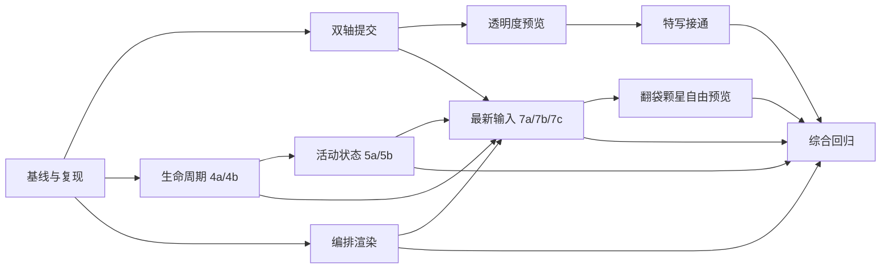

# 每日清台能力推广剩余问题修复方案

版本：v1.4 · 2026-10-14。状态：**M01-01与U01用户复验通过；M01-02打点预览、M02-01透明度及打点/方案通过，M02-02普通字号通过；用户取消已自动验证的共用控件逐页人工复测，按证据覆盖收口。旧B09常驻特写前提已纠正。**

**本文件是本轮需求真源**，范围仅为 2026-10-13 逐页源码审计的 G01–G08、D01–D03、V01；不覆盖其他评审任务。用户在 v1.0 交付后要求「直接做完吧」，现授权串行实施 B00–B09（含 B08）及候选项的推荐处理。候选 C01/C02/C03 保留既定评估与用途差异，不自动全局开启；C04 在编排主链稳定后接入。本文的建议不是已实施结果。

排期前置已满足：从 B00 开始，每批进入前重新核对源码和在途任务。授权包括代码修复、定向测试和独立模拟器验证；不包含提交或发布。原“只做方案”约束作为 v1.0 历史记录保留。

执行记录：[逐项状态与真实截图](/Users/song/projects/13.billiard_trainer/output/table-page-adaptation/remaining-20261013/index.html)。历史失败、各轮源/二进制身份与有效证据分别保留；技术通过不代替人工认可。

## 1. 需求回显与证据基线

用户已明确的要求：

1. 按当前代码逐页核实每日清台能力的应用情况，整理剩余问题。
2. 针对这些剩余问题给出详细修复方案，按优先级拆批。
3. 每批明确涉及的页面和验收要求；v1.0 只做方案，随后用户授权直接实施。

依据：[逐页审计报告](/Users/song/projects/13.billiard_trainer/output/daily-adoption-audit-20261013/index.html)、[问题与证据数据](/Users/song/projects/13.billiard_trainer/output/daily-adoption-audit-20261013/audit.json)、[审计源码指纹](/Users/song/projects/13.billiard_trainer/output/daily-adoption-audit-20261013/source-manifest.json)。审计基于工作区实际字节，包含原有未提交改动；HEAD 为 `2bf7618bc9ff6b83d97eda1ce409de30a539c57b`，不能仅靠此 commit 重现。

制定方案时再次比对：`BTTeachingTablePage.swift` 与 `AngleDynamicView.swift` 已变化，当前新增页面自有显示菜单，且共享标题已有适配改动。已重新读取相关调用链，G01/G02/G03/G05/G08 结论仍成立。保留这些在途成果，不按旧审计文件整体覆盖源码；本方案锚点按当前行号更新。

本轮源于代码证据，尚无本轮运行复现。G01–G05/G07 是代码接入问题；G06 是需要分业务处理的能力差异；G08 是生命周期风险检查；D01–D03 是业务取舍。功耗、温升、真实触感及跨尺寸画面均不能提前宣称通过。

## 2. 修复原则与推荐范围

先确保一次输入完整、计算结果属于当前输入，再补设置和渲染接线，最后扩大连续预览。共享组件提供能力，页面决定业务适用性。

- 保留五个规划/求解页的解集、下一解、草稿微调、重打和回放语义。调参使用对应正向预测，不因拖动反复触发全量反解。
- 保留每日清台、分离角与走位、自由击球、自由走位、上手试打已经接好的能力；这些是共享层回归对象，不重做一轮迁移。
- 阅读页、测验页不加入玩家 HUD；答题态不提前暴露答案；只读回放不接入可编辑击球入口。
- 不通过降低物理精度、缩短运动到静止的模拟、减少图谱八档或更改几何常量来达成流畅性。
- 生命周期中区分暂时遮盖、切后台、真正离页和结束播放；不要统一清空用户球形、草稿或训练进度。
- 新公共接口先复用现有成对打点、活动通知和调度能力。确需跨模块重构时另做架构审查；不为本轮建立全 App 巨型宿主或重写所有 VM。

## 3. 优先级、批次及依赖

P1：影响实际击球参数的确定正确性问题。P2：功能接线、稳定性和体验一致性。P2 中按依赖排序，不意味着后面的页面不重要。B00/B09 为验证批，C 系列为独立候选。

量级用于控制会话负载：小为局部接线与定向验证；中为一个共享层或一组同类页面；大必须按列明的子批串行交付。不是工时承诺。

| 顺序/批次 | 优先级、问题 | 具体页面 | 工作与量级 | 前置 |
|---|---|---|---|---|
| B00 基线与复现 | 验证，V01/G08 | 后续各批受影响页；每日清台作参照 | 固定输入、源码身份、设备；取得每批真实 before。小，按后续批次滚动采集 | 获实施指令 |
| B01 完整打点提交 | P1，G01 | 思路训练、打一走二想三、防守、翻袋/颗星已求解微调 | 一次提交 X/Y，消除单次输入丢轴。中 | B00 |
| B02 设置即时预览 | P2，G03 | 上述五页 | 透明度设置同步展开打点盘及关闭流程。小 | B01 |
| B03 瞄准特写接通 | P2，G02 | 思路训练、打一走二想三、防守 | 能力与状态区分；同源特写数据和有效入口。中 | B01、B02 |
| B04 生命周期核验与修复 | P2 风险，G08 | 五规划/求解页、角度与瞄准、两图谱；批量编排、详情/记录 | 4a 教学宿主族；4b 编排/内嵌回放，两个中批。先验证，仅修证实的问题 | B00；共享文件在 B03 后串行落地 |
| B05 休眠与交互活动 | P2，G04/G05 | 详情、记录、两提取页；思路/打三开球尺、翻袋/颗星自由尺、两图谱、批量编排 | 5a 四页静止休眠；5b 外部仪表活动，两个中批 | B04 对应页；提取页可独立核生命周期 |
| B06 编排外观对齐 | P2，G07 | 批量编排求解页 | setup 前显式接正式交互球桌渲染配置。小 | B00；建议 B05 后取稳定对照 |
| B07 最新输入与连续预览 | P2，G06 | 7a 三规划页；7b 翻袋/颗星已求解态；7c 批量编排 | 三个中批，分族接线，禁止一次合成大批 | B01、B04/B05 对应页；7c 另需 B06 |
| B08 求解器自由态完整预览 | P2，G06 推荐推广部分 | 翻袋、颗星自由瞄准态 | 保留几何即时提示，补同源完整物理预览。中 | B07b |
| B09 综合回归与交付 | 验证，V01 | 所有已实施页面及实际受影响共享消费者 | 补全矩阵、真机手感/性能证据、逐项结案。中，复用有效批次证据 | 已选实施批次完成 |

默认按表串行推进。B06 技术上独立，但与 B05b/B07c 同文件，安排串行避免互相覆盖。B04 在增加异步预览之前完成，以免把退出后的迟到结果问题放大。

### B00 — 固定可比较的基线

准备每批独立证据目录，例如 `output/table-page-adaptation/remaining-20261013/B01/r01/`。记录源码 commit、涉及文件 SHA-256、未提交改动指纹、构建配置、设备 UDID/OS、窗口点尺寸、安全区、字号、外观、会员 fixture、球形、模式及输入序列。不可把订阅弹层当目标页；不可使用已删除的原生截图归档链接作本轮证据。

各批开工前采对应 before，无须先把全 App 的所有状态截图一遍。G01 复现记录最终 X/Y 与求解输入；G03 记录菜单和盘是否同时可见；G04/05 记录渲染活动状态、手势起止与首帧；G08 记录任务代次及离页后的回调。失败证据保留，不用猜测数值填表。

验收：每个拟修问题有可执行的复现步骤和预期结果；不能运行者明确写明原因，不伪造“复现通过”。以现有工作区为基线，发现其他会话改动时只重核受影响部分，不覆盖其文件。

### B01 — 一次打点完整提交两个轴

范围：P04/P05/P06、P07a/P07b 已求解微调。锚点 A01–A04。

1. 将现有 `BTSpinPad.onSpinChange(x,y)` 能力贯通到教学宿主的 planning 配置，再分别接入五页 VM。新增属性的命名由实现决定，不能继续依赖两个 Binding setter 顺序表达一次输入。
2. 三规划页一次调用 `adjustCurrentSolution(spinX:spinY:)`，避免先提交 X 后因 `isComputing` 丢弃 Y。翻袋/颗星一次构造完整打点，避免第二任务携带旧 X 并覆盖第一任务。
3. 单轴修改明确保留另一个轴；回中以 `(0,0)` 一次提交；沿用生产防滑杆边界。开球/自由模式仍走各自完整参数入口。
4. 本批关闭“单次输入丢轴”；计算中连续输入的最新意图保留由 B07 关闭，不能提前合并宣称全部拖动问题已修复。

验收：五页各测双轴非零点选、四象限斜拖的单次采样、单轴改动、双轴回中；UI读数、VM打点、实际预测输入一致。已求解微调不改原解集，下一解/返回原解恢复正确；固定参数的结果与直接调用同一预测器一致。加入能在旧实现失败的参数完整性回归，并沿用 `BankKickAdjustmentDraftLayerTests` 检查草稿与目录隔离。原生验证至少五页各一例，不以共享单测代替页面接线。

### B02 — 调透明度时看得到打点盘

范围：P04/P05/P06/P07a/P07b。批量编排已经正确展开，仅作回归对象。锚点 A02/A05。

从更多进入“打点盘透明度”时同步展开大盘；关闭透明度面板后保留大盘，盘自身关闭按钮再收盘，焦点按每日已有行为返回。设置期间屏蔽背后击球、拖球等误触；盘与设置面板仍可见、可调、可退出。保留现有透明度存储作用域，不附带改偏好键。

验收：五页 2D/3D 中按“更多→透明度→0/50/100→关设置→关盘→重进”检查数值、实际盘背景、状态与持久化；100% 时仍能辨认必要操作元素。SE 横屏、标准手机、iPad 横竖及窄窗检验双面板不遮住各自关键控件；大字号、VoiceOver 可完成相同流程。提供原生前后图和一段完整操作录屏，轻量 UI 修改优先复用现有 UI 测试，不为赋值语句单独造测试。

### B03 — 特写设置与真实能力匹配

范围：P04/P05/P06；回归 P07a/P07b 已有特写。锚点 A02/A06。

推荐设计：思路训练、打一走二想三在当前有效击球方案下提供特写，数据来自当前预测的首碰/假想球/方向关系。方案切换或参数失效时旧特写同时失效，重新求解完成后更新。禁止仅为特写再运行一套不同口径物理。

防守页先核现有 `AimCloseupSnapshot` 能否表达非进袋首碰。若可表达，展示真实首碰特写；若其契约必须依赖进袋目标，则先做具体“防守首碰特写”样张和数据契约提案，在该能力成立前不显示可切换却无效果的入口。不得捏造袋口让防守看起来像进攻。此处是推荐分支，不是已经裁定删除防守辅助功能。

共享层区分“页面是否支持”与“当前是否有数据”。支持页临时无解时禁用并给出简短状态说明，不能菜单随每次计算无规则消失；不支持页不暴露无效开关。保留现有共享偏好，不偷偷改成另一种持久化规则。

验收：无解/求解中/有效解/微调/下一解/播放/重打/切球形均无旧特写残留；开关在适用状态确实改变本页画面。2D/3D、六袋适用样本、近库大切角验证球体相切、投影与避让；临时俯视按现有规则隐藏/恢复。新增数据几何前加载几何技能并做数值验证。防守分支未完成时单独保留该子项，不能用隐藏入口宣称三页特写全部接通。

### B04 — 先验证退出、后台和迟到回调

**B04a 教学宿主族**：思路训练、打一走二想三、防守、翻袋、颗星、角度与瞄准、分离角图谱、加塞偏移图谱。**B04b 编排与回放**：批量编排、动作详情、训练记录。锚点 A07–A09。

先画每族的任务所有权和状态表：可见/不可见、active/inactive/background、求解/预览/播放、手势/临时俯视。检查现有 `stopForDismissal`、SCNView dismantle、业务代次与回放控制器是否已经覆盖目标路径。现有销毁释放测试保留，不预判它必然失败。

只对证实的遗漏补接：离页或后台使本页待提交结果失效，清理手势活动；恢复时按保留参数重建必要预览。不能物理取消的在途计算允许结束，但不得提交至失效页面或启动下一轮；调度器不能把旧任务伪装结束后再开新任务造成并行堆积。共享音频仅停止本页拥有的播放，不全局误停其他页。

验收：各页在计算中返回、播放中返回、拖动中切后台、后台恢复、连续进入退出 10 次；补测打开/关闭普通 sheet 不丢草稿、不重复 setup。迟到结果不能回写球形、播放或提示；恢复无永久 busy、静止帧或无法击球。记录任务数/代次/对象释放与真实回放；若无法复现且生命周期已被现有路径覆盖，写“已验证由现有机制覆盖”，不为接口整齐强加清理。内存观察异常须与 SceneKit 裸场景对照，不凭一次未释放断言泄漏。

### B05 — 让静止页休眠，让外部拖动保持活动

**B05a：G04，动作详情/训练记录、普通拍照确认/批量提取确认。** 对三个 `AngleSceneView` 调用显式提供真实活动状态，映射播放、相机过渡、可见 SCNAction、球位调整等；不得把缺省 nil 全局改 false。宿主计算完成更新节点时有可验证的单次唤醒路径，CPU求解本身不必无条件维持GPU连续绘制。

**B05b：G05，思路/打三开球方向尺，翻袋/颗星自由方向尺，两图谱杆速及可调打点，批量编排仪表。** 将外部手势开始、更新、结束、取消接到渲染活动聚合；内部相机/拖球活动保留。活动结束后依据真实动画和预览提交状态回落，不能用永久 true、每次 View 更新或长定时器代替状态。

验收：静止等待至少现有空闲阈值再加 2 秒，确认进入源码定义的静止策略；随后逐项首拖、持续拖、松手、取消、播放、暂停、切视角，首个操作无需第二次触碰才生效。画面和读数同步、运动不被暂停、停止后恢复休眠；图谱轨迹提交后必须显示最新结果。记录活动状态/帧回调与录屏。采用现有帧率策略，不卡死固定 60/120 Hz；节能和温升收益留给真机同条件测量，模拟器通过只证明功能和状态路径。

### B06 — 批量编排显式采用正式球桌渲染

范围：P14b 编排求解；不包含批量提取确认。锚点 A10。

在 `composer.setupScene` 前接 `configureReferenceTableRendering()`，采用正式交互页当前 R 配置和曝光 -0.1；参数从现有入口取得，不在页面复制 shader 配方。保留 2D 编辑器定位，不顺带引入玩家四视角。隔离材质变量，不夹入实验阴影/台呢选项。

验收：同球形、同尺寸、同镜头下保留 A 现状与候选 R 原图，检查球体高光、接触影、库边、台呢、轨迹、打点盘；静止与击球运动各取证。最低支持 Runtime 与当前 Runtime 无 shader 编译错误或替代色；正常使用距离不丢标记。编排参数、序列保存和导出配方不变；导出回归使用临时 fixture，不覆盖正式教学素材。视觉不合格时只撤回本批显式配置，不能改全局材质默认值掩盖差异。

### B07 — 最新完整输入必达，连续计算有上限

共同契约：立即保存用户的完整参数快照；每页同一预览通道最多一个正在计算的任务，外加一个可覆盖的最新待算快照。输入身份至少包含球形/模式、解或步骤身份、方向/杆速/打点和页面会话代次。结果只能交付给仍匹配的输入；旧轨迹可暂留作参考，但不能以旧输入击球/保存当前杆。无效新解必须显示当前失败或不可击球态，不回退为“旧解仍可击球”。

“最多单任务”包含不可取消的底层预测：切模式时隔离提交，等待旧任务收尾后再调度，不能仅清 busy 标志。沿用生产物理精度。每日 15 Hz 是上限参考，不是要求所有复杂页面实际达到 15 Hz；实际频率按单次计算耗时确定。

**B07a 三规划页（P04/P05/P06）**：去掉计算中丢弃后续调参的行为，保留最新完整意图；反解过程与已得解的正向微调分开。拖动时保持输入可用，击球等待当前结果；下一解、重算、变更约束各自失效旧草稿任务，不混写解集。

**B07b 翻袋/颗星已求解态（P07a/P07b）**：替换每事件另开 detached 预测的堆积方式。保留 `seedRails` 搜索锚、实测库序、原始解集和 `adjustmentDraft` 分层；调参后拓扑改变按当前页面规则显示，不悄悄换目录项。

**B07c 批量编排（P14b）**：审查 `PositionPlayViewModel` 已有连续预览入口后按页面显式启用，不改默认值推广到未知消费者。补齐取消/恢复、外部活动、击球可用性及步骤切换接线。新杆、前后杆、撤销/重做、重播和保存对各自当前步骤负责。

每子批验收：

1. 用受控慢预测覆盖“输入 A 运行时连续输入 B/C，随后 A 完成”；只接收当前结果，最终必达 C，不能丢掉 C 的任一参数。调速与打点交错时也验证完整快照。
2. 连续拖动 5 秒、至少 30 次变化，测正在运行任务峰值不超过 1、待算快照不超过 1；记录首次/持续交付间隔和松手后最终交付耗时。耗时上界按“剩余在途时间 + 一次最终预测 + 调度预算”验证，不捏造所有页统一的毫秒目标。
3. 旧结果未更新期间击球/保存不能消费旧参数；新结果到达后可恢复。退出/后台/换模式/下一解/换球形再进入，旧回调不能覆盖新状态。
4. 同完整输入与同步直接预测的杆法、关键碰撞/进袋/终点一致；保留适用的现有数值容差，不删除旧断言求绿。
5. 每页真实拖动与击球/回放闭环；7c 另验临时数据保存/读回、撤销重做和步骤恢复。共享 VM 变化回归每日、自由击球、自由走位及上手试打。

### B08 — 翻袋/颗星自由态的完整轨迹预览

范围：仅 P07a/P07b 自由瞄准态。锚点 A11。这是推荐推广的能力提升，与 B07b 的正确性修复分别结案。

保留当前即时方向/首碰几何提示，在 B07 已验证的调度约束下，用自由击球实际使用的物理链生产完整轨迹。几何提示与最终物理结果有明确状态，不把参考线当成完整预测。击球消费匹配当前参数的结果，或等待当前预测，不能呈现一条轨迹却执行另一组参数。模式切回求解态时恢复原求解器语义。

验收：无首碰、正常首碰、挡球、多库、脱靶、进袋等代表球形；方向/杆速/双轴变化和自由↔求解切换。预览与真正击球关键事件一致，完整结果迟到时不覆盖新模式。沿用 B07 的单任务、最新结果和生命周期门槛，保留真实连续操作录屏。不得为匹配预览而削弱实际击球物理。

### B09 — 综合收口与明确交付边界

复用源码/构建身份仍有效的逐批证据，只补共享变更影响的缺口，不反复全量跑测试。B01 参数正确性、B02/B03 功能行为、B04 生命周期、B05 活动状态、B06 材质、B07/B08 最新预览各有独立结论。

验收输出逐问题表：已修且技术验证通过 / 现有机制已覆盖 / 未复现仍待验 / 待业务取舍 / 待真机体验。每项附页面、模式、代码版本、测试/原图/录屏和限制；没有证据的项不得关闭。构建、模拟器、真机安装、真机性能、用户认可分别记状态。提交发布另行处理。

## 4. 候选批次：明确建议，不计入确定缺陷关闭率

| 候选 | 来源/页面 | 推荐取舍与具体工作 | 若实施，验收门槛 |
|---|---|---|---|
| C01 图谱持续交付 | G06；分离角、加塞偏移图谱 | 第一阶段保留已有单任务/最新意图与 0.5 秒交互去抖；先由 B05 修活动接线。若真实拖动等待影响教学，再改成有界持续交付；整组八条轨迹按同一输入原子替换 | 八档完整、颜色/读数对应，不混用不同输入；不降低物理精度；慢计算下仍无任务堆积；旧/新同设备对照说明收益和负担 |
| C02 联合推荐排序 | D01；P01/P02/P03a/P03b | 推荐仅先评估 P02 普通自由击球；P01 教学固定目标、P03 手动编排/试打默认保留原策略。先给具体同球形候选排序对照，不全局打开标志 | 合法目标×六袋排序与手动锁定分别测试；无候选、难球、挡球、六袋对称；用户手动目标/袋口/方向不被调参覆盖 |
| C03 非交互消费者外观 | D02；详情、记录、两提取页、外观预览及离线输出 | 按消费者决定“正式球桌外观”或“教学示意”。实时只读页可先做小样；离线 plain、tutorial/AppAppearance 分支先保留，外观预览维持按需绘制 | 固定样张逐项比球、影、库、台呢；导出先验证配方和包内资源。未选择新外观前不批量重生成、不覆盖已认可素材 |
| C04 编排特写 | D03；P14b | 推荐在 B07c 稳定后补选配特写，复用 VM 的真实 snapshot 和现有 overlay；保留 2D 编排用途 | 与当前步骤/参数同步、播放与换步清旧状态、小屏不挡操作；开关可达；不增加四视角或改导出语义 |

这些候选不会阻塞 B01–B07 的明确修复。B08 已由本轮「直接做完」明确纳入；候选项仍按本表推荐边界处理。

## 5. 页面覆盖与问题去向

| 页面/模式 | 本轮必要处理或验证 | 只回归/候选 |
|---|---|---|
| 思路训练 P04、打一走二想三 P05 | B01/B02/B03/B04a/B05b/B07a | 开球与正常解分开验 |
| 防守 P06 | B01/B02/B03/B04a/B07a | B03 非进袋特写契约单列 |
| 翻袋 P07a、颗星 P07b | B01/B02/B04a/B05b/B07b | B03 既有特写回归；B08 自由态推广 |
| 角度与瞄准 AD01 | B04a 生命周期核验 | 保护当前新增显示菜单；共享宿主改动回归 |
| 两图谱 P08a/P08b | B04a/B05b | C01；八档与教学读数保留 |
| 普通/批量拍照确认 P13a/P13b | B05a | C03；不加玩家相机 |
| 批量编排 P14b | B04b/B05b/B06/B07c | B02 既有透明度回归；C04 |
| 动作详情/训练记录 P15a/P15b | B04b/B05a | C03；只读与可记录边界保留 |
| 每日 D00、分离角与走位 P01、自由击球 P02、自由走位/上手试打 P03a/P03b | 共享组件/VM 受影响时回归，当前不重做布局迁移 | C02 有选择地评估排序 |
| 2D/3D 角度训练 P09a/b、2D/3D 瞄准点 P10a/b | 若共享渲染/组件变更触达则回归 | 保留答题、理想方向隐藏和成绩语义 |
| P11a–i 阅读图解、P12a/b 测验、附加十个阅读入口及六条输出管线 | 无本轮确定修复项；仅按实际公共依赖安排冒烟 | 不强行加入全套每日交互；C03 单列输出用途 |

覆盖核对：G01→B01；G02→B03；G03→B02；G04→B05a；G05→B05b；G06→B07/B08/C01；G07→B06；G08→B04；D01→C02；D02→C03；D03→C04；V01→B00/B09。不存在仅在总表出现却无去向的问题。

## 6. 验收矩阵与执行门槛

### 页面与设备

- 每个直接修改页至少在标准手机完成该批完整操作链。共享层通过不替代各页接线验收。
- 影响布局/面板的 B02/B03，以及 B06/B08 的显示变化：涉及页逐一覆盖 SE 小屏横屏、标准手机横屏、iPad 横屏/竖屏；至少一台 iPad 实际缩至窄窗再恢复，保留内容与操作状态。
- 纯状态类 B01/B04/B05/B07：各页标准设备验证；每个宿主族再选小屏和 iPad 代表页做完整交互。发现尺寸相关失败即扩到同族全部相关页。
- 每族覆盖浅/深色；新增/改动控件在最大辅助字号、VoiceOver 下可读可达，关键点击区域按项目 44pt 规则检查。场景与固定仪表依现有适配约定，不用强行整页缩小规避文字问题。
- 材质改动 B06 覆盖最低支持 iOS 与当前 iOS；执行时先从工程配置和已安装 Runtime 核实版本，不把无法启动的旧系统标为通过。
- 真机至少选普通规划微调、翻袋/颗星自由拖动、只读回放各一条关键链。批量编排入口仅模拟器开放，单列模拟器操作验收，不要求新增真机入口。B05/B07 的性能比较使用同一设备、球形、编译配置与交互脚本；记录 CPU/GPU、帧间隔和热状态。温升按设备性能技能控制充电及环境，不以模拟器数值推断收益。

### 构建、测试与门禁

实现批按 `scripts/Makefile` 的当前入口执行 `make -C scripts build`、定向 `test`、`verify-gate`、`verify-doc-size` 及本任务 diff 检查。测试使用独立 DerivedData、明确设备 UDID 和日志目录；具体变量/selector 按当时 Makefile 和真实方法名填写。统计日志中的实际 Test Case/Executed 数量，不能仅看退出码或命令中的测试名。

已核实可复用的入口：`BankKickAdjustmentDraftLayerTests`、`PositionPlayFreeAimTests`、`IdealDirectionIntegrationTests`、`DrillStaticPreviewTests`、`SeparationAngleAtlasTests`、`CushionEnglishAtlasTests`；UI 候选为 `ATeachingStandardsUITests.swift`、`DailyAdaptivePanelUITests.swift`、`DailyLayoutLifecycleUITests.swift`、`DailyStandardFreePlayUITests.swift`。这些是候选入口，不表示现有方法已覆盖新增要求；实施时先读方法再选，并只补有独立失败机理的回归。

特别注意：图谱测试文件存在视频导出/证据写盘方法，不可整文件无筛选运行。本轮不提出“全量测试后工作区零 diff”的门槛；未来若采用该门槛，必须先按技能盘点完整测试集及写盘用例。已有 unrelated dirty 改动与门禁失败独立归因，不能清理用户文件或删除失败断言求绿。

运行 UI 自动化期间不同时操作 Simulator 的共享窗口/键盘；先确认没有其他会话占用目标设备。不为本计划另建用户聊天或自动派发任务。

### 每批交付与暂停条件

每子批都有独立变更范围、实际运行命令/exit、原始日志/xcresult、真实前后图、必要录屏，以及“已验证/未验证/待体验”表。改变预测的批次附完整输入与结果比对；活动/生命周期批次附起止与失效证据。不能拿测试页或静态重建图冒充生产入口。

出现参数丢失、旧结果可击球、退出后旧任务回写、播放冻结、不可退出面板或材质编译失败，本批不得晋级；修复或仅回退本批变更，保留失败证据。业务取舍或未具备的真机条件只冻结对应子项，不阻止不依赖它的已授权工作。

## 7. 当前交接与版本记录

当前活动入口为本文件；旧页面卡与历史验证保留。B01–B08/C04已实施，B09自动化技术验证已收口、人工验收待完成：72项单测通过；SE/标准手机/iPad的主要功能链、编排、正式动作库十次试打往返、两图谱等已验证。FL-149完成按容量滚动和可见内容边界修复，SE普通/最大字号、标准手机/iPad横屏三页2D/3D特写与恢复通过。手机五页透明度r32通过；iPad竖屏聚合（透明度、三页2D/3D特写、两自由态完整链）和横屏透明度r32均通过。构建、verify-gate、资源哈希已通过；完整源/二进制身份与原生证据见[实施记录](../../output/table-page-adaptation/remaining-20261013/index.html)。真机性能/手感、VoiceOver、iPad实际缩窗及用户认可仍独立待验；不将技术回归写成所有人工验收完成。

v1.0规划阶段历史校验（非当前执行状态）：本地引用存在、49 个源码锚点可定位、12 个审计问题全部有批次去向，本任务 `git diff --check` 通过。`verify-doc-size` 未通过：写入本次进度前 `PROGRESS.md` 已为 102466 字节，超过 100 KiB 上限；本次增加进度入口后仍超限。未为消除该既有问题改写或归档其他任务记录。未运行 App 构建和运行测试。

| 版本 | 日期 | 变化 |
|---|---|---|
| v1.4 | 2026-10-14 | 用户明确特写仅在开启且滑动瞄准条时显示；三规划普通求解态无瞄准条，不应常驻。修正验收前提，U01复验中。 |
| v1.3 | 2026-10-14 | 将剩余人工项拆为8个页面组，补操作/预期/记录口径；纠正批量编排仅模拟器入口的真机适用范围。只整理验收文档，未改代码。 |
| v1.2 | 2026-10-14 | 完成B01–B08/C04实现及三设备自动化收口；FL-147/149返工修复，FL-148测试入口边界保留；人工验收逐项列于§7.1。 |
| v1.1 | 2026-10-13 | 用户要求直接做完，开启 B00–B09 串行实施；候选按原推荐边界处理，保留未验项与其他会话工作。 |
| v1.0 | 2026-10-13 | 首版；将逐页审计映射到 B00–B09 和 C01–C04，明确子批、依赖、验收及只做方案边界。重新核对在途共享组件与 AD01 菜单变化。 |

后续实质调整增加版本号并记录原因，高版本覆盖本文件旧方案；不把旧“待验”直接改成“已通过”而无新证据。

### 7.1 技术收口后仍须独立记录的验收

| 项目 | 涉及页面与操作 | 通过要求 / 当前边界 |
|---|---|---|
| VoiceOver | 五规划/求解页展开打点盘与透明度，读控件名/值并调节；三规划页读取长说明与特写开关；编排菜单与存档入口 | 焦点顺序合理、值与视觉一致、关闭/返回可达，无隐藏测量副本重复朗读。当前仅AX自动化查询，不算VoiceOver实测。 |
| iPad实际缩窗 | 思路/打三/防守、翻袋/颗星自由态、批量编排，保持参数/录杆草稿，从全屏缩到系统允许窄窗再恢复 | 真实App viewport改变而非缩放Simulator外窗；输入/步骤不丢失，面板可退出，说明可读、特写不挡必要控制，球桌比例不变。已验横竖屏不能代替此项。 |
| 真机操作与性能 | 普通规划微调、翻袋/颗星连续自由拖动、详情/记录只读回放；编排仅模拟器操作验收 | 同设备/球形/编译配置/操作脚本记录CPU、GPU、帧间隔与热态；不得用模拟器数值证明收益。历史检查中已配对iPhone不可连接，执行前重新发现设备；拔线/无无线充电/正常温度条件待用户确认。 |
| 用户视觉与手感 | 查看最终原生图册或在设备上操作上述代表链 | 用户认可独立于构建、单测、模拟器截图及安装成功；未代签认可。 |

### 7.2 按页面逐项人工验收清单（2026-10-14）

本清单承接 §7.1，不重开全 App 十设备视觉评审。用户切页、调参、反馈；主控一次只引导一个小项，未收到明确结果不勾选。设备/安装版本与实际结果见下方断点；初始待验状态只随明确反馈更新。

记录每项的设备/系统、构建身份、方向/实际窗口、字体/明暗、模式和用户原话。状态采用「待验 / 通过 / 有问题 / 跳过 / 不适用」。跳过不等于通过，某设备的视觉通过不代表 VoiceOver、缩窗或性能通过。出现问题先保留当前页面与复现步骤，再处理对应问题。

**顺序**：先 M01–M05 手机常规视觉与操作，再 M06 模拟器编排、M07–M08 回放；随后集中做大字号/深色、VoiceOver、iPad 实际缩窗，最后真机性能。用户可指定其他顺序。先确认当前装的是本轮修复版本，再记录结果。

> **2026-10-14 验收方式调整（用户授权）**：用户原话“这种就不用验证了吧，你模拟器验证过了就可以了”。从当前M03透明度项开始，已由真实模拟器测试覆盖的共用控件不再安排逐页人工复测，包括透明度/保存值、成对打点/回中、已覆盖预览链和特写显示条件。已有证据可用于收口，但保留设备、版本、模式和用例边界；历史r32矩阵不改称r34全矩阵，颗星空杆不算特写正向可见。下方未执行条目不是人工通过，只有与证据匹配的部分标为“采用自动验证／免重复人工”。未覆盖条件及主观体验仍独立待验，不因本次授权统一关闭。

#### 共用操作卡（各页分别记结果）

| 卡号 | 具体操作 | 应看到的结果 |
|---|---|---|
| T 透明度与打点 | 页面右上「…」→「打点盘透明度」；拖到0%、约50%、100%；点设置面板×，再操作打点盘，最后关闭打点盘。重新进入设置查看保存值 | 设置打开时真实打点盘出现；0%白盘不透明、100%白盘透明，中间逐渐变化；刻度/打点标记仍可辨。面板×只关闭设置，打点盘仍能操作；重进设置保留值。滑条连续，约50%无需精准卡整数 |
| S 成对打点 | 展开打点盘，依次点左上、右下、回中；每次停手等预览完成，再小幅改力度或方向 | 左右塞与高低杆一起对应新位置；回中两轴都归零；预览最终对应最后一次操作，不回跳旧结果。主观响应与真机性能分开记录 |
| A VoiceOver | 系统「设置→辅助功能→旁白」开启；回 App 左右轻扫遍历更多菜单、透明度、打点、特写开关及关闭/返回。双击激活；滑条若被读为可调整，单指上下轻扫调整；长说明三指滚动到底 | 名称、当前值/选中态可理解，读值与画面一致；能进入也能退出，无焦点陷阱；说明不重复读隐藏测量副本。打点调整方式需实际可发现、可完成，不能以自动化查询成功代替 |
| W iPad真实缩窗 | 先记住球位、参数、模式及当前杆数；打开透明度或说明面板。用 iPad 系统窗口功能将 App 全屏缩至允许的窄窗，再恢复全屏；窄窗内尝试关闭面板、滚说明、点必要操作 | App 内容实际重新排布；球桌不拉伸，信息可滚完，关闭/返回可达，特写不挡必要控制；当前输入/步骤不丢失。仅缩放 Mac 上 Simulator 外框不算；系统无此能力则记不可执行，保留待验 |
| L 字体与明暗 | 记录原设置；系统「辅助功能→显示与文字大小→更大字体」开启更大辅助功能字体并拉至最大，系统外观切深色；回页面查看说明/菜单，滚至最后一行。结束恢复原设置 | 正文能读完，文字不靠强缩小塞进区域；必要按钮仍可触达；普通字号应出现的特写不因空白容器被隐藏。紧凑状态允许按容量避让，以该页已批准规则为准；深色文字/盘刻度清楚 |

#### M01 思路训练

入口：底部「练习」→「解」→「思路训练」。先普通字号、当前设备横屏、2D。

| 子项 | 具体操作 | 通过要求 |
|---|---|---|
| M01-01 | 执行 T | 透明度实际作用于打点盘，关闭设置后盘可继续使用 |
| M01-02 | 用默认球形选目标球/袋口，选择「落区」并画一块可达区域，求解后选一条结果；执行 S；打开特写偏好，切2D/3D并查看调参后画面 | 盘与预览同步；普通求解态没有瞄准条，即使有有效求解、开启偏好，也不显示特写；改打点/力度、返回前台均不得触发常驻特写。若无解先调大合理落区 |
| M01-03 | 执行 L、A、W（分别记录） | 说明完整可读、控件可达；缩窗保留当前球形与参数 |

#### M02 打一走二想三

入口：「练习」→「解」→「打一走二想三」。使用有三颗目标球的球形，按页面提示指定一、二、三球并完成求解。

| 子项 | 具体操作 | 通过要求 |
|---|---|---|
| M02-01 | 执行 T、S，检查第一杆预览；有其他方案时切换方案 | 同一杆的打点/力度/轨迹一致；方案切换不混用旧特写 |
| M02-02 | 更多菜单开启「瞄准特写」，查看2D/3D；执行 L，滚动长说明到最后一行，再操作下方控制 | 普通规划态无瞄准条，不显示特写；长说明可读完，不压住击球/返回等控件 |
| M02-03 | 执行 A、W，缩窗前记住一/二/三球与所选方案 | 语义可读，长文无重复副本；缩窗恢复后选择与参数保持 |

#### M03 防守

入口：「练习」→「解」→「防守」。选目标球并按页面提示求解，先选一条有效防守结果。

| 子项 | 具体操作 | 通过要求 |
|---|---|---|
| M03-01 | 执行 T、S，开启「瞄准特写」偏好，切2D/3D观察 | 普通防守求解态无瞄准条，不显示特写；轨迹仍表达本页防守语义，调参不弹出特写 |
| M03-02 | 普通字号检查无常驻特写，再执行 L；滚动说明并点击必要操作 | 无常驻特写；最大字号信息读得完，按钮可用 |
| M03-03 | 执行 A、W | 防守语义与选中态可理解；缩窗不丢当前球形/参数，特写不挡控制 |

#### M04 翻袋解球

入口：「练习」→「解」→「翻袋解球」。

| 子项 | 具体操作 | 通过要求 |
|---|---|---|
| M04-01 | 求解态执行 T、S；转自由态开启特写偏好，再滑动瞄准条并松手 | 盘、参数、当前方案一致；近目标球且有可放置空间时，拖条显示特写，松手收起；仅开偏好/调打点力度不得触发 |
| M04-02 | 切「自由」，连续拖瞄准方向约10秒后停手，再改力度与打点；等当前预览就绪后击球；退回练习页再进入 | 自由态显示完整物理路径，停手后以最后输入为准；不把旧预览当作新杆击出；离开/重进无冻结或旧回写。无碰撞时无需强求接触特写出现 |
| M04-03 | 执行 A、W；W使用自由态且保留刚设置的参数；深色检查盘/线 | 焦点、数值与视觉对应；窄窗能操作，恢复后参数不丢，暗色下可辨 |

#### M05 颗星解球

入口：「练习」→「解」→「颗星解球」。独立重复 M04 的三项，记为 M05-01/02/03；求解先按提示摆球并取得一条有效解。

通过要求除 M04 同类要求外：颗星/库边参照与实际球路可辨，切自由态不把前一求解结果残留为当前预览。不能以翻袋通过代替本页通过。

#### M06 批量编排（模拟器专用）

入口：模拟器「练习」→「打」→「批量出片台」→选测试用练习→选图确认后「送入编排求解台」，或使用无图新增球形入口。先确认测试数据；不要覆盖正式存档。

| 子项 | 具体操作 | 通过要求 |
|---|---|---|
| M06-01 | 第一次进入观察台面、球/影/库；执行 T；摆出能接触目标球的一杆，开启特写 | 首帧就是正式球桌外观，无闪成旧材质；透明度和特写可用，特写来自当前杆 |
| M06-02 | 击球录一杆，观察杆数；菜单「播放当前录制序列」→「回上一杆球形」；保留草稿执行 W | 播放/回退可用，换杆不残留旧特写；缩窗不丢草稿/参数，必要控件可达 |
| M06-03 | 执行 A，遍历「播放当前录制序列」「回上一杆球形」「保存并选择下一张图」「保存并进入下一个练习」；只检查保存入口可读，不执行保存 | 操作名/禁用态可理解，关闭/返回可达；保存不在本项范围内，勿覆盖已有内容 |

本页没有正式真机入口，真机性能记「不适用」，不能为了勾选验收新增入口。模拟器的 VoiceOver 或真实缩窗若无法执行，单独保留待验原因。

#### M07 动作详情的球台回放

入口：「动作库」→选一个带击球序列的动作→详情球台。记录动作名/球形，后续性能采样复用。

| 子项 | 具体操作 | 通过要求 |
|---|---|---|
| M07-01 | 播放一遍；滚出球台区域再滚回来；离开详情再进入；播放中切后台数秒再回来 | 球台恢复可显示/可播放，无永久黑屏、冻结或重复播放叠加；内容仍为当前动作。无需要求后台继续跑动画 |
| M07-02 | 如该动作支持上手试打，进入后返回详情一次；浅/深色各看球、影、库与正文 | 回到同一动作且导航可用；只读详情不意外变成可摆球/录杆。此项不重复此前十次自动往返回归 |

#### M08 训练记录中的球台示意

入口：已有训练记录的动作记录页→展开「球台示意」。优先使用已有记录；没有可用记录时先记缺少测试数据，不要求编造正式训练成绩。选带真实序列的动作；静态兜底图不能验证动画恢复。

| 子项 | 具体操作 | 通过要求 |
|---|---|---|
| M08-01 | 展开球台并播放，收起再展开；离开记录页再返回；播放中切后台数秒再回来 | 回放恢复可用，球形与当前动作相符，无冻结/旧动画残留；原有组数/成绩不因查看球台改变 |
| M08-02 | 浅/深色查看球台与记录文字；核记录仍可正常查看/返回 | 图与正文清楚；球台保持只读，记录操作不被球台手势吞掉 |

#### P 真机手感与性能（视觉项之后单独组织）

涉及 M01 普通规划、M04/M05 自由态、M07/M08 回放；M02/M03如出现独有手感问题再扩测。先确认设备连接、本轮构建和适用的性能采样条件。

1. 用户按同一球形重复「静置→连续调参→停手→击球/回放→退出」；逐页反馈拖动是否跟手、停手后是否回跳、是否出现卡顿与异常发热。
2. 主控按真机性能技能准备固定脚本，采集 CPU/GPU、帧间隔、热状态及起止版本；温升对照须满足正常温度、未充电等条件。用户按引导操作即可，不要求凭肉眼判断数值。
3. 操作通过与性能证据分别记账。没有可比基线时只报告本次测量，不能宣称性能改善；没有真机采样时性能仍待验。

#### 本轮人工记录与断点

| 页面组 | 视觉/操作 | 大字号/明暗 | VoiceOver | iPad实际缩窗 | 真机手感/性能 |
|---|---|---|---|---|---|
| M01 思路训练 | M01-01、U01及M01-02打点/预览通过 | 待验 | 待验 | 待验 | 待验 |
| M02 打一走二想三 | M02-01、M02-02普通字号通过 | 待验 | 待验 | 待验 | 代表链M01；独有问题扩测 |
| M03 防守 | 共用控件采用自动验证；独有体验按需 | 待验 | 待验 | 待验 | 代表链M01；独有问题扩测 |
| M04 翻袋解球 | 待验 | 深色待验 | 待验 | 待验 | 待验 |
| M05 颗星解球 | 待验 | 深色待验 | 待验 | 待验 | 待验 |
| M06 批量编排 | 待验 | 随视觉记录 | 待验 | 待验 | 不适用：仅模拟器 |
| M07 动作详情 | 待验 | 明暗待验 | 非本轮剩余项 | 非本轮剩余项 | 待验 |
| M08 训练记录球台 | 待验 | 明暗待验 | 非本轮剩余项 | 非本轮剩余项 | 待验 |

当前断点：**用户要求不再逐页人工重复已由模拟器验证的共用控件。M03-01透明度引导取消，透明度、成对打点/回中、预览更新与特写显示时机在已有真实测试覆盖范围内采用自动验证证据；记“采用自动验证／免重复人工”，不记“用户操作通过”。已明确通过的M01/M02记录保留。其他未覆盖状态、独有训练语义/主观手感、VoiceOver、实际iPad缩窗及真机性能不因此关闭；按需单列，不自动启动设备操作。当前交付设备仍为QiuJi-Closeup-Regression-20261014，iPhone17Pro/iOS26.3/r34，控制权归用户。** 每次反馈追加「子项｜设备/系统/构建｜方向/字号/明暗/模式｜操作范围｜结果｜用户原话/问题位置」。只关闭明确验过的子项；用户说“下一页”不推定其他项已通过。

- 2026-10-14｜M01-01｜iPhone 17 Pro模拟器/iOS26.3/r32（身份见上）｜按下发横屏2D流程，字号/明暗未单独确认｜透明度0/约50/100、关闭面板后操作及重进设置｜**用户确认通过**｜原话：“M01-01通过，继续下一项。”此结论不延伸到3D、VoiceOver或其他设备。

- 2026-10-14｜M01-02打点预览｜iPhone17Pro模拟器/iOS26.3/r34（沿用交付身份）｜按下发横屏2D流程，字号/明暗未单独确认｜有解球形左上→右下→回中、关闭盘后小幅调力度；预览跟随最终操作，无旧结果回跳/卡死/常驻特写｜**用户确认通过**｜原话：“M01-02打点预览通过，继续下一项。”前后台恢复未单独人工确认；不扩大至其他页面或设备。下一项M02-01先透明度，再打点/方案切换。

- 2026-10-14｜M02-01透明度｜沿用iPhone17Pro模拟器/iOS26.3/r34｜按下发横屏2D流程，字号/明暗未单独确认｜透明度0/约50/100、关闭设置后继续操作打点盘、重进设置保留数值｜**用户确认通过**｜原话：“M02-01透明度通过，继续下一项。”只关闭本页透明度子项；打点/力度预览与方案切换仍待验。

- 2026-10-14｜M02-01打点与方案｜沿用iPhone17Pro模拟器/iOS26.3/r34｜按下发横屏2D流程，字号/明暗未单独确认｜左上→右下→回中、调力度、第一杆预览及下一解切换｜**用户确认通过**｜原话：“M02-01打点与方案通过，继续下一项。”合并此前透明度结果，M02-01本轮范围通过；继续M02-02普通字号，最大字号/明暗仍待集中验收。

- 2026-10-14｜M02-02普通字号｜沿用iPhone17Pro模拟器/iOS26.3/r34｜横屏、当前普通字号、2D/3D，明暗未单独确认｜开启特写偏好、调打点/力度、查看完整方案说明及必要控件｜**用户确认通过**｜原话：“M02-02普通字号通过，继续下一项。”不扩展到最大字号/深色、旁白或实际缩窗。下一项M03-01防守页先验透明度。

### 7.3 U01：瞄准特写错误常驻（2026-10-14，P2，技术复验通过、待用户复验）

**最新状态：用户复验通过（2026-10-14）。** 原话：“U01通过，继续 M01-02。”按上一轮下发的r34思路训练求解/开启特写、静置/调打点/2D→3D范围记录；明暗/字号未另行确认。仅关闭U01常驻缺陷，不代签M01-02其余操作或其他页面。以下保留修复时记录。

用户原话：“你这瞄准特写一直显示着干嘛的？瞄准特写是在开启瞄准特写，然后在滑动瞄准条才应该出现的”。[用户原图](../../output/table-page-adaptation/remaining-20261013/B10/user-before.png)。该规则覆盖本文及旧B09报告中“求解完成后常驻显示”的错误前提。

- 根因：`BTTeachingTablePage`直接呈现`planning.closeupSnapshot`，三个规划VM的几何快照未包含手势门控；旧UI测试也错误要求开关打开后空闲态可见。
- 页面事实：思路/打三/防守的普通求解态没有瞄准条；应不显示特写，不能为完成旧验收项新增手动方向控制。翻袋/颗星自由态才有对应瞄准条。
- 修复：共享教学页仅在瞄准条活动时允许特写，打点面板/菜单/临时俯视时隐藏；沿用偏好、有效快照及放置约束。松手/取消/后台清活动。物理、布局和求解策略不变。
- 验证：重写原错误UI断言，三规划页2D/3D核空闲、调打点、返回前台均不出现特写；翻袋/颗星自由态2D/3D核关闭偏好、开启空闲、真实拖条持触、松手和前后台。持触状态以原生截图独立审查，不用手势结束后的AX查询冒充持触证据。
- 控制权：原验收设备411CCF0D保持用户现场；独立回归设备3CD07A23-44BA-4641-90AA-65408ADC6C11（iPhone17Pro/iOS26.3）。本轮r34构建通过；手机3项UI、SE3/iOS17的三规划2D 1项UI均通过，运行期间源码无漂移。证据集中于B10，用户复验仍待完成。

- 原生核对：手机40张、SE16张XCTest状态图已逐组审查；另有16张真实持触帧。翻袋2D/3D均已确认关闭偏好拖动不显示、开启偏好拖动显示，松手后隐藏。颗星默认夹具是空杆/先碰库，没有有效首碰快照，持触时隐藏符合几何门控；该组不能算“开启后可见”的正向证据。无条件常驻显示的旧结论正式撤回，历史图保留。
- 检查：r34 build-for-testing通过；verify-gate通过（首次stdout写面未登记失败已修，原失败日志保留）；文档体积与本次文件diff检查通过。未重跑全设备/深色/最大字号矩阵，不把原r32结果冒充r34全矩阵。
- 交付设备：QiuJi-Closeup-Regression-20261014 / iPhone17Pro / iOS26.3 / 3CD07A23-44BA-4641-90AA-65408ADC6C11；App1.0.0(1)，r34可执行文件SHA256 `8fe22b4faa612ed5b9ea5a699334294520d19997792841babf509cd700b59c7e`。原411CCF0D仍是r32且保留原场景，不应在旧窗口验新修复。
- 用户复验步骤：在新窗口进入思路训练，求解后开启瞄准特写，静置、调打点并关闭面板，再切一次3D；均不应出现常驻圆形特写。确认U01后继续M01-02a打点/预览，M01-01已通过不撤回。自由态拖条正向手感留到M04/M05。
- 证据：[手机图册](../../output/table-page-adaptation/remaining-20261013/B10/phone-r34-gallery.html)、[SE图册](../../output/table-page-adaptation/remaining-20261013/B10/se-r34-gallery.html)、[B10说明](../../output/table-page-adaptation/remaining-20261013/B10/REPORT.md)。

## 8. 源码锚点索引

以下锚点于 2026-10-13 按当前源码/审计片段重新核对；行号可能随后续工作移动。历史 E 编号来自审计报告，当前行号以本表链接为准。

| 索引 | 责任 | 当前源码锚点 |
|---|---|---|
| A01 | 成对打点基础 | [BTSpinPad:126 E06](/Users/song/projects/13.billiard_trainer/QiuJi/Core/Components/BTSpinPad.swift:126)；[FreePlayView:2709 E03](/Users/song/projects/13.billiard_trainer/QiuJi/Features/PositionPlay/Views/FreePlayView.swift:2709) |
| A02 | 教学宿主打点/设置/活动 | [BTTeachingTablePage:26 E17](/Users/song/projects/13.billiard_trainer/QiuJi/Core/Components/BTTeachingTablePage.swift:26)；[BTTeachingTablePage:433 E07](/Users/song/projects/13.billiard_trainer/QiuJi/Core/Components/BTTeachingTablePage.swift:433)；[BTTeachingTablePage:197 E14](/Users/song/projects/13.billiard_trainer/QiuJi/Core/Components/BTTeachingTablePage.swift:197)；[BTTeachingTablePage:316 E15](/Users/song/projects/13.billiard_trainer/QiuJi/Core/Components/BTTeachingTablePage.swift:316)；[BTTeachingTablePage:147 E16](/Users/song/projects/13.billiard_trainer/QiuJi/Core/Components/BTTeachingTablePage.swift:147)；[BTTeachingTablePage:370 E23](/Users/song/projects/13.billiard_trainer/QiuJi/Core/Components/BTTeachingTablePage.swift:370) |
| A03 | 三规划页微调与配置 | [SiluTrainerViewModel:630 E08](/Users/song/projects/13.billiard_trainer/QiuJi/Features/PositionPlay/ViewModels/SiluTrainerViewModel.swift:630)；[PlanThreeViewModel:1200 E09](/Users/song/projects/13.billiard_trainer/QiuJi/Features/PositionPlay/ViewModels/PlanThreeViewModel.swift:1200)；[SnookerTacticsViewModel:717 E10](/Users/song/projects/13.billiard_trainer/QiuJi/Features/SnookerTactics/ViewModels/SnookerTacticsViewModel.swift:717)；[SiluTrainerView:77 E46](/Users/song/projects/13.billiard_trainer/QiuJi/Features/PositionPlay/Views/SiluTrainerView.swift:77)；[PlanThreeView:82 E47](/Users/song/projects/13.billiard_trainer/QiuJi/Features/PositionPlay/Views/PlanThreeView.swift:82)；[SnookerTacticsView:25 E48](/Users/song/projects/13.billiard_trainer/QiuJi/Features/SnookerTactics/Views/SnookerTacticsView.swift:25) |
| A04 | 翻袋/颗星微调 | [BankShotViewModel:1076 E11](/Users/song/projects/13.billiard_trainer/QiuJi/Features/AngleTraining/ViewModels/BankShotViewModel.swift:1076)；[DiamondSystemViewModel:1034 E12](/Users/song/projects/13.billiard_trainer/QiuJi/Features/AngleTraining/ViewModels/DiamondSystemViewModel.swift:1034)；[SolverStageChrome:300 E13](/Users/song/projects/13.billiard_trainer/QiuJi/Features/AngleTraining/Views/SolverStageChrome.swift:300) |
| A05 | 每日与批量透明度参照 | [FreePlayView:1195 E04](/Users/song/projects/13.billiard_trainer/QiuJi/Features/PositionPlay/Views/FreePlayView.swift:1195)；[BatchAuthoringView:897 E50](/Users/song/projects/13.billiard_trainer/QiuJi/Features/BatchDrillStudio/BatchAuthoringView.swift:897) |
| A06 | 特写数据消费与菜单 | [BTTeachingTablePage:197 E14](/Users/song/projects/13.billiard_trainer/QiuJi/Core/Components/BTTeachingTablePage.swift:197)；[BTTeachingTablePage:316 E15](/Users/song/projects/13.billiard_trainer/QiuJi/Core/Components/BTTeachingTablePage.swift:316)；[BTTeachingTablePage:26 E17](/Users/song/projects/13.billiard_trainer/QiuJi/Core/Components/BTTeachingTablePage.swift:26) |
| A07 | 教学生命周期与相机 | [BTTeachingTablePage:100 E35](/Users/song/projects/13.billiard_trainer/QiuJi/Core/Components/BTTeachingTablePage.swift:100)；[SiluTrainerViewModel:39 E36](/Users/song/projects/13.billiard_trainer/QiuJi/Features/PositionPlay/ViewModels/SiluTrainerViewModel.swift:39)；[TeachingTableHost:38 E41](/Users/song/projects/13.billiard_trainer/QiuJi/Features/AngleTraining/ViewModels/TeachingTableHost.swift:38) |
| A08 | 每日退出/后台与外部活动参照 | [FreePlayView:476 E05](/Users/song/projects/13.billiard_trainer/QiuJi/Features/PositionPlay/Views/FreePlayView.swift:476)；[FreePlayView:769 E49](/Users/song/projects/13.billiard_trainer/QiuJi/Features/PositionPlay/Views/FreePlayView.swift:769) |
| A09 | 详情回放/提取/渲染活动 | [AngleSceneView:85 E18](/Users/song/projects/13.billiard_trainer/QiuJi/Core/Scene/AngleSceneView.swift:85)；[AngleSceneView:969 E19](/Users/song/projects/13.billiard_trainer/QiuJi/Core/Scene/AngleSceneView.swift:969)；[DrillSceneView:704 E20](/Users/song/projects/13.billiard_trainer/QiuJi/Core/Scene/DrillSceneView.swift:704)；[BallExtractionView:391 E21](/Users/song/projects/13.billiard_trainer/QiuJi/Features/BallExtraction/Views/BallExtractionView.swift:391)；[BatchBallExtractionView:614 E22](/Users/song/projects/13.billiard_trainer/QiuJi/Features/BatchDrillStudio/BatchBallExtractionView.swift:614)；[DrillSceneView:804 E51](/Users/song/projects/13.billiard_trainer/QiuJi/Core/Scene/DrillSceneView.swift:804) |
| A10 | 批量编排初始化/活动/材质 | [BatchAuthoringView:346 E26](/Users/song/projects/13.billiard_trainer/QiuJi/Features/BatchDrillStudio/BatchAuthoringView.swift:346)；[BatchAuthoringView:685 E27](/Users/song/projects/13.billiard_trainer/QiuJi/Features/BatchDrillStudio/BatchAuthoringView.swift:685)；[AngleTrainingScene:34 E37](/Users/song/projects/13.billiard_trainer/QiuJi/Core/Scene/AngleTrainingScene.swift:34)；[MobileReferenceLighting:173 E38](/Users/song/projects/13.billiard_trainer/QiuJi/Core/Scene/MobileReferenceLighting.swift:173) |
| A11 | 预览调度与自由态 | [PositionPlayViewModel:250 E29](/Users/song/projects/13.billiard_trainer/QiuJi/Features/PositionPlay/ViewModels/PositionPlayViewModel.swift:250)；[PositionPlayViewModel:3201 E30](/Users/song/projects/13.billiard_trainer/QiuJi/Features/PositionPlay/ViewModels/PositionPlayViewModel.swift:3201)；[SeparationAngleAtlasViewModel:315 E31](/Users/song/projects/13.billiard_trainer/QiuJi/Features/AngleTraining/ViewModels/SeparationAngleAtlasViewModel.swift:315)；[CushionEnglishAtlasViewModel:329 E32](/Users/song/projects/13.billiard_trainer/QiuJi/Features/AngleTraining/ViewModels/CushionEnglishAtlasViewModel.swift:329)；[BankShotViewModel:691 E33](/Users/song/projects/13.billiard_trainer/QiuJi/Features/AngleTraining/ViewModels/BankShotViewModel.swift:691)；[DiamondSystemViewModel:670 E34](/Users/song/projects/13.billiard_trainer/QiuJi/Features/AngleTraining/ViewModels/DiamondSystemViewModel.swift:670) |
| A12 | 推荐与离线独立用途 | [FreePlayView:400 E01](/Users/song/projects/13.billiard_trainer/QiuJi/Features/PositionPlay/Views/FreePlayView.swift:400)；[DrillSceneView:96 E39](/Users/song/projects/13.billiard_trainer/QiuJi/Core/Scene/DrillSceneView.swift:96)；[BallExtractionViewModel:298 E40](/Users/song/projects/13.billiard_trainer/QiuJi/Features/BallExtraction/ViewModels/BallExtractionViewModel.swift:298)；[AppearanceCombinationPreview:35 E43](/Users/song/projects/13.billiard_trainer/QiuJi/Features/Profile/Views/AppearanceCombinationPreview.swift:35)；[SequenceVideoExporter:1031 E44](/Users/song/projects/13.billiard_trainer/QiuJi/Core/Media/SequenceVideoExporter.swift:1031)；[SequenceVideoExporter:194 E45](/Users/song/projects/13.billiard_trainer/QiuJi/Core/Media/SequenceVideoExporter.swift:194) |
