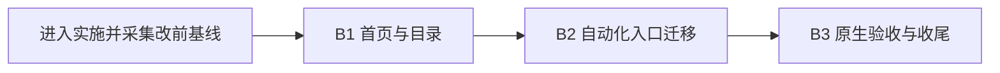

# “练”Tab 六分组调整实施方案 v1.3

> **本文件是本轮需求真源。**
> 日期：2026-11-06。用户已确认六组、43张卡片，以及“副标题和星级也一起加上”。v1.3 已将 §10 同步接入练习首页，按常规字号双列验收；原生验证范围见文末实施记录。
> 编制依据：用户最后提供的六类清单与命名决定、[43张卡片逐页总结](练Tab卡片页逐页总结-20261106.md)、2026-11-06核实的生产代码；采用 [issue-collection-restructure](../.cursor/skills/issue-collection-restructure/SKILL.md) 整理依赖与批次。

## 1. 需求回显

1. 保留当前“练”Tab名称；“练”是本轮讨论称呼，不借此修改系统Tab现有显示文案或无障碍名称。
2. 分组采用 **基础 → 准度 → 控球 → 走位 → 进阶 → 策略**，六个名称均为两个字。
3. 卡片严格采用用户给出的归属与组内顺序；共43张正式卡片，每张只有一个首页主入口。
4. “杆法”采用用户选定的“控球”，“专项”采用“进阶”，“战术”采用“策略”。
5. 保留“自定义球形”和“拍照建球形”，分别位于走位组第9、10位。
6. 本轮调整首页组织方式，沿用现有卡片展示和详情页。此前五组方案、独立“球理”目录、主要卡片与知识条目分层、卡片拟改名均被本方案替代。
7. 新增方案项：重写截图红框所指的卡片**副标题**，并在标题下增加学习难度或用途。卡片主标题、六组及其顺序继续按已确认清单；§10列出逐卡采用的文案和星级，不把“改描述”解释为全部页面改名。

### 1.1 一页总览：分组及卡片顺序

从左到右是分组顺序，从上到下是各组卡片顺序；空白位置不生成卡片或占位。

| 组内顺序 | 基础（7） | 准度（6） | 控球（7） | 走位（10） | 进阶（6） | 策略（7） |
| ---: | --- | --- | --- | --- | --- | --- |
| 1 | 瞄准原理 | 角度与瞄准 | 分离角图谱 | 分离角与走位 | 翻袋解球 | 反向规划 |
| 2 | 瞄准方法 | 角度预测 | 加塞吃库图谱 | 走位求解 | 颗星解球 | 关键球原理 |
| 3 | 旋转与加塞 | 角度练习 | 30° 法则 | 打一走二想三 | 翻袋练习 | 球团管理 |
| 4 | 瞄准修正 | 假想球练习 | 90° 法则 | 分离角练习 | 解球练习 | 风险报酬决策矩阵 |
| 5 | 瞄准点对照表 | 瞄准点练习 | 切线法则 | 两球走位 | K球练习 | 安全球三维度模型 |
| 6 | 浅谈凭感觉瞄准 | 准度练习 | 母球速度分级 | 三球走位 | 防守练习 | 清台 5 步决策流程 |
| 7 | 进球容错角 | — | 最少加塞原则 | 多球走位 | — | 清台速查手册 |
| 8 | — | — | — | 蛇彩练习 | — | — |
| 9 | — | — | — | 自定义球形 | — | — |
| 10 | — | — | — | 拍照建球形 | — | — |

### 1.2 各组承担的任务

| 分组 | 定位 | 与相邻组的边界 |
| --- | --- | --- |
| 基础 | 建立瞄准、旋转、修正和进球空间的基本认识 | 瞄准原理和方法在这里；反复判断、作答与进球练习在准度 |
| 准度 | 观察角度、判断瞄准方向，再通过练习检验 | 保留“角度与瞄准”作为本组的观察工具，不因为它不是练习题而移走 |
| 控球 | 理解碰后分离、碰库、旋转与速度的关系 | 研究母球怎么运动；具体走到哪里、怎样接下一球在走位 |
| 走位 | 研究落点和连续衔接，从推演到两球、三球、多球练习 | 自定义与拍照工具服务球形复现和走位研究，按用户决定放在组尾 |
| 进阶 | 翻袋、解球、K球和防守等具体打法 | 防守练习在这里；攻防取舍与安全球决策框架在策略 |
| 策略 | 选择球序、管理球团、比较风险并形成清台思路 | 保留理论与流程的直接入口，不新增中间目录页 |

这套分类按学习任务组织，适合本次入口调整。它仍有内容交叉，例如加塞同时涉及基础认识和控球，防守同时涉及技术执行和策略判断；以表中主归属消除首页重复，不把六组描述成完全互斥的理论体系。“进阶”也不表示整组均为Pro或必须先完成前四组。

## 2. 当前结构与改动边界

### 2.1 已核实的现状

| 当前分组 | 正式卡片数 | 调整后的去向 |
| --- | ---: | --- |
| 学 | 10 | 基础7、准度1、控球2 |
| 理 | 12 | 控球5、策略7 |
| 练 | 7 | 准度5、走位2 |
| 打 | 10 | 走位6、进阶4 |
| 解 | 4 | 走位2、进阶2 |
| 合计 | 43 | 7＋6＋7＋10＋6＋7＝43 |

现行首页集中在 `AngleHomeView.swift`：侧栏枚举、入口数组、筛选、网格和点击门控在同一文件。详情路由由 `MainTabView` 注册，理论卡片的标题和副标题来自 `TheoryCatalog`。分组选择是视图内 `@State`，当前没有分组偏好的持久化迁移任务。

模拟器额外显示 `batchDrillStudio`（批量出片台），它不计入43张正式卡片。实施默认将其接在走位组最后，继续受原 `targetEnvironment(simulator)` 条件控制。这样正式走位10张、模拟器走位11张；正式总数43、模拟器包含工作台共44。它是内部工具，不占用用户清单中的序号位置。

### 2.2 本轮具体调整

- 首页侧栏六组名称、排列、图标与组头说明。
- 43张卡片的主归属和组内排列；“全部”同步按六组排列。
- 依赖旧分组的测试入口、原生采集流程、文案审计清单。
- 产品信息架构、实施规范及任务记录中的当前分组说明。

### 2.3 继承的行为

- 保留卡片标题、封面、内容类型角标、Pro角标、点击权限及详情目的地；首页副标题和学习难度按§10实施。
- 搜索按标题和副标题匹配，主题筛选按现有 `topics` 匹配。
- 训练项目ID、每日额度、成绩、历史记录、模板、账号归属及同步契约。
- 每个球桌页的控件、物理、求解、设置和2D／3D行为。

这次不新增独立球理页，不合并内容页，不重写理论正文，也不扩大成首页视觉重做。首页没有交互球桌，本轮无需重新审计43个详情页的全部TP条款；若实施中发现必须修改某个球桌页合同，再进入该页专项流程。

## 3. 首页呈现与交互方案

### 3.1 侧栏与组头

侧栏排列为：**全部、基础、准度、控球、走位、进阶、策略**。沿用现有左右区域各自滚动的结构、选中态和卡片网格；初次进入仍选择“全部”。六列表格只用于本文编辑，不要求App改成六列卡片。

新增一组后，左栏共有七项。保留侧栏滚动，确保小屏和键盘展开时“策略”仍能到达；不靠缩小正文或挤压点击区域强行放进一屏。当前76pt侧栏、60pt行高及两列网格作为实现基线，只有出现本次名称或数量造成的实际可达性问题时才做局部调整。

组头继续使用 `BTLibrarySectionHeader`。以下是本方案的默认配套文案／图标建议，便于用户在实施前修改，不属于此前已经拍板的卡片名称：

| 分组 | 组头说明建议 | 图标建议 |
| --- | --- | --- |
| 基础 | 理解瞄准、旋转与进球空间 | book / book.fill |
| 准度 | 从判断角度到瞄准进球 | target |
| 控球 | 掌握母球碰撞、旋转与速度 | circle.circle |
| 走位 | 规划落点，练习连续衔接 | arrow.triangle.branch |
| 进阶 | 练习翻袋、解球、K球与防守 | square.stack.3d.up |
| 策略 | 安排球序，权衡攻防与风险 | lightbulb / lightbulb.fill |

图标在实施时核对工程部署下限与实际显示；没有合适填充变体时沿用同一符号表达选中状态，不创造不存在的 `.fill` 名称。

### 3.2 卡片与顺序

“全部”按六组依次展示，每组内部按§1.1排列；选单组只展示该组。标题随内容排一至两行，沿用封面比例和内容类型角标，不按新分组批量换封面颜色。

每组编号仍从01重新开始。现行编号由筛选后可见数组的索引生成，因此搜索／筛选后仍从01连续编号；本轮不把它改成永久课程编号。切换分组、重复点击分组及结果列表改变时，沿用当前滚到首个可见组的行为。

### 3.3 搜索、主题与空状态

- “全部”搜索跨六组；选中某组时搜索只在该组中进行。
- 搜索和主题筛选叠加，结果保持原有相对顺序，空组不显示组头。
- 保留现有准度／加塞／走位／吃库／防守主题菜单。分组是主目录，主题是交叉筛选；即使两者都有“准度”，也使用各自现有的标识作用域。
- 无结果沿用当前提示及“浏览全部练习”动作。该动作目前清空搜索词和主题，**不重置所选分组**；本轮继承这一行为，测试不得误写成必定回到“全部”。
- 当前防守练习的 `topics` 没有 `.safety`，拍照建球形也没有主题标签。本轮保留标签映射，因此“防守”主题不等于“进阶组全部防守内容”。这属于现有主题标签问题，不能在搬卡时静默修订。

### 3.4 导航、权益与历史

卡片沿原 `AngleRoute` push 原详情页。基础／控球等组名不写入训练项目ID，不作为历史记录的新分类键。`AngleEntry.isPremium`负责卡面展示，`AngleRoute.requiresPremium`及原权限入口负责准入，两者随原卡片保留；组名“进阶”不触发整组付费。

自定义球形继续打开模板入口并沿用owner；拍照建球形继续打开原识别入口。仅搬动首页卡片不要求迁移模板、照片或训练记录。验收应从新位置进入并返回，确认原数据仍可见，不用创建或删除用户真实资产作测试。

## 4. 43张卡片的实施映射

下表使用已存在的路由；`theoryPage`的参数为 `TheoryPageID`。这些ID保持不变。组内位置是本次顺序验收基准。

| 新组 | 位置 | 卡片名称 | 当前组 | 保持的路由 |
| --- | ---: | --- | --- | --- |
| 基础 | 1 | 瞄准原理 | 学 | `aimingPrinciple` |
| 基础 | 2 | 瞄准方法 | 学 | `aimingMethods` |
| 基础 | 3 | 旋转与加塞 | 学 | `spinAndEnglish` |
| 基础 | 4 | 瞄准修正 | 学 | `aimingCorrection` |
| 基础 | 5 | 瞄准点对照表 | 学 | `contactPointTable` |
| 基础 | 6 | 浅谈凭感觉瞄准 | 学 | `ballFeel` |
| 基础 | 7 | 进球容错角 | 学 | `pocketTolerance` |
| 准度 | 1 | 角度与瞄准 | 学 | `angleDynamic` |
| 准度 | 2 | 角度预测 | 练 | `geometricQuiz` |
| 准度 | 3 | 角度练习 | 练 | `sceneAiming2D` |
| 准度 | 4 | 假想球练习 | 练 | `aimPointTraining` |
| 准度 | 5 | 瞄准点练习 | 练 | `aimPointScene2D` |
| 准度 | 6 | 准度练习 | 练 | `accuracy2D` |
| 控球 | 1 | 分离角图谱 | 学 | `separationAngleAtlas` |
| 控球 | 2 | 加塞吃库图谱 | 学 | `cushionEnglishAtlas` |
| 控球 | 3 | 30° 法则 | 理 | `theoryPage(.t01)` |
| 控球 | 4 | 90° 法则 | 理 | `theoryPage(.t02)` |
| 控球 | 5 | 切线法则 | 理 | `theoryPage(.t03)` |
| 控球 | 6 | 母球速度分级 | 理 | `theoryPage(.t04)` |
| 控球 | 7 | 最少加塞原则 | 理 | `theoryPage(.t09)` |
| 走位 | 1 | 分离角与走位 | 打 | `positionPlayComposer` |
| 走位 | 2 | 走位求解 | 解 | `positionPlaySolver` |
| 走位 | 3 | 打一走二想三 | 解 | `planThree` |
| 走位 | 4 | 分离角练习 | 打 | `separationPractice2D` |
| 走位 | 5 | 两球走位 | 打 | `twoBallPractice2D` |
| 走位 | 6 | 三球走位 | 打 | `threeBallPractice2D` |
| 走位 | 7 | 多球走位 | 打 | `multiBallPractice` |
| 走位 | 8 | 蛇彩练习 | 练 | `snakePractice` |
| 走位 | 9 | 自定义球形 | 练 | `customFormationPractice` |
| 走位 | 10 | 拍照建球形 | 打 | `ballExtraction` |
| 进阶 | 1 | 翻袋解球 | 解 | `bankShot` |
| 进阶 | 2 | 颗星解球 | 解 | `diamondSystem` |
| 进阶 | 3 | 翻袋练习 | 打 | `bankPractice2D` |
| 进阶 | 4 | 解球练习 | 打 | `kickPractice2D` |
| 进阶 | 5 | K球练习 | 打 | `kBallPractice2D` |
| 进阶 | 6 | 防守练习 | 打 | `defensePractice2D` |
| 策略 | 1 | 反向规划 | 理 | `theoryPage(.t05)` |
| 策略 | 2 | 关键球原理 | 理 | `theoryPage(.t06)` |
| 策略 | 3 | 球团管理 | 理 | `theoryPage(.t07)` |
| 策略 | 4 | 风险报酬决策矩阵 | 理 | `theoryPage(.t08)` |
| 策略 | 5 | 安全球三维度模型 | 理 | `theoryPage(.t10)` |
| 策略 | 6 | 清台 5 步决策流程 | 理 | `theoryPage(.flow)` |
| 策略 | 7 | 清台速查手册 | 理 | `theoryPage(.quickRef)` |

## 5. 实现方式及关联适配

### 5.1 首页数据组织

在 `AngleHomeView.swift` 内完成六组枚举和入口归属调整，保持现有 `AngleEntry` 与列表渲染链。建议内部case使用 `basics / accuracy / cueControl / position / advanced / strategy`，显示文字使用六个中文名称；这只是局部实现命名，不引入新的业务模型或持久化协议。

普通卡片保留标题、topics和权限，副标题及星级采用§10.4。理论卡片按显式ID序列取 `TheoryCatalog` 元数据：控球为 `t01,t02,t03,t04,t09`，策略为 `t05,t06,t07,t08,t10,flow,quickRef`。保留 `isPublished` 门控和现有内容类型／主题映射；目录缺ID须有可定位检查，不能用无提示的过滤掩盖少卡。

现有 `TheoryGroup` 是理论索引的分类，不需要改成六个首页组。保留 `theoryIndex` 等兼容路由；首页不重新出现球理总卡。避免为本次排序建立第二份理论标题真源，也不按标题字典序自动排列。

### 5.2 文案审计脚本

`scripts/audit_billiard_copy_quality.py` 的 `card_audits()`目前按 `learnEntries/trainEntries/basePlayEntries/solveEntries` 提取卡片，并把理论目录统一标成“理”。改名或重组数组会导致少提取、错归组或错误的相邻卡片比较。

同批适配提取逻辑，使其能获得新六组、真实组内顺序和全部43条。理论卡片只计算一次；内部工作台单独排除。现有W18–W21是历史内容批次标签，须和新的首页分组分开处理，不能把旧批次号伪装成新分组定义。脚本当前最后按route排序；新的当前目录输出应按组序和组内序，历史审计报告保留原样。

另有已存在的提取缺口：`parse_angle_entries()`只识别字符串字面量标题，不能识别当前四处 `TrainingProject.*.title`。适配时一并从现有 `TrainingProject` 标题真源解析，否则即使更新数组名，也不能证明43条完整。此问题属于脚本原有前提失效，不是六分组引入的卡片遗漏。

### 5.3 测试、截图巡游与原生流程

已检出直接消费旧侧栏名的UI测试、`TheoryIndexNavigation`、`ScreenshotTourUITests`和 `scripts/native-atlas/flows/*.json`。实施时按**目标卡片**查§4迁移，而不是将“学→基础、理→控球、打→走位”一律替换。

- `TheoryIndexNavigation.openPage`根据目标理论页选择控球或策略，再滚动找卡；保留当前有界等待、左右ScrollView区分和目标页面确认。
- `openTheorySection`无参数接口不能再表示12张卡片同处一组。检查其全部调用者：单页用例改为明确目标页入口；首页目录用例改验两个组的理论子集。不能让它默认打开控球后遗漏策略。
- 首页组截图改为六组；页面详情截图按新归属导航。截图文件名／场景key若被采集目录消费，须同步更新当前配置或保留明确兼容映射，历史证据文件不重命名、不覆盖。
- native-atlas的 `practice-sections.json`增加第六组并同步当前entry元数据；`practice-filter.json`可用基础组验证现有“防守主题无结果→清筛选”行为。
- 测试中尚存“自由击球”“自由走位”等与现状不一致的旧卡名，先标记为已有失配。只有经现行路由和页面合同核实的入口迁移才修改，不能为让老测试通过恢复已移除卡片。

### 5.4 现有断言为什么需要调整

| 已核实的断言／入口 | 本次变更后的失败机制 | 合理处理 |
| --- | --- | --- |
| P5 `testFiveSegmentTabs`：`for name in ["学", "理", "练", "打", "解"]`，断言 `angleHomeTab_\(name)` 存在 | 旧侧栏按钮被六个新按钮替代 | 改为六组名称及顺序验证，保留必须存在的断言 |
| P5 `testSegmentCards`：切“理”后断言“切线法则”存在 | 理组不再存在，切线法则迁入控球 | 按新组核所属卡片，并检查基础／策略中不重复出现 |
| V28权益用例：`angleHomeTab_学` 后点击“分离角图谱” | 图谱已在控球，旧导航无法到达 | 改到控球；“显示订阅页”和“不得先进入图谱”的业务断言保留 |
| `TheoryIndexNavigation.openPage`先调用无参 `openTheorySection`，内部定位 `angleHomeTab_理` | 12篇内容拆成5＋7，单一理论组前置失效 | 先按目标页选择控球／策略，再执行原详情页断言 |
| P5旧断言 `app.buttons["自由击球"]`、`app.buttons["自由走位"]` | 当前首页已无这两个标题，属于本轮之前的失配 | 记录旧前提，逐项核实替代入口；不归因于这次六组调整，不删除断言求绿 |

不因分组变化改动理论条件、物理结果、训练记录、权限或评分断言。新发现的断言需要调整时，同样记录原断言、前提变化和替代验收。

## 6. 实施批次、依赖与完成标准

工作量主要集中在一个首页文件，但关联自动化入口较多，拆为三个串行批次。六组共用同一结构，不按组拆六批；也不为纯排列建立独立架构重构批次。

| 批次 | 范围 | 量级 | 依赖 | 交付 |
| --- | --- | --- | --- | --- |
| B1 首页与目录 | 六组、43张卡片排列、组头、审计脚本、当前规格同步 | 小至中：一个主View＋一个审计脚本＋相关文档 | 用户要求进入实施，完成改前基线采集 | 可构建的六组首页、完整目录核对 |
| B2 自动化入口迁移 | 共享理论导航、首页测试、巡游及原生流程中的旧分组引用 | 中：多个调用方，按目标卡片逐项迁移 | B1分组和路由映射稳定 | 可编译测试目标、可用当前采集流程、受影响调用方清单 |
| B3 原生验收与收尾 | 入口、筛选、权益、跨尺寸、浅深色验证及问题修复 | 中：复用受管模拟器，集中采集与审图 | B1＋B2完成 | 验收报告、代表截图、进度与剩余边界 |



### B1：一次完成首页归组

执行内容：

1. 核对当前43条及工作区差异，记录改前原生首页；按模拟器生命周期入口借用设备。
2. 更新六组及入口数组，保留卡片元数据、过滤、编号、权限和导航。
3. 同步文案审计脚本，使新目录完整且有序。
4. 更新 `docs/05-信息架构与交互设计.md`当前实现说明；同步 `UI-IMPLEMENTATION-SPEC.md`和设计记录，明确覆盖旧五分类约定。旧规范正文中的DR-065分组描述须附新决定指针，避免后续恢复旧组。

完成标准：

- [x] 正式路由集合与改前43条完全相等，唯一且无缺漏；六组数为7／6／7／10／6／7。
- [x] 各组顺序逐项符合§4，不只检查总数；12个理论ID恰好出现一次。
- [x] 逐route比较标题、副标题、内容类型、topics、权限和封面映射，除分组、顺序、组头及§10明确的副标题、难度外没有非预期变更。
- [x] 模拟器工作台条件保留，正式清单没有把它作为第44张卡片。
- [x] Debug App构建通过；目录审计输出43条并能反映六组实际顺序。
- [x] 文档清楚区分“已实现”和“原生验收待B3”；不以构建通过声明UI完成。

### B2：迁移依赖旧分组的入口

执行前以 `angleHomeTab_`、旧组数组、`switchHomeTab`、`TheoryIndexNavigation`和巡游场景表做完整引用清单。区分现行可执行代码／流程与历史文字；仅改动当前执行入口及真实依赖，逐文件记录目标卡片和新组。

先修共享导航，再修独立测试和JSON流程。旧组拆分按§4逐卡处理；不以扩大等待时间或吞掉找不到卡的情况作为适配。

完成标准：

- [x] 当前执行流程不再点击已移除的五个侧栏按钮；确需保留的历史字符串有用途说明。
- [x] 共享理论导航可分别进入控球和策略，全部12篇的调用者已审查。
- [x] 首页组存在／顺序、43入口归属、权益拦截、搜索主题组合均有适用的现有测试或验收用例承接。
- [x] 测试目标编译通过；修改的JSON流程解析通过；选取普通阅读、控球理论、策略理论、走位、进阶各类导航完成定向冒烟。
- [x] 测试断言修改附前提说明；历史失配与本次引入问题分开记录。
- [ ] 当前截图场景key和索引一致，旧证据不被覆盖。本轮不要求测试后整个工作区“零diff”。

### B3：原生验收、修复与交付

模拟器按 `simulator-use`及仓库生命周期规范复用设备；执行时选择标准手机、紧凑手机、iPad代表窗口，记录系统版本、窗口、构建与权益条件。B1改前截图与本批改后截图应可比较。

完成标准：

- [ ] 标准手机逐组核六组名称、顺序、所有43张卡片和最后一项可达；模拟器工作台单独标记。
- [x] 每张卡片从新主入口点击可达原目的地或预期权限页；需要Pro的内容使用测试权益验证实际目的地，再选代表入口验证非Pro门控。
- [x] 自定义球形与拍照建球形从走位末尾可达并正常返回；使用测试资产验证既有模板可见，不删除用户数据。
- [ ] 单组与全部、搜索与主题叠加、无结果、清筛选、重复点组、返回首页行为符合§3。
- [x] 紧凑手机核左栏第七项、走位尾部、策略长标题；iPad核宽窗口及缩窄恢复。用常规字号的浅／深色检查受影响布局，截图目视确认文字和点击区域。
- [ ] 原图审查卡片两行标题、封面、编号、内容类型与Pro角标；不能用AX存在替代真实可见。
- [x] 执行适用项目检查，包括 `make -f scripts/Makefile verify-gate`、`verify-doc-size`及变更范围diff检查；记录命令、结果与失败归因，已有失败不能记为通过。
- [ ] 交付记录分列功能验证、视觉审查、未测范围与用户复验状态。真实购买、相机真机拍摄、全App和物理精度不因本次入口验收而宣称通过。

若发现本次引入的问题，在对应实现处修复并仅重跑受影响验证；最终截图和结论绑定修复后的代码。没有实际跑到的测试、没有打开检查的截图，均列为未验证。

## 7. 核实后的锚点索引

核实日期：2026-11-06。以下是编制时行号，实施若发生漂移按符号重新定位。

| 文件 | 行号／符号 | 本轮用途 |
| --- | --- | --- |
| `QiuJi/Features/AngleTraining/Views/AngleHomeView.swift` | 82 `PracticeTopic`；95 `PracticeContentKind`；109 `AngleEntry` | 保留主题、类型与逐卡属性 |
| 同上 | 140 `PracticeSection`；187 `selectedSection`；197 `gridColumns` | 六组定义、默认全部、现有网格 |
| 同上 | 203 `learnEntries`；217 `theoryEntries`；232 `theoryTopics` | 基础／准度／控球与理论条目来源 |
| 同上 | 245 `trainEntries`；256 `playEntries`；271 `basePlayEntries`；285 `solveEntries` | 练习、走位、进阶及内部工作台来源 |
| 同上 | 292 `entries(for:)`；302 `filteredEntries`；316 `visibleGroups` | 目录组合与顺序保持 |
| 同上 | 414 `sectionSidebar`；444 `sidebarItem`；488 `entryGrid` | 七项侧栏、AX标识、网格与滚动 |
| 同上 | 534 `open`；544 `searchEmptyState`；569 `AngleGridCard` | 权益入口、空态、卡片外观继承 |
| `QiuJi/Features/AngleTraining/Theory/TheoryCatalog.swift` | 10 `TheoryPageID`；33 `TheoryGroup`；81 `TheoryCatalog` | 理论ID与卡片元数据真源 |
| `QiuJi/App/MainTabView.swift` | 211 `authorizedAngleDestination`；314 `theoryDestination` | 维持详情路由；243自定义、284编排、293拍照 |
| `QiuJiUITests/P5_AngleTrainingUITests.swift` | 17 `switchHomeTab`；38 `testFiveSegmentTabs`；45 `testSegmentCards` | 主目录测试与旧前提审查 |
| `QiuJiUITests/Helpers/TheoryIndexNavigation.swift` | 8 `openTheorySection`；35 `openPage` | 12篇理论导航拆组 |
| `QiuJiUITests/V28VisualUnificationUITests.swift` | 29权益用例；120五分组截图 | 控球Pro入口及截图适配 |
| `QiuJiUITests/ScreenshotTourUITests.swift` | 195–209旧分组入口；547分组选择 | 巡游导航／场景key消费关系 |
| `scripts/audit_billiard_copy_quality.py` | 402 `card_audits`；410旧数组映射 | 文案目录提取、归组及排序 |
| 同上 | 349 `parse_angle_entries` | 仅识别字面量标题的已有提取缺口 |
| `QiuJi/Core/Training/TrainingProject.swift` | 8 `title` | 四处动态卡片标题真源 |
| `scripts/native-atlas/flows/practice-sections.json` | 1起，六组采集需替换旧五组steps | 当前原生采集入口 |
| `scripts/native-atlas/flows/practice-filter.json` | 1起，基础组筛选／空态流程 | 保持筛选语义 |

关联调用方已检出但不在这里伪造逐函数锚点：P5／V27／V28／V30／V49相关套件、各专项训练UITests、ScreenshotTour、native-atlas阅读／理论／球桌流程。B2开始时按当前引用清单逐项定位并记录；不能把本表当成所有调用方已完成迁移的证明。

## 8. 文档关系与变更纪律

- 本文件覆盖[原41张卡片草案](练Tab分组与卡片顺序调整草案.md)的分组顺序，以及[五主题入口方案](练Tab入口归属与展示方案-20261106.md)的归属、展示形式和改名建议。旧稿保留为讨论历史。
- [43张逐页总结](练Tab卡片页逐页总结-20261106.md)继续作为内容理解参考；其旧组编号不能作为新首页顺序。
- 本轮先保存方案、同步规划状态。实施时再记录DR和已实现状态，避免规范写成已经上线。
- 当前仅改变13项目内的入口组织，不改14／15／16／18的内容资产、定理定义或图标源；若后续扩展这些范围，再按Project Hub规则同步。
- 后续用户调整卡片、名称或顺序时，升级方案版本，同时更新总览、路由表、批次影响和版本记录。高版本覆盖低版本，执行者不得混用旧稿。

## 9. 版本与当前交付状态

| 版本 | 日期 | 变化 | 状态 |
| --- | --- | --- | --- |
| v1 | 2026-11-06 | 将用户确认的六组及43张卡片固化，补全真实代码锚点、依赖迁移、三批实施与验收 | 方案完成；B1／B2／B3均未开始 |
| v1实施启动 | 2026-11-06 | 用户授权实施；完成改前构建、小屏原生基线采集；文案审计提取逻辑正在适配 | B1进行中；B2／B3未完成 |
| v1.1 | 2026-11-06 | 按用户两张截图追加43张副标题改写、三至五星学习难度建议、工具例外、布局和验收约束 | §10方案已补充，尚未写入App；原六分组实施继续有效 |
| v1.2 | 2026-11-06 | 用户确认一起实施；六组43张首页卡片采用§10副标题，40张显示学习难度，3张显示工具或速查 | 已接入App，验证记录见文末 |
| v1.3 | 2026-11-06 | 用户明确只考虑常规字号，保留原双列、标题两行和独立难度行；不另设字号布局分支 | 已接入 |

方案校验记录（2026-11-06）：脚本对照当前首页、TheoryCatalog与TrainingProject，确认43个正式路由唯一且集合相等、标题一致、组数7/6/7/10/6/7、顺序符合用户清单、总览表与路由表一致；本文所有本地链接可解析。变更文档的 `git diff --check` 与 `make -f scripts/Makefile verify-doc-size` 通过。这些结果只证明方案文档一致性，不是B1–B3的App验收结果。

## 10. 已采用：卡片副标题与学习难度

### 10.1 用户反馈与建议结论

用户指出两处问题：一是卡片底部描述不够准确，希望基于前面的逐页功能总结重新写；二是标题与描述之间有空白，可以用星星说明重要程度或难度。本节按[43张逐页总结](练Tab卡片页逐页总结-20261106.md)组织候选，并用当前`AngleHomeView`的`subtitle`与`TheoryCatalog`的`cardSubtitle`核对旧文案。

**建议重写全部43张卡片副标题，星级统一表示“学习难度”，采用三至五颗星，分别对应入门、应用、综合三个层次。** 重要程度随用户的基础、当前问题和训练目标变化，不适合和难度共用一套星星。基础知识可能很重要但并不难，复杂练习也不必然应该优先学习。若今后确实需要推荐优先级，可另行设计“建议先学”，本轮不同时增加第二套等级。

这里的学习难度指**理解页面的核心内容，并开始有目的地使用它所需的知识与判断负担**。它不是按钮操作复杂度、真人技术等级，也不是题目最高难度。评级是编辑建议，尚无用户研究或训练数据校准；不能描述成客观测评结果。

### 10.2 副标题怎么写

- 用一句话说明进入后可以学什么、判断什么或完成什么，优先保留能区分相邻页面的任务。
- 阅读页说明获得的认识，观察页说明比较的对象，练习页说明要完成的任务，求解页说明输入条件与求解目标；不统一套成“提升某某能力”。
- 目标长度约10–16个汉字，准确表达优先。先给出完整候选，再以实际卡宽检查；不能为挤进一行删掉“母球／目标球”“求解／练习”等关键区别。
- 不把有条件的法则写成无条件结论，不承诺必进、唯一最优解或准确胜率；不凭空增加页面没有的评分、自动识别或教学功能。
- 主标题、详情导航标题与路由保持已确认清单。这里的“重新命名描述”落实为副标题改写。

重点区分：角度预测是在简图上估角，角度练习是在球桌场景中判断；瞄准点练习检验方向，准度练习检验模拟进球；两球走位是一次衔接，三球走位是两杆衔接；分离角与走位是自行试打，走位求解是给定落位要求后找方案；翻袋关注目标球碰库进袋，解球关注母球先碰库后碰目标球。

### 10.3 星级口径与例外

2026-11-06用户调整：星数范围采用三至五颗星。统一五个星位，分别点亮三、四、五颗，不设置一星或二星档；原入门／应用／综合的相对评级保持不变。

| 显示建议 | 含义 | 评级依据 |
| --- | --- | --- |
| ★★★☆☆ | 入门 | 主要理解一个基础关系，或完成单一判断，较少依赖其他页面知识 |
| ★★★★☆ | 应用 | 需要已有瞄准或控球认识，比较条件、联系多个因素，或完成一次衔接 |
| ★★★★★ | 综合 | 需要连续规划、组合控制，或同时权衡路线、落位及失败后果 |
| 工具 | 不评级 | 内容由用户导入或自建，入口本身不能代表球技难度 |
| 速查 | 不评级 | 跨多个难度层级的索引／回顾材料，不适合给单一难度 |

同组允许有不同星级，不按“基础到策略”机械递增，也不按Pro、文字篇幅、组内序号评级。练习题数量、库数、球距、障碍与辅助设置会改变具体任务难度，首页星级只说明页面核心学习任务，不随某一道题实时变化，不参与出题、解锁、排序或成绩计算。

自定义球形、拍照建球形建议标“工具”；清台速查手册建议标“速查”。它们在表中仍完整保留，用“—”表示不适用，而不是零星或低质量。“分离角与走位”等探索工具有明确的控球学习任务，因此可按理解和使用该任务的知识负担给星；“自定义球形”则是承载任意内容的模板入口。

### 10.4 全部43张卡片实施表

按已确认的六组及组内顺序排列，“采用副标题”和“学习难度／用途”是本版 App 采用的值，可直接在此编辑下一版。评级依据不在卡片内显示。

| 分组·顺序 | 卡片名称 | 原副标题 | 采用副标题 | 学习难度／用途 | 评级依据 |
| --- | --- | --- | --- | --- | --- |
| 基础·1 | 瞄准原理 | 从切球角找瞄准点 | 理解切角、厚薄与瞄准点的关系 | ★★★☆☆ | 建立基础几何认识 |
| 基础·2 | 瞄准方法 | 三种方法找瞄准点 | 对比同一球形的三种瞄准方法 | ★★★☆☆ | 在共同球形下认识视觉参照 |
| 基础·3 | 旋转与加塞 | 预判旋转后路线 | 认识打点、旋转与母球走向 | ★★★★☆ | 区分打点与到球旋转状态 |
| 基础·4 | 瞄准修正 | 补偿投掷与加塞 | 观察力度与旋转造成的瞄准偏差 | ★★★★☆ | 已有几何瞄准基础上理解偏差 |
| 基础·5 | 瞄准点对照表 | 按切球角查瞄准点 | 按切角查瞄准点与接触点 | ★★★☆☆ | 查阅与比较对应关系 |
| 基础·6 | 浅谈凭感觉瞄准 | 从找参照到凭感觉判断 | 用参照和练习建立瞄准感觉 | ★★★☆☆ | 理解培养与核对感觉的方法 |
| 基础·7 | 进球容错角 | 拖球看进袋方向范围 | 摆球查看可进袋的方向范围 | ★★★☆☆ | 观察位置与进袋空间的关系 |
| 准度·1 | 角度与瞄准 | 拖球看瞄准点变化 | 拖动球形观察切角与瞄准方向 | ★★★☆☆ | 自由观察，不要求先给答案 |
| 准度·2 | 角度预测 | 估切角看误差 | 看简图估切角，对照答案与误差 | ★★★☆☆ | 单一角度判断 |
| 准度·3 | 角度练习 | 切换视角，练切角判断 | 在球桌场景中练习切角判断 | ★★★★☆ | 将角度认识迁移到完整球桌视角 |
| 准度·4 | 假想球练习 | 拖假想球看毫米差 | 根据切角摆准假想球位置 | ★★★☆☆ | 在局部几何中完成单一位置判断 |
| 准度·5 | 瞄准点练习 | 切换视角，练瞄准判断 | 在球桌上选准瞄准方向 | ★★★★☆ | 综合球、袋和视角判断方向 |
| 准度·6 | 准度练习 | 指定打点，瞄准进袋 | 调整瞄准与杆速，击球检验进袋 | ★★★★☆ | 从几何判断进入模拟击球检验 |
| 控球·1 | 分离角图谱 | 看高低杆碰后方向 | 对比不同高低杆的母球路线 | ★★★★☆ | 联系打点、力度与碰后运动 |
| 控球·2 | 加塞吃库图谱 | 换塞侧看出库方向 | 对比不同左右塞的母球吃库路线 | ★★★★☆ | 联系侧旋与碰库前后路线 |
| 控球·3 | 30° 法则 | 自然滚动约偏30° | 理解自然滚动的碰后方向与条件 | ★★★★☆ | 需要区分滚动状态与适用条件 |
| 控球·4 | 90° 法则 | 认清斯登的90° | 理解斯登击球的直角分离条件 | ★★★★☆ | 需要理解到球时的旋转状态 |
| 控球·5 | 切线法则 | 用切线判断碰后路线 | 用切线建立母球碰后路线参照 | ★★★★☆ | 将几何参照用于路线判断 |
| 控球·6 | 母球速度分级 | 练出可重复的力度 | 建立力度参照，按球形校准 | ★★★☆☆ | 学习建立参照，不等于精确控速已熟练 |
| 控球·7 | 最少加塞原则 | 先想清加塞的用途 | 按路线需要选择合适塞量 | ★★★★☆ | 先理解加塞用途，再比较代价 |
| 走位·1 | 分离角与走位 | 逐杆摆打推演走位 | 自由摆球试打，观察母球走位 | ★★★★☆ | 有目的地改变条件并比较结果 |
| 走位·2 | 走位求解 | 定落点看塞与力度 | 指定落位要求，求解击球方案 | ★★★★☆ | 提出落位要求并理解候选方案 |
| 走位·3 | 打一走二想三 | 定三颗倒推第一杆 | 根据后两颗球倒推当前走位 | ★★★★★ | 联结后续球位与当前击球选择 |
| 走位·4 | 分离角练习 | 调打点力度，复现目标轨迹 | 调整打点与力度，复现母球路线 | ★★★★☆ | 为指定路线联合调整击球参数 |
| 走位·5 | 两球走位 | 练目标轨迹，或走下一球 | 打进第一球，为第二球留下位置 | ★★★★☆ | 一次进球与走位衔接 |
| 走位·6 | 三球走位 | 提前选袋，练两杆连续走位 | 提前选袋，完成两杆走位衔接 | ★★★★★ | 第一杆结果影响第二杆安排 |
| 走位·7 | 多球走位 | 中八残局与追分 | 规划球序，练习残局连续走位 | ★★★★★ | 连续衔接并随实际局面更新计划 |
| 走位·8 | 蛇彩练习 | 连续进球与走位 | 按指定顺序连续进球与走位 | ★★★★★ | 连续控制并遵守指定顺序和碰球限制 |
| 走位·9 | 自定义球形 | 自由摆球与练习 | 编辑保存球形，随时重复练习 | — 工具 | 难度取决于用户选择或创建的球形 |
| 走位·10 | 拍照建球形 | 拍球局导入沙盘 | 从照片还原球形，校准后推演 | — 工具 | 照片输入与校准不是球技难度 |
| 进阶·1 | 翻袋解球 | 选袋求一至三库线 | 摆球求解目标球翻库入袋 | ★★★★☆ | 理解翻袋目标并比较求解路线 |
| 进阶·2 | 颗星解球 | 摆球求一至三库线 | 摆球求解母球绕库碰球 | ★★★★☆ | 理解母球先碰库的解球任务 |
| 进阶·3 | 翻袋练习 | 按指定库序，把目标球翻进指定袋 | 按指定库序将目标球翻进袋 | ★★★★★ | 自行控制参数完成受约束翻袋 |
| 进阶·4 | 解球练习 | 按指定库序，让母球解到目标球 | 按指定库序让母球解到目标球 | ★★★★★ | 自行控制路线并满足解球规则 |
| 进阶·5 | K球练习 | 进第一球，让母球K到第二球 | 进球同时让母球碰到第二球 | ★★★★★ | 一杆兼顾进袋与后续碰球 |
| 进阶·6 | 防守练习 | 控制落点，压缩对方的进攻机会 | 控制双方球位，限制对手进攻 | ★★★★★ | 同时考虑合法击球与终局机会 |
| 策略·1 | 反向规划 | 从最后一颗倒推 | 从收尾球倒推球序与落位 | ★★★★☆ | 学习倒推关系，完整多球应用会更难 |
| 策略·2 | 关键球原理 | 先找收尾关键球 | 识别关键球，安排收尾衔接 | ★★★★☆ | 判断球在后续计划中的作用 |
| 策略·3 | 球团管理 | 选好球团处理时机 | 判断球团处理时机与后续衔接 | ★★★★★ | 兼顾处理机会、保险球和后果 |
| 策略·4 | 风险报酬决策矩阵 | 打前问把握与代价 | 权衡成功收益与失败代价 | ★★★★★ | 比较攻防方案与失败后的局面 |
| 策略·5 | 安全球三维度模型 | 看距离库位和障碍 | 从距离、库位与障碍分析防守 | ★★★★☆ | 学习观察框架，实战组合判断会更难 |
| 策略·6 | 清台 5 步决策流程 | 按五步想完这一杆 | 串起观察、规划、执行与复盘 | ★★★★★ | 把多个判断环节组织为完整流程 |
| 策略·7 | 清台速查手册 | 上场前回看判断要点 | 快速查阅控球与清台判断要点 | — 速查 | 汇集多个层级知识，不设统一难度 |

上表“走位求解”的落位要求涵盖原页面已有的落区、落点或途经条件；“多球走位”概括主要连续任务，原有规划／自由模式与中八／追分选项保留；“两球走位”概括共同目的，原有轨迹／自由模式保留。副标题不需要枚举全部开关，也不能借改写改变功能。

### 10.5 卡片布局建议

练习卡片的标题按实际行数排版。短标题用一行，长标题按卡宽自然换行，最多两行。星级紧随标题。

建议文字区自上而下为：**标题 → 星星 → 功能副标题**。示意如下，仅表达顺序，不代表像素稿：

```text
走位求解
★★★★☆
指定落位要求，求解击球方案
```

- 难度行独立参与垂直布局；长标题自然占两行。首版预留独立信息行，接受卡片合理增高，不假设“加星后高度一定不变”。
- 维持封面、序号、内容类型和Pro角标的职责。点亮的实心星用练习页主题绿，剩余空心星用次级灰，浅色与深色均复用现有颜色；金色仍用于Pro标记，不显示成用户评分或收藏按钮。
- 同一网格行保持文字区域节奏；不能为对齐把长标题压成单行。工具／速查在相同行放对应文字，不显示全空心星星造成“零分”误解。
- 沿用练习首页的双列网格，常规字号副标题最多两行。标题与星级按 4 pt 间距排布，副标题独立成行。
- 星级不设独立点击，不增加收藏或评分动作。VoiceOver合并朗读为“走位求解，学习难度四星，应用，指定落位要求，求解击球方案”；不要逐颗朗读星形符号，也不要只靠颜色传达等级。
- 搜索栏只保留搜索和主题筛选。卡片中间只显示星星，辅助功能标签提供难度含义。

### 10.6 后续接入范围与验收

用户已授权本节与六组目录同时实施。C1只覆盖练习首页，不影响训练中的题目难度或成绩。

1. **文案来源**：普通31张首页入口改`AngleEntry.subtitle`；12张理论入口改`TheoryCatalog.cardSubtitle`。理论完整`subtitle`、正文和页面主标题保持原义，避免把短卡片文案覆盖到理论论断。
2. **难度来源**：按稳定路由／理论ID维护显式元数据，采用3／4／5星与工具／速查例外；不从组名、标题字符串、Pro或序号推导。评级不写进训练成绩、个人能力或历史记录。
3. **组件范围**：优先利用`BTContentGridCard`已有`meta`插槽组合难度与副标题；需要扩展行数等能力时保留其他调用方默认表现。这里只改变练习首页卡片，不让动作库和计划卡片自动出现星级。
4. **搜索与自动化**：搜索继续使用当前显示的标题／副标题，所以采用新文案后关键词结果会自然变化；补充新关键词、无结果和组内搜索验证。检查精确副标题断言与组合AX标签，保留原目的地和权益断言。
5. **完整性**：核43行与§4一一对应、无重复、组序不变；40张有建议星级，2张工具＋1张速查明确不评级。模拟器批量出片台继续不计入正式目录，可标内部工具，不评球技难度。
6. **语义审阅**：逐卡对照功能总结；特别检查图谱／练习、求解／自行判断、母球／目标球、单杆／连续衔接的区分。不能因短文案读起来顺就声明功能描述正确。
7. **原生验收**：标准／紧凑手机与iPad，浅／深色、常规字号；重点看两行长标题、16字左右副标题、工具例外、Pro共存与VoiceOver。记录新增信息行对首屏数量和滚动量的影响，再确定最终间距与行数。

§10.4 保留为可编辑的逐卡对照表。后续调整在此回填，并同步首页文案、难度和断言。

## 11. 实施与实测记录（2026-11-06）

| 项目 | 结果 |
| --- | --- |
| 目录与文案 | 43个正式入口逐项比对§10.4，组序7／6／7／10／6／7，标题、副标题、星级均一致。三星9张、四星20张、五星11张、工具2张、速查1张。模拟器另列批量出片台。 |
| 保留项 | 31个普通入口的标题、内容类型、主题、权益标记按路由与改前逐项相同；理论目录除12条短副标题外无差异，原页面路由和封面目录未改。 |
| 构建与门禁 | Debug模拟器App、单测与UI测试目标均构建成功；文案严格审计、149份采集流程JSON解析、项目门禁、文档体积门禁与diff空白检查通过。 |
| 43个页面入口 | 测试权益下，从首页依次点击到原目的地并核对页面标识：基础＋准度13个、控球＋走位17个、进阶＋策略13个。每个目的地都保留截图与辅助功能树；自定义球形到管理页、拍照建球形到选照片入口。 |
| 筛选与理论 | 通过副标题命中、无结果、清空保留当前组、主题筛选、连续切组和免费用户订阅拦截。12项理论目录单测全部通过。 |
| 卡片呈现 | 常规字号，沿用原双列与标题样式。标题按实际行数排版，下一行只显示五个星位（绿实星、灰空星）或用途，副标题单独显示、最多两行；每张卡合并朗读卡名、难度与功能，保留内容类型和Pro状态。 |
| 交互与视觉 | 已对照iPad mini浅色及深色六组首屏，并检查iPhone SE普通字号的双列换行。订阅门控、按新副标题搜索和清空后保留选中组已在iPad上实测。 |

原生截图、测试日志与逐卡对照结果见 [本轮证据目录](../output/practice-six-groups-20261106/)。去掉“学习难度”文字前的配色记录：[星级配色近照（浅／深）](../output/practice-six-groups-20261106/星级配色对照.png)、[iPad六组明暗总览](../output/practice-six-groups-20261106/six-groups-pad-overview.jpg)、[iPhone SE基础组](../output/practice-six-groups-20261106/star-color-phone/small/appearance-light/six-基础.png)。

历史采集流程中另有8处引用已删除的卡片或已合并的2D／3D入口，清单见[旧入口记录](../output/practice-six-groups-20261106/legacy-flow-mismatches.json)；它们不计入本轮通过项。未做真实购买、相机真机拍摄、VoiceOver人工听读、全App或物理算法回归。

范围修订：按用户最新要求，本轮只按常规字号实施、验收。切换分组时右侧列表回到首卡，保留左侧栏与搜索条件。

最终配色复核：iPhone SE浅色六组、iPad mini浅／深两色各六组，三次原生采集均通过。走位求解的四个实星落在主题绿色，剩余一个是灰色空心星；配色近照取自真实模拟器。

### 紧凑卡片与补充验收

| 检查 | 原生模拟器实测 |
| --- | --- |
| 标题、星级和搜索栏 | iPhone SE 第三代，常规字号。「瞄准原理」标题高度由 41 pt 收到 20.5 pt，标题下缘距星级上缘 4 pt。绿实星与灰空星在标题和副标题之间，搜索框右侧只有主题筛选。[卡片近照](../output/practice-final-acceptance/练习卡片.png) · [完整首屏](../output/practice-final-acceptance/run/small/appearance-light/six-基础.png) |
| 已有球形与入口返回 | 从走位组打开自定义球形，以内置 L 型创建个人测试副本。退出并重启 App 后，从走位组再次进入，按相同模板 ID 找到 15 球副本并选中。随后删除该测试副本并返回。拍照建球形也从走位组进入选照片页并正常返回。[回显证据](../output/practice-final-acceptance/run/pad/template/reopened-personal-template.png) |
| iPad 窗口缩窄与恢复 | 在 13 英寸 iPad Pro 模拟器拖动系统窗口，宽度从 1376 pt 缩至 438 pt，再恢复到 1376 pt；首张卡从 632 pt 缩至 163 pt，再恢复到 632 pt。三个状态均核对基础组选中、首卡可点击、星级紧随标题。[缩窗实拍](../output/practice-final-acceptance/window-proof/pad/window/narrow.png) · [恢复实拍](../output/practice-final-acceptance/window-proof/pad/window/restored.png) |

三设备六组首屏已按常规字号、浅色、竖屏采集，共 18 张。[每组首卡对照](../output/practice-six-device-gallery/六组卡片跨设备对照.png) · [iPhone SE](../output/practice-six-device-gallery/se-六组首屏.jpg) · [iPhone 16 Pro Max](../output/practice-six-device-gallery/max-六组首屏.jpg) · [13 英寸 iPad Pro](../output/practice-six-device-gallery/ipad-六组首屏.jpg)。目视发现 iPhone SE 策略组的「风险报酬决策矩阵」实际显示省略号，长标题换行仍有此例外。

### 封面去重（2026-11-06）

43 张正式卡片中保留 33 张，替换 10 张。进球容错角、两球走位、蛇彩练习采用已预览的袋口特写、两球衔接、蛇彩球阵。准度练习使用长台视角，三球走位使用三球题库，自定义球形复现内置 L 型。翻袋、解球、K 球采用题库球位，防守采用封锁对手直线的实际终局。解球额外放置的黑 8 只用于封面示意。所有封面均以静态图片随 App 打包。

43 个首页路由已核对为 43 组不同的解码像素。11 项封面目录单测通过，含正式入口资源的包内读取。iPhone SE、iPhone 16 Pro Max、13 英寸 iPad Pro 上均已采集改动分组的竖屏常规字号首屏；Pro Max 另滚动至组尾，截取全部 10 张新卡。[十张实拍](../output/practice-cover-replacement/十张新封面.jpg) · [走位与进阶](../output/practice-cover-replacement/走位与进阶.jpg) · [题形与取景记录](../output/practice-cover-replacement/scenes.json)。

### 练习封面与 App 球桌外观对齐（2026-11-06）

准度练习、三球走位、自定义球形、翻袋练习、解球练习、K球练习、防守练习共 7 张，沿用上节球位，重新以 iPhone SE 模拟器内的 App 训练场景取景。应用默认经典绿台呢与球桌、球贴、球杆样式，使用透视相机、训练室反射和球下接触阴影，导出 1600×1200 静帧。第一轮取景读到了模拟器保存的赛事蓝偏好，最终资源统一按全新偏好的默认外观生成。首页读取打包静帧。其余 36 张沿用原素材。[同球形前后对照](../output/practice-native-covers/同球形渲染对照.jpg) · [七张封面完整对照](../output/practice-native-covers/七张封面前后对照.jpg)。

在 iPhone SE 卡片内复查后，准度、翻袋、防守和 L 型球阵调整了相机取景，以避开内容角标。最终构建的 iPhone SE 与 13 英寸 iPad Pro 模拟器采集均通过；SE 滚动实拍覆盖全部七张，43 张正式卡的封面像素仍各不相同。[最终卡片实拍](../output/practice-native-covers/原生封面卡片.jpg)

### 其他入口与卡片同名（2026-11-06）

按六组43张现行卡片核对 App 生产路由与历史卡名。教学页的67处固定卡片跳转已逐项核对标题或目的地说明，2处目录跳转直接用理论条目名，另2处进入动作详情。额外检查了角度预测的结果按钮、拍照确认菜单、会员权益、操作布局名称、历史筛选及列表。

| 出现位置 | 同一目的页的现名 |
|---|---|
| 瞄准修正的讲解、页末按钮、拍照确认 | 走位求解 |
| 浅谈凭感觉瞄准、角度预测的结果按钮 | 角度练习 |
| 瞄准原理与瞄准方法之间的互链 | 瞄准方法、瞄准原理 |
| 会员权益与新记录中的工具名 | 分离角与走位；会员页中另一工具为颗星解球 |
| 历史类型筛选、成绩口径 | 几何估角对应角度预测；摆假想球对应假想球练习；场景瞄准对应瞄准点练习，附2D或3D |
| 模拟练习记录、布局名称 | 对应卡名在前，按需要标明2D、3D或混合视图；准度、分离角补齐“练习” |

两球走位里的“自由走位”是答题模式。旧工具活动和认知会话写入时冻结的名称继续按快照展示；按视图、历史类型计算的展示名使用现名。沿用原路由、记录类型和计分。卡片审计支持从共享页面标题读取卡名，并在遇到无法解析的卡片时报告错误，当前六组计数为7／6／7／10／6／7。

13 英寸 iPad Pro 固定源码 Debug 验证通过，4 项逻辑测试覆盖筛选、视图及快照历史，1 项界面测试实际从练习首页进入瞄准修正并经同名按钮打开走位求解。43卡与教学跳转的其余覆盖为源码核查；真机与全 App 逐页点击待验。[测试摘要](../output/practice-entry-names-20261106/test-summary.json)

### iPhone 入口与落地页实点（11 月 6 日）

设备为 iPhone 17 Pro，iOS 26.2，使用简体中文 Debug 构建。通过练习首页卡、正文按钮、系统菜单和历史记录进入对应页面，核对按钮文字、页首标题与截图。拍照入口使用演示球形进入第 4 步。下表仅列本次实点范围。

| 来源 | 实际点击与结果 |
|---|---|
| 拍照建球形 → 使用球形 | 保存排第一，命名后仍在确认页，重开自定义球形库能找到模板。菜单其他三项及对应首页卡分别进入「分离角与走位」「走位求解」「打一走二想三」，横屏标题完整。[菜单与标题对照](../output/iphone-entry-names-20261106/photo-menu.jpg) |
| 教学页的瞄准链接 | 「瞄准原理」「瞄准方法」的互链，以及「瞄准修正」「旋转与加塞」各自通往这两页的按钮，共六处统一显示目的页全名。 |
| 教学页与练习 | 「瞄准修正」进入「走位求解」。「瞄准原理」进入「角度预测」。从「浅谈凭感觉瞄准」和「角度预测」答题结果进入「角度练习」，都继续点「开始训练」核到球桌标题。[入口、设置与球桌](../output/iphone-entry-names-20261106/r4/screens/testPredictionAngle.jpg) |
| 记录与统计 | 实做一题「假想球练习」并重开 App，点当日记录可见同名详情。在统计页逐项点选七种类型，核对各名称、选中态和有数据／空结果。[记录与筛选](../output/iphone-entry-names-20261106/r4/screens/testHistoryNames.jpg) |
| 会员权益 | 在「订阅管理」查看「分离角与走位」「颗星解球」以及两种图谱的说明；从练习首页分别打开相应工具与图谱，对照页面标题。 |

首轮完成 17 个界面用例，其中 15 个通过，两条因测试操作中断。修订后 8 个定向用例通过；另将两个同名回链限定在正文的滚动区域，分别从瞄准方法页和角度预测结果实点「瞄准原理」，两项均通过。三轮合计覆盖 21 个不同用例。拍照识别、真机及其余卡片未在本轮逐页复测。[正文互链截图](../output/iphone-entry-names-20261106/r5/screens/testDocumentLinks.jpg) · [答题结果回链](../output/iphone-entry-names-20261106/r5/screens/testPredictionPrinciple.jpg)
