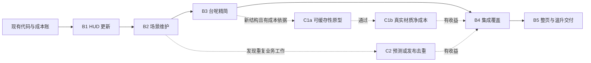

# 问题集合：3D 活动期性能与发热优化 v1

**本文件是本轮需求与批次安排的真源。** 日期：2026-11-13。状态：B1/B2 已实现并保留局部候选，B3 已完成并淘汰无可靠收益的光照候选；B4 本地集成已完成，B5 本地交付完成：固定按住瞄准窗口 CPU 观察值下降，GPU/连续击球温升待验；用户要求先本地交付。逐轮记录：[B1](render-activity-20261113/B1-HUD.md)、[B2](render-activity-20261113/B2-MAINTENANCE.md)、[B3](render-activity-20261113/B3-LIGHTING.md)。

主问题：当前手机试用已经流畅，但在「分离角与走位」3D 连续击球时仍会逐渐发热。本轮要降低完成相同训练任务所需的持续工作量，保留画质、物理、帧率设置和交互语义。第一步是 B1 的共享近景 HUD 更新优化，随后处理共享场景维护和台呢光照。一次只推进一个有明确交付物的批次。

本方案由 `issue-collection-restructure` 技能组织，依据生产代码、已有 CPU 采样、结构工作量和历次实验制定。它接管本轮后续优先级，不覆盖其他项目任务，也不改写历史实验结果。现已按用户授权从 B1 开始实施；本轮未启动手机采集。

## 1. 用户需求回显与范围

| 用户已经明确的要求 | 本方案中的落实方式 |
|---|---|
| 认真核对生产代码，结合原方案和优化经验 | 每个候选绑定实际调用链；列出已经实现、已经失败和仍待证明的部分；见 §2、§3、§10 |
| CPU、GPU 都应分析，按环节评估计算量与能耗 | 采用 CPU 归属、GPU 同类工作次数、同设备配对差分三层账；未知项保留，不用单一百分比冒充整机能耗 |
| 优化应抓住主要问题，让进展可见 | 优先活动期 UI/场景更新和台呢固定成本；不再以补齐 Instruments 数据作为开始改进的前提 |
| 接受研究探索，希望每轮记录、持续优化 | 每轮必须有保留的改动，或有证据的淘汰决定；没有新假设不重跑；每阶段有结束条件 |
| 不能只凭一台手机下普遍结论 | 通用工作量、不同场景与硬件上的方向一致性、具体手机体验分别报告；设备能力不混成平均分 |
| 相关场景都应用，不能遗漏 | 共享组件优先，最终刷新全量调用点登记；按实时页、预览、导出和 legacy 分开核对 |
| 目前以已有约 40 秒测试分析 | 直接沿用已有 Run3，不重复补录历史基线；未来只对有实际改动的阶段候选安排集中复验 |
| 手机拔线，分离角与走位连续击球才反映问题 | 阶段温升验收采用该场景和至少 3 分钟连续击球；与 CPU/GPU 机制分析分开给结论 |
| 已有连续调参、球库拖入、相机行为不能被优化破坏 | 保留最新输入、最终击球守卫、投影一致、同帧球影、模式切换、进入首帧及退出释放 |

本阶段默认维持当前画质：同分辨率、4x MSAA、HDR、材质与球影、正常 R 反射、用户选定帧率。60 FPS 是这次比较的固定设置，不把默认降到 30 FPS 当作方案成果。物理精度、实际播放时间和训练结果不变。若后续候选需要有损近似，必须在新版本方案中单列误差和收益，不能沿用旧讨论中的宽泛许可直接替换生产。

不纳入本阶段：全面重写 SceneKit、重做球反射预过滤、批量重生成历史图片、全 App UI 改版、以降低分辨率/减少 MSAA/关闭 HDR 掩盖持续成本。

## 2. 事实基线：已知什么，能据此决定什么

### 2.1 已有采样与用户体验

- Run3 的完整录制约 106 秒；成本分账采用其中 `31 ≤ t < 78` 的约 47 秒活动窗口，包含杆间间隔，不是 47 秒纯运动。用户大约击球 6 杆、60 FPS，结束时温感正常。
- 该窗口共有 15,038 个 Running CPU 样本，每个 1 ms，合计 15.038 CPU 秒。跨核 CPU 秒不是墙钟时间。按最近已知功能调用者互斥归属，每个样本只计一次。
- Run3 的帧节奏有效；GPU 命令与画面的关联缺失，不能把导出中的 GPU 零值当成 GPU 零工作量。
- 后续约 3 分钟用户击球约 13 杆，约 1 分钟开始热、结束时比较烫；该轮封存时 ENOSPC，未取得可用于完整成本分析的 CPU/GPU 结果。保留主观热体验与失败记录，不再默认追补或重复恢复这轮数据。

| CPU 功能域 | 累计 CPU 秒 | 占该窗口采样 CPU | 如何用于本轮决策 |
|---|---:|---:|---|
| UI 更新与合成的 CPU 端 | 4.714 | 31.35% | 检查不变内容持续更新和父视图传播；不能直接归给近景 HUD |
| Metal / GPU 驱动的 CPU 端 | 3.527 | 23.45% | 检查提交、资源/状态更新；这不是 GPU 执行时间 |
| SceneKit | 3.525 | 23.44% | 检查每帧维护和场景失效；不能假设全部可以消除 |
| App 未充分解析业务 | 1.347 | 8.96% | 暂不命名为物理；需要时才做定向符号化/计时 |
| 系统运行时 / 未归属 | 1.140 | 7.58% | 保留剩余项，不强行分摊给已知模块 |
| FramePacing 采集相关 | 0.482 | 3.21% | 单列，不能全算产品成本或全算工具成本 |
| 音频 | 0.303 | 2.01% | 当前不作为第一优化目标 |

UI、SceneKit、Metal 提交合计 **78.24% 的已采样 CPU 工作**。这支持先查图形链路 CPU；不等于整机发热占比，也不表示能省掉 78%。归属算法是可复核的启发式，业务符号和调用边界仍有误差。

旧采集二进制 UUID 与当前默认 DerivedData 不一致，不能拿后者的 dSYM 强行解释旧业务地址。B1/B2 可以直接用当前可命名的局部指标做前后比较，不等待恢复全部旧符号。

来源：[CPU 与能耗成本账](render-lowdim-20261113/COST-ENERGY-AUDIT-20261113.md)、[真机采集记录](render-lowdim-20261113/PHONE-HEAT-20261113.md)。

### 2.2 代码表明哪些工作仍在重复

| 环节 | 方案起点行为（实施变化见 §5） | 下一步判断 |
|---|---|---|
| 近景 HUD | 可见且有 snapshot 时，`TimelineView` 以 1/60 秒最小间隔更新；即使投影/球态/输入不变也保持时间线。底图已异步缓存，没有第二个常驻实时 SCNView | 是确定的重复更新入口；具体占比未知，先让更新频率服从真实变化 |
| 主场景 | `renderUpdate` 活动帧维护 viewport、临时俯视、相机、活动性、标注；多个函数已经有早退 | 应找早退之前的工作和过宽失效范围，不把每次调用描述成重建 |
| 标注 | 已有 geometry key，避免无变化时重排文字；仍会构造 key、排序和投影锚点 | 只优化剩余重复项，必须保留 SceneKit presentation 滞后后的最终投影更新 |
| 动画检测 | `didRenderScene` 查 root，再扫描子节点，遇首个活动动作即停止 | 最坏 O(节点数)，实际耗时未知；未知动画来源必须留兜底，不能直接删扫描 |
| 球参数提交 | 16 槽读取及打包，256 字节/材质，已有脏检查；在应用动画后同步 presentation | 60 Hz 约 960 槽检查/秒，净载荷每材质最多约 15 KiB/s；不是大带宽热点，优先保正确性 |
| 台呢光照 | 两灯合计 near 64 / far 8 次光照与 BRDF 求值；far 仍有解析面光漫反射、AO、材质等成本 | guard 主要少算遮挡；远离球影的大面积基础成本仍有优化空间 |
| 球反射 | 正常 R 使用预过滤环境和 BRDF 响应 LUT；资源不可用才回退 64 采样 | 不能把正常路径描述成每球片元 64 次环境积分，更不能重复申报已完成优化 |
| 输入预测 | 连续轨迹预览约 15 次启动/秒上限，单在途、合并最新意图，已有去抖；播放期间 `recompute` 提前返回 | 不先重构求解器；只有当前定向证据显示仍有重复求解/发布才进入 C2 |
| 播放 | 复用已求得 recorder，用 SCNAction 查询球态/姿态；并非每显示帧重算整杆 | 优化围绕更新与显示；不能牺牲轨迹、旋转、碰撞时刻 |
| 反射资源 / 外观 | probe 按外观配置缓存；球位和相机不进该缓存键。外观应用函数有同值 guard | 只检查失效是否正确；不新增同功能缓存或宣称每帧重建 probe |

普通分离角场景最多 2 个目标球加母球，球对最多 3；物理仍有库边、袋口和其他局部计算，不能用球对数估完整耗时。开球等分支另有多球负载。原多球 guard 收益不代表普通少球场景收益。

### 2.3 GPU 工作量可用于排序，但不能直接变成能耗百分比

既有 600×400 隔离场景统计：`L = 64 × near + 8 × far = N × (8 + 56q)`，其中 N 为可见台呢输入数，q 为 near 比例。当前 guard 保留 near/far 选择，因此此同类求值计数仍有参考价值。

| 既有夹具 | near 比例 | 光照 / BRDF 求值次数每帧 | far 占同类求值 |
|---|---:|---:|---:|
| single-low | 3.23% | 1,600,568 | 78.91% |
| single-near | 11.71% | 3,427,160 | 48.51% |
| edge-low | 12.02% | 632,688 | 47.78% |
| rack-overview | 3.93% | 384,576 | 75.32% |
| scatter-overview | 21.36% | 747,128 | 31.51% |

这些是旧夹具的源码工作次数，**不是手机实际片元数、GPU 指令数或 GPU 时间占比**。它们揭示少球低位场景中，继续只削减近球遮挡的收益空间可能有限，因此 B3 检查固定光照与 far 路径。

同时计入 AO、法线纹理、解析面光漫反射、球/桌木/房间/球杆、深度、MSAA resolve 和合成；不只围绕 64 次循环做账。4x MSAA 也不能机械解释为每像素执行 4 份完整材质。

## 3. 对原方案的继承、纠偏和禁重跑清单

旧方案入口：[每日清台持续性能 v2](问题集合_每日清台持续性能_v2.md)、[低维渲染 handoff](render-lowdim-20261113/HANDOFF.md)、[迭代记录](render-lowdim-20261113/ITERATIONS.md)、[推广结果](render-lowdim-20261113/ROLLOUT.md)。旧研究目录的早期 PROGRESS 不再作为本轮待办入口。

| 原方向 / 已做工作 | 本轮处置及原因 |
|---|---|
| R 球反射预过滤 + LUT | 保留为现状；仅验证缓存/回退边界，不重新做一次 |
| guard 保守球遮挡剔除 + 不可变 shader 文本缓存 | 保留为新比较基线；已推广共享默认、已装手机，不从未优化原 R 起算夸大新增收益 |
| 主场景按活动休眠 | 保留；用户反映是操作/击球后发热，重点转向活动期；仅把 idle 正确性作为回归 |
| 静态外观 → 球位相关 → 视角相关 → 投影合成的依赖拆分 | 继续采用；这是计算依赖模型，不强制变成四个独立 pass 或四张纹理 |
| R2 GPU 分类再拆 dispatch | 既有全局结果不划算；没有不同成本结构不重做 |
| R3 全局 18 层 RGBA16F 空间场 | 生成、存储、采样算总账后更慢且有精度/预算问题；本阶段不推广 |
| R4 每球局部 tile | 尚无完整 GPU 净收益证明，16 球资源代价不小；只在 C1 满足新前提时研究 |
| R5 K8 / 两矩因式分解 | BRDF 次数减少但所测 GPU 变慢，不能仅用“运算少”宣布成功 |
| R7 K2/K4/K8、R8 support grid | 已有场景退化；不因更换名字重复同实验；冻结 consumer 不代表包含生成的净收益 |
| 既有 `factorsBRDF` 实验 | 已存在且与默认 guard 条件有冲突；“把视角 Smith 项提到循环外”不是全新未试方向 |
| R22/R23 多球 guard 收益 | 只在对应完整场景成立；少球近景未证明明显收益，不外推给这次发热场景 |
| R24 进入期 1 code 差异 | 原 reference 自比也有差异，原零误差验收未通过；新候选必须先固定对照噪声规则，不能事后放宽门槛 |
| R25 文本缓存 / 进入退出资源趋势 | 保留已解决的重复字符串与内存增长成果；不包装成活动 GPU 新收益 |
| R26–R32 整页工具与 ABBA/BAAB 反复核验 | 记录保留；R32 基线漂移约 16.51%，高于平均 GPU 约 5.18% 的差异，不能宣称稳定整页收益；同源码同条件不再重跑求显著 |

从原方案走到这一步的偏差是：局部遮挡路线推进和推广较充分，随后过多时间花在证明整页收益、工具连通及采集恢复；UI/场景维护和大面积基础光照的工作削减尚未成为主线。本方案把这些欠账提前，验证作为每批改动的短闭环，集中温升验收放在阶段末。

## 4. 合理的计算量与能耗评价方法

### 4.1 三层账，分别回答不同问题

1. **工作量账（跨设备）**：每真实输入、每杆、每呈现帧的 UI 发布次数、HUD 投影/布局次数、场景维护次数、驱动提交、有效球槽、光照求值、纹理/缓存读写及临时资源峰值。按球数、台呢覆盖、near 比例和阶段分组，不能把不同单位直接相加。
2. **时间账（同设备同版本配对）**：目标函数/域 CPU ms、进程累计 CPU 秒、真实呈现帧、GPU 执行时间、生成与同步成本、P95/P99 帧间隔。CPU 与 GPU 可重叠，不能相加充当墙钟。局部降低同时报告整页是否改变。
3. **能耗账（有校准才报能量）**：若当前工具可提供同一窗口可解释的功耗/能量指标，记录其量纲、系统范围及限制；否则报告 CPU/GPU 活动代理、热状态、主观温感，不编瓦数或焦耳。不能用温感反推每个函数耗电占比。

现有 `aP/aE = 1、2、4` 仅是压力假设下的 CPU 代理敏感性分析，不是 A18 Pro 的测量系数或可信区间。保留该分析用于看排序是否稳健，不拿其中 31%–42% 当 UI 的真实能耗范围。

### 4.2 用差分把“代码工作量”逐步变成可用估计

- 每个候选只改变一个明确机制：例如取消无变化的 HUD 时间线、减少 viewport 维护、修改一段台呢光照。控制球路、镜头、显示参数与构建方式，A 为本轮前版本，B 为候选。
- 先获得 `Δ工作次数` 与 `ΔCPU/GPU时间`；有同条件能源指标时再得到 `Δ能耗`。这给出该改动的**边际节省**，比凭代码行数分摊总能耗可信。
- 想估算单位成本时，可用多个受控规模点拟合 `成本≈固定项+Σ(工作次数×系数)`，例如球数或可见台呢覆盖；检查残差和参数相关性。样本不足时只保留方向，不给无法识别的系数。
- 多项优化会相互影响，组合后的收益直接测量，不能把单项百分比相加。若只能做一个对照，优先当前生产基线与最终组合，单项用局部数据解释。
- 屏幕、系统、工具、网络和未知业务始终保留剩余项。即使取得总能量，也不自动获得逐函数能量；只有受到干预且有可辨识差分的部分才分配。

### 4.3 每个候选的轻量判定规则

以下是本方案的工程筛选规则，尚不是用户看到的已达成效果：

- 比较前固定场景、指标、画质误差规则与成功标准。先做短 A/A 自比，确定自然波动；后续小批使用相同协议，不每次重建工具链。
- 调度优化首先证明无变化时目标工作不再持续执行、变化时更新不缺帧；再核进程总 CPU 和帧尾是否退化。GPU 优化必须算生成、消费者、同步和资源，而非只截取最快 kernel。
- 需要宣称时间收益时，使用至少两组短的顺序平衡配对，报告每组结果与基线漂移。保留门槛为收益超过 `max(5%, A/A 波动幅度)`；5% 是筛选门槛，不是硬件定律。若目标工作可以确定性消除而总量低于噪声，可标“工作量减少，整页收益未证实”，不能升级为降温成果。
- 画质、物理、状态合同为硬门禁。CPU/GPU另一侧、P95/P99或内存的回退超过预先固定的噪声门槛，必须解释总收益和代价；不能只报平均帧率。
- 同一候选最多进行两次针对明确原因的修正；重复无收益或收益小于漂移，归档该候选，转下一项。新证据推翻前提才重开，必须写清与旧实验的差别。
- 这里只安排局部、可解释的短验证。阶段手机长测集中在 B5；已有通过检查只有受新改动影响才重跑。

## 5. 批次表、依赖与当前断点

批次量级按代码范围和阅读上下文估计，不承诺固定工时。每批应在一个会话内完成实现、定向验证和记录；预计超出时，先按实际责任拆小并升级方案，不带着未验大改跨多个会话。默认由当前执行者串行完成，方案不额外要求委派、模型选择或新线程。

| 批次 | 范围 / 可见交付 | 量级 | 依赖 | 当前状态 |
|---|---|---|---|---|
| B1 | 近景 HUD 随输入和投影变化更新，消除不变状态时间线；形成首个可运行候选 | 中，1 个共享组件及必要状态桥接 | 本方案与当前源码快照 | ✅ 2026-11-13 候选保留；[结果](render-activity-20261113/B1-HUD.md)，本地集成与固定窗口见 B4/B5，温升待验 |
| B2 | 共享渲染循环中不变 viewport / 标注 / 配置维护收窄 | 中，1 个协调器及必要失效键 | B1 结论；复用其更新身份，避免两套机制 | ✅ 2026-11-13 保留局部候选；[40 逻辑＋3 有效 UI 及边界](render-activity-20261113/B2-MAINTENANCE.md)，组合固定窗口结果见 B5，未单独归因 B2 |
| B3 | 台呢 far / 固定光照的等价精简候选；明确保留或淘汰 | 中，1 个 shader 候选及回退/测试 | 现有 guard 基线；执行顺序在 B2 后，算法不依赖 B2 | ✅ 2026-11-13 候选淘汰；[数值与 GPU 结果](render-activity-20261113/B3-LIGHTING.md)，不改生产材质 |
| B4 | 合并通过候选，刷新相关消费点、普通启动和生命周期验收 | 中，入口清单 + 定向集成 | B1–B3 各有明确结论，至少一个可保留候选 | ✅ 本地集成完成；[8 场景/5 HUD 接入、27 材质族与边界](render-activity-20261113/B4-COVERAGE.md)；iPhone/iOS17/完整 Release 待验 |
| B5 | 最终组合整页成本、3 分钟热体验和阶段交付 | 中，集中配对窗口 + 结论 | B4；真机长测另需设备/物理状态就绪 | ✅ 本地交付：六轮固定输入对照完成，均值 CPU 下降约15%–24%；[边界与待验](render-activity-20261113/B5-DELIVERY.md)，手机/GPU/帧尾待验 |
| C1a / C1b | 条件性静态低维表示：先证明单项可缓存，再接一个真实材质消费者 | 每子批中；禁止合成大重写 | B3 仍显示该项值得处理，且提出不同于旧失败方案的新结构 | 未触发 |
| C2 | 条件性输入预测 / 发布去重 | 中，限定一个已定位的触发源 | 当前数据明确指向重复求解或发布 | 未触发 |



条件批次不会仅因“还有优化空间”自动启动。若 B1–B3 全部淘汰，直接交付这一阶段的具体否证与下一步选择，不伪造可发布优化，也不无限转入新研究。B5 的长测未就绪时，可完成其他交付并标记“温升待验”，不能宣称发热已解决。

## 6. 各批次的实施范围与完成标准

### B1：近景 HUD 的按需更新

**问题与预期**：可见 HUD 目前由时间驱动。相同输入、投影和布局没有必要每 1/60 秒重新投影和布局。此机制在代码上可确认，但 Run3 是否显示 HUD 没有记录，因此不能把它认作那次 31.35% UI CPU 的全部来源。

**实施范围**：

1. 在现有组件内区分内容变化和实际 renderer 投影变化。更新身份至少覆盖 snapshot/理想线、presentation 相机、可见 viewport、场景尺寸、临时 2D、保护区域/placement、偏好及显示/隐藏。
2. 不变状态停止时间驱动的内容计算；瞄准、拖球、相机插值、模式切换等连续变化期仍保持所需跟随。优先复用主场景的更新/呈现通知，不新增另一个常驻显示循环。
3. SceneKit 的模型相机与实际 presentation 可能不在同一时刻生效；保留正确的最后一次更新，不因只比较业务状态而让特写停在上一帧。独立 2D 图解或没有 scene 的使用路径继续可用。
4. 底图现有缓存与 `.task` 保留。不要把创建更多缓存、关闭 HUD、统一降低跟随帧率作为捷径。

**验证与 DoD**：

- 记录 HUD 可见/隐藏、静止/调参/相机变化时的投影与布局调用计数。稳定静止后不继续因时间推进调用昂贵内容计算；变化时与原版相同时间点的投影、落位和显示语义一致。
- 定向覆盖近景进入/离开、持续按住后暂停、重抓、双手势释放、拖球、相机插值、临时 2D 及返回、页面退出。复用 `AimCloseupBuilderTests`、`AimCloseupPlacementTests` 等相关用例，不跑无关全量。
- 检查共享 `BTTeachingTablePage`、FreePlay 普通/每日分支、瞄准训练和批量编辑的调用合同；本批先运行一个代表性实时宿主，其他宿主的实际回归在 B4 按差异补齐。
- 当前 App 构建通过；代表页原生截图/短交互证据证明特写内容与位置未退化；给出局部 CPU 与整页 CPU 各自能支持的结论。
- 若实际计数表明目标路径在试用状态不活跃，明确其适用范围，继续 B2，不能为宣称降温而构造唯一有利负载。

**交付**：最小可运行改动、源身份、变化/静止计数、合同测试、短成本对照、保留/淘汰决定。生产默认是否推广由 B4 统一核定。

### B2：共享场景维护收窄

**问题与预期**：主场景活动时需要连续呈现，但每帧都重新准备不变布局和维护信息未必必要。现有幂等 guard 和标注缓存应保留并利用。

**实施范围**：

1. 按依赖收窄 `updateViewport` 的不变坐标/安全区计算，以及标注 geometry key 的构造/排序等工作；同一输入只准备一次。viewport、safe area、scene 变化、相机 presentation、投影模式、球/标注内容分别失效。
2. 读取当前方法内部早退后再决定是否改动；外观、FPS 读数和临时俯视已有缓存/节流，不能重复做同功能优化。临时俯视旧分支使用缓存快照，不默认当作一直双场景实时渲染。
3. 对 `didRenderScene` 动画扫描只做有限定向核查。若代价很小，原样保留；只有能覆盖动作启动、结束、取消、替换及未知调用者，才允许用已有活动状态缩小扫描。完整动画所有权重构超出本批，须单列新批次，不能顺手扩大。
4. `contentIsAnimating == nil` 的兼容语义、0.5 秒交互宽限、进入首帧收据、球袋动作、相机阻尼等继续有效。球 uniform 仍在 `didApplyAnimationsAtTime` 后读取 presentation，保持球与球影同帧。
5. 诊断计数仅为定向判断服务，停用后不新增持续发布或全节点扫描；不把诊断本身带进正式性能收益。

**验证与 DoD**：

- 给出前后每帧执行次数、实际跳过的工作及触发重新计算的事件，不能只报“增加了缓存”。同输入不重复做重工作，输入变化后的下一次正确呈现不遗漏。
- 复用 `Daily3DRenderDiagnosticsTests` 的 idle、wake、播放优先级、配置变化、双 delegate 收据等合同，并补充新增失效边界的少量必要测试。
- 一个实时宿主覆盖持续击球/停稳、相机移动后停稳、2D/3D/临时俯视、离页重进；另核一个 `nil` 兼容宿主，避免误停动画。截图或短录像检查标注、球影和投影。
- App 构建通过；定向 CPU/提交量对照按 §4.3 判定。动画扫描没有确证收益时，记录保留原因并完成其他收窄工作。

**交付**：B1/B2 共用的失效契约、局部改动和证据。禁止用一套永远变化的 revision 让缓存名义存在、实际继续逐帧全量更新。

### B3：台呢基础光照的等价精简

**问题与预期**：guard 已削减很多球遮挡测试，但 far 仍重复两灯共 8 次光照/BRDF、解析漫反射及其他材质工作。先探索不增加中间纹理的等价简化，避免再承担生成 pass 和带宽。

**实施范围**：

1. 比较当前最终安装的 guard shader，识别编译器尚未有效消除的恒定工作、重复表达式和 far 专属冗余；以实际编译/运行证据确认，不把源码写得短当成计算量少。
2. 本批最多一项主候选加一次有原因的修订，优先当前 far 分支与固定灯几何的等价整理；不把已经存在的 `factorsBRDF` 同一改写重新包装成新研究。
3. **关键数学边界**：far 的 visibility 为 1，虽然累积 E 与 unoccludedE 相同，但 `E / max(unoccludedE, 1e-6)` 在零值/极小值时不恒等于 1。任何移除这段归一化的方案必须保留逐通道小值行为、灯背面/地平线与有限值边界，不能直接替成常量 1。
4. 保留生产 geometry modifier、法线强度 0.65、实际 roughness、near/far 判定、AO 衰减、两灯能量、视角相关高光及原 guard 有限域回退。AO 不是可以随意截断的有限半径效果。
5. 候选拥有单独算法身份和缓存键；当前 guard 与原 reference 都保留作比较/回退。源 SHA 门禁、probe 身份、桌节点缓存、扩容回退一起核对，不能仅改 golden hash 让测试通过。

**验证与 DoD**：

- 首先做数值/边界比较和真实生产材质对照，固定误差政策后再评估性能；没有等价依据的近似不进入生产默认。
- 覆盖少球低位、少球近景、边缘擦角、多球散台/开球；沿用已有夹具与真实 geometry/normal，结果能解释 near/far 分布。
- 计入完整材质及 SceneKit 消费成本；同类运算减少但 GPU 变慢即淘汰。画质先过再测，GPU 时间没有可靠净收益就不推广。
- 复用 `DailyClothSupportExperimentTests` 的源身份、unsupported、缓存隔离、32/48 槽扩容和 probe 复制检查；候选有明确结果后才进入 B4。

**交付**：一项可解释的 shader 候选及保留/淘汰报告。即使无收益，也必须回答是编译器已优化、算术并非限制、寄存器/分支代价，还是画质边界阻止等价改写；未知则明确未知，不能虚构根因。

### B4：相关场景集成与遗漏检查

**实施范围**：仅合并 B1–B3 已通过候选；一个组合配置，一份可回退基线。以[既有 27 组推广清单](render-lowdim-20261113/ROLLOUT-COVERAGE.md)为起点，重新搜索实际调用点，不直接把历史数量当最新验收完成数。

| 消费族 | 本轮应覆盖的责任 | 代表性验证 |
|---|---|---|
| FreePlay 及其复用页面 | 分离角与走位、每日清台、练习/编辑/模拟等间接调用；确认 B1/B2 实际走共享路径 | 少球连续操作 + 每日多球 + 一个差异编辑流程 |
| 其他教学/答题/容差页面 | 共享宿主、独立宿主、只读/交卷后 HUD 等例外 | 各独立调用合同至少一个代表，不每个页面重复同一 shader 基准 |
| 外观与嵌入预览 | 设置、引导、动作详情/记录、球形提取等 liveReference | 不新增常驻动画；换外观、进退及缓存身份正确 |
| 临时俯视与正式 2D | 同源球态、材质共享、实际投影及恢复 | 不另起动作时间线；不重置球局、相机偏好和计分 |
| 显式匹配 App 的离屏图/视频 | 仅有共享材质候选时核 recipe/缓存变化 | 输出随正确配方；纯 HUD 调度不波及离屏流程 |
| legacy / 非 R / 无台呢 | 保留原消费合同 | 不强行改 R；不把未适用当漏接，也不把未测写成不适用 |

**DoD**：

- 产出完整调用点登记，每项写“继承 / 特例 / 不适用及原因、安装机制、验证层级”；HUD 与材质适用集合不同，不用一个总开关覆盖全部。
- 普通启动没有实验参数仍安装预期候选；记录实际 installed identity，不只检查请求 flag。无资源、非 reference、容量扩展等回退正确。
- 本机 iPhone/iPad 各一个必要代表尺寸核交互；模拟器只证明行为，不证明真实 GPU 能耗；原生 Mac GPU 结果单列。设备沿共享生命周期入口，不新建任务私池。
- 正常生产构建路径与定向测试通过；完整 Release 如仍受既有配置阻塞，单列该状态，并验证可独立覆盖的非 DEBUG 分支，不通过修改正式 API 来绕过问题。最低 iOS 17 未覆盖要保留为待验。
- 进入/退出短循环确认没有本轮新增的 scene、定时器、订阅或缓存驻留趋势；不因未做无限时长测试而继续追加同一循环。

**交付**：可安装候选、真实构建/源码身份、完整覆盖清单、已验与未验范围、回退方式。没有新候选则跳过安装与重复验收，直接交付淘汰结论。

### B5：整页成本、温升与阶段交付

**目标**：回答“最终组合在实际训练中省了多少工作、是否改善这台手机的热体验、哪些结论可以推广”。这是集中验收，不以补齐漂亮的所有轨道为目标。

1. 先在可控环境重放固定输入/镜头/球路，比较当前生产基线与最终组合的整页 CPU、GPU、帧尾和资源。继承 B1–B3 可用证据，不另起一轮无改动的大矩阵。
2. 真机具备条件后，集中安排基线与候选各一段至少 3 分钟「分离角与走位」连续击球；保持 60 FPS、同亮度/外观、相近球局与操作节奏，两段均从正常温度开始且不充电。真实人工击球差异记录杆数、活动时长和变化，工作量归一化以 CPU/GPU每活动秒与每呈现帧为主，每杆仅作辅助。
3. CPU 和 GPU 的活动指标需要对应同一正式窗口；详细 GPU counter/命令分析只有对判定确有必要时才用短录制补充，不用多分钟重型全量轨迹承担所有问题。现有连接或工具不支持可靠 GPU 指标时，明确降级，不把缺失填成零，也不据此宣布整机能耗改进。
4. 正式请用户操作之前，先用短采集验证数据非空、进程身份正确、正常停止、封存、导出和清理路径。磁盘预算同时覆盖录制、封存、导出副本及任务临时目录，不能只检查录制前空闲空间。一次工具失败定位后只重试有明确修复的一次；失败则留下可用数据与缺口，不反复让用户完成 3 分钟。
5. 对精确能量值核实工具范围和量纲；有可靠能源指标时算单位活动任务的增量能量，并保留显示/系统剩余项。没有则交付时间/工作量/热状态证据，不虚构逐模块能耗占比。
6. 输出基线和候选的时间趋势、开始与结束热状态、用户温感、CPU/GPU/帧节奏有效性和环境差异。系统 thermal state 不等于外壳温度，正常状态也不等于用户不觉得烫。

**DoD / 结束条件**：B1–B4 的保留/淘汰与集成状态完整，最终成本比较有结论，温升结果有证据或明确待验，相关场景覆盖与回退已交付。可以结束一个“工作量下降但温升尚未证实”的阶段，不能把它写成“发热已解决”。若热体验仍差，依据本轮差分选下一主因，升级 v2；不自动回到旧 guard 整页测试。

## 7. 条件路线：允许研究，但需新依据

### C1：只缓存真正低频且可稳定复用的部分

触发条件：B3 的成本与画面证据仍指向某个视角无关项，并能说明方案为何不同于已失败的全局 18 层场、冻结 consumer 或 K8 分解。未满足则不启动。

- **C1a，可缓存性原型**：只选一个项，例如固定灯与固定表面的几何响应，写清变量依赖、采样域、误差来源、失效键、生成频率和资源上限。真实纹理法线/roughness、mip/导数、几何抬升不能被平面常法线偷换；视角相关 BRDF 继续按视角计算。球位相关 AO/遮挡不能冒充静态项。
- C1a 完成标准：使用真实输入证明所选表示在预定画质边界内，列出生成/存储/采样工作和反例；无可复用性或资源/误差超标则结束。
- **C1b，一个真实消费者**：只接一个生产材质测试入口，计算生成 + consumer + 同步 + 首次进入 + 换外观的完整成本，保留 reference 回退。暂不全 App 替换、不扩大为 Metal 引擎重写。
- C1b 完成标准：少球和多球代表场景均不退化，净收益超过 §4.3 门槛，资源预算与生命周期通过。若成立再进入 B4；若需要有损近似或大架构迁移，先出 v2 明确权衡，本版不默认批准。

### C2：有证据才优化预测与业务发布

触发条件：新的定向归属/计数显示相同输入重复求解、无变化数据重复发布，或业务成本在具体场景显著。当前 8.96% 未解析样本不能独自触发。

- 限定一个实际触发源，复用现有 15 Hz 单在途最新意图调度和去抖；优先去重输入/输出，保留最新输入、取消旧任务及最终出杆预测的一致性。
- 不通过减少物理步骤、沿用过期预测或改变最终击球守卫省时间；不得破坏力度/方向手势期间稳定按钮和连续轨迹。
- DoD：同输入重复工作减少，最新意图与最终击球结果保持，定向预测/草稿/交互测试通过，代表页验证；收益达标才进入 B4。其他求解器和内容库不顺带重构。

## 8. 页面合同、跨场景与排期前置

这是共享渲染/更新策略调整，使用现行球桌页面规范，保留各页原完整检查表。仅复核受影响条款及依赖；本轮不是新页或整页迁移，不重新机械跑 TP01–TP36 全矩阵。

| 条款 | 本轮判定 | 保留合同 / 验收落点 |
|---|---|---|
| TP15 | 继承于相关调参页；无连续预测的页面按原例外 | 调参中稳定控件与最新轨迹/击球守卫，不发布旧结果，B1/C2/B4 |
| TP16 | 继承；固定离屏按业务调整 | 同场景正式 2D/3D、临时俯视，不改球局或持久化临时模式，B1/B2/B4 |
| TP17 | 继承 | 相机、手势、阻尼与切换期间不漏更新，B1/B2 |
| TP18 | 继承于相关可编辑页；只读页按原例外 | 球库/拖球的实际 renderer 投影与状态合同，B1/B2/B4 |
| TP23 | 继承；无特写消费者不适用 | 近景内容、显示条件、避让与投影一致，B1/B4 |
| TP27 | 继承 | 用户偏好不被内部优化改写，跨页配置隔离，B4 |
| TP29 | 继承 | 共享组件、scene 身份、物理与材质合同，全部实现批次 |
| TP30 | 继承；离屏按业务调整 | 进入首帧、异步取消、退出释放，不新增常驻循环，B1/B2/B4 |
| TP35 | 继承 | 源码覆盖、构建、模拟器、原生 GPU、真机热体验分开留证，B4/B5 |
| 其他条款 | 延续现有页面完整判定，本次未改动 | 若实现扩大布局/业务范围，先补受影响条款，不能以“局部优化”豁免 |

规范真源：[球桌页面统一规范](../docs/design/table-pages/球桌页面统一规范.md)、[变更与来源](../docs/design/table-pages/变更与来源.md)。几何/投影实现前加载仓库 geometry-spatial-reasoning；真机实施前加载 ios-device-performance；模拟器实施走 simulator-use。文档阶段不占设备。

排期前置只按依赖处理：

- B1–B3 不等待手机、Mac mini 或完整历史 GPU 轨迹。开始每批时保存所涉文件身份并检查并发修改；当前工作区已有大量未提交内容，不能 reset、覆盖或一并归档。
- iPad on Mac 自动化限制、历史最低系统覆盖缺口、Release API 配置是各自验证边界；不拿无关账号/上线人工项阻断局部实现，也不把这些缺口写成已验。
- B5 需要实际可用连接和当时的物理状态；此前已确认的状态不能当作未来采集时仍然有效。确认集中在测试真正就绪后，不提前反复打断用户。
- 如需改正式配置、扩大画质权衡或变更公共行为，先给出具体可审阅方案差异。日常可逆代码验证不额外设置审批关卡。

## 9. 每轮记录与进展报告

执行时证据集中放入 `tasks/render-activity-20261113/`，原始产物放任务对应 `output/`；本方案保持批次真源。首次实施再创建记录目录，不提前制造空台账。

每轮最少记录：

```text
批次/轮次与源码身份：
本轮具体问题、变化及与旧实验的区别：
基线与候选：实际安装身份、构建方式、设备/场景/固定输入：
预先声明的成功标准、误差/波动规则：
结果：工作次数、CPU、GPU、帧尾、内存、画质/交互（缺失写明）：
结论：保留 / 淘汰 / 外部验证待完成；理由及可复算证据路径：
下一步：唯一主任务；什么情况下才允许重测：
资源与工作区收尾：
```

给用户的阶段进展先说明“实际改了什么、减少了什么、在哪些场景有效、下一项是什么”。构建次数、工具连接、跑过多少个测试不单独算优化进展。

每个新版本方案要同步根 `tasks/PROGRESS.md` 的唯一入口。旧研究记录继续保留，不能从 R17 等过期断点自动恢复。若一次验证已经回答当前问题，直接进入后续批次；不为了获得更好看的数字追加重复采集。

## 10. 已核实锚点索引

方案起点核实日期：2026-11-13。当时 HEAD：`259a2116bb084534f9546dd44b5fae72c1b0696a`，含本地未提交改动；下列行号对应本次工作区，不只对应 HEAD。执行时优先按符号定位，再核文件身份。[本次锚点文件指纹](../output/render-activity-plan-20261113/source-manifest.json)记录读到的文件内容，不能替代未来实施时核对。

| 文件（相对仓库根） | 已核实位置 / 责任 | 对应批次 |
|---|---|---|
| `QiuJi/Core/Components/BTAimCloseupHUD.swift` | B1 后：262 body/稳定显隐；304 Debug 旧刷新器对照；314 displaySnapshot；363 dailyPlacement；桥接见 `AimCloseupCoords.swift:8/48` | B1 |
| `QiuJi/Core/Components/BTTeachingTablePage.swift` | 589 共享近景调用 | B1/B4 |
| `QiuJi/Features/PositionPlay/Views/FreePlayView.swift` | 575 配置与分支；813 普通近景；1915 每日近景 | B1/B4 |
| `QiuJi/Features/AngleTraining/Views/AimPointSceneTrainingView.swift` | 876 特写显示条件调用 | B1/B4 |
| `QiuJi/Features/BatchDrillStudio/BatchAuthoringView.swift` | 556 特写调用 | B1/B4 |
| `QiuJi/Core/Scene/AngleSceneView.swift` | 130 nil 活动性兼容；176 MSAA；252 updateUIView；675 临时俯视；904 FPS 节流 | B2/B4 |
| 同上 | 1113 updateViewport；1167 updateContentActivity；1181 updateFramePacing；1364 标注；1382 renderUpdate | B1/B2 |
| 同上 | 2375 willRender；2410 didApplyAnimations；2413 didRender 动画检测；2471 DiagramLabelOverlay.update | B2 |
| `QiuJi/Core/Scene/TableFrameReceipt.swift` | 5 类型；10 arm；18 willRender；22 didRender，首帧 revision / completion 收据 | B2/B4 |
| `QiuJi/Core/Scene/AngleTrainingScene.swift` | 80 reference 默认；145/170 外观 guard；806 球贴图 guard；960/981 HDR；1231 房间幂等 | B2/B3/B4 |
| `QiuJi/Core/Scene/MobileReferenceLighting.swift` | 182 filteredBallShader；415 directShadowProgram；433 directShadowShader；499 factorsBRDF | B3 |
| 同上 | 672 解析面光；929 clothShader；959 E/unoccludedE 归一化 | B3/C1 |
| `QiuJi/Core/Scene/DailyClothSupportExperiment.swift` | 124 resolve 门禁；183 guardedCore；220 guard helpers | B3/B4 |
| `QiuJi/Core/Scene/MobileTableRendering.swift` | 152 MobileContactOcclusion；185 AO；269 update / 打包与脏检查 | B2/B3 |
| `QiuJi/Core/Scene/RoomReflectionProbe.swift` | 237 安装 R 过滤反射/回退；319 缓存与异步生成 | B3/B4 |
| `QiuJi/Features/PositionPlay/ViewModels/PositionPlayViewModel.swift` | 288 预览间隔；1770 recompute；1825/1850 实时预览；2368 play；2420 launchBalls；3835/3897 两种调度器 | C2/B4 |
| `QiuJi/Core/Physics/TrajectoryPlayback.swift` | 387 查询状态；533 播放 action；692 二分帧查询 | B2/C2 |
| `QiuJi/Core/Physics/EventDrivenEngine.swift` | 1143 / 1232 球对事件搜索，另有库边/袋口等成本 | C2 的现状依据 |
| `QiuJiTests/Daily3DRenderDiagnosticsTests.swift` | 119/137/157/175/208/227 活动/配置合同；257 首帧 delegate | B2 |
| `QiuJiTests/DailyClothSupportExperimentTests.swift` | 18 reference 完整源；39 默认安装；65 临时俯视；466 扩容；486 probe 复制 | B3/B4 |
| `QiuJiTests/AimCloseupBuilderTests.swift` | 11 生成几何；288 持续手势；305 多源释放；320 重抓 | B1 |
| `QiuJiTests/AimCloseupPlacementTests.swift` | 371 相机投影；440 跨视角相切；515 空间不足；实施按受影响 selector 选取 | B1 |
| `QiuJiTests/AdjustmentDraftLayerTests.swift` | 20 测试类，验证草稿不污染原解、展示/击打取微调值 | C2 |
| `QiuJiUITests/ClothSupportPageResearchUITests.swift` | 102 普通共享默认；120 外观/投影/生命周期；197/201 击球返回 idle | B4 |

锚点仅证明读取/定位，不表示本轮运行了对应测试。历史安装包与当前代码的对应证据见成本账中的 installed-source-check；当前未提交的所有业务文件不能一概声称与旧手机采样二进制相同。

## 11. 版本记录

| 版本 | 日期 | 变更 | 状态 |
|---|---|---|---|
| v1 | 2026-11-13 | 按现有生产代码、Run3 CPU 分账及 R1–R32 经验，将主线调整为 UI/场景重复工作与台呢基础光照；制定 5 个主批次、条件研究、分层成本/能耗评价和结束规则 | 方案完成，实施未开始 |

后续需求、优先级、画质权衡或批次边界变化需升版本并说明原因；高版本覆盖低版本的后续执行安排，历史证据继续有效且保留原适用范围。不能只改根进度一句话而让本方案与实际执行分叉。
