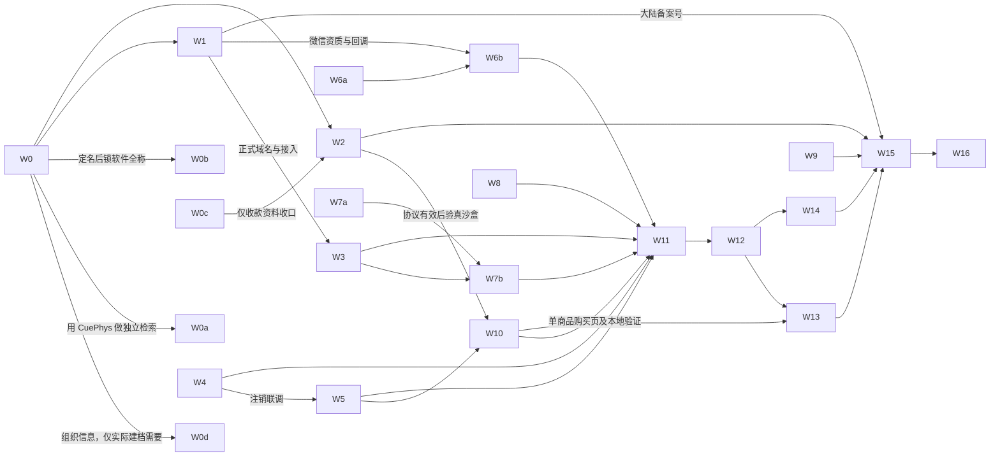

# 问题集合 v65｜CuePhys iOS 首发实施方案

**本文件是本轮需求真源。** 2026-11-10，v65.9，方案已开始执行，11 月 10 日更新第一批实查结果。CuePhys 尚未上线，适用范围为准备在中国大陆提供联网服务并上架 iPhone 和 iPad 的首版。按仓库 [issue-collection-restructure](.cursor/skills/issue-collection-restructure/SKILL.md) 拆批。

**配套记录**：[首发执行台账](tasks/LAUNCH-READINESS-20261109.md)保存 01–25 的实际状态、完成证据、外部回执和下一步。本方案保存范围、依赖和验收方法。每次接手先读台账最后的执行记录；看到回执、失败结果或你的新决定，以最新记录为起点。材料可在本周启动，正式备案、微信资质、Apple 协议及审核的完成日均待回执。

**本周品牌与主体办理入口**：[商标注册（台账 21）](#商标注册)、[软件著作权与权属（22）](#软件著作权与权属)、[对公开户与财税启用（23）](#对公开户与财税启用)。你已确定正式名称和拟申请文字标为 **CuePhys**。名称已定，商标可用性、商店名称占用及备案受理待核。

## 一、已定范围和待决定事项

| 已定事项 | 执行口径 |
|---|---|
| 产品名与说明 | App 桌面显示名、App Store 名称、商标文字、备案拟报名及微信开放平台拟用名统一为 **CuePhys**。引导页欢迎标题、介绍页页眉可写 **CuePhys：台球训练**；“台球训练”为描述，不并入正式名。此前中文候选的检索只留历史。 |
| 公司主体 | 你确认公司全称为 **无锡有球科技有限公司**。商标申请人、备案主办者和法律页运营方按此名称备料；Apple 卖方、D‑U‑N‑S 和银行账户分别以后台核验。 |
| 3D 球桌品牌 | 你要求参考 ShootersPool，在 3D 球桌上考虑加入 **CuePhys** 字标。2D 球桌不加入。本轮先记方案，位置、尺寸、颜色和最终效果待看样。 |
| 执行人只有你和我 | 我准备材料、写代码、验证、记进度。你确认产品和主体，处理本人实名、账号持有人签署、实际账户操作及最终放行。对外等待事项写由谁跟进和下次日期。 |
| 登录与游客 | 首发做微信登录和通过 Apple 登录，两种身份可绑定到同一个 CuePhys 账号，保留游客在本地练习。首版不做手机号登录，包括短信验证码及手机号＋密码注册登录。登录已列入本次统一方案，实施留待后续。 |
| 声音 | 沿用当前声音，音频商用核查、补录、替换事项已关闭。休息计时的后台运行方式单列，保留用户听到的现有提示音。其他随包或宣传素材继续盘点。 |
| 大陆联网首发 | 账号及云同步决定按 App 备案路径办理。分别核 App 和网站记录；属地服务类目、是否涉及经营许可或前置文件以实际书面回复为准。[办理依据与咨询稿](tasks/LAUNCH-READINESS-20261109.md) |
| 收费与产品范围 | 首发只售一次性购买的永久会员（非消耗型 IAP），中国区售价待你确认。月付、年付不列入首发商品或送审。防守求解、一库翻袋样课已明确放到上线后。[延期决定](tasks/DEFER-DEFENSE-BANK-LESSON-20261103.md) |
| 记录方式 | 取得一项结果就回填，尤其区分材料备齐、已送件、已受理、已获号、已提审和已发布。本周目标是推进可控工作，11 月 13 日据实判断能达到哪一步。 |

**到具体批次时再拍板的事**

1. **W0–W1**：CuePhys 的商店名称可用性、首发地区、个人／组织账号路线和正式域名。拿品牌检索记录、域名实名、已有备案与 Apple 账号状态给你判断，避免带旧名或未核准域名送件。
2. **W5–W6**：双渠道绑定已确定。11/10 已决定：若两个账号各自已有训练记录，首发保留双方账号及各自记录，提示绑定冲突。
3. **W2、W10**：永久会员售价、权益说明及是否申请小型企业计划。后台真实数据尚待你核，不沿用旧文档的示例价格或试用承诺。
4. **W7、W15**：未成年人场景、客服与数据保留期、审核员如何访问账号功能。由我列实际数据流、生产能力和可行选项，你确认对外承诺。

## 二、批次表与依赖

量级 S 为材料或窄范围复核，M 为一次可独立验收的实现／联调，L 为分成两个明确会话的工作。每个会话收一份结果；等外部回执时先登记“等待”，切到不依赖它的批次。批次号表示工作归属，允许按依赖交错进行。

| 批次 | 台账编号 | 内容 | 量级 | 开工或收口前置 | 本批交付 |
|---|---|---|---|---|---|
| W0 | 01、02、04 | 定名、卖方、地区与账号身份 | S | 可先核现状 | 你确认的身份与地区表，外部未知项有查询入口 |
| W0a | 21 | 商标注册：CuePhys 近似检索、核项目、申请及后续跟踪 | M | 检索现在可开始；你确认 CuePhys 检索结论及申请包后送件 | 分别记录检索结论、提交回执、受理通知、核准结果 |
| W0b | 22 | 软件著作权与权属材料 | S | 11/10 决定首发上线后再启动；届时锁软件全称、版本、权利人 | 申请材料、回执和后续证书状态 |
| W0c | 23 | 对公户、税务启用与续期清单 | S | 执照已到，先查已办项目 | 银行／税务办理状态及下一办理日期 |
| W0d | 24 | Android 名称和包名占位可行性 | S | 公开规则可先查；建档需你决定渠道、组织主体和包名 | 按渠道区分规则、草稿、登记成功与未确认；独立于 iOS 放行 |
| W1 | 03、20 | App／网站备案和微信资质 | M | W0 可准备，定名／主体后送件 | 两套独立材料、各自回执及补件清单 |
| W2 | 02、05、08 | Apple 协议、银行税务、商品目录 | S | 可立即查；变更须按实际主体 | 商务状态、永久会员商品 ID、实际价目及送审资料 |
| W3 | 09 | 生产配置与 HTTPS | M | 本地可开工，公网验证待域名与接入条件 | 生产配置拒绝错误输入，候选真实请求有据 |
| W4 | 08、09 | 注销、旧令牌、删除失败重试 | M | 隔离库即可开工 | 注销后拒绝写入、真实隔离库零新增 |
| W5 | 20、08 | Apple 登录与 Apple 授权撤销 | M | 本地验证已过；待公司会籍、正式标识、登录密钥及 HTTPS 后真机联调 | 新老账号和失败恢复用例、真机记录 |
| W6a／W6b | 20 | 微信服务端身份／iOS 回调与账号隔离 | L | W6a 按双渠道绑定规则设计；W6b 实调需 W1 微信凭据与可用域名 | 分两次收服务端测试和真机登录凭据 |
| W7a／W7b | 06、07 | 隐私数据流及公开三页／客户端告知 | L | 草稿先行，上线需正式域名、主体和业务数据 | 权利请求路径、三个 URL、拒绝及撤回实测 |
| W8 | 18 | 休息计时、锁屏与通知 | M | 可独立进行 | 倒计时和 Live Activity 真机结果 |
| W9 | 10 | 备份和恢复演练 | M | 隔离恢复环境、可核实的备份与保留期 | 还原记录、时间、删除数据处理证据 |
| W10 | 05、08 | 永久会员购买、恢复、退款撤销与账号隔离 | M | 本地先跑；沙盒需 W2、可用登录及测试账号 | 永久会员的交易环境与结果，失败可定位 |
| W11 | 11 | 生成分发候选包 | M | 首发功能集成、环境和证书齐全 | 绑定提交号、build、资源版本的签名归档 |
| W12 | 12 | 上传并安装内部 TestFlight | S | W11、ASC 账号可用 | 上传回执、处理完成、实际安装 build |
| W13 | 13、07、08、18、20 | 同一候选包的真机主链验收 | M | W12；两登录、交易、线上服务可用 | 设备矩阵和缺陷复验结果 |
| W14 | 14、15、19、25 | 双设备素材、审核访问与商店表单 | M | 素材盘点／文案可先；最终截图和访问用 W12 候选 | 两套截图、资料表、独立设备审核走查 |
| W15 | 03、05、08、14、15、16 | 提审、审核反馈与手动发布 | M | W1 获号及适用文件、W2/W7/W9/W10/W13/W14 的发布凭据 | 明确提审决定、回执、审核结果与放行记录 |
| W16 | 16、17 | 首日运行、客服、地域义务和经营跟进 | S | 预案先写；实际观测随上线开始 | 首日记录、异常处置、后续责任和日期 |

图中的 W1 有几个分别到达的结果。域名可用时即可验证法律页；微信资质到位即可验证微信回调；大陆正式提审另等备案号。W10 可先用本地与沙盒调试包验证，最终结果由 W13 在实际候选包上重验。W9 可独立开工。

**工程排期修正。** W4 与 W5 共用身份和撤销链路，应先修旧令牌，再联调；W6a 可提前做接口和隔离用例，W6b 的真实微信回调须等应用资质、签名和可访问域名。W2 后台现状核查与 W0c 开户同时启动；W10 的单商品页面、本地 StoreKit 测试先于 W11 冻结，真实交易可在 W12 后用候选包复验。W9 的保留期与恢复结果必须在 W7 对外承诺定稿前对齐。W14 文案、非音频素材、审核员路线先准备，正式截图最后拍。商标注册证、软著证书、小型企业优惠和 W0d 均不列为 iOS 提审的统一前置；若具体渠道提出额外要求，按回执更新。

## 三、各批执行卡

### W0–W2｜先把外部事实拿齐

**W0　主体、品牌、地区。** 我把已有执照、商标检索、Bundle ID、App 记录和拟用域名整理成一页，仅在项目存脱敏引用。你核对公户、域名持有人、Apple 会员类型、Team 和卖方，核 CuePhys 的商店名称可用性并确定地区；Apple 事项先启动现有个人会籍转组织，核创始人资格和公司邓白氏编号，再按 Apple 回执核原 Team、App 和永久会员商品。商标申报同期推进。交付字段为“已确认值／依据／未决事项／谁跟进／日期”。商标、软著、组织转换各记自己的状态，按实际依赖安排。[主体办理资料](docs/research/20260810-公司注册执行分工清单.md)

**W0 的技术标识检查**：现有 iOS 主包为 `com.xinkuan.qiuji`，Live Activity、签名、Apple 登录的服务端 audience 及永久会员商品也涉及旧前缀。先在现有 ASC 记录查是否上传过任何 build（含 TestFlight），再定正式 iOS 路线：若从未上传，可在首次上传前注册并选择新的 Bundle ID，同步主 App、扩展、签名、登录和备案材料；若已经上传，现有记录的 Bundle ID 已锁定，先比较保留旧 ID 与另建 App 记录的成本。已保存的 IAP Product ID 无法改名，如要换前缀需新建永久会员商品并复验购买和恢复。新增 Android 包名采用公司确定的命名空间。技术前缀与法定卖方是不同字段。[Apple：Bundle ID](https://developer.apple.com/help/app-store-connect/reference/app-information/app-information) · [Apple：IAP Product ID](https://developer.apple.com/help/app-store-connect/reference/in-app-purchases-and-subscriptions/in-app-purchase-information)

### 商标注册

**W0a · 台账 21。** 商标拟由 **无锡有球科技有限公司** 申请。11 月 10 日已确定首批同期申报 **CuePhys** 英文字母文字标，第 9 类（可下载软件）、第 41 类（体育训练／教学）、第 42 类（相关软件服务）；第 28、35 类按实际器材或推广业务另议。图形标如需申报应另件。准确的保护项目要按实际业务从官方目录逐项核名。[类别与类似群底稿](docs/research/20260826-球迹商标类似群选择.md) · [国家知识产权局分类指引](https://www.cnipa.gov.cn/art/2023/12/29/art_66_189403.html)

| 步骤 | 我做什么 | 你做什么／收什么凭据 |
|---|---|---|
| ① 检索 CuePhys | 在 9／41／42 类对 CuePhys、CUEPHYS、Cue Phys、Cue-Phys 及近音、近形、组合要素做官方检索。逐条核标志、类似群、核定项目和状态。 | 如需本人登录，你取结果，我记查询日期、条件与在先申请号；由你确认风险和是否送件。旧中文检索不计为 CuePhys 检索结果。 |
| ② 核申请材料和预算 | 按 CuePhys 准备公司全称、执照信息、送达地址、联系人、文字图样及各类标准商品／服务项目。按第 9 类 0901、第 41 类 4101／4105、第 42 类 4220 等方向逐类核准拟选名称。 | 你核图样拼写、实际使用项目、申请人和预算。按接受电子发文的网申官费口径，一个文字标报三类、每类最多十项，基础官费为 810 元；按提交时通知核实金额。[官方收费答复](https://www.cnipa.gov.cn/jact/front/mailpubdetail.do?sysid=13&transactId=507649) |
| ③ 送件与缴费 | 我准备申请表预览并逐字核图样、类别、标准项目和送达地址；逐类建状态行。 | 你以公司身份核验、提交，按通知缴费。分别留提交日期、申请号或回执、缴费凭据与正式受理通知。对公号与账号证件仅留受控位置。[官方办理入口说明](https://www.cnipa.gov.cn/jact/front/mailpubdetail.do?sysid=13&transactId=329644) |
| ④ 跟踪至结案 | 我按申请号记录补正、审查意见、初审公告、异议／驳回或核准，逐件记通知日期、届满日与下一步；跨年度按届时有效规则与通知核期限。 | 你查官方送达并决定如何答复；获准后核电子证书、核定项目和续展日，归集实际使用材料。只有获准的类别和项目写“已注册”。[项目操作手册](docs/research/20260826-商标申请逐步操作手册.md) · [官方流程答复](https://www.cnipa.gov.cn/jact/front/mailpubdetail.do?sysid=13&transactId=331322) |

**排期**：CuePhys 是既定名称，本周把该文字标的独立近似检索与申报底稿交给你；并行准备备案和商店材料。若外部平台不接受该名称或检索发现实质障碍，保留书面凭据再由你决定处理方式。本轮未查得 CuePhys 商标注册、App Store Connect 改名或备案获准凭据。

### 软件著作权与权属

**W0b · 台账 22。** 11/10 决定先留底稿，上线后再办理。届时我核软件全称、简称、版本、开发完成时间、拟登记权利人和已有材料；若开发早于公司成立，单列个人与公司间的权属依据，避免直接认定公司已取得权利。准备申报表草稿、程序及说明书鉴别材料、截图；检查版本一致，移除凭据和真实用户数据。你核实权利事实、签署并决定提交时间；我分开登记材料齐备、提交回执、补正、证书。与商标注册分别跟踪，首发排期按实际渠道所需材料判断。[原知识产权方案](docs/research/20260810-商业化主体与知识产权方案.md)

### 对公开户与财税启用

**W0c · 台账 23。** 执照已取得。你核刻章、银行开户面签、税务实名、税种核定、开票权限和银税协议各项实际状态；我整理每项办理入口、是否适用及待补材料，向 W2 提供可用的收款主体资料。注册资本实缴按章程／实际期限留凭据；你确认申报和年报日历，我记下次动作。银行账户、域名实名和云资源实名分别核，不用一个回执代替三项。[原公司办理清单](docs/research/20260810-公司注册执行分工清单.md)

### Android 占位（可选）

**W0d · 台账 24。** 我先盘清“品牌词、Android application ID、渠道展示名”三个对象。商标由 W0a 负责。新增包名不沿用旧前缀。以公司长期控制的域名或统一命名空间拟 Android 包名，归属与可用性待核。正式包名、签名密钥保管及是否开通渠道账号由你决定。每个渠道单列后台记录号、包名、可用状态、保留期限及官方答复；安卓开发和发布另排。

- **华为 AppGallery Connect**：可先创建项目，填应用名称、包名、分类和语言，拿到 App ID。官方示例把建档放在创建 Android 工程之前。可登记为“华为已有草稿”；名称是否具有排他性、草稿能留多久，另取后台提示或工单。[华为官方指南](https://developer.huawei.com/consumer/cn/codelab/AGCPreparation/index.html)
- **小米及其他国内渠道**：小米有同名限制和商标权申诉流程；不能从这条规则推导出“无 APK 可保留名称”。我查同名和预留政策，你需要时发工单；OPPO、vivo、应用宝同样分别取证。拿不到明确保留凭据就记“未确认”。[小米官方规则](https://dev.mi.com/xiaomihyperos/documentation/detail?pId=2167)
- **Google（若计划分发）**：Play Console 有新应用包名登记路径；只做 Play 以外分发时也可评估 Android Developer Console。后者登记流程涉及包名和签名证书 SHA-256，已有包名还可能要求上传签名 APK 证明控制权。以实际后台显示 Registered 为凭据；这仅完成 Google 体系的包名登记。[Play Console 指南](https://developer.android.com/developer-verification/guides/google-play-console) · [Android Developer Console 指南](https://developer.android.com/developer-verification/guides/android-developer-console)

**W1　备案与微信申请。** 我按实际功能准备教学、交互式击球、付费及云同步说明，列主办者、域名文件、图标、Bundle ID、公钥及 iOS 证书 SHA-1；以腾讯云预核结果选用域名，旧 `qiuji.app` 保留为待核历史配置。你做实名、提交和补件。网站、App、微信开放平台移动应用各留申请号和答复。获 App 备案号后核简中元数据、ASC 填写及 App 显著位置查询链接。微信另核 AppID、平台审核、Universal Links 域名和 AASA 实际可达；私钥、AppSecret 留受控位置。若平台要求补商店或测试资料，我准备对应材料，你回填平台实际要求。**验收分两段**：本周能交材料或工单；完成上线前置要有获号和微信回调可用的凭据。[H-05、H-13、H-19](tasks/HUMAN-REQUIRED.md)

**W2　收款和商品。** 你读取最新商务状态并处理持有人协议、法律实体、银行及税务；我对照历史审计与源码中的非消耗型商品 `com.xinkuan.qiuji.premium.lifetime`，核本地化名称、中国区价格、可售范围、审核截图及随首版提交的位置。月度与年度商品保留历史记录，首发只选永久会员。记录“目录齐／协议有效／实机能取价／沙盒成交”四个独立结果。未生效时先备齐商品与审核资料，给 W10 留具体阻塞。优惠资格、税费和结算以账户及报表为准。[既有审计](tasks/PRO-ENTITLEMENT-EXECUTION-20261017.md)

### W3–W7｜生产服务、身份和用户数据

**W3　配置边界。** 我先查归档读取的 API 地址、两个法律 URL、ATS 旧 IP 例外及后端 JWT 默认值。分别构造空地址、非 HTTPS 地址、缺生产密钥和有效配置，验证错误输入可观察且生产不会发出明文认证请求；同步核依赖、登录限速、日志脱敏和证书期限。实际域名可用后，用无真实用户数据的探针验证 TLS 与目标路径。证据分源码、归档 Info.plist、真实请求三层；缺公网条件时只完成本地部分。

11/10 已完成本地配置验收，当前 Release 私有配置里的 HTTP 地址已被构建拦截。正式域名与现服待核，见[实测与部署前检查](tasks/launch-20261110/生产配置验证.md)。

**W4　注销和账户失效。** 我先在隔离数据库重建台账的缺陷基线。账号 A 有训练、角度、球形和头像，保留已登录设备的 access／refresh token；删除前、删除中、删除后分别尝试单条和批量写、刷新及跨账号读取。改共享鉴权、删除标记和清理顺序，使迟到写入不能重新制造已删账号的数据；对已开始的写操作也验证与删除的竞态。注入头像或数据库清理失败，重试后清理一致，并保持账号 B 可用。**验收**：每个旧凭据被拒绝，直接读库确认 A 无新增、B 数据原样；记录实际并发次序、响应及重试结果。已有 HTTP 201 证据是存储替身复现，真实隔离库结果另记。[注销代码](backend/src/services/accountDeletion.js) · [现有删除测试](backend/test/accountDeletion.test.js)

**W5　Apple 登录与撤销。** 我核候选签名的 Apple entitlement、后端 audience、生产 HTTPS，以及授权窗口回调中的主线程同步风险；再设计授权码交换、凭据保管、撤销失败重试和旧账号重新授权路径，与 W4 联调。你在真机完成首次授权、隐藏邮箱、取消重试、冷启、退出重登和注销；我核服务端记录与账号归属。单次错误不会生成第二个账号，撤销路径有脱敏响应；说明账号删除及永久购买恢复的处理方式。过往签名、模拟器或资料接口结果记作已有证据；本批登记本次 build 的真实授权。[历史登录故障](tasks/FAILURE-LOG.md) · [候选包依赖](tasks/LAUNCH-READINESS-20261109.md)

**W6a　CuePhys 账号与登录身份。** 采用一个稳定的 CuePhys 用户 ID，微信和 Apple 各自经验证的身份可共同指向该 ID。保留老 Apple 用户现有 ID 及训练数据归属。第一次用某个新身份进入时，给已有用户“绑定已有CuePhys 账号”的路径；已登录用户也可在账号设置中主动添加第二种登录方式。绑定时验证当前账号归属和新渠道授权；同一渠道身份只能属于一个CuePhys 账号。昵称、头像、邮箱（含 Apple 隐藏邮箱）均不用于自动配对。用数据库唯一约束及原子绑定处理重试和并发。目标身份已属于别的CuePhys 账号时，提示冲突，保留双方数据。**验收**：微信先注册／Apple 后绑定及相反顺序都可走通；退出后任一方式返回同一用户 ID、同一训练记录和球形，Pro 状态仍按既有交易归属核验。取消绑定、重复回调和并发抢绑不产生多余账号或越权读写。[现有用户模型](backend/src/models/User.js) · [Apple 避免重复账号的说明](https://developer.apple.com/documentation/signinwithapple/authenticating-users-with-sign-in-with-apple)

11/10 W6a 双向绑定已通过本地服务端验收；两账号冲突保留数据，登录方式切换后记录可以继续读写。真实平台授权、客户端绑定和永久会员恢复待 W6b 真机验证。[验收记录](tasks/launch-20261110/双渠道账号绑定验证.md)

**W6b　微信 iOS 接入。** 我基于 W6a 接回调、登录页及退出流程；新增 SDK 时按项目规则登记依赖与 ADR，回写实际 SDK 数据流。你完成平台实名及设备上的微信授权。实测微信已安装／未安装、拒绝、回调中断与重试，Apple 登录和游客入口仍可达。两种登录分别走冷启、登出、游客记录迁移或拒绝；付费页发起登录后保留选择。平台凭据未到时先交本地接口合同与异常用例，真机回调仍记待验。

11/10 W6b 已接入 iOS 登录页与账号安全页，模拟器已验证账号绑定入口。正式微信移动应用配置、Apple 公司标识和 HTTPS 就绪后，按[验收记录](tasks/launch-20261110/双渠道账号绑定验证.md)完成真机授权及会员复验。

**W7a　数据流与对外页面。** 我从游客、已登录未开同步、主动开启同步三个状态列字段、接收方、目的与保存期，覆盖照片处理、头像、生日、球形、交互记录、购买、微信 SDK。你确认运营主体、数据地域、备份期限、未成年人处理和客服邮箱。我补齐隐私、条款、支持三页，保留版本和权利请求入口。匿名访问最终 HTTPS 域名三页返回正确正文；真实客服邮件能收能回复，登录／关于／会员购买页的法律链接点验。服务地址未定时先完成本地模板及配置校验。[现有法律模板](backend/public/README.md)

11/10 进度：支持页、隐私政策及永久会员条款已在本地匿名 HTTP 验证；三种使用状态已按源码核对。正式邮箱、公网、备份期限及微信 SDK 实际数据流待验。[上线台账](tasks/LAUNCH-READINESS-20261109.md)

**W7b　客户端隐私行为。** 我对照 W7a 检查首次启动、拒绝非必要处理、撤回、主动登录、云同步开关和相机／相册／通知首次申请；对照实际数据流更新权限文案、隐私清单与 ASC 填表稿。选游客并拒绝可选处理后仍能完成基础训练；云同步未开启时，用客户端请求和服务端读回核实边界。已有用户升级和两个账号切换各测一次。归档隐私报告、界面截图和脱敏网络结果随 build 登记。

11/10 14:03 游客与两账号同步的 10 个请求和数据库检查点通过，已复验拒绝、同意合并、撤回后新增记录及换号。权限、隐私报告和 ASC 标签留待下一步。[结果](tasks/launch-20261110/游客与云同步验证.md)

### W8–W10｜可独立推进的计时、恢复与购买

**W8　休息计时。** 代码已有 `restEndDate` 和 Live Activity，同时播放静音循环。我沿用截止时间恢复倒计时，梳理到点通知、跳过、加时、提前停止与返回前台；核后台 audio 是否仍有其他真实用途后再调整声明。保留当前可听音效及用户开关。自动化验证到点只结束一次、加时重排、取消无残留；真机验锁屏、通知拒绝、系统打断和前后台切换。记录完成时间、界面及提示次数，未取得真机证据时保留待验。

11/10 已沿用原截止时间与实时活动，替换静音保活，实测系统通知到达后返回训练。自动化 86 项通过；物理锁屏与听感待本人复核。[历史与实测](tasks/launch-20261110/组间休息计时验证.md)

**W9　备份恢复。** 已有单节点 Mongo 副本集与冷备份。我核备份对象、异机保留与最近成功时间，在隔离环境还原训练、球形、头像和删除状态，对照记录数及样本，测实际恢复耗时。覆盖删除后恢复旧备份的情形，避免把已注销用户重新开放；记录恢复点、最大数据缺口和故障联系步骤，再将实际保留期给 W7a。凭据为脱敏恢复报告，生产数据留受控环境。[生产部署记录](tasks/CUSTOM-FORMATION-DEPLOY-20261019.md)

11/10 先复现旧快照恢复已删账号和凭据，再以独立注销记录、独立检查点及启动前补删修复。本地三账号演练通过，现服 11:51 启用，Mac mini 11:53 还原真实加密备份并通过核验。随后已启用定期异机备份、及时注销证明、受管归档过期清理和双 Mac 告警；以定期归档再次恢复通过。历史手工归档、密钥恢复与业务容灾承诺仍待确认。[隔离演练及复验条件](tasks/launch-20261110/备份恢复验证.md)

**W10　永久会员与权益。** 我把正式购买页、可购商品目录、会员状态页及法律模板统一到永久会员：只提供一次性价格和恢复购买，移除月／年套餐选择、试用及自动续费话术。用本地 StoreKit 复验后，你用 Apple sandbox 验首次购买、取消／待处理、重启与重装恢复、退款撤销、断网冷启及CuePhys 账号切换。绑定微信与 Apple 后回到同一 CuePhys 账号，核对会员状态及训练数据；不同账号之间仍按现有交易归属验隔离。每例记商品 ID、交易环境、预期／实测权益及恢复结果。协议未生效时保留 W2 阻塞。[Pro 验收计划](tasks/test-plans/TP-PRO-20261017.md)

11/10 已确定购买权益归购买时所登录的 CuePhys 账号。微信和 Apple 绑定同一账号可恢复；不同 CuePhys 账号即便共用同一 App Store 账号也不能领用。未标记归属的旧交易需核对。[实现与测试记录](tasks/launch-20261110/永久会员本地验证.md)

### W11–W16｜从候选包走到真实发布

**W11　分发归档。** 我冻结提交、资源版本及 build 号，跑全仓门禁、受影响回归和 Archive；逐条记录失败及是否影响候选。核宿主／Live Activity 扩展的签名、权限、版本，生产 API、法律 URL、测试解锁／深链、StoreKit 测试配置、隐私报告、加密申报、dSYM 和按设备拆分后的大小。检查正式题库、资源及两项延期内容。交付归档位置、构建日志、验证结果和候选清单。出现失败时派回所属批，修复后生成新 build，再绑定证据。

**W12　TestFlight。** 我准备实际上传路径、内测说明、测试账号和内部组；你完成需要持有人权限的操作。脚本的 upload 目标只打印说明，必须另取真实上传回执、处理完成状态及设备安装编号。外部邀请若启用，再走 Beta App Review。内部测试包与最终提审包若更换，记录二者差异并重验受影响路径。

**W13　候选包验收。** 我编写步骤并整理自动化，你完成需亲自授权、锁屏或体验的场景。记录设备、系统、build、账号类型、预期、实测和证据。小屏／最低支持系统检查基础路径，iPad 检查横竖和恢复；长时间 3D 练习记录温升或掉帧反馈。优先完成下表用例，失败回到所属批并保留原记录。

| 入口／情形 | 候选包通过条件 |
|---|---|
| 干净安装或老版本升级 → 游客 → 练习 → 保存 | 一次完整训练能保存并重开，升级前样本可读；拒绝可选处理后游客仍能练。 |
| 微信／Apple → 接受或拒绝游客迁移 → 重装 | 各自能恢复本账号应有记录；拒绝迁移的游客记录不会进入账号 B。 |
| 购买／恢复 → 弱网 → 冷启 → 切账号 | 界面与实际商品／权益一致，失败有重试路径，个人训练记录互不泄露。 |
| 注销 → 旧手机后台重试 → 再次注册 | 旧凭据无法读写，新身份没有旧账号私有数据；永久购买的恢复路径可找到。 |
| 拍照建球形／通知／休息 → 拒绝权限或锁屏 | 权限文案与用途一致；拒绝可返回；计时到点和加时行为与 W8 一致。 |
| iPad 横竖、动态字体、VoiceOver、较长连练 | 主要流程可完成；限制和未测设备单列。商店声明只采用已验证范围。 |

**W14　商店与审核访问。** 我先做非音频素材来源表、简中元数据、审核员操作稿及截图脚本。你确认 CuePhys 的商店可用性、类目、地域、邮箱、联系号码及审核访问方案。候选确定后用实际 iPhone 大屏和 13 英寸 iPad 截图，核年龄问卷、内容权利、隐私标签、支持页和永久会员专用审核图。审核员用独立设备按说明完成游客练习、账号、购买／恢复和注销；避免个人 Apple ID、过期凭据或开发专用解锁。交付的是可直接填表的资料和已验证的路径。[现有商店资产](tasks/appstore-assets.md)

**W14 · 3D 球桌字标（台账 25，待看样）。** ShootersPool 官方 Rasson OX 画面中，近端短边外侧板有 ShootersPool 字标；Victory II 的斜角画面也能看到桌身外侧的厂牌，台呢中央留给击球。借这个位置关系，建议先看一个版本：把 **CuePhys** 放在短边桌框朝外的竖直面，做成随桌面透视、受场景光照影响的单处字标。若常用镜头下短边被裁掉，再用同一球局比较长边外侧的位置。字体大小、材质和落点以实际画面决定；不把「CuePhys：台球训练」整句搬到球桌上。[ShootersPool 官方 OX 画面](https://storage.googleapis.com/shp-promo-europe/web-promo/img/gallery/shooterspool-rasson-ox.webp) · [Victory II 官方画面](https://storage.googleapis.com/shp-promo-europe/web-promo/img/brands/rasson-billiards/shooterspool-rasson-victory-01.webp)

后续制作样稿时，我用相同球局对照手机 3D 全桌、低位瞄准和切回 2D 的画面；检查颗星、袋口、瞄准线、球和击球操作，2D 及共用场景的俯视模式不显示字标。你看样后决定位置及是否用于首发。此次只记录方向，未改球桌模型、材质或代码。[共享桌体与换视角入口](QiuJi/Core/Scene/AngleTrainingScene.swift#L449) · [2D 相机模式](QiuJi/Core/Scene/AngleSceneView.swift#L1048)

**W15　提审与放行。** 我给你一页放行记录，逐项对齐 App 与 IAP 的地区、简中名、备案号、适用批文、法律 URL、签名 build、隐私问卷、商品、审核账号和回退路径；列出 W13 未过事项及影响。你决定提交和获批后的实际发布日期。我记录提交、处理中、补件／拒绝、重新送审、获批、商店可见各自的时间和依据。资料问题改表单并读回；二进制问题回所属批、升 build、重验再送。上架后从大陆商店页实际安装再走游客、登录和商品加载。

**W16　运行交接。** 首日我核崩溃与符号化、登录错误、付费恢复、同步和客服，按实际影响分析；你处理账户操作及是否暂停销售、发布修复版的决定。后端保留已验证的兼容版本；客户端修复走新 build，已安装用户须能继续使用自己的数据。你核属地公安联网备案等义务的适用性和起算日，我登记跟进日期、续期及恢复联系人。首周汇总首练、反馈、退款及投诉，使用与隐私说明相符的数据来源。[项目可观测约定](.kiro/steering/observability.md)

## 四、本周如何开工和续接

### 每个新子任务开始前先说明

每次开始新子任务，我先在对话里用日常语言向你说明，再动手。同一批次里切换到另一个子任务，也按这个约定执行。

- **要解决什么、为什么现在做。** 从你或用户会遇到的具体情况讲起，交代上一步已经完成了什么，这一步还缺什么。
- **我准备怎么做。** 按顺序说明主要动作，点明涉及 App、现有服务器或第三方平台中的哪一处，以及用户会看到什么变化。
- **你什么时候需要参与。** 需要你操作时，写清在哪台设备或哪个后台、要做什么。可以由我独立完成时，直接告诉你这一步我来做。
- **怎样算完成。** 说清预期结果、怎么验证，以及你可以在哪里看到记录。执行中若发现要换目标，先解释原因和新任务，再继续。

例如，开始做 Apple 登录授权撤销前，我会先说明 CuePhys 已经能删除服务端账号，这一步要让 Apple 也收到撤销该 App 登录授权的请求。我负责接接口和验证失败重试；到真机验收时，你用测试账号登录、注销并再次授权，我核对撤销结果和重新注册后的训练记录。

| 日期 | 你 | 我 | 当天怎样记结果 |
|---|---|---|---|
| 11/9–10 | 核 ASC 名称、卖方／Team、已签协议、银行税务、已有备案和域名实名；向腾讯云、微信开放平台查未上线 App 的分类及所需材料 | 准备商标近似检索和申请底稿、备案／微信工单、永久会员商品核对表；固定 W4 失败样例 | 每个外部事项填“已办且有回执／可送件／缺什么、谁补、何时再查”。名字已选定，商标可用性仍待查。 |
| 11/11–12 | 有条件即递交备案和微信材料，处理持有人协议；确认永久会员价格；双账号冲突已定为保留双方 | 主做 W4，用真实隔离库验注销后的旧令牌和迟到写入；解决后接 W5。若外部平台要求测试链接，先确认可接受的材料与构建形式 | 记录工单或补件原因、数据库读回、测试通过或仍失败的用例。未到最终候选条件时，按需验证受限内部工程包。 |
| 11/13 | 逐项核外部回执，选下周最先需要你操作的一件事 | 汇总 W4/W5 结果、微信绑定接口和剩余工程量；对实际收到的材料重新估期 | 明确已完成、可继续内测、卡在哪条外部链，以及最早下次复核日。 |
| 11/14–15 | 有外部回复再补件，有可用 build 再配合真机 | 完成已开始批次；准备 W6 服务端、W7 文本或 W8 中一项可独立交付的工作 | 保留测试结果和下一步；周末无需假定平台会审核。 |

**后续时间窗（两人排期的规划假设，按周滚动）**

| 窗口 | 预期投入与可验证产出 | 延迟时怎么办 |
|---|---|---|
| 11/16–22 | 优先完成 Apple 登录／注销与微信身份绑定的隔离测试；并行推进单商品页面、域名／法律页。你集中处理平台补件和一次真机授权。 | 微信凭据未到先做服务端和异常路径；早期内部 TestFlight 如有需要，可验证签名、上传和安装，只记录该包实际可走的路径。 |
| 11/23–29 | 若微信真机回调、生产 HTTPS、法律页、永久会员购买路径和高风险修复已就绪，制作 W11 完整候选，进 W12–W14。安排一个修复／重测轮次。 | 外部手续或身份链路仍阻塞就维持工程内测，平移候选日期；软著与 Android 建档继续旁路。 |
| 11/30 起逐周复核 | 当大陆 App 备案获号、适用材料齐、真实交易／恢复通过、同一候选完成真机主链及恢复演练、审核材料可用，才由你决定送审。 | 备案独立记“接入商预审／管局收到齐全准确材料／获号”。工信部办理口径为管局收到齐全准确材料后二十个工作日内，前置准备与补件另计。Apple 审核和可能的重新送审也另计。[工信部通知](https://www.miit.gov.cn/zwgk/zcwj/wjfb/tz/art/2023/art_920db564162e4312916a01bed6540ad8.html) |

每周用三条记录刷新判断：大陆备案与微信资质最新节点、Apple 商务及沙盒状态、工程候选通过和失败项。若微信要求未上线 App 提供 TestFlight 等证明，先取平台书面要求，另记一个内部工程 build 供核验；编号、权限及功能边界与正式候选分开。[Apple 内部测试流程](https://developer.apple.com/help/app-store-connect/test-a-beta-version/testflight-overview/)

**批次交接写法**：在台账追加“日期｜台账编号＋W批次｜你或我｜输入（commit/build/工单）｜动作和真实结果｜证据位置｜剩余项、负责人、下次日期”。例：W1 已提交，记录受理号并约下次查询；W4 只在隔离库通过，就把真机端到端留在 W13；W12 上传成功还要继续跟到处理完成和可安装。收到新的范围决定，先改本方案版本记录，再回填台账。

## 五、已核对的工程和办理锚点

核实日期为 **2026-11-09**。行号指本工作区当日版本；后续先用标识符重新定位。尚未取得的账号配置、凭据、公网站点和主管方答复，统一在台账标待核。

| 批次 | 已有入口（文件与行） | 当日观察及实施时应验证的边界 |
|---|---|---|
| W0/W1/W2 | [人工清单 H-05](tasks/HUMAN-REQUIRED.md#L62)、[H-13](tasks/HUMAN-REQUIRED.md#L304)、[H-19](tasks/HUMAN-REQUIRED.md#L455)、[ASC 历史审计](tasks/PRO-ENTITLEMENT-EXECUTION-20261017.md#L15) | 项目记录支持准备材料；实际会员、协议、收款及申报状态由你读后台。 |
| W3 | [Release URL 配置](Config/Release.xcconfig#L5)、[AppConfig.apiBaseURL](QiuJi/Core/Extensions/AppConfig.swift#L5)、[后端密钥默认值](backend/src/config/index.js#L5)、[ATS 例外](project.yml#L188) | 声明、注入和产物三者均要核；当前代码中能看到历史回退路径。 |
| W4 | [auth 中间件](backend/src/middleware/auth.js#L3)、[deleteAccountData](backend/src/services/accountDeletion.js#L22)、[训练单条写入](backend/src/routes/trainingSession.js#L26)、[批量写入](backend/src/routes/trainingSession.js#L43)、[refresh](backend/src/routes/auth.js#L57) | 共享鉴权、刷新、清库和实际写入共同决定旧凭据能否继续使用。 |
| W5 | [登录按钮](QiuJi/Features/Profile/Views/LoginView.swift#L143)、[Apple 客户端](QiuJi/Data/Services/AuthService.swift#L12)、[授权窗口](QiuJi/Data/Services/AuthService.swift#L108)、[服务端登录](backend/src/routes/auth.js#L11)、[签名配置](project.yml#L161) | 已传一次性授权码并移除窗口回调的同步派发。本地构建和隔离库通过。正式签名及真机授权待验。 |
| W6 | [当前渠道说明](QiuJi/Features/Profile/Views/LoginView.swift#L134)、[微信工程配置](project.yml#L196)、[现有 entitlement](QiuJi/QiuJi.entitlements#L5)、[已接登录迁移](QiuJi/Data/Services/AccountDataCoordinator.swift#L107) | 微信有配置占位，现有服务端已挂 Apple 路由。微信 SDK 回调、服务端换码及绑定入口待实施时定位／新增。 |
| W7 | [法律路由](backend/src/app.js#L36)、[发布配置校验](backend/src/services/legalDocuments.js#L22)、[隐私清单](QiuJi/PrivacyInfo.xcprivacy#L73)、[账号云同步选择](QiuJi/Data/Services/AuthState.swift#L154)、[权限配置与入口实测](tasks/launch-20261110/相机相册与通知权限验证.md) | 已有隐私与条款路由；支持页、正式配置、首次告知与撤回按真实入口验证。 |
| W8 | [开始休息](QiuJi/Features/Training/ViewModels/ActiveTrainingViewModel.swift#L954)、[到点处理](QiuJi/Features/Training/ViewModels/ActiveTrainingViewModel.swift#L988)、[静音循环](QiuJi/Core/LiveActivity/RestTimerLiveActivityManager.swift#L76) | 可复用已有截止时间和 Live Activity；现有倒计时提示与后台保活是两处行为。 |
| W9/W10 | [生产事务与恢复前提](backend/CUSTOM-FORMATION-SYNC.md#L5)、[现有购买入口](QiuJi/Features/Profile/Views/SubscriptionView.swift#L443)、[Pro 测试计划](tasks/test-plans/TP-PRO-20261017.md) | 生产副本集与真实沙盒是不同环境，各用自己的验收凭据。 |
| W11/W12 | [verify-gate](scripts/Makefile#L366)、[archive](scripts/Makefile#L418)、[export](scripts/Makefile#L436)、[upload](scripts/Makefile#L463)、[StoreKit 本地配置](project.yml#L290) | 有构建入口；真实上传与 ASC 处理状态仍须另取。 |
| W13–W16 | [商店资产](tasks/appstore-assets.md)、[H-26 真实环境核验](tasks/HUMAN-REQUIRED.md#L126)、[可观测约定](.kiro/steering/observability.md)、[首发台账](tasks/LAUNCH-READINESS-20261109.md) | 最终实拍、客服渠道、审核员访问方式和候选安装证据待收。 |

## 六、旧清单逐组对照

| 原记录 | 本版承接与处理 |
|---|---|
| 9 月 §2.1–2.2 商标；§2.6 软著 | 21／W0a、22／W0b 独立登记，区分办理回执与最终证书。 |
| §2.3–2.5 对公、域名与云实名、App／网站备案 | 23／W0c 核开办，03／W1 同时核注册商、域名和云购买主体、是否需过户、两种备案回执。 |
| §2.7–2.8 邓白氏与小型企业计划 | 02／W0 走组织路线时查 D-U-N-S；05／W2 由你定是否申请优惠，若申请则记录申请日、结果和到账核对。按永久会员收入建账。 |
| §2.9–2.11 公安备案、旧协作分工与微信 | 17／W16 追踪属地起算日及回执；旧稿涉及第三人协作的协议与分工由最新两人约定取代。20／W6 做微信及 Apple；手机号登录暂缓。 |
| §3.1–3.6 合规与 OTA；公司分工清单 C9 | 06／07／08／14 核法律页、永久会员条款（权益范围、一次性价格、恢复和退款）、首启隐私和宣传文案。W11 核首版内容实际取数路径；旧库更新归入未来开启 OTA 的前置，若候选包已连 OTA 则先校核数据版本。 |
| §4.1–4.12 资产与提交；§5 真机 | 11–15／18 覆盖候选包、内测、提审、真实用户流程；H-24、26–28 的跨日／时区、大字号、VoiceOver、OLED 低亮度和降低透明度逐项记已验或待验。 |
| §6 长期；公司清单 A3/A4、B5、§7 | 17／23 记账开票、申报、年报、适用的实缴及期限；17 跟域名、云资源和 Apple 会员续期；21 跟商标使用、通知和续展。首次公开版本是否已办相关事项以票据／回执为准。 |

对照来源：[9 月上线总清单](docs/research/20260915-上线前事项总清单.md) · [8 月公司注册执行分工清单](docs/research/20260810-公司注册执行分工清单.md)。账号、支付、声音及两人分工沿用本轮已确认的决定。

## 七、版本记录

| 版本 | 日期 | 状态与变更 |
|---|---|---|
| v65.0 | 2026-11-09 | 首版方案。把台账 01–20 重组为 W0–W16；W6、W7 各拆两个会话。纳入微信＋Apple 登录、大陆备案、声音沿用、两人执行，以及内测／提审／发布的独立凭据。后续同主题高版本覆盖低版本，以台账续记实际进展。 |
| v65.1 | 2026-11-09 | 用户确认微信与 Apple 身份可绑定同一 CuePhys 账号；补齐两种绑定顺序和已有账号冲突验收。手机号＋密码注册仍是建议待定项。 |
| v65.2 | 2026-11-09 | 首版不做手机号登录（含验证码、手机号＋密码）；付费只售永久会员。同步收窄 W2、W10、W13、W14 的商品、验证与送审范围，价格待定。 |
| v65.3 | 2026-11-09 | 恢复商标注册的独立入口；补软著和对公／财税办理卡，增加旧清单覆盖对照。首发执行人仍为你和我。 |
| v65.4 | 2026-11-09 | 首次上线前确定正式名及拟申请文字标 CuePhys；说明性标题采用“CuePhys：台球训练”。原中文候选检索留作历史，CuePhys 须独立检索。 |
| v65.5 | 2026-11-09 | 调整两人排期，将本周检查点、内部工程包和完整发布候选分开；补 W10→W11 前置、分周重排规则和可选 Android 占位工作。 |
| v65.6 | 2026-11-09 | 公司全称确认为无锡有球科技有限公司；撤下旧前缀安卓候选，增加首次上传前 iOS 标识核对。 |
| v65.7 | 2026-11-09 | 新增仅限 3D 球桌的 CuePhys 字标看样项，纳入 ShootersPool 官方参考；落点暂定，未开始实施。 |
| v65.8 | 2026-11-10 | 新增每个子任务开始前的沟通约定，覆盖同一批次内的任务切换。 |
| v65.9 | 2026-11-10 | Apple 事项优先办现有个人会籍转组织。你决定公司会籍与正式 App 标识确定后再建登录密钥。W5 已本地验证，真实授权和部署待办。 |
