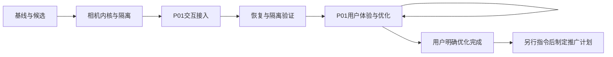

# v67 · 分离角与走位相机重构与持续优化方案

版本 **v67.9** · 2026-11-18（北京时间）

**本文件是本轮需求真源。状态：用户已于2026-11-17明确要求按v67开始执行，B0基线与首轮候选冻结已完成；B1/B2已写入正式P01，B3本轮定向恢复与隔离验证已闭环，原生时钟访问崩溃与恢复覆盖已修复；三尺寸触控及记录重放通过，B4首轮原生证据已交付，未验组合与真机体验仍单列。新相机只在「分离角与走位」正式练习入口接入、测试和优化；其他页面保持现有相机。用户明确表示优化完成并要求推广前，不启动推广。**

采用 [issue-collection-restructure](.cursor/skills/issue-collection-restructure/SKILL.md) 整理。v67不替代v66空间物理、v65上线或既有页面业务合同；本轮只接管该试点的新相机需求。现行页面真源见 [P01](tasks/table-page-adaptation/P01-SHOT-SIMULATION.md) 与 [既有36项审计](tasks/table-page-adaptation/P01-UNIFIED-AUDIT-20261021.md)。

## 1. 需求回显与授权范围

|编号|用户已确定的结论|本方案约束|
|---|---|---|
|R01|需要代码控制、可重放、平稳的运镜|输入事件、机位状态、路径与时间参数分离；同输入可重放|
|R02|镜头不能过远，球桌应更饱满；长库方向尤其要避免退远|v67.7 优先稳定，横滑保持水平距离；远近交给双指|
|R03|不再保留凹面作为强制运动轨道|新策略不以CameraSurface.travel同时驱动高度、距离、焦点、FOV；旧策略只作对照并继续服务其他页面|
|R04|区分观察构图和第三人称瞄准构图|全桌观察关注桌面关系；沿杆瞄准以母球为偏下视觉锚点|
|R05|自由转向时相机跟随球杆，球杆位于画面中间|沿杆状态共用真实瞄准方向，加塞时以实际杆轴为准|
|R06|第一、第三人称的自由瞄准均跟杆|第三人称进袋横滑观察。第一人称横滑和方向尺均手动改向并进入自由模式|
|R07|第一人称横滑直接进入本杆自由瞄准|从当前实际杆向增量转动，球杆居中，松手保留新方向|
|R08|参考App现有第一、第三人称高度和距离|保留实际参数的测量基准；基础机位、避让修正和最终机位分列|
|R09|只用「分离角与走位」作测试页面|正式练习入口显式接入；同宿主其他入口默认旧策略|
|R10|等用户全部优化好后再推广|当前批次没有推广任务；验证通过不自动视为允许推广|
|R11|前期先形成方案；2026-11-17已明确开始执行|允许按批次构建、测试和实施唯一试点；不扩展其他页面，不提交发布|

此前第三人称样片的整体观感获用户认可；第一人称与原生手势仍待体验。相机回到原角度不自动回到进袋模式，作为前轮已整理的连续交互规则保留。以下具体数值、松手回正及新增纵向观察行为属于**实施候选**，不能标成用户逐项已认可。

## 2. 现状、来源和隔离边界

### 2.1 当前实际实现

核查日期2026-11-17，核查时HEAD为 `5a21b7fdeff8a2e5d5b4dab66d63311e7f1b67e2`。另有未提交文档改动；实施时重新记录相关源码与资源哈希，不能仅凭HEAD认定同一输入。前轮只读分析、离线样片通过不代表当前App已验证。

|实际路径|已核实事实|本方案处理|
|---|---|---|
|CameraRig.configurePlayerCameraControls|daily配置开启surface/merged/simple/twoView；多个页面共用|增加请求／页面级显式策略选择，旧默认不变；不能直接全局替换daily=true|
|CameraSurface|默认水平距母球1.65m、台呢上方0.65m；母球约距顶部67%；近端0.90m，近端高度至少0.18m；远端高1.80m|借用尺度，不再借用整张运动曲面|
|CameraSurface.boundary|相对桌心的超椭圆主轴半径3.5m/2.5m；不是相对母球的固定距离|仅用于旧策略与历史记录重放|
|dailyPlayerPose第一人称|沿杆后退0.90m，杆轴上方0.13m；使用实际strike/elevation|作为第一人称基础姿态；不能把0.13m写成离台面高度|
|firstPersonEntry|检查击球点与母球部分轮廓的桌体遮挡，可抬高眼位，再拟合球和目标球／HUD；并非全场景遮挡证明|保留真实几何检查思路；避免每次方向更新都重做大幅自动取景|
|TwoViewCamera|已有过渡、观察记忆、上下文失效、固定眼点转头和曲面时间参数化|复用职责与已证不变量，轨迹求值不绑定旧凹面|
|PositionPlayViewModel.nudgeFreeAim|部分宿主手动改向进入temporaryFree，preferredAimMode仍可能为pocket|区分手动改向与自动无解回退；保护本杆手动意图|
|曲面输入／更新|surfacePan仅接第三人称；updateSimpleShot遇surface直接返回|B0已确认方向尺改向但眼位不跟随；B2已显式路由并在正式入口主流程验证|

**正式入口区别：** `MainTabView` 的 `.shotSimulation` 与 `.positionPlayComposer` 当前均创建 `PositionPlayComposerView`，后者使用 `FreePlayView(editorModel:editor:)`，内部entryMode为`.standard`，页面偏好为`.composer`。另一个 `ShotSimulationView` 才直开`.shotSimulation`。只用`isShotSimulation`判断会漏掉用户实际入口。

### 2.2 试点启用合同

- 由正式练习路由传入显式相机策略／试点身份，经Composer配置、FreePlay宿主、VM传到CameraRig。已实现`ShotCameraPolicy.p01Replayable`，其余消费者默认`.legacy`。
- 仅正式「分离角与走位」默认练习入口启用候选；同一入口内合法摆球、开球交付、进袋／自由与2D／3D往返保留该身份。
- 默认未传策略时沿旧路径。动作试打、导入盘面、个人／内置自定义球形、每日清台、自由击球、蛇彩、多球、教学／答题、扎杆与跳球及序列导出不自动接入。
- 不以显示标题、`.standard`、`.composer`偏好键、`usesDailyPerspective`或`usesAttackRecommendations`单独识别试点，它们被其他入口复用。
- 同名直接测试入口可在夹具中显式选择候选，但其通过不能替代正式入口验收。
- 新的机位记忆限定页面与策略版本；旧用户布局、球形和业务偏好不迁移、不重置。旧凹面留在旧消费者中，当前无删除计划。

### 2.3 已有样片证据

- [凹面／新方案对比](tasks/CAMERA-CASES-SURFACE-PREVIEW-20261117.md)、[桌形适应V3](tasks/CAMERA-ORBIT-V3-HYBRID-PREVIEW-20261117.md)。
- [第三人称抬高、拉近、切观察](tasks/CAMERA-THIRD-PERSON-AIM-PREVIEW-20261117.md)、[三种母球位置](tasks/CAMERA-THIRD-PERSON-POSITIONS-20261117.md)、[瞄准条跟随](tasks/CAMERA-FREE-FOLLOW-PREVIEW-20261117.md)。
- [第一人称与输入分离](tasks/CAMERA-FIRST-PERSON-INPUTS-20261117.md)：726姿态、8独立段＋4流程／对照片；与App接线和触控验收分开。
- 样片第三人称2.00m/0.70m、第一人称杆轴上方0.18m，38mm镜头约50.7°水平视野。当前第三人称默认水平视野64°；不能只比距离，忽略镜头、窗口比例和HUD。

## 3. 相机产品合同

### 3.1 三种构图，两个业务模式

业务层独立持有进袋／自由模式、实际aim、打点、抬杆角及球袋选择；相机层持有第一人称、第三人称、全桌观察构图，以及该构图内的观察偏移。全桌观察不是第三种击球模式；切视角不切业务模式。

- **第一人称瞄准**：以真实杆向为基准，站位接近杆后端，母球偏下；首次有效横滑从当前杆向进入自由瞄准，后续横滑沿杆取景。
- **第三人称瞄准**：沿杆后方观察，母球偏下；可抬高、拉近、绕台观察。观察期间不再强制杆轴居中。
- **全桌观察**：关注桌面关系，绕桌心保持固定半径；沿用实际桌框与安全可见区，不要求瞄准近景六袋全见。

母球是视觉锚点，不是所有情况下唯一的旋转中心。全桌观察围绕桌面；沿杆改向围绕本杆母球／实际杆轴重建站位。目标球观察只改变观看对象，不修改真实瞄准目标或解算方向。

### 3.2 输入矩阵

以下为本版候选实现合同；R06/R07为已确定语义，其余细节在B0与试点中检验。

|输入|第一人称|第三人称瞄准／局部观察|全桌观察|
|---|---|---|---|
|进袋模式左右滑球桌|进入本杆自由瞄准，球杆与镜头同转|绕母球竖轴等距观察，杆向／模式不变|绕桌心竖轴等距观察|
|自由模式左右滑球桌|增量修改真实杆向，杆轴居中，松手保留新方向|与第一人称一致|绕桌心竖轴等距观察|
|上下滑球桌|首轮保持现有不移动眼点的边界；上下转头作为单独候选，不擅自上线|独立调整眼高，水平距离原则上不变|独立调整眼高，不绑定退远|
|双指缩放|首轮不增加新行为；拉近需求需单独样片验证|沿当前水平观看方向拉近／退远，眼高原则上不变|改变圆轨道半径|
|滚动瞄准条|手动改向并进入自由；相机沿新杆向跟随|同左|建议恢复最近使用的瞄准视角并跟随；首次默认第三人称，标记为待体验候选|
|第一／第三人称按钮|切入指定沿杆构图，保留有效高度／距离偏好与真实aim|同左|同左|
|全桌观察按钮|进入／恢复全桌观察快照|同左|不改变aim／模式|
|显式回到沿杆|清观察偏移，保留本视角高度／距离|同左|回最近瞄准视角|

合法移球、球袋点选、控件拖动优先按页面权限仲裁。空白处横滑按上表处理，继续遵循已有拖球与2D台内瞄准合同。不新增重复工具条；沿用现有相机、方向和缩放入口。上下手势保持方向锁定的既有意图，具体正负方向沿旧操作实测冻结，不能混用“拖场景”与“转头”的符号。

**瞄准条规则：**首个有效非零改向输入才进入手动自由；按下未动不切模式。增量基于当前真实显示杆向，不退回母球—目标球中心连线。回到旧角度、松手或后台预览完成均不自动回进袋。显式进袋选择重新求解；下一杆按本页原偏好合同恢复，不把本杆手动自由误写成所有页面永久偏好。

第一人称横滑松手后保持新杆向。第三人称与全桌观察松手后保留当前观察角度。

重复点选当前目标球只播放选中反馈。第三人称横滑观察后点选其他球，从当前机位平滑转到新目标的有效杆向。击球后自动选球沿用这套转向，自由模式同时更新实际杆向。全桌观察保留当前机位。一、三人称切换时，母球的屏幕纵坐标在两端之间连续移动；全桌过渡逐渐将视线交给桌心。

### 3.3 基础机位与取景参数

坐标契约：SceneKit XZ水平、Y向上，单位米；高度统一相对运行场景`surfaceY`，不写死0.80世界Y。球心高度、实际strike高度和台呢高度分开；球半径与台面尺寸以现有代码真源为准。Blender XY/Z-up只用于离线适配，不混入生产算法。

|参数|首轮基准|比较／冻结方式|
|---|---|---|
|第一人称沿杆后退长度L|瞄准姿态下从击球支点到实际杆尾的轴向距离|由球杆网格与当前打点决定，水平投影为L·cos(e)|
|第一人称眼睛至杆轴竖直间距G|0.13m|0.18m样片作对照；最终值由同场景比较确定|
|第一人称基础眼高|strike.y−surfaceY＋L·sin(e)＋G|再加明确、可记录的遮挡修正，不能把修正吞进基础参数|
|第三人称水平距离D|1.65m|2.00m样片作对照；抬高时不自动改变D|
|第三人称台呢上方高度H|0.65m|0.70m样片作对照；缩放时不自动改变H|
|母球垂直锚区|第三人称65%–70%，第一人称约70%|按实际Scene视窗与HUD验，百分比从视窗顶部计；先按67%／70%取候选|
|水平构图|沿真实球杆轴居中|加塞侧偏时母球不强求X=50%，保证在下方可读区域|
|镜头|第三人称64°水平视野为App基准；第一人称沿当前dailyFOV基准|同窗口比较样片约50.7°；全程记录水平／垂直FOV，禁止混比较|
|全桌观察高度|1.80m基准|桌框／HUD／球可读性共同检查，非固定所有窗口最终值|
|水平观察距离|绕当前竖轴固定半径|第三人称绕母球，全桌绕桌心。全桌初始半径取室内完整圆的可用半径，进入时按 HUD 一次取景|

同一杆位下，第一人称基础眼高随实际杆尾的高度变化，避让抬升单独记录。首轮不把大抬杆或全角度观察都认定为已支持。

**独立控制原则：**第三人称抬高只改H，拉近只改D；横滑只改方位，水平半径、眼高、俯仰和视野固定。锚点由朝向解算维持。触及几何或视口限制时采用最小必要修正，记录原因；不能为满足全桌入镜而无限退远或拓宽镜头，也不能以此暗切第一／第三人称。

**取景优先级：**合法机位与有限姿态 → 操作意图和真实杆轴 → 当前母球／所需目标／HUD可读 → 舒适构图。近景允许裁切桌框；第一人称不能为消除所有遮挡无限抬到全桌高度后仍声称低位瞄准成立。无可行机位保留最近合法姿态并提供原有观察入口，原因进入诊断。

### 3.4 观察转入手动瞄准

- 观察期间保存独立的yaw／pitch偏移，不改aim。
- 瞄准条开始改向时，业务aim及时更新；相机从**当前实际可见姿态**进入回正过渡，不能先跳默认机位再播放动画。
- 回正尚未完成时允许球杆暂时不居中；到达沿杆状态后杆向与机位方位共用同一方向源，不能给相机yaw另加滞后造成杆偏中线。
- 连续方向输入更新目的状态，不每次新建0.18/0.95秒转镜并锁住控件；回正过程可被新观察操作接管。
- 本视角高度／距离／镜头偏好保留，只有显式复位或真实安全限制能改变。
- ±8°转头／±30°瞄准条只是现有样片测试范围，不是最终产品限幅。瞄准条允许跨±180°和多圈连续输入，角度路径保留用户旋转方向；模式切换采用最短路需与多圈输入区分。

## 4. 状态、轨迹与生命周期

### 4.1 职责划分（拟议，不预设新文件名）

1. **宿主适配**：页面身份、可用能力、权限、真实aim/strike/elevation、球形／杆代次和viewport/HUD。业务模式仍由VM管理。
2. **相机状态**：构图类型、操作所有权、各视角参数、观察偏移、当前可见pose与目标pose、独立快照；不复制规则或物理解。
3. **机位求值**：基础站位、固定半径、偏下锚点、最小几何修正，输出eye/orientation/FOV和诊断；以纯值输入输出便于离线对拍。
4. **运动控制**：直接手势、回正、视角切换、自动观察分别处理；CameraRig是相机节点唯一写入者，避免SceneKit action和显示循环同时写。
5. **重放记录**：schema／策略版本、场景几何标识、初态、viewport/HUD、时间戳输入、目标变化及验收采样；离线和原生共用相机参数求值，Blender只转换坐标与镜头。

### 4.2 平稳与可重放

- 过渡位置不能只做两眼点直线插值，需检查中途穿桌、穿墙和视线异常；用合法路径参数化，朝向／锚点沿路径求解。
- 时间策略参考当前按平移、转角与镜头变化安排速度的思路，新增路径不依赖凹面。具体速度／时长上限在B0冻结，不能把旧3.6m/s等值直接当已认可手感。
- 手动路径按真实时间和输入采样，30/60/120Hz及事件合并应得到容差内一致结果；静止不持续刷新，保持现有唤醒／休眠合同。
- 用户接管时从可见pose开始，旧过渡请求按代次失效；不得出现回旧目标的一帧。
- 相机重放是输入和轨迹重放，不声称物理求解、GPU逐像素或所有设备浮点完全一致。

### 4.3 状态转移与恢复

|事件|应保持／改变的内容|
|---|---|
|视角切换|保留进袋／自由、aim、打点、杆速、球袋选择；进入指定构图并保留该视角有效参数|
|仅调整杆速|不抢回观察视角、不触发默认构图|
|调整打点／抬杆|保留观察意图；第一人称必要眼高／杆轴更新与重新瞄准分开，不因普通刷新清空转头|
|进袋求解迟到|只消费匹配当前球形／杆代次与意图的结果；本杆手动自由不能被旧解覆盖|
|临时俯视|纯查看后恢复快照；编辑后使旧球位相关锚点失效，按当前有效意图恢复；不顺便改模式|
|正式2D↔3D|保留本页业务与有效相机快照；2D手势仍按原合同，不能套3D滑屏规则|
|出杆／球运动|冻结本杆站位参考，不把滚动母球当持续跟随中心；保留既有击球事件转观察语义并验证原生时序|
|新杆／重打|新杆使旧相机请求失效，按页面事件建立新上下文；重打恢复原杆数据和相机意图，不借机改全局偏好|
|上一杆回放|起点使用原杆视角，结束／取消恢复进入回放前现场；2D不强切3D|
|母球落袋／目标删除|旧锚点不可再用；按本页补球和合法选择结果重新建立，等待期间保持可用观察|
|旋转／窗口变化|保留模式和观察意图，按真实视口／HUD重算构图与命中，不套固定手机尺寸|
|后台／离页／重入|取消所属手势和旧请求；沿既有稳定盘面恢复，不新增永久相机存档需求|
|布局编辑／遮罩|沿现有权限冻结冲突输入，退出后恢复可见相机现场|

## 5. 页面规范与其他页面隔离

这是P01已有完整清单上的局部相机改造，不重新设计全页。以下只列受影响条款，其余沿 [P01现行审计](tasks/table-page-adaptation/P01-UNIFIED-AUDIT-20261021.md)。

|条款|判定|本轮要求／验证状态|
|---|---|---|
|TP01/03|继承|正式入口与页面身份已验证；标准/小屏横屏及iPad横竖/真实窗口定向通过|
|TP02/08/09|继承|标准手机主流程与四种近库位置已验；三尺寸独立原生投影/HUD审计通过|
|TP10/13/15|按业务调整|已实施；一三人称正式UI与100次连续业务改向集成通过，原生取消/斜拖完整排列未验|
|TP14/18|继承|已保留权限；标准手机四种2D摆位及实际3D拖球通过，未改推荐/求解算法|
|TP16|继承|标准手机严格眼点/朝向往返与2D原杆恢复集成通过；小屏菜单夹具返工后r15严格恢复通过|
|TP17|按业务调整|已实施；只有两条正式P01路由启用，四类旧消费者原生隔离通过|
|TP23|继承|继承既有显隐权限，主流程保留；独立显隐完整排列未验|
|TP25/26|继承|严格原杆方向/回放机位验证通过；后台Float末位比较修订后三尺寸完整恢复通过|
|TP27/28|继承|默认策略/页面偏好隔离已核，编辑入口取消旧过渡；完整编辑原生组合未验|
|TP29/30/31/35|继承|静止主流程/近库状态无持续渲染，恢复渲染身份检查已实现；真机性能和动态效果完整组合未验|

不将共享TP17全文改成新相机已推广。当前只在P01记录试点来源；用户优化认可后，推广仍需独立指令和消费者计划。

隔离证明必须同时包含：未传策略默认旧行为；正式P01拿到候选；相同FreePlay宿主的试打／自定义／每日保持旧策略；TeachingCameraHost与DrillSceneController不被共享配置误切；导出和静态资源没有隐式引用试点。不能仅以页面标题不同证明隔离。

## 6. 批次、依赖与完成标准

当前B0/B1/B2已完成，B3本轮定向验证闭环、B4首轮原生证据已交付；实施状态以[续接卡](tasks/table-page-adaptation/CAMERA-V67-STATUS.md)及真实证据为准。用户2026-11-17追加明确要求“一次全做完，不要停下来”，覆盖默认单会话单批节奏；本会话连续完成B1–B3和B4首轮可自动验证部分，每批独立验收回写，用户实际体验不虚报认可。B4为用户反馈驱动的可重复优化轮；若实际工作量超过单会话可完整验收的范围，按下列切分点拆小，不扩大消费者范围。

|批次|范围与主要锚点|量级|依赖|状态|
|---|---|---|---|---|
|B0 基线与候选冻结|正式P01入口、旧实际机位记录、同条件参数／动作对照、待体验选择|中：一次会话；已有视频复用，必要时补录|用户启动实施／验证|✅ 2026-11-17，见B0证据|
|B1 独立相机内核|页面级策略隔离、三构图纯值求解、独立H/D、桌形距离、连续路径与重放|中高：一次会话；必要时按求值／运动拆分|B0基准与候选确定|实施及定向验证完成；未验组合单列|
|B2 P01输入与模式接入|正式路由→Composer→FreePlay→VM→Rig，滑屏／瞄准条／按钮／特写与忙态|中高：一次会话|B1|实施及定向验证完成；未验组合单列|
|B3 恢复与隔离验证|2D／临时俯视／击球／重打回放／新杆／离页窗口，以及其他页面旧策略验证|中：一次会话|B2|实施及定向验证完成；未验组合单列|
|B4 原生体验与迭代|P01实测、用户反馈逐轮修正、同条件视频和未验账本|每轮一会话；没有预设自动结束轮数|B3；每轮依反馈复验影响项|首轮原生证据交付，用户体验未验|

### B0 完成标准

- 从正式练习入口进入P01，记录实际路由、策略、场景源、机位eye/orientation/FOV、真实aim/strike/elevation、HUD／viewport和原生基准录像；保留原始素材。
- 比较现有App基础尺度与前轮样片：固定球位、真实杆向、窗口及镜头条件，分别比较高度／距离和FOV，不能所有变量同时改变后归因。
- 冻结首轮候选参数范围、距离函数、转头限幅与方向、自动回正候选、观察中滚动瞄准条行为；未认可项标候选，不能冒充用户已拍板。
- 核已有测试类与scheme，记录实际可跑的定向基线和失败；不以历史日志作为本轮通过。
- 后续实际使用模拟器时遵循simulator-use与生命周期租约；本方案编写不启动模拟器。

B0验收结果与冻结参数见[基线报告](tasks/camera-v67/B0-BASELINE.md)：r6构建及8项测试通过，13状态球位／投影审计通过；原生录像89.873秒完整解码。具体范围、镜头上限、避让限额、输入符号和时间参数为工程候选；B0当时未接入，当前实施状态见续接卡，尚未获用户体验认可。

### B1 完成标准

- 新策略为显式选择，旧消费者默认不变；新轨迹求值不调用CameraSurface.travel来决定机位。
- 独立扫描高度／距离、四库／角袋、左右加塞和杆向跨缝，验证有限值、眼位合法、轴向、锚区与连续性；参数范围及容差先记录依据。
- 同一相机记录在30/60/120Hz重放进行采样对拍；中断与再次输入不回跳，静止无多余更新。
- 新策略定向单测及相关旧策略测试通过，App定向构建通过；构建成功不等同手势／观感通过。
- 若修改已有断言，逐条附原文、失效前提和替代合同；不能放宽旧策略测试以接受新策略差异。

### B2 完成标准

- 正式P01可达新相机，直接测试入口与正式入口分别标注；同宿主其余入口保持旧策略。
- 原生左右／上下／斜拖、短拖／反向／取消、球旁／空白起手、合法拖球与方向尺独立操作均按权限路由。
- 一三人称均证明：进袋横滑保持aim，自由横滑推动真实aim并沿杆跟随；有效方向尺改向进入手动自由；回到旧角度仍自由；当前杆向与机位跟随一致。
- 偏头／绕台观察→连续滚动瞄准条→再观察不跳变、不因每个增量转镜禁用控件；可在过渡中接管。
- 打点、杆速、球袋选取、轨迹、特写与出杆许可不被相机错误改写；最近有效输入与异步结果代次一致。
- 构建、定向逻辑测试和正式入口原生视频通过；首次默认盘面与自摆盘面分别验证。

### B3 完成标准

- §4.3事件矩阵逐项有结果；至少覆盖第一／第三人称×进袋／手动自由、正在观察／回正中、方向尺持触和击球阶段。
- 标准横屏手机、紧凑横屏手机、iPad横竖及窗口变化完成影响项；具体设备按fleet现状选择，不裸建专用设备池。
- 代表旧消费者原生复验：每日清台、动作试打、自定义球形、一个TeachingCameraHost页面；其他已枚举入口用策略选择／配置断言核旧默认。若共享文件改动影响更广，按实际风险补验。
- 不改物理参数、题目／成绩、账号偏好或其他页面布局；隔离失败在本批修复，不能记为推广工作。
- 所有检查分别列通过／失败／未验；失败基线与新回归分开。

### B4 每轮完成标准与停止条件

- 先记录用户原话与本轮调整项；相同球位／窗口／动作生成前后对照，保留参数版本。
- 仅修改反馈涉及的相机规则或参数，复验相关几何、手势、恢复与旧页隔离，不机械重跑无关全集。
- 每轮交付可操作P01与必要录像，明确功能、原生视觉、真机手感、用户认可四种状态。
- 第一人称接近感、第三人称饱满度、长库观察距离、回正、连续瞄准及各球位均由用户体验确认；模拟器／离线通过不替代真机手感。
- 用户未表示优化完成时，保持“试点优化中”；用户表示优化完成后标记“试点已认可，推广未启动”。绝不自动切其他页面默认。

## 7. 验收矩阵与证据

|维度|最低覆盖|
|---|---|
|球位|桌中、靠两侧长库、两端短库、四角袋附近；左右镜像；球面净距按真实半径标注|
|瞄准|真实进袋解、手动自由、空杆／无目标、目标不可直进、左右加塞、高低打点、普通及近库抬杆|
|方向|沿长轴、短轴、斜向；±180°跨缝、多圈输入；不能仅验现有±30°视频|
|动作|独立抬高、独立拉近、绕台、转头、切视角、偏头直接改向、过渡中断、正反向与持触松手|
|恢复|同杆切换、新杆、重打、回放结束／取消、临时俯视查看／编辑、2D往返、目标失效、窗口和后台|
|可见性|真实杆轴、母球下方锚区、必要目标／袋嘴、HUD、桌体／房间；中心射线可见不代表整球轮廓可见|
|性能|与同场景旧版比较输入延迟、呈现节奏、CPU/GPU和静止休眠；不无依据声称120FPS或无温升|
|隔离|正式P01候选；共享宿主非试点、教学、序列与导出保持原策略|

建议证据目录 `output/camera-v67/<batch-or-round>/`，实施续接卡 `tasks/table-page-adaptation/CAMERA-V67-STATUS.md` 在启动B0时创建。逐轮记录源码身份、环境、参数／输入记录、原生图／录像、测试输出、用户反馈与未验项。若测试写文件，应先检查所选测试的写盘行为并隔离导出；本方案不要求整个已有工作区零diff。

已存在测试可复用：`CameraSurfaceTests`、`TwoViewCameraTests`、`DailyAdaptivePanelUITests`、`S2_ShotPagesLayoutUITests`、`V52DailyClearanceUITests`，实际选择需按新旧策略和正式入口确认。

**旧断言迁移实例：** `CameraSurfaceTests.testS3ButtonTransitionStaysOnSurfaceAndTouchTakesVisiblePose`中的`XCTAssertEqual(camera.pose.transform, surface.pose.transform)`只证明旧曲面策略，保留在旧策略测试中；新策略不应沿凹面，另验路径合法、连续与接管。`TwoViewCameraTests.testFirstPersonHeadTurnKeepsEyeLensAndModeAndRejectsVerticalInput`中的`XCTAssertFalse(camera.vertical(delta: 100))`是旧第一人称边界，首轮保留；若以后选择上下转头，另以显式新策略建立“eye/lens/aim不变、pitch变化”的断言，不删除旧边界换绿。

## 8. 源码锚点索引

以下均于2026-11-17核对。行号为当时定位，执行时按符号复核；新增类型／文件尚未落地。消费者清单的接入调用已搜索核实，未声称所有页面本轮已原生运行。

|文件与行号|职责／核实内容|
|---|---|
|[MainTabView.swift:283](QiuJi/App/MainTabView.swift#L283)|正式shotSimulation／positionPlayComposer路由|
|[PositionPlayComposerView.swift:5](QiuJi/Features/PositionPlay/Views/PositionPlayComposerView.swift#L5)|编辑宿主配置；第60行创建FreePlay；第95行setupBoard|
|[FreePlayView.swift:212](QiuJi/Features/PositionPlay/Views/FreePlayView.swift#L212)|编辑宿主固定.standard；第39行偏好身份；第575行配置相机；第978行3D输入；第2401行瞄准条|
|[ShotSimulationView.swift:18](QiuJi/Features/AngleTraining/Views/ShotSimulationView.swift#L18)|同名直接测试入口，不能替代正式入口|
|[PositionPlayViewModel.swift:160](QiuJi/Features/PositionPlay/ViewModels/PositionPlayViewModel.swift#L160)|启用相机、观察、显式视角；第309行临时自由；第1504行手动改向；第2549行出杆事件转镜；第4054行ShotPlayCamera|
|[CameraRig.swift:74](QiuJi/Core/Scene/CameraRig.swift#L74)|共享策略入口；第650行第一人称基准；第855行杆姿更新；第931行视角入口；第1475行曲面输入；第2452行ShotReplayCamera|
|[CameraSurface.swift:35](QiuJi/Core/Scene/CameraSurface.swift#L35)|旧桌形边界、78行高度距离、225行最终构图|
|[TwoViewCamera.swift:851](QiuJi/Core/Scene/TwoViewCamera.swift#L851)|第一人称遮挡与取景；950行运动时钟；1032行曲面手势；1107行冻结更新；1346行第一人称入口；1472行普通手势|
|[AngleSceneView.swift:1745](QiuJi/Core/Scene/AngleSceneView.swift#L1745)|手势接管、曲面路由与主轴锁定；本轮新策略分支不得改变非试点|
|[AngleTrainingScene.swift:116](QiuJi/Core/Scene/AngleTrainingScene.swift#L116)|shot-aware共享配置；第1030行rig配置，不作试点识别条件|
|[TeachingTableHost.swift:72](QiuJi/Features/AngleTraining/ViewModels/TeachingTableHost.swift#L72)|共享教学相机及恢复；本轮保持旧策略|
|[DrillSceneView.swift:116](QiuJi/Core/Scene/DrillSceneView.swift#L116)|序列宿主共用配置；本轮保持旧策略与镜头时序|
|[CameraSurfaceTests.swift:769](QiuJiTests/CameraSurfaceTests.swift#L769)|旧曲面连续性与触摸接管断言|
|[TwoViewCameraTests.swift:109](QiuJiTests/TwoViewCameraTests.swift#L109)|第一人称固定眼位、镜头、模式与纵向输入边界|

其他已核实共享配置消费者包括：AngleDynamic、BankShot、DiamondSystem、SeparationAngleAtlas、CushionEnglishAtlas、SiluTrainer、PlanThree、PocketTolerance、AccuracyPractice、AimingQuiz、AimPointSceneTraining、SeparationPractice、TwoBallPractice、ThreeBallPractice、KickPractice、BankPractice、KBallPractice、DefensePractice和SpatialPractice。**这些是隔离影响面，不是本轮推广清单。**

## 9. 风险、候选与后续入口

- 第一人称贴库和大抬杆可能迫使眼高偏离低位感；先量化必要修正，不能用无限抬高掩盖无可行构图。
- 同时严格要求真实杆轴居中、母球X=50%和加塞几何会冲突；按§3.3以杆轴优先、母球锚区约束解决。
- 用户录屏反馈横滑中地面起伏。v67.7 取消方向相关半径，在多球位与完整一周中验证水平距离、眼高、俯仰和视野。
- 第一人称纵向观察、全桌观察中滚动方向尺、最终镜头与距离范围为体验候选；不影响本轮完整方案交付，B0／B4用可比较结果收敛。
- 正式P01与直接测试入口混淆、页面策略泄漏、迟到求解抢回杆向、每次输入重启转镜，均为实施重点风险；读码风险与实际复现分开。
- **唯一执行入口：B0已完成，B1/B2实施完成、B3本轮定向验证闭环，B4首轮证据已交付，后续按用户体验继续优化；仅正式P01显式启用，其他页面不接入、不推广。**

## 10. 版本记录

|版本|日期|变更原因与状态|
|---|---|---|
|v67.8|2026-11-18|仅正式分离角与走位：同球确认与观察中换球保留机位；显式切镜按母球／桌心约束途中构图；进袋横滑只观察，自由横滑沿真实杆向。记录同盘原生对照。|
|v67.9|2026-11-18|仅分离角与走位。第三人称慢横拖、升降与单笔反向在收到每个有效触点时按单轴位移更新。自由横滑收到位移时同步实际杆姿和镜头。用同机原生录屏、系统触点与绘制机位回执复核。|
|v67.7|2026-11-18|根据真机录屏反馈简化试点。第三人称绕母球竖轴、全桌绕桌心竖轴；固定半径，横竖滑动分别使用固定增益。全桌进入时按当前屏幕取景，不额外抬高。手感待复验。|
|v67.6|2026-11-18|三尺寸定向验收闭环，修复迟到求解/后台重复求解覆盖和记录容量边界；正式P01原生对照、恢复/近库/窗口证据交付，构建/门禁通过并收尾。未验事件保留，试点优化中，不推广。|
|v67.5|2026-11-17|实现三构图、输入分离、记录重放与P01隔离；完成标准手机主流程/近库/旧消费者验证，修复恢复覆盖。最终跨尺寸复验与原生对照交付结果见续接卡；未推广。|
|v67.3|2026-11-17|B0完成：正式P01旧相机13状态、8项测试、参数单变量对照及候选冻结；修复采集夹具FL-277并保留失败。新相机未接入，下一批B1；范围仍仅正式P01。|
|v67.2|2026-11-17|用户授权按v67执行，正式分离角与走位为唯一试点；启动B0原生基线与候选冻结，保留其他页面旧相机。|
|v67.1|2026-11-17|首次归并代码分析、离线样片和取消凹面强制轨道决定；写作期间纳入用户追加：正式「分离角与走位」为唯一试点，优化完成且另行要求后再推广。5批仅服务试点；App未改。|

同一v67中的后续高版本覆盖低版本；不跨范围覆盖其他问题集合。每轮反馈修改参数或行为须写原因、证据和版本，不覆盖原始对照素材。
