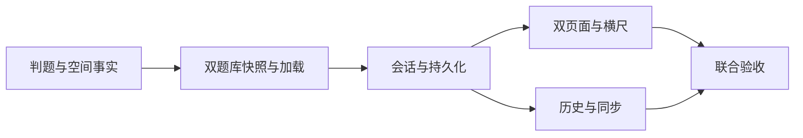

# v73 · 扎杆与跳球双答题模式建设方案

版本 **v73.6** · 2026-11-26（北京时间）

**本文件是本轮需求真源。** 状态：2026-11-26用户授权v73.6分两批，B1默认角度/三页观察手势/示范观察定向验证通过；B2技术判定与题库示范全量复核完成，最终53方法和双尺寸定向UI证据见[验收](tasks/spatial-v73/feedback-r3/RESULTS.md)。v73.3 B0–B5、v73.4/v73.5保留为各自旧合同证据。授权不含发布或改写在途研究。

工作包：[完整页面检查表与接线矩阵](tasks/table-page-adaptation/SPATIAL-QUIZ-CHECKLIST-20261126.md)。活动交接只维护本文§12。此前[需求补充](tasks/spatial-v66/QUESTION-REQUIREMENTS-20261126.md)作为讨论来源，冲突以本文和用户后续指令为准；v66继续负责原自由页，不把其历史“两个答题后续”当成本方案禁止范围。

## 1. 需求回显与范围

|ID|用户决定／原话|本方案落实|
|---|---|---|
|Q01|现在写完整方案，两个可以一起|一份方案、共用实现、每批同时覆盖扎杆与跳球|
|Q02|答题模式参考其他相关页面|准度为作答/首答/复练参考；翻袋等为设置与记录参考；空间自由页为物理、相机与抬杆参考|
|Q03|母球打到目标球，然后有一颗球吃库就算成功|合法碰目标后，母球或目标球发生有效吃库即可；不要求指定库序或次数|
|Q04|目标球直接进袋肯定算成功|合法碰目标后，目标球进入任一实际袋口也成功，无需再吃库；没有指定袋、错袋失败或必须进袋要求|
|Q05|障碍球用黑八，目标从全色/花色任意选一个|每题母球＋黑八＋一颗1–7或9–15号目标；目标身份抽取后冻结|
|Q06|抬杆默认采用截图样式，现有自由页也相同|回放右侧横向刻度条、下方角度文字；复用现有实现并验证三个入口默认状态，不把截图3°写成初始角度|
|Q07|看统一规范，近期修改可能未写入|TP01–TP36逐项判定，并核最新来源/源码；发现差异回填，不以旧正文覆盖最新决定|
|Q08|此前题库讨论：每球形一个障碍位置和一个解，不做扰动测试|两模式各自每基础球形保留一个合格候选；参考解不是唯一答案；不新增扰动成功率入库门槛|
|Q09|两个功能页要用扎杆与跳球的物理引擎|实际击球、参考复核和示范统一显式使用现有`.spatialPractice`，传入真实仰角与空间球位|
|Q10|示范出现时机参考其他页，几次击打仍解不到|沿翻袋/解球共用规则：本题成功一次或累计完成三杆有效提交后，在结果态解锁；三杆含首杆和复练|
|Q11|摄像机、渲染等担心未使用统一规范|明确共享代码与初始化配置，逐阶段检查真实调用/后置状态；遵守TP16/17/29/30，不新造镜头或渲染配方|

**本方案的具体设计默认（不是冒称用户已逐项拍板）**：在进阶区保留现有自由页，并列增加「扎杆练习」「跳球练习」；两者固定3D＋临时俯视只读；普通每轮15题、每项目每日15次免费有效首答，不限题练习使用现有Pro权益；结果态达到成功或三杆条件后可看参考示范；成绩与设置按项目隔离。此组默认用于形成完整可评审方案，整体评审若修订，只修改对应合同与批次。

本轮包括：题库导入、双模式设置/答题/反馈/复练/示范/总结、首答记录/恢复/现有同步、历史与本月概览接入、同款抬杆和跨尺寸验收。无新增SDK，无新支付产品，无重新构建物理引擎；不把自动选球、自由摆球、开球、连续清台、难度评分或正式2D模式加入答题页。

## 2. 已核实现与关键差异

核对日期2026-11-26；当前工作区`/Users/song/projects/13.billiard_trainer`，核对时`main`，HEAD `a08ff66cfc2a4b26a36ce136bda477d7adaabb5f`。工作区有本轮及其他会话文档修改，执行前重新核对，不覆盖/还原他人工作。

|当前资产|可复用内容|必须区别处理|
|---|---|---|
|AccuracyPracticeView / ViewModel / Record|设置入口、冻结输入、首答保存、重打与回放分离、末题总结|现有评分依赖指定袋，球号可能包含8，且依赖准度配置；不直接改名后照搬|
|SpatialPracticeView / ViewModel / Record|空间模拟、显式仰角、球杆可达性、相机、播放与姿态、横向抬杆控件|自由页有编辑、推荐下一球、飞台自动回收；答题不能继承这些收尾行为|
|BankPracticeSettings / Record / LocalBankPracticeRepository|完整竖屏Form、草稿取消、Pro模式、版本化压缩记录/续段|袋型/指定库数筛选与本页无关；普通轮题数与每日额度分别管理|
|ShotPrediction / ShotEvent / TrajectoryRecorder|真实碰球、碰库、进袋、停稳、空间接触和离域事实|自由模拟的objectPocketed表示任意非母球进袋，不能拿它判断指定目标成功；必须按本题角色映射识别|
|SpatialPracticeRecord.Shot|可回放的空间轨迹与原杆输入|未保存完整碰库/进袋事件序列，不能仅凭它或最高跳高完成新判题|
|TrainingSession / BackendSyncService|既有版本化payload传输、owner与同步队列|新kind必须注册历史/owner迁移/有效活动判断，不能走未知类型默认分支|

跳球来源已有8,146个研究合格解；扎杆使用全量任务的独立审核候选导出。正式入库数量以B1冻结清单为准，不复制持续变化的研究数字作为发布数量。全量搜索不必结束才开始开发。

**当前文档差异**：v66.8顶部与11月18日返工记录已有回放右侧横尺，正文旧竖条已同步；docs/05旧正式2D描述已纠正。TP来源表已纳入11月20–21日菜单、11月22日第一人称推进/重入复位、11月25日背景回退。新页继承这些现行规则，不声称本次已审完全App。

### 2.1 物理执行合同（Q09）

两个模式都使用现有「扎杆与跳球」自由页的空间物理链：`ShotPredictor.simulateFree(... simulationModel: .spatialPractice, elevation: frozen.radians, initialSpatialPositions: ...)`。这是同一空间模型支持两种杆法，模式不切换成两套互不一致的物理参数。

玩家首答/复练、正式题包参考复核、示范重新计算均显式选择该模型，使用相同几何、材料、球号角色映射与精确四输入；保留竖直运动、旋转、腾空/落台和桌外接触事实。现有`simulateFree`省略模型会落到`.appDefault`，当前是`.planarReference`，且非空间出杆分支把仰角归零，故禁止依赖默认值。不得因为套用准度/翻袋答题壳而沿用其平面模拟入口，也不得用`.spatialPockets`的局部袋口表现替代完整`.spatialPractice`。

回放消费保存的真实空间轨迹，不改用另一模型重算。示范若不能在当前空间模型重现，提示参考未能重现并允许继续练习，不回退旧引擎/平面模型。B0验证明确模型与仰角传递，B1/B5验证真实参考；本轮实现沿此合同，不改变全App物理默认值。

## 3. 判题合同

### 3.1 玩家成功条件

设首次合法母球—目标球接触为C。完整一杆的条件为：

`成功 = 模拟完整且事实有效 ∧ 已使用本题指定技术 ∧ 已合法碰目标 ∧ 无失败事件 ∧（C后目标球进任意袋 ∨ C后母球/目标球有效吃库）`

「C后」按物理事件的因果/时间组解释，不按动画帧、声音或球位接近库边推断。成功分支分别记录`targetPotted`、`cueCushionAfterContact`、`targetCushionAfterContact`，可同时成立。待整杆结算后给出最终结果，不能先显示成功后忽略母球落袋。

以下是本方案采用的失败与边界默认：

- 母球首次碰球必须是指定目标；先碰黑八或首次同时碰黑八与目标不能算合法首碰。
- 合法先碰目标后，母球或目标球再碰黑八不因碰撞本身失败；黑八进袋/飞台、母球落袋/飞台、目标球飞台仍失败。合法跳跃离开台呢不等于飞台；木边/地面接触、空间离域及离出台面须用原始物理证据区分，不能用自由页回收后的盘面洗掉失败。
- 母球首碰目标前先吃库，本练习不通过，提示“碰目标球前先吃库”。这是专项练习要求，不改动普通台球规则。
- 吃库指实际胶边接触；包含被几何明确归为胶边的袋口胶边，不把落台、木质库顶、桌体、地板、仅初始贴库静态支撑算吃库。不强行限定研究中的某一主库编号范围。
- 目标球预先贴库时，只有物理确认受击后发生有效冲击才计入，不用初始贴库状态计数。同时间目标碰球/碰库组须核对接触事实，不能以数组偶然排序决定正误；缺失因果证据时技术未确认，不能编造成功。
- 未碰目标、仅碰球后两球停在台面且没有有效吃库/进袋：失败。
- 未完整停稳、超出模拟预算、取消、损坏事件、无法识别的表面/角色：技术未确认，不记答错、不计成绩、不消耗有效首答额度；保留可诊断原因与原始输入。

玩家判题版本为spatial-quiz-v3。除共同结果外，跳球必须在首碰目标前实质腾空越过黑八；扎杆必须沿台面形成绕障弧线，且起点至本次接触位置的直线路径被黑八挡住。只按引擎物理区间判定，不按参考输入相似度或仰角贴标签；碰球后的转向/弹起不能充当证据。沿用研究1毫米的贴台/弯曲区分尺度，并要求直线遮挡/跳越投影有1毫米实质余量；数值求连续区间极值和水平最近点，禁用显示帧采样。缺少完整物理证据不计失败。参考解按玩家同一v3规则全量复核，拒绝项留审计且不再抽取；原v1入库证据与新增v3复核分列。旧首答按原版本冻结，旧规则活动记录不继续作答。不额外要求仰角等于示范，也不要求跳球必须先落台后碰目标。

### 3.2 判题事实与实现边界

新增共用纯判题器（拟名`SpatialQuizJudgement`），输入为完整空间模拟的角色映射、终止状态、事件及必要空间接触证据；输出版本化结果和具体原因。不能直接调用`AccuracyShotJudgement`，也不能使用`objectPocketed`作为目标身份判断。

B0核查`ShotEvent`对空间胶边事件的覆盖：与`TrajectoryRecorder.localStaticContacts`及几何表面角色对照，验证主库、袋口胶边、落台、木边、地面分离。已有输出不够时增加只读事实适配器；保留原事件ID/时间/表面来源并去重，不修改响应/恢复系数来迁就评分。

首碰使用现有`SpatialPracticeRecord.firstCueContact`同时间接触组思想，避免黑八与目标同时接触被遍历顺序误判。几何/时间容差须来自当前引擎与坐标合同，B0记录实际映射与依据，不另设拍脑袋常数。

### 3.3 反馈呈现

成功只显示「成功」；失败只显示主要原因，不追加「失败」或罗列全部条件。失败主原因优先严重犯规，再首碰、先吃库及技术要求，最后未完成；完整事实保留供诊断，不在桌边堆叠技术字段。技术异常显示“本次未能完成计算，请重试”，不加入成功率分母。

首答成绩固定；复练显示本次复练结果但不覆盖首答。总结仅题数、成功数、成功率、重新开始、完成；历史独立显示该模式模拟成绩，不混入真实球台准确率。

## 4. 题库与参考解

### 4.1 来源与冻结

- 跳球：`research/masse-jump-capability-20261122/one-solution-current-run.json`定位的`solutions.jsonl.gz`、manifest与逐题原始包。
- 扎杆：同目录`masse-full-current.json`定位的`question-candidates.jsonl`与对应原始包；仅导入独立审核已接受项，排除待复核和不完整模拟。
- B1复制已完整发布的候选清单及依赖到本工作包独立快照，记录北京时间、runIdentity、源包SHA、引擎/几何版本；复制前后核清单身份，遇后台原子更新则重取快照。App不读取研究任务正在写的目录。
- 稳定内容ID包含模式、sourceLayoutID与内容版本；题目实例另有UUID。两库可共享基础球形，但分别保留自己的障碍位置和参考解，不能强行要求同一障碍位置。

### 4.2 数据合同（拟新增，不冒称已实现）

共用题目结构：模式、内容ID、来源基础球形ID、母球/目标/黑八坐标、障碍标签s/q、距离、参考精确输入、参考进袋来源信息、候选审核来源、几何/物理/判题版本。原参考袋仅保留为证据/示范信息，不成为玩家目标袋或筛选条件。

正式包拟为两份独立gzip及manifest，位于`CuePhys/Resources/`，由共用加载器解码校验；不修改准度`training-grid-bank.json`。包内保留一个位置/一个答案，不打包搜索日志、所有尝试、xcresult或全量逐帧研究轨迹。

实体角色先与物理名称解耦：母球、目标、障碍三角色唯一；显示黑八映射`_8`。导出时按内容ID和固定种子从14个合法号码中均匀抽取目标号，写入正式题目；参考复核使用这个实际球号，运行时复制到题目快照，不再次随机换号。原始证据的`cueBall/object/obstacle`必须完整映射到实际名字，包括输入、事件、帧、终态、进袋列表和回放，禁止仅改球皮。不同号码不改变球物理参数。

坐标转换只在边界做一次，使用几何真源、实际surfaceY及球半径；研究XZ米与场景球心高度不能重复加高。实施前加载几何技能并数值验证，不通过截图脑算坐标。

### 4.3 入库与抽题

新成功条件包含直接进袋，因此旧进球参考在业务目标上仍可用；仍须在当前App空间引擎、实际黑八/目标角色映射、当前球杆可达性下复现，不直接凭旧标记收录。

B1先每模式至少20题覆盖不同距离、s/q、近库、左右和目标球号的真实参考复现，完成端到端数据接入；正式候选快照中的全部拟交付参考在B5逐题复核，未完成者不进入本次发行清单。每题只有一个参考；不新增扰动测试或多解成功率门槛。失败单列具体原因，不伪报物理无解，不修改原研究结果。

普通轮同模式无重复内容ID；不限题轮尽量避开本轮近期已用题，耗尽后明确提示重新抽取。默认在选定条件下按题均匀无放回抽取，不沿用准度依赖目标袋/切角的组合权重。筛选不偷偷放宽；普通轮条件不足15个不同题时不开始，提示调整条件。

加载器校验版本、模式、重复ID、非有限坐标、合法球号、参考参数、资源SHA及必要字段，错误带资源名和codingPath。资源缺失/不兼容提供返回/重试，禁止自动换成别的模式或旧题库。

## 5. 页面、设置与控件

### 5.1 导航与身份

练习→进阶：保留「扎杆与跳球」自由页；在其后并列「扎杆练习」「跳球练习」。建议新增route、TrainingProject、TablePreferencePage、额度namespace、记录kind各两项，名称全入口一致。一个共享View/VM按模式配置，不复制两套页面。

首次进入到训练设置；有合法活动记录时续练原模式。模式通过入口确定，答题中不直接切模式；退出再进入另一项目，不能借切模式重置首答。新页默认固定3D，提供同款小眼睛临时俯视及第一/第三人称；临时俯视不允许摆球。手机横屏球桌、竖屏完整设置页；iPad横竖/缩窗按当前窗口布局。

### 5.2 设置表单

|组|项目及默认|权限／持久化|
|---|---|---|
|训练模式|普通15题默认；不限题练习|不限题沿现有Pro，不能与原自由摆球页混为一类；普通3D不新增维度付费门槛|
|练习说明|按指定技术绕过/跳过黑八，先碰目标后进球或吃库成功，首碰前不能吃库；只记首答|两模式分别说明贴台弯曲绕障/跳起越障，共用进袋或吃库条件；说明不提指定袋|
|球形条件|母球—目标球距离、障碍位置、遮挡档位，默认综合|选项从本次正式manifest已有分层生成；标签使用真实距离/近中远及s/q语义，不把q伪称可见面积百分比|
|演示|击球过程，默认开|关闭只简化呈现，仍执行同一完整物理与判题；不因此跳过保存或末题结果|
|恢复默认|恢复本页设置草稿|取消不影响活动局；确认重新开始才提交设置并生成新局|

不提供目标袋型、切角、指定库序、固定打点与击球轴互斥等准度专属选项；四输入都按可达性开放。球号自动选定，不新增球号筛选。难度等级第一版不提供，低仰角不等于容易。

设置按owner＋项目隔离保存。数据准备使用可取消任务；取消、后台、换账号、返回后的过期结果不能覆盖当前局。开局前校验题数与额度；额度不足15时保留预选轮结构，只允许剩余有效首答数，结果后显式结束，不静默超额。

### 5.3 球桌布局

顶栏短名「扎杆练习／跳球练习」；球库只显示本题目标与黑八，固定两个目标球容量，保持共享15球球径基准，不把两球放大。颜色用于真实球号；题目角色不靠把黑八染色表达。

左侧沿准度的题目/成功率信息＋方向尺＋重打/回放；抬杆横尺放回放区域右侧，下方显示「抬杆N°」。右侧打点、杆速、相机、主动作沿共享壳。状态信息不把方向/杆速有效轨道推错位；紧凑屏使用共享容量分支，不用缩桌缩字补空间。

抬杆复用现有0.20°/点连续输入、0–75°范围、可达性与真实角度读数。新题起始输入采用不含答案的公共初始化：朝目标球中心、默认杆速2m/s、中心打点、共享空间可达起始角；不会把参考方向/仰角/打点填入作答草稿。扎杆新题默认25°、跳球新题45°，仍按共享可达性解析实际杆姿；旧草稿、重打及示范保留各自输入。自由页现有3°初始化保持。若参考参数与控件当前允许范围冲突，则拒绝该题，禁止无声夹断参考输入后仍称已复现。

从`SpatialPracticeView`提取可复用横尺呈现组件（拟名`BTSpatialElevationWheel`），接入自由页及两个答题页；只提取控件和回调，不搬自由页业务。保留自由页现有`shot.elevation`与AX标识、个人模板和动态角度逻辑。新项目使用独立偏好/布局域；默认布局未应用自定义模板时即呈现同款横尺，不靠用户手动拖出来。

### 5.4 菜单和辅助权限

完整逐项映射见检查表C。设置菜单只提供真实具备的能力：训练设置/结束练习、网格、打点盘透明度、瞄准特写、实际上一杆回放/路线/详情、正常/1/4回放、操作布局与本页显示恢复。

首答前只保留当前用户瞄准方向，不显示完整预测轨迹、参考解参数、预测接触点、假想球、分离角、参考进球线或测量解题工具。网格/临时俯视仅观察，不生成答案；复用AimLineGeometry：命中目标时停在其表面，否则到库边，黑八不截断。接入AimCloseupBuilder.currentAim及共用特写，只取当前瞄准、真实目标与库边；默认开启，仅方向操作且接近目标时显示，不注入参考答案。通用“应用到所有页”或旧偏好恢复不能绕过答题阶段权限。

首答结果后开放自己的实际轨迹/回放；参考示范必须另经§5.5门控，不能首答失败一次就开放。参考示范通过独立只读输入/播放快照展示精确参数，用现有仪表表达，不覆盖玩家草稿/最近一杆/首答。结束/停止示范恢复进入前球位、相机和结果态；看完再重打也恢复玩家上次输入。原研究袋口可以随示范事实说明，但不加为本题要求。

示范开播顺序（v73.5）：先恢复本题初始球位并安装参考输入/真实杆姿，再调用统一第三人称默认复位，取景到位后才出杆，不能与旧视角转场同时播放。停止/结束恢复玩家进入示范前的观察视角。详[本轮反馈](tasks/spatial-v73/feedback-r2/PLAN.md)。

### 5.5 示范解锁时机（Q10，覆盖v73.1首答后开放的旧写法）

复用`PracticeDemonstrationProgress`与翻袋/解球的成功制接法：`qualified`取本杆是否成功；本题任何一次有效击打成功即解锁，否则在累计第三杆有效击打被接受后解锁。三杆是首杆加两次重打，不是失败三次后再打一杆，也不是必须连续三次失败。两模式不套轨迹题的75分门槛。

- 未击球及前两杆失败：不开放参考参数/轨迹/示范入口；自己的实际回放仍按已完成击球开放。第三杆失败或提前成功后，待播放结束进入结果态才可点示范，不自动播放。
- 只计本题已完整模拟、判题并可靠保存的不同玩家attemptID，首答和复练都计；完整模拟后的犯规/未解到属于有效失败击打。连点、回放、示范、未成功出杆、计算取消/截断和技术未确认不计。保存失败暂不接受，重试保存成功只计一次。
- 保存本题解锁进度与去重身份（复用共享结构，解锁后不无限累积ID），与最新杆及首答成绩同一事务写入。恢复/换视角/重打保留，下一题创建新进度；任一成功后再失败也不重新锁定。首答成绩和每日额度仍只记首答。
- 复用TP25的解锁和只读示范行为；本页没有测量能力，不制造灰显「测量」按钮。解锁后在左下原回放位复用BTPracticeDemonstrationButton直接显示「示范」，玩家回放放到上一杆菜单；直接动作调用与恢复路径同样检查门控。

## 6. 状态与动作合同

|阶段|右下主动作|四输入/球位权限|辅助动作与退出后置状态|
|---|---|---|---|
|读取／准备|禁用|禁用|可返回；旧准备任务取消，不占用首答额度|
|设置草稿|开始训练／重新开始|表单编辑|取消返回原局原题原输入，不改首答|
|首答瞄准|击球|四输入可调，球位和目标/袋不可改|可观察、设置、退出续练；重打/回放/示范不可用|
|冻结／计算／保存结果|禁用|禁用，不显示预测答案|防重复提交；后台/离页取消呈现，已冻结输入按同一尝试ID恢复|
|首次击球播放|播放中禁用再次击球|不可调参，可按共享许可观察|结果已可靠保存；中断/离页重进交付已保存结果，不恢复成免费未答|
|首答结果|下一题／查看总结|结果只读|重打、自己的回放；仅成功或满三杆后可示范；末题不自动跳总结|
|复练瞄准|击球|四输入可调，球位恢复本题初始|保留首答；可返回首答结果/下一题，不覆盖统计|
|复练结果|下一题／查看总结|只读|显示本次复练反馈，更新本题示范门控，首答成绩仍不变|
|回放／示范|停止|仪表显示冻结输入且只读|不计成绩/额度；结束和停止恢复进入前现场，正常/1/4速度同一轨迹|
|技术未确认|重试计算|恢复或使用已冻结输入，不能假判失败|不扣额，允许返回调整形成新的有效尝试；旧回调失效|
|保存失败|重试保存|禁止下一题或再次计分|保留同一个结果/ID；成功后再计额与播放，不重复模拟求不同成绩|
|总结|完成／重新开始|只读|可回看末题；重新开始走设置与现有权益检查|

本题题面快照、玩家最新实际杆、参考示范三者分开保存/持有。重打恢复题面球位与姿态及玩家最近输入；参考展示从不成为玩家最近杆。重新开始建立新runID；退出不偷偷重开。每题计分/计额以questionInstanceID幂等，重复播放、后台返回、保存重试、恢复、换观察视图均不新增首答。

技术未确认后原输入重算沿用attemptID；返回调整则先取消旧计算代次，再创建新attemptID。旧未确认尝试不计成绩/额度，迟到回调不能提交；同一questionInstanceID仍至多接受一次有效首答。

## 7. 数据、记录、额度与架构

### 7.1 共用模块与隔离

拟新增`SpatialQuizMode`（masse/jump）、`SpatialQuizQuestion`、`SpatialQuizRecord`、`SpatialQuizJudgement`、题库加载/准备器、`SpatialQuizViewModel`与`SpatialQuizView/Settings`；拟新增文件名仅为实施建议，不是现存源码锚点。View→VM→Repository接口；纯判题与只读题库位于Core，持久化位于Data，页面状态位于Features。

空间模拟继续使用`ShotPredictor.simulateFree(...simulationModel:.spatialPractice)`，显式传四输入和三球。提取最小必要的模拟结果→空间回放/判题事实适配器，不让新VM持有一个可编辑自由页VM。静止/输入预览只刷新必要杆姿与可达性；隐藏完整预测时不得仍在后台连续计算全轨迹。点击击球后异步一次求解，最新意图、取消token、owner、题号和代次共同校验。

共享抽取若改变模块边界，B0/B2在对应Phase末尾补ADR并更新数据合同；本方案中的架构方向不冒充已落地ADR。没有新增SPM或SwiftData实体/Schema迁移的需求，优先复用既有TrainingSession载荷能力。

### 7.1.1 摄像机、渲染与宿主复用清单（Q11）

**已核事实与实施要求分开**：现有自由页、准度、翻袋、解球已共同调用参考渲染配置及`.p01Replayable`相机策略；新答题页尚未实现，以下是强制接入合同，不是“已统一”的运行结论。`AngleTrainingScene`虽沿用历史名字，已是多训练页共用场景，不是仅供角度题使用的旧渲染。

|层级|必须复用的现有代码／配置|新页职责与禁止事项|
|---|---|---|
|球桌页面及布局|`BTTeachingTablePage`、`DailyLayoutMetrics.Foundation`、共享仪表/菜单/相机按钮|只提供模式身份、阶段与动作权限；不另写球桌缩放、安全区或相机按钮列|
|场景实例与组装|每个活动页面自己的`AngleTrainingScene`，`setupScene`/`setupVisualizationNodes`|复用组装代码，不把自由页或两个模式的可变活scene作为全局单例共享|
|渲染配方|先`configureReferenceTableRendering()`：`.liveReference`、`.reflection`及共享曝光/材质配置|保留球桌/球模型、球房、台呢、灯光、反射、球影和用户外观链；不另抄灯强/曝光/着色器常数|
|摄像机初始化|先`configureShotAwareCamera()`，scene建好后`configureTeachingCamera(policy: .p01Replayable)`|与自由页及翻袋/解球一致；不能漏参落入默认`.legacy`，也不调用携带每日业务配置的整页初始化|
|摄像机与手势|`TeachingCameraHost`→`CameraRig`→`P01CameraMotion`，共享`ShotPlayerCameraButtons`与`AngleSceneView.Coordinator`|沿用第一/第三人称、沿杆推进、观察、复位与过渡；输入当前真实杆姿和阶段，禁止另设眼高/距离/插值算法|
|渲染宿主与帧调度|`AngleSceneView`的`SCNView`创建、viewport同步、事件唤醒/空闲调度、销毁链|保留共享帧率偏好、材质更新与delegate；不新建常驻渲染循环，不用强制连续渲染掩盖漏唤醒|
|临时俯视|`TeachingCameraHost.beginTemporaryTopDown`＋共享临时投影/安全场景复制与材质隔离|沿自由页设置`isolatesTemporaryTopDownMaterials = true`；固定三球只读，关闭拖球/换目标/选袋，外部透明背景与地毯沿现行实现|
|回放与恢复|`ShotReplayCamera`、`CameraRig`的杆前状态/书签、空间记录实际轨迹|保存与恢复玩家现场；示范独立快照，退出不能拿参考镜头覆盖玩家镜头；不复制自由页自动收球/推荐下一球收尾|
|生命周期|共享页面scenePhase/onDisappear与`AngleSceneView.dismantleUIView`；新Host实现`suspendTeachingActivity`/`resumeTeachingActivity`|协议的默认空实现不够：实际取消求解/运镜/声音、清理回调、恢复合法阶段及首输入唤醒；后台与离页不混同计分|

共享渲染下游已查到`AngleTrainingScene`调用`TableModelLoader`、`MaterialFactory`、`MobileTableRendering`、`MobileReferenceLighting`及`BakedTrainingRoom`。不在新页面复制这些类或生成另一套材质；外观更新仍由共享入口重建。静态光照/LTC等优化依资源、配方及机位条件生效，不能因为类被调用就断言每个镜头都命中优化。11月26日[渲染核查](tasks/RENDER-REGRESSION-20261126.md)只证明所测每日页面的实际情况，不是两个未实现新页的性能证据。

v73.6三页业务手势：扎杆与跳球自由页、扎杆练习、跳球练习的场景横滑均用于观察，不再修改杆向；杆向只通过方向条调整。第三人称侧看时调整方向条保留眼位与视线；全桌观察调杆依原规范回沿杆。合法母球拖动及临时俯视权限保持。示范/自由页回放开放只读侧看，不改变参考输入和成绩；共享CameraRig、TeachingTableHost及AngleSceneView，不新增相机或渲染实现。

**摄像机逐阶段接线（TP16/17/25/30）**：

1. 入题/重进先恢复本题球位与玩家输入/真实杆姿，再走共享默认第三人称；重进不直接套用上次任意观察机位。视口晚到仍须完成取景。新题沿自己的公开初始方向，不沿参考解瞄准。
2. 瞄准/复练期间四输入、`strikePose`、`CameraRig.cuePose`与物理冻结输入同源；高抬杆时第一人称按实际杆尾/杆轴取景，不用平面杆姿假装统一。第一人称推进、再次点亮按钮复位、第三人称观察/捏合都消费共享策略；有无出杆空间与是否允许观察分别判断。
3. 击球/回放/示范保持该杆冻结方向，按共享rolling-camera接口开放观察；滚动中的手势不能改变已提交输入。首答结束留在本题结果，不执行自由页推荐下一球及自动取回飞台球。
4. 重打恢复题面和玩家最近输入，依当前杆姿重建合法相机上下文；回放/示范进入前保存现场，停止/结束恢复进入前机位与盘面。后台、换题或离页后的旧运镜回调无权覆盖新题。
5. 临时俯视的可用阶段沿共享门控，不能绕过`p01ShotFrozen`；三个观察入口与打点/方向权限逐阶段实测，观察只读不等于停用全部摄像机。

B3逐层核真实调用参数→回调→后置状态，记录recipe、profile、相机policy、真实仰角/杆姿、viewport和主宿主身份；默认3D只一个主宿主，临时俯视使用既有受管覆盖层，不能把该覆盖层误判成重复泄漏。B5用同构建/同窗口/同球形及输入对照现有自由页与答题参考页的适用项。覆盖高抬杆、贴库、三视角/推进/复位、重打/示范返回、转屏/缩窗、静止首输入与离页释放；功能、原生视觉和真机性能分别记，不能用截图或物理测试替代。

### 7.2 冻结与存储

版本化记录至少包含：记录/owner/模式/规则版本，题库/引擎/几何指纹，题目实例和固定三球身份/坐标/姿态，设置与游标，四输入草稿，首答精确输入/事件/判定/原因/时间/计额凭证，当前最近一杆空间回放与相机，当前阶段及累计首答统计、本题示范解锁进度与有效杆去重身份。

输入先落盘，结果先落盘，再确认消费凭证与播放。保存失败不提前展示成功或扣额；重进从已存凭证补账而非重复扣额。复练可保存最近一杆但不改首答台账。未答草稿仅本地，不同步、不进入历史或本月概览。题库更新后旧历史保持可读、成绩冻结；旧活动题可用冻结题面/轨迹查看，下一新题不得悄悄混用新指纹，应提示重新开始。

共用Repository处理两种新kind（拟`massePractice`、`jumpPractice`），与自由页SpatialPracticeArchive完全隔离。参考Bank记录的压缩方式和大小守卫：只保留当前最新完整回放，首答保留精确输入/事件和结果；不限题按10题或512KB滚动续段，单载荷沿用现有1,450,000字节约束并验证真实DTO/base64传输。若单杆仍超预算，保留本地证据并明确保存失败，不能删除关键帧/事件换取假成功；B2必须以最坏代表杆验证可用的存储方案后再接页面。

### 7.3 额度、同步和聚合

- 两项目分别使用独立额度namespace，普通15题/轮与15次免费有效首答/日；Pro不限日额并开放不限题。进入/看题/技术失败/复练/回放/示范不扣额。当前免费日界沿现有TrainingQuotaLedger设备日历规则，不另写时区算法。
- 保留现有reserve→result持久化→receipt幂等accept→release/recovery流程；跨日、账号切换、两页面连续进入及最后一个名额单独验。权益降级不剥夺已完成题的查看/复练，继续新题按当前权益。
- 沿TrainingSession原DTO、BackendSyncService、SyncQueueManager、SyncRestoreService传输；后端kind为String且payload透明，不先假设需要改schema。B4验证本地到DTO/后端测试环境往返和未知类型保留，未通过不得宣称云端完成。
- OwnerTransferService显式注册两类载荷：外层owner与内层owner同步迁移，失败原子回滚，跨账号晚到结果丢弃；不只改外层TrainingSession。
- 历史日历/列表/摘要分别显示模式、首答题数、成功数/率、时长。不新增逐题历史答题入口；活动局内回放仍可用。
- 不计真实球台准确率、不计周目标、不生成DrillEntry或AngleTestResult。本月概览按11月25日现行全活动口径纳入有效已提交记录，显式扩展hasRecordedActivity；草稿/损坏载荷排除。两项目数据不相互合并为一个成功率。

## 8. 分批实施与验收

按六批组织；量级是单次会话所需上下文与改动规模估计，不是完成日期承诺。每批同做两模式；机器长跑支持受管后台/断点，不让执行者手工重开或同时启动重复全量任务。批后更新本文§12与检查表证据；一个批次未过则在本批修复，不把缺口推给最终截图。

|批次|范围／量级|依赖|可独立验证的交付|
|---|---|---|---|
|B0 判题与空间事实|Q03/Q04/Q09，角色/事件/表面映射、纯判题、最小适配；中|方案开始实施|两模式同一规则，正反例及真实空间杆证据|
|B1 题库快照与双库加载|Q05/Q08，冻结来源、角色映射、包/manifest、抽题；中|B0|双库资源、身份审计、每模式≥20题当前引擎参考复现|
|B2 会话状态与持久化|Q10、首答/复练/示范隔离、取消/恢复、保存/额度；中偏大|B0/B1|无UI也可验证完整双模式会话与故障恢复|
|B3 双页面与横尺复用|Q01/Q02/Q06/Q07/Q11，入口/设置/壳/菜单/相机/横尺；中偏大|B2|两模式实际答题闭环与现有自由页同款默认控件|
|B4 历史、owner与同步|两kind、历史/本月概览/传输/迁移；中|B2；整体整合用B3|离线落盘与同步/迁移/聚合实证|
|B5 正式题包与联合验收|全入包参考、设备/阶段/旧页回归、性能与证据；中＋机器长跑|B1–B4|两模式及自由页影响项完整交付，不把单页通过当双页通过|

默认串行执行B0→B1→B2→B3→B4→B5；B3/B4仅逻辑上可独立，不自动启动并行智能体，共享文件修改串行整合。

### B0 完成标准

- [x] 玩家首答/复练、参考复核与示范显式走`.spatialPractice`，真实仰角/空间初态被消费；含弯曲与腾空代表杆，遗漏模型/仰角传递的回归用例应失败。
- [x] 写明角色名、原始事件、同时间组、胶边/木边/落台/离域映射及版本，确认事件完整性。
- [x] 判题覆盖直接进任意袋、母球后吃库、目标后吃库、无进袋但完成、仅碰球前吃库、未碰目标、先碰8、同组碰8、后来碰8、进球后母球落袋、飞台后回收、初始贴库、袋口胶边、木边/地板、取消/截断/缺字段。
- [x] 合成事件边界测试和生产空间模拟代表杆都通过；同时间组反转排列不改结果。无任意阈值刷绿。
- [x] 保留准度指定袋判题与自由页物理输出；未修改引擎参数，若发现真实引擎缺陷单列根因和影响，不顺手扩大物理重构。

### B1 完成标准

- [x] 两库冻结输入/导出/审核身份可追溯；只读研究来源，当前全量任务继续运行。
- [x] 每题一个障碍位置/参考，全部字段验证；目标全色/花色全14号身份映射测试，黑八不得成为目标。
- [x] 两模式各≥20题真实模拟通过新判据与可达性；包含一个源布局在两模式分别有题的情况（若源集合确有交集）。先保证数据闭环，不宣称这40题等于全库验收。
- [x] 抽题无重复、筛选不足可处理、不暗中回退、坏包明确诊断；资源被project.yml与生成工程实际纳入，研究原始目录不进包。

### B2 完成标准

- [x] 一套状态机跑通两模式首答→保存→结果→复练→回放/示范→下一题→末题→总结。
- [x] 两模式分别覆盖首杆成功、第二杆成功、连续前三杆失败（第1/2杆锁定、第3杆解锁）、重复ID、技术/保存失败、重启保留、换题清零、成功后再失败仍解锁；结果态入口及直接调用都不能绕过门控。
- [x] 断电/进程重启模拟覆盖冻结后未算、结果存后未扣额、扣额后未播放、保存失败；幂等首答与额度，有效成功/失败均恰好一次。
- [x] 同题重打不重选号/坐标，参考演示不覆盖玩家最新杆；账号切换/过期模拟不能污染新局。
- [x] 最坏代表杆压缩、载荷上限、滚动续段、损坏/未知版本保留与恢复有真实写盘测试；测试用独立owner/UserDefaults/临时目录，不碰用户档案。

### B3 完成标准

- [x] 正式进阶入口均可进入；两设置独立，取消返回原题/参数；两模式均能实打出成功与失败结果。
- [x] 按§7.1.1逐层核场景/渲染/摄像机/宿主/生命周期真实接线；记录`.liveReference`/`.reflection`/`.p01Replayable`，验证真实高抬杆杆姿、相机复位与示范恢复，不靠类名存在判通过。
- [x] 固定三球、无选袋/移球/开球、四输入和真实可达性、各阶段权限、答案不泄漏均有原生操作证据。
- [x] 两新页与自由页默认横尺同款；横向拖动数值与实际杆姿/输入一致；个人模板保持，默认/自定义/恢复默认分开验证。
- [x] 标准/紧凑手机首轮原生截图，iPad横竖代表状态；轴线、角度文字、热区、末题反馈不被挤掉。
- [x] 自由页添移球、开球、恢复、回放能力保持；准度首答/复练/额度及相机不因共享抽取改变。

### B4 完成标准

- [x] 两类历史摘要/成功率独立，技术失败/草稿不计，本月概览有效活动纳入，周目标和真实准确率保持原口径。
- [x] payload真实编码/解码与既有DTO往返，后端测试环境保留kind和字节；同步失败可重试、删除/恢复按既有协议，未连真实服务则明确其验证边界。
- [x] 游客迁账号时两种新payload内外owner一致；中途失败原子回滚；历史旧类型和未知载荷不损坏。
- [x] 规则/题库版本变化不重算旧首答；已完成记录可读，活动记录跨指纹处理明确。

### B5 完成标准

- [x] 对本轮正式清单全部参考在当前构建逐题复现，给出计划/完成/通过/失败/未确认数量；两模式均有可发布非空题包，未验题不混入。相同解重跑不是扰动验证。
- [x] 按检查表D执行标准手机、紧凑手机、iPad横/竖与缩窗回程；最低支持Runtime代表验证、浅深设置、末题/额度边界/后台/重进/布局保存均覆盖两模式。
- [x] 全部当前源码构建与定向逻辑/UI检查通过；保留原失败和重跑证据，不移除断言求绿。每模式成功/失败/示范/重打、自由页默认横尺打开原图目视审查。
- [x] 采集静止休眠、四输入拖动、计算/取消、回放/慢放、连续换题及退出释放；对同设备当前自由页基线比较输入到首帧、求解耗时、内存和后台工作量。真实温升/手感由真机单列，模拟器不代替。
- [x] 题库manifest、文档/数据合同、页面检查表、ADR/变更记录和PROGRESS同步；实现、测试、视觉、真机、用户认可、安装、提交、发布分别写状态。

## 9. 已核代码锚点索引

以下为2026-11-26实际读取/检索的现存锚点，行号用于定位，执行前须随HEAD复核；拟新增模块见§7，不混进现存列表。

|路径:行|已核职责／本轮用途|
|---|---|
|`CuePhys/Features/AngleTraining/Views/AngleHomeView.swift:302`|现有自由页与进阶目录，新双入口邻接位置|
|`CuePhys/App/MainTabView.swift:263`|自由页正式路由，新增双模式路由分支|
|`CuePhys/Features/AccuracyPractice/AccuracyPracticeView.swift:18`|设置/球桌/总结与正式动作接线|
|`CuePhys/Features/AccuracyPractice/AccuracyPracticeView.swift:151`|共用球桌、题目/进球率与左侧重打/回放参考|
|`CuePhys/Features/AccuracyPractice/AccuracyPracticeViewModel.swift:361`|首答冻结及模拟；:416结果accept；:472复练；:507保存重试；:513下一题|
|`CuePhys/Features/AccuracyPractice/AccuracyPracticeRecord.swift:36`|准度事件结果与指定袋差异；:152复练临时attempt|
|`CuePhys/Features/SpatialPractice/SpatialPracticeView.swift:123`|横尺默认锚点；:179现有SpatialElevationWheel|
|`CuePhys/Features/SpatialPractice/SpatialPracticeViewModel.swift:346`|空间模拟；:499自由页回收收尾；:523回放；:545重打|
|`CuePhys/Features/SpatialPractice/SpatialPracticeRecord.swift:17`|输入角度与范围；:191空间轨迹冻结；:258首碰同时间组|
|`CuePhys/Core/Physics/EventDrivenEngine.swift:25`|SimulationModel；:37 appDefault是平面；:56空间路径含桌外事实|
|`CuePhys/Core/Physics/ShotPredictor.swift:589`|空间出杆与显式仰角；非空间分支elevation归零|
|`CuePhys/Features/SeparationPractice/SeparationQuestionGenerator.swift:296`|共享PracticeDemonstrationProgress，成功或三个不同shotID解锁|
|`CuePhys/Features/BankPractice/BankPracticeRecord.swift:98`|示范进度持久化；:148 accept按failure判成功|
|`CuePhys/Features/KickPractice/KickPracticeRecord.swift:116`|解球相同示范门控与持久化接法|
|`CuePhys/Features/BankPractice/BankPracticeViewModel.swift:594`|结果态且解锁才能示范；动作入口再次guard|
|`CuePhysTests/DefensePracticeTests.swift:232`|共享解锁去重与编解码既有测试，本轮未运行|
|`CuePhys/Core/Physics/ShotPredictor.swift:76`|ShotEvent；:90完整状态；:676自由模拟事件抽取|
|`CuePhys/Core/Physics/TrajectoryRecorder.swift:276`|空间静态接触；:282离域记录|
|`CuePhys/Core/Training/TrainingQuestionBank.swift:101`|可序列化事件；:296旧准度判题，仅作差异参考|
|`CuePhys/Features/BankPractice/BankPracticeSettings.swift:30`|设置分组、普通/不限题与取消/开始交互|
|`CuePhys/Features/BankPractice/BankPracticeRecord.swift:184`|版本头＋LZFSE载荷；新记录采用自己的版本头|
|`CuePhys/Data/Repositories/Local/LocalAccuracyPracticeRepository.swift:30`|原子保存/owner验证/同步入队参考|
|`CuePhys/Data/Repositories/Local/LocalBankPracticeRepository.swift:57`|1,450,000字节载荷守卫|
|`CuePhys/Features/AngleTraining/AngleUsageLimiter.swift:19`|项目额度实例；新项目独立注册|
|`CuePhys/Core/Training/TrainingQuotaLedger.swift:29`|项目namespace；reserve/accept幂等与日界|
|`CuePhys/Core/Training/TrainingProject.swift:4`|项目名、轮数、视图身份；新固定3D不得机械生成可用2D入口|
|`CuePhys/Data/Services/TablePreferencesStore.swift:17`|显示字段白名单；新答题页不能沿用自由页完整预测权限|
|`CuePhys/Data/Models/ControlLayout.swift:168`|自由页控件catalog含shot.elevation；新页隔离注册|
|`CuePhys/Core/Components/BTTeachingTablePage.swift:873`|AngleSceneView实际接线；:928共用相机按钮；:436生命周期|
|`CuePhys/Core/Scene/AngleTrainingScene.swift:111`|参考渲染配置；:131独立相机配置；:416场景组装|
|`CuePhys/Features/AngleTraining/ViewModels/TeachingTableHost.swift:112`|共享相机policy配置，默认legacy须显式覆盖；:173请求视角；:264临时俯视|
|`CuePhys/Core/Scene/CameraRig.swift:25`|真实杆姿构建P01 shot；:3027 ShotReplayCamera|
|`CuePhys/Core/Scene/P01CameraMotion.swift:12`|共享运镜状态与几何；不是新页另建算法|
|`CuePhys/Core/Scene/AngleSceneView.swift:159`|共享SCNView/布局/手势；:351销毁；:464临时投影|
|`CuePhys/Core/Scene/MobileReferenceLighting.swift:310`|参考材质渲染与按条件启用的静态灯光/LTC优化|
|`CuePhys/Features/SpatialPractice/SpatialPracticeViewModel.swift:132`|共享配置实际消费者；:823/836生命周期具体实现|
|`CuePhys/Core/Components/BTTeachingTablePage.swift:1115`|共享左右仪表布局；新页复用计算链|
|`CuePhys/Data/Models/TrainingSessionKind.swift:7`|模拟类别/聚合边界|
|`CuePhys/Data/Services/BackendSyncService.swift:20`|现有payload DTO；:172解码|
|`backend/src/models/TrainingSession.js:57`|版本化payload和无enum限制的kind|
|`CuePhys/Data/Services/OwnerTransferService.swift:62`|载荷迁移/回滚清单；:117翻袋迁移参考|
|`CuePhys/Features/History/ViewModels/HistoryViewModel.swift:650`|hasRecordedActivity；:731模拟记录装配参考|
|`CuePhys/Features/Profile/Views/ProfileView.swift:198`|本月概览使用端；有效记录按History统一判断|
|`CuePhysUITests/SpatialPracticeUITests.swift:82`|既有横尺位置/拖动原生测试，可复用；本轮尚未运行|
|`CuePhysTests/AccuracyPracticeIntegrationTests.swift:7`|存在导出写盘测试，禁止无差别跑全套后要求仓库零diff|
|`research/masse-jump-capability-20261122/analyze_masse_search.py:17`|独立扎杆候选审核及源/障碍/答案映射|

## 10. 测试执行与证据纪律

当前已完成B0–B5构建/定向验证；正式1196扎杆＋8131跳球全参考通过，逐项证据见交付与实施记录。实施按`simulator-use`、fleet/lifecycle和当前设备租约选择本地或Mac mini；研究全量任务正在使用的设备不抢占、不终止、不擦除。远端构建测试沿已授权流程，发布另按实际指令。

新逻辑/UI测试类在B0–B3建立并写明真实selector；不要把拟名当现存测试。既有`SpatialPracticeUITests/testHorizontalElevationThenRackAssist`是自由页横尺回归入口，其余按变化挑选。受管命令使用`scripts/Makefile`的`sim-test`与`ONLY_TESTING`或fleet入口，执行前核当前脚本参数，不裸建模拟器。

写盘测试审计：已发现AccuracyPracticeIntegrationTests首个测试会导出；新持久化测试统一独立临时目录/owner/UserDefaults，记录写入清单。若某批想断言测试后零diff，先按技能盘点该selector实际依赖的全部写盘测试和scheme/testplan，不能只检查已知导出一项。原始研究证据与用户档案始终只读。

证据至少记录源/构建身份、模式、题目内容/实例、输入、版本、设备/OS/窗口、原始命令与Executed数量、结果、xcresult、原图/录屏和目视结论。截图只证明对应页面状态；参考解复现不等同真人球台校准；规范表填满不等同用户认可。

## 11. 风险与处理

|风险|处理与接受条件|
|---|---|
|空间事件不含某胶边接触|B0先与原始recorder/几何对账，只读补足；未确认不能进入评分|
|自由页自动回收掩盖飞台|新VM用原始结果结算，结果态保留真实事件，重打才恢复题面|
|球号替换只换材质|三角色输入/事件/轨迹全链映射，14号码测试和真实带黑八复现|
|旧进球判据残留|任意袋成功、无进球后吃库成功、初始袋元数据改变不影响用户判定的负向检查|
|默认横尺与个人布局混淆|同版本默认/个人模板各验，保留旧ID，不全局清理用户模板|
|两模式复制导致漂移|共用判题/状态/控件，模式仅决定内容、名称、身份及来源；每批双模式用例|
|长轨迹导致记录膨胀|最新杆与首答摘要分离、压缩/续段/实测上限，不删关键物理事实|
|当前研究任务与页面测试争资源|只读冻结来源，fleet选未占用角色或远端，保存任务身份和等待原因|
|“有解”被误说成简单/真实标定|不新增难度等级/扰动门槛，标清App模型范围、低仰角扎杆参考事实|

## 12. 当前交接与版本记录

- 当前模式：v73.5双模式示范开播第三人称复位完成；开播瞬间/取消/恢复单元1项和iPad原生流程1项通过，详[当前交付](tasks/spatial-v73/feedback-r2/RESULTS.md)。v73.4六项反馈及其32项逻辑、小屏3项和平板3项验证保留在[前轮结果](tasks/spatial-v73/feedback-r1/RESULTS.md)。
- 设计：v73.3整体实施已获授权；B0/B1/B2/B3/B4/B5工程验收通过。页面与原生视觉已有B3分项实证；真机/用户接受未验；各批结果见[实施记录](tasks/spatial-v73/IMPLEMENTATION.md)。
- 已完成：现有代码锚点盘点、判题与双模式页面/数据合同、六批依赖及DoD、完整TP检查表。
- 文档验证：`make -f scripts/Makefile verify-doc-size`与`git diff --check`通过；工作包本地链接目标、源码锚点的文件/行号存在性、TP01–TP36完整性及原图复制一致性检查通过。这些检查不代表App构建、运行或视觉验收。
- 本工作包B0定向测试20/20通过（local-test-runs/63cb30bfa1644915bbe3c85a4377214a）；外部扎杆全量任务以其`masse-full-current.json`和作业状态为准，本文不控制它。
- 下一动作：用户体验v73.5两页；本轮定向功能与原图检查完成，真机体验独立记录。本任务未提交或发布。
- 后续每批在这里替换当前快照：源码/分支、已完成DoD、失败/未验、命令/日志/设备租约、下一批进入条件；完整证据放工作包，不把运行流水塞进规范。

|版本|日期|变更|
|---|---|---|
|v73.5|2026-11-26|双模式示范先按参考杆姿同步复位默认第三人称，再出杆；停止仍恢复玩家视角|
|v73.4|2026-11-26|合法首碰后允许再碰黑八；结果精简；示范直达；共用目标截线与当前瞄准特写，两模式共同修复|
|v73.3|2026-11-26|响应统一规范顾虑，列明共享摄像机/渲染/宿主与生命周期代码链、初始化配置、阶段权限与实证门禁；仍为未实施方案|
|v73.2|2026-11-26|补明统一空间物理链；按现有翻袋/解球改为成功或三杆解锁示范，同步状态、持久化、DoD和检查表，仍未实施|
|v73.1|2026-11-26|按issue-collection-restructure建立双模式完整方案；确认进球或碰球后吃库；固定黑八/随机目标；沿用横尺与现行球桌规范，附六批与TP01–TP36|

最终交付：[B0–B5交付记录](tasks/spatial-v73/DELIVERY.md)；同条件运行实测：[性能记录](tasks/spatial-v73/PERFORMANCE.md)。

## v73.7（2026-11-27）

本轮用户确认覆盖v73.6扎杆技术的贴台/直线阻挡条件，采用弧线>1mm且未跳过黑八。两答题页取消训练设置演示组并固定击球播放，实际轨迹自动显示。实施与验收真源：[feedback-r4](tasks/spatial-v73/feedback-r4/PLAN.md)，旧轮次证据保留。
