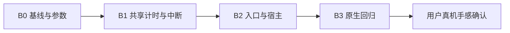

# v74 · 跨页面摄像头切换速度统一与中断回位修复方案

版本 **v74.5** · 2026-11-26（北京时间）

**本文件是本轮需求真源。** 状态：用户已授权逐批实施，验证通过后继续下一批；B0/B1/B2/B3工程验收已通过（2026-11-26）；真机手感与用户体验确认待完成。用户已确认现有切换目标球的速度合适。技术方案及参数候选不得写成已经获得用户体验认可。

本方案只负责相机转场的时间规律、请求衔接及其跨页接线，继承[球桌页面统一规范](docs/design/table-pages/球桌页面统一规范.md) TP17 的机位、构图、手势权限和恢复语义。v68/v69/v72 既有机位与推进合同、v73.5 示范时序继续有效；本文件不整体替代它们。活动交接唯一入口为本文 §9。

## 1. 需求回显

|ID|用户原话／明确意图|本轮落实|
|---|---|---|
|C01|各页面正常切换球时速度正常；切换中手动滑动中断，再点击第三人称会很慢|覆盖真实“选球转场→观察手势接管→松手→第三人称复位”链路，统一回位节奏|
|C02|不同情况下会慢，大距离更明显，怀疑加速按行程比例|盘点各入口的计时策略，区分路程增加、起停被拉长、重复重启和宿主帧调度；长行程不拉长起停阶段|
|C03|“目前的切换球时的视角切换速度是比较合适的”|以当前正常选球为体验基线，保留其约120°/秒、中长转场起停各0.16秒的现状；这些数字来自现行代码与TP17，并非用户另行指定的新数值|
|C04|使用 issue-collection-restructure 技能写方案|按实际共享代码拆为可独立验收的批次，本轮交付方案与进度入口|

**实现提案**：让显式第三人称回位及中断后重入沿用正常选球的节奏；第一／第三人称互切及仍可达的观察转场，用相同起停原则协调转向、平移、升降和镜头变化；重复请求同一目的地不重新从零速起步。不同目标的新请求仍须生效。该提案不要求所有距离都在同一秒数内完成。

不新增镜头模式、设置项、页面按钮或业务权限；不改球位、杆向求解、成绩、答案保护、材质、分辨率、FPS目标或连续预测频率。现有菜单和布局不重做。静态截图只能验证构图，不能验收速度。

## 2. 已证实问题与证据边界

核实日期：2026-11-26。仓库 `/Users/song/projects/13.billiard_trainer`，分支 `main`，HEAD `a08ff66cfc2a4b26a36ce136bda477d7adaabb5f`。存在其他任务未提交修改，B0需重查实际工作区；禁止还原、覆盖或混入其他任务的变更。

以下为方案制定时的初诊边界，实施后结果见§9及RESULTS。已直接读取相机内核、相机门面、共享按钮、教学宿主、PositionPlay宿主、序列入口及空间答题示范调用。初始化扫描确认多个正式教学/练习页使用P01。尚未逐页原生采集，也未复现用户设备上的完整触摸路径。

### 2.1 根因链

1. 正常选球经 `commitP01Target` 等入口传 `.selection120`，使用固定时间的起停与中段角速度。
2. `requestPlayerView`／共享按钮复位通常不传 `turnPace`。`enterPlayerView` 的P01分支只把 `duration > 0` 转为动画开关，页面传入的0.95秒不控制实际耗时。
3. `accept` 默认按位移、转角、FOV变化估算时长，并用 `framedDuration` 的48段最大局部变化进一步放大全程时间；`blend` 在全程上应用五次缓动，起步与收尾随总时长伸长。
4. `beginObservation` 会清掉旧转场，保存实际可见姿态。已测问题不是旧动画残留慢速，而是新的按钮请求进入较慢策略。
5. 同目的地重复 `select` 默认重新计时，连续点击可能反复消耗极慢的起步阶段。

这些差异足以在纯内核复现慢速。帧调度、迟到求解、真实手势是否误命中球仍需原生验证；本方案不把全部慢速现象归为已证实的同一原因。

### 2.2 诊断样例

使用未修改的生产 `P01CameraMotion.swift` 独立编译；只为独立编译提供三个真实外部几何常量，不含UIKit宿主、渲染或求解器。28组数值诊断已完成，核实本轮源码仍与诊断指纹相同。

|条件|当前耗时|对照／意义|
|---|---:|---|
|同路径90°转向：按钮／选球|2.7672秒／0.9100秒|同起终点不同计时|
|同路径150°转向：按钮／选球|4.6116秒／1.4100秒|选球节奏为保留基线|
|同路径180°转向：按钮／选球|5.5336秒／1.6600秒|长转场差异更明显|
|150°选球转场20%处中断，滑动后复位|3.6766秒|同起终点换选球计时的研究对照为1.1564秒，并非已实施修复|
|侧看约150°，回位前距离约1.65／2.36／2.65米|4.6125／6.6112／7.4518秒|缩放、转向及路径变化共同影响耗时|
|每0.15秒再点同目的地，共10次|绝对到达时间约6.0965秒|不重复时约4.6116秒；最后一次请求自身耗时约4.5965秒|

证据：[原始结果](output/camera-speed-diagnosis-20261126/results.json)、[可运行诊断](output/camera-speed-diagnosis-20261126/main.swift)、[源码身份](output/camera-speed-diagnosis-20261126/source.json)。这些是限定输入下的逻辑证据，不能代表全App、真机或用户验收。

## 3. 修复合同与技术方向

### 3.1 计时统一

- 正常选球作为控制组。固定母球、标准高度距离的30°／90°／150°／180°转向，保留当前轨迹、节奏及到达时间。小角度沿现有选球短行程规则验证，不能为了“更快”顺带改已认可的基线。
- 第三人称复位在同起点、终点、路径和策略条件下，时间进度应与选球入口一致；“来自中断”不能触发独立慢档。
- 中长转场的起停各采用0.16秒基准；增加行程主要增加中间运动时间。新的一般转场短行程采用无长匀速段的平顺衔接，零位移请求直接完成。短行程的具体计算在B0冻结，避免修改选球原有短角度表现。
- 径向距离、眼高、俯仰、FOV变化必须参与一般转场计时。不能只给全部调用补 `.selection120`：现有选球时长主要考虑绕球转角及锚点平移，无法完整约束纯升降、纯拉近和镜头变化。
- 保留现有合法路径、短弧方向、投影锚点、房间限制和终点求解。优先在共享层调整时间参数；以分段累计运动量估计进度，避免单个局部变化把全路径按同一最慢比例拉长。若边界约束要求局部慢行，须记录具体区段与原因。
- 不重新套用旧的全局1.8米/秒眼点限速去约束已认可的绕球转向，否则会再次压慢120°/秒控制组。区分绕锚点运动与径向、竖向、锚点平移等通道。

**B0已冻结的工程参数（v74.2）**：径向／锚点3m/s、竖向1.8m/s、俯仰90°/s、FOV40°/s；96段累计通道耗时、起停各0.16s、最小0.32s。依据、对照及37项测试见[批次记录](tasks/camera-v74/B0.md)。原方案参数收敛要求：径向、升降、俯仰、FOV的速率。B0优先参考当前选球可接受的实际运动量，并对照近距、小角度、拉远、边界和跨人称样例，形成有单位、有来源、有数值对照的参数表。不能把旧SurfaceMotion的180°/秒、距离加速系数或随意缩短总时长直接作为新产品合同。参数选择在已有目标内完成；只有实质改变已确认手感或构图的取舍才另提具体对比。

### 3.2 中断、重入与请求身份

- 手势接管从当前实际可见姿态开始，清除旧转场；松手后的保留／回正语义沿当前页面合同。
- 新切镜请求从当前可见姿态重建，不能从上次终点、旧快照或旧进度起步。真实目标变化时及时重定向。
- 动画进行中重复同一有效请求，继续现有运动与到达时间，不重置起步。去重身份须覆盖上下文、目标视角、有效杆姿、默认复位意图、目标几何／镜头及布局修订；不能只比按钮枚举或球号。
- 已到默认机位再次点击不产生空转动画；手动侧看后再点已亮按钮仍须执行复位。故“按钮已选中”不能成为忽略请求的依据。
- 布局变更、切题、离页、前后台、临时俯视、回放及迟到求解按原代次/所有权合同处理，不借去重吞掉有效更新。

### 3.3 特殊时序和兼容

|路径|处理要求|
|---|---|
|普通选球、选袋、自动下一球|保留已认可节奏，和复位作同条件对照|
|手动侧看／缩放／抬高后复位、切镜途中被打断再切|使用统一一般转场，覆盖两轴、捏合与多次中断|
|第一／第三人称互切、滚动中显式切镜、公开目标观察|接入同一起停原则，保持各自杆姿、权限和目标；不能泄露答案|
|仍可达的全桌观察、焦点请求、序列转场|逐调用审计后分类；普通显式切镜采用一般策略，带阶段时序的请求显式保留其合同，不因没按钮就漏查|
|标准开球退镜|保留球杆淡出后1.5秒的专用时序；不由普通策略覆盖|
|扎杆／跳球示范|保留初态球位→参考杆姿→默认第三人称同步复位→确认到位→出杆；`animated:false`继续同步，结束／取消恢复原机位|
|减少动态效果、首次就位、恢复快照|保留对应非动画/受限动画语义；明确duration参数与计时策略的职责|
|旧运镜记录和旧快照|按记录原策略重放。为新一般计时明确编码版本或策略字段，缺省旧字段仍指向旧行为；保存中的新转场也要携带足够计时信息|
|TwoView／Surface／legacy分支|保留原策略并作隔离回归；B0若发现本轮正式入口实际落入旧分支，纳入对应覆盖，不直接全局改速|

`duration`兼容入口可以保留，但必须明确区分“无动画”“指定时长特殊流程”“由速度决定时长”；不能继续让调用者以为传0.95秒就保证0.95秒结束。

## 4. 页面范围、能力与规范影响

这是既有共享相机的局部修订，不是新页或整页迁移。页面完整检查表沿原工作包；B0逐入口链接已有表，没有表则补全适用性，不能将未验标不适用。

|消费者组|已核源码范围|执行时覆盖及业务差异|
|---|---|---|
|每日清台、分离角与走位、自定义练习等PositionPlay宿主|`FreePlayView`→`PositionPlayViewModel.requestPlayerView`→`CameraRig`|选球/选袋、自由与进袋、开球/普通杆、自动推荐、滚动中观察；确认实际policy|
|共用教学／练习宿主|`BTTeachingTablePage`→`TeachingTableHost`，多个VM显式配置P01|选可调杆、固定题、无杆公开目标三类代表；禁用第一人称的阶段继续禁用|
|扎杆与跳球自由页和两答题页|`SpatialPracticeViewModel`、`SpatialQuizViewModel`配置P01；答题示范同步入口已查|高抬杆、双模式、示范开播瞬间与停止恢复，独立记录|
|动作详情／记录内嵌、序列及共享直连按钮|`DrillSceneView`、`SequenceSceneTransition`、`ShotSceneCameraButtons`|卡片视口和逐杆真实输入；不得改播放时序或构图|
|其他调用者及旧分支|共享函数存在其他消费者|B0用调用清单确认可达性与策略，尚未逐页原生验证；逐条给出纳入或保留理由|

菜单处理：沿用现有三键、正式视图切换及减少动态效果设置，没有新增速度选项。按钮可用性、临时俯视状态、球权和可观察对象继续由页面提供。

|条款|判定|本轮检查|当前验证状态|
|---|---|---|---|
|TP01|继承|正式入口身份与真实可达分支，不能只跑Debug直达|源码部分核实，原生未验|
|TP03|继承|横竖屏、缩窗后真实viewport及请求代次；终点不漂移|未验|
|TP16|继承|正式2D、临时俯视往返不续跑已取消的动画|未验|
|TP17|按本方案调整时间规律；机位与权限继承|速度一致、中断接管、复位、旧运镜兼容|已有旧版28组诊断，新实现未验|
|TP25|按业务保留专用时序|开球1.5秒、示范同步就位、重打与回放恢复|调用已核，新实现未验|
|TP29|继承|球位、杆姿及渲染宿主不因计时改变；不改物理|未验|
|TP30|继承|动画唤醒、到位休眠、后台/离页取消及迟到回调|未验|
|TP31|继承|减少动态效果；不改变声震|未验|
|TP35/36|继承|证据分层、原始失败保留、共享决定与来源回写|方案已编写，实施待开始|

其余条款本轮无修改，不作为被豁免或已重新验收。执行中发现新影响时补进上表。

## 5. 批次与依赖

四批串行，每批以一个会话可完成实现与约定验收为目标。B0先把真实基线和未定速率收敛，B1集中改内核，B2集中处理共享入口，B3做原生覆盖，避免每页复制一次算法。量级为上下文/工作量估计，不是完成日期承诺。默认由当前Codex直接执行，不因项目角色名自动委派或创建新聊天。

|批次|范围|量级估计|依赖|主要产物|
|---|---|---|---|---|
|B0 基线与计时参数冻结|补全调用清单、真实复现、控制组、一般转场参数及兼容设计|中，1会话|获得实施范围授权；当前28组证据可复用但需核源|调用矩阵、before、参数表、可执行判据|
|B1 共享计时与请求衔接|一般转场时钟、手势中断、同目的地去重、记录版本兼容|中偏大，1会话|B0通过|共享实现、纯值回归、兼容证据|
|B2 各入口接线与宿主集成|PositionPlay、Teaching、直连、滚动、公开目标、序列和特殊时序|中，1会话|B1通过|调用矩阵闭合、应用宿主测试、构建|
|B3 原生回归与交付|标准/紧凑手机、iPad、真实手势、关键流程、前后录屏|中偏大，1会话；设备排队另计|B2通过|原生证据、结果账本、真机待体验项|

### B0 完成标准

- [x] 记录本轮源/分支/相关dirty差异与诊断指纹，冻结独立工作输入；并行渲染、空间页任务的变更不被覆盖。
- [x] 从配置及所有 `selectP01`、`enterPlayerView`、`selectTarget`、观察/焦点、`watchBreak`、`updateShot`、`release` 调用追到正式入口，列明普通、特殊、旧分支和不可达项。
- [x] 在标准手机模拟器正式入口复现“正常选球→中途观察→按钮回位”，保存真实输入/机位/时长与录屏；手势必须证实未抓球、未误改目标或袋口。若不复现，记录与纯内核差异并定位，不写已修。
- [x] 复核原28组并扩展纯径向、纯升降、第一人称推进后复位、FOV变化、小角度和边界场景；记录固定输入、起终点、路径、起停、总时长及分通道速率。
- [x] 冻结§3.1未定参数及计算规则，给出旧版／候选／正常选球同条件对照。普通150°控制组保留1.41秒；同路径复位不能仍为4.61秒。混合路径写自己的可计算预期，不强行套1.41秒。
- [x] 明确新旧记录的默认解释、同步复位及指定时长优先级、请求等价条件；更新本方案版本及具体测试判据，不改写用户确认范围。

### B1 完成标准

- [x] 共享内核实现§3；普通选球的关键样本、终点及短角度节奏保持；新一般时钟通过纯平移、升降、转角、FOV和组合运动验证。
- [x] 在转场20%／50%／80%处接管，再切镜时起点等于可见姿态；多次中断无旧动画复活、无瞬移、无累计减速。
- [x] 重复同有效目标不修改原到达时间；新目标/布局/上下文不能被误去重；零位移不创建持续动画。
- [x] 相同新记录在30/60/120Hz及不均匀帧间隔采样时关键姿态与到达时刻一致；旧记录、缺省字段及进行中快照往返按旧策略重放。测试区分输入发生时刻与渲染时刻。
- [x] 路径/终点合法、镜头不穿越主体或越房间边界、无姿态/FOV非有限值；保持既有构图约束。
- [x] 完成相关纯值测试和iOS编译。纯值探针不能代替宿主可选结构体访问、UIKit入口或SceneKit验证。

### B2 完成标准

- [x] 调用矩阵每项明确普通计时、特殊固定时长、同步、记录恢复或旧分支；所有正式P01普通切镜入口显式获得正确策略，不靠逐页魔数。
- [x] 正常选球与按钮复位在宿主同输入对照；教学与PositionPlay两个实际消费者均通过。其余直连/公开目标/滚动/内嵌分支各有应用宿主覆盖。
- [x] 开球仍在杆淡出后退镜1.5秒；空间双答题示范在出杆调度瞬间已经同步复位且无待布局；结束/取消恢复旧机位。
- [x] 按当前权限测试手动方向优先、迟到求解不抢镜、球/袋选择保持、旧分支隔离；持续动画到位后可休眠。
- [x] 新鲜源快照下应用构建及受影响相机集成通过；无关已存失败如实隔离。至少更新TP17和来源表，若改变共用API则按项目规则补DR/UI规范，不写成真机已认可。

### B3 完成标准

- [x] 完成§6矩阵，输出原生操作、时长/姿态数据和同条件前后录屏；说明有效Executed数、失败与重跑，不以截图或按钮被点击替代实际到位。
- [x] 标准手机完整主链；紧凑手机与iPad做风险覆盖，含iPad横竖/缩窗回程，检查窗变后没有误去重或旧转场恢复。
- [x] 每个独立宿主分支至少一个正式入口原生流程；共享按钮引用相同不能替代真实接线。扎杆、跳球的示范时序分别验证。
- [x] 验证正常选球手感未被拖慢；手动侧看、长距离、中断重入不再出现旧慢策略；同目标连点不持续延后到位。
- [x] 保存旧失败、源/构建身份、设备/OS/实际视口和输入；按受管模拟器入口释放租约，用户评审现场按规则保护。
- [x] 工程、自动化、原生观感、真机手感、用户认可分列。真机体验未完成时可交付工程结果，但不得将整项标为用户验收完成。

## 6. 验收矩阵与测试边界

|场景|纯内核／宿主判据|原生覆盖|
|---|---|---|
|正常选球、选袋、自动下一球|保留既有策略、终点和关键样本|标准手机完整；紧凑手机与iPad代表流程|
|侧看、抬高、拉远后第三人称复位|分别验证各通道及组合；同条件跨入口计时一致|标准手机＋iPad；含长距离与近边界|
|中途横滑／纵滑／捏合再切镜|20/50/80%处起点连续、旧请求取消、终点正确|真实手势确认未抓球；固定题观察与可调杆场景区分|
|第一↔第三、第一人称推进后复位|非零平移/升降被计时、保持杆轴与默认终点|两人称开放的正式页，手机＋iPad|
|同目标连点、快速改点另一人称|同目标不延时；不同目标最后合法意图生效|标准手机；无瞬移和卡住|
|滚动中观察、停稳交接|按原杆观察/下一杆选择与手动所有权处理|每日或PositionPlay宿主；教学代表|
|无杆公开目标、作答禁止第一人称|不泄题、不扩大权限，合法观察正常复位|进球容错角或同类无杆入口；答题阶段|
|临时俯视、正式2D往返、后台/离页|不恢复已撤销转场、快照正确、唤醒/休眠正常|标准手机完整；iPad窗口变化|
|开球、重打、回放、示范|固定1.5秒／同步就位／进入前快照合同分别保持|开球代表；空间双模式示范开播与停止|
|动作详情/记录内嵌与序列|真实卡片视口、杆姿和编排顺序不变|至少一内嵌和一逐杆入口|
|减少动态效果、旧策略隔离|非动画语义、旧记录解释与旧分支不变|开关代表流程；最低支持OS风险项|

优先复用 `P01CameraMotionTests`、`P01CameraIdleTransitionTests`、`P01CameraIntegrationTests`、`CameraSurfaceTests`，以及 `CameraV67PilotUITests`、`CameraV67LegacyIsolationUITests`、`SpatialQuizUITests` 中相关真实入口；方法选择必须在执行时核实，不按旧名字猜类归属。新用例覆盖行为差异，避免仅断言某个新字段存在。

**既有断言处理前提**：`P01CameraMotionTests.testSmoothTransitionSpeedBoundsAndStationaryEnd` 包含 `XCTAssertLessThanOrEqual(maxSpeed,1.801)` 和 `XCTAssertLessThanOrEqual(maxAngular,.pi/2+0.001)`，约束的是当前默认慢策略。若新普通策略承接此构造，该上限可能按新合同失败；应显式保留旧策略用例，并为新策略增加按通道及控制组计算的断言。不能删除旧断言、放宽到任意大数或把旧记录改用新策略求绿。若构造仍选旧策略，则本就应保持原断言。

历史v72记录过TwoView既有失败；这是排查线索，不是当前豁免。执行前用匹配源判断相关性，报告实际结果，不把历史绿灯或历史失败直接套到本轮。不得为文档任务启动模拟器；实施期先加载测试、模拟器生命周期及必要的几何技能。

## 7. 代码锚点索引

以下均于2026-11-26读取正文核实；行号仅为本轮定位，执行前按符号重定位。

|文件|行号／符号|责任|
|---|---|---|
|[P01CameraMotion.swift](CuePhys/Core/Scene/P01CameraMotion.swift)|133 `TurnPace`；182 `Transition.blend`|现有选球参数、两种时间曲线|
|同上|575 `select`；619 `selectTarget`；638 `beginObservation`|显式切镜、换目标、接管及状态复位|
|同上|808 `release`；813 `accept`；909 `framedDuration`；931 `advance`|回正、计时创建、路径采样和推进|
|[CameraRig.swift](CuePhys/Core/Scene/CameraRig.swift)|64 `selectP01`；251 `selectP01RollingView`；278 `enterMergedGlobal`|P01门面、记录、滚动/全桌分支|
|同上|612 `prepareTemporaryObservation`；1163 `updateP01TargetCue`；1264 `commitP01Target`|手势所有权与选球节奏|
|同上|1375 `enterPlayerView`；2240附近 `observeP01Object`；2650 `update`|duration语义、公开目标及时间推进|
|[TeachingTableHost.swift](CuePhys/Features/AngleTraining/ViewModels/TeachingTableHost.swift)|112 `configureTeachingCamera`；173 `requestPlayerView`；231附近 `settleTeachingCamera`|教学/练习共用入口与下一杆|
|[PositionPlayViewModel.swift](CuePhys/Features/PositionPlay/ViewModels/PositionPlayViewModel.swift)|320 `requestPlayerView`|每日、自由等共用入口及滚动分流|
|[BTShotInstrumentColumn.swift](CuePhys/Core/Components/BTShotInstrumentColumn.swift)|314 `ShotPlayerCameraButtons`；381 `ShotSceneCameraButtons`|共享三键与直连调用|
|[BTTeachingTablePage.swift](CuePhys/Core/Components/BTTeachingTablePage.swift)|932–955相机控件闭包|无杆公开目标/普通切镜实际分支|
|[FreePlayView.swift](CuePhys/Features/PositionPlay/Views/FreePlayView.swift)|832–838；2701–2708|PositionPlay实际按钮接线|
|[AngleSceneView.swift](CuePhys/Core/Scene/AngleSceneView.swift)|1485附近display tick；1773/1895/1981附近手势分支|真实输入、帧间隔、手势与渲染驱动|
|[TwoViewCamera.swift](CuePhys/Core/Scene/TwoViewCamera.swift)|953 `SurfaceMotion`；1069 `enterSimpleShot`；1230 `beginTemporaryObservation`|既有分段计时参考与旧分支隔离，非直接复制目标|
|[SequenceSceneTransition.swift](CuePhys/Core/Scene/SequenceSceneTransition.swift)|59 `enterThirdPerson`|逐杆序列默认机位|
|[DrillSceneView.swift](CuePhys/Core/Scene/DrillSceneView.swift)|119 P01配置|内嵌演示消费者|
|[CueStroke.swift](CuePhys/Core/Scene/CueStroke.swift)|311 `transitionPlayerCameraForShot`|第一人称出杆后切镜|
|[SpatialQuizViewModel.swift](CuePhys/Features/SpatialQuiz/SpatialQuizViewModel.swift)|358 `play`，368同步复位|双模式示范开播时序，必须保留|
|[P01CameraMotionTests.swift](CuePhysTests/P01CameraMotionTests.swift)|275、321、440、458附近测试|帧率重放、旧速度上限、选球节奏、旧记录|
|[CameraSurfaceTests.swift](CuePhysTests/CameraSurfaceTests.swift)|1021 `P01CameraIntegrationTests`|应用宿主回归入口|

## 8. 分工、依赖与回写

只有用户与Codex两方：Codex负责复现、实现、自动化、证据与文档；用户负责最终实际手感判断。每批开始回显目标、为什么现在做、步骤与验收范围；不预设其他工程/测试人员。

当前无外部账号前置。H-05微信审核与本轮相机方案无关。实施依赖可用的受管模拟器和匹配构建输入；不得抢占其他任务设备。等待/排队发生时用北京时间记录实际起点、下次复核点和状态，区分估计与完成，不编造截止时间。

实施证据统一放 `tasks/camera-v74/` 或其链接的 `output/camera-v74/`；B0创建逐批记录。本方案§9为唯一活动交接，项目 `PROGRESS.md`只留摘要与入口。新通用规则正式采纳后在实施批次同步TP17/来源表及必要DR，不提前把草案写成现行已实现行为。此任务没有与14/15/16/18联动，不触发跨项目资产改造。

## 9. 当前交接

- v74.5；B0/B1/B2/B3工程验收已通过，2026-11-26 22:09北京时间最终参考复验2/2通过；正常选球曲线未改。完整[结果账本](tasks/camera-v74/RESULTS.md)、[B3原始失败与复验](tasks/camera-v74/B3.md)。
- B2新鲜构建119/119通过；合并后124个相机/宿主方法最终均有通过结果（122初次通过，2个旧眼高参考保留原精度修订后复验通过）。19个不同原生UI方法最终均通过，覆盖标准手机、iOS17紧凑手机、iPad旋转及真实缩窗，减少动态效果系统读回与恢复通过。无跳过；原失败、重跑及源身份分列，不能称第一次全绿。
- 原生正常选球0.804578→0.804577秒，中断回位1.492038→0.581267秒；合并眼高后再次复验0.581266秒，重复第三人称请求不重启。前后真实手势接管相差约一帧，严格同输入对照由纯值/宿主覆盖。
- TP17、DR-474、FL-291及进度已回写。既有辅助轨迹断言、两处UI入口、并行眼高合同的序列参考修订均记录原因与失败证据，未调整生产速度求绿。
- 本轮临时模拟器已回收，原5台设备均保留；构建按回传校验后关闭流程收尾。最终工作区与源快照核对一致，未提交/推送共享工作区。
- 工程自动化和原生画面已验；真机主观手感及用户认可仍待体验，不把本状态写成用户已验收。后续如有具体体验偏差，以正常选球基线为约束继续定位。

## 10. 版本记录

|版本|日期|变更与优先级|
|---|---|---|
|v74.0|2026-11-26|根据本次诊断与用户确认建立方案；明确保留选球节奏、统一普通回位计时、特殊时序隔离、四批验收。后续高版本覆盖本文对应修订项，不覆盖其他工作包无关合同。|

|v74.1|2026-11-26|用户授权分批实施；B0开始，保留现有选球基线。|

|v74.2|2026-11-26|B0真实中断基线及参数通过；B1共享内核实施开始。|

|v74.3|2026-11-26|B1内核与iOS验证通过，B2统一门面接线及宿主验证开始。|

|v74.4|2026-11-26|B2最终构建119/119通过，历史失败及请求修订边界闭合，进入B3原生矩阵。|

|v74.5|2026-11-26|B3多设备原生矩阵与最终参考复验通过；124个相机/宿主及19个不同UI方法最终通过，原失败分列，正常选球速度保持；真机手感待体验。|
